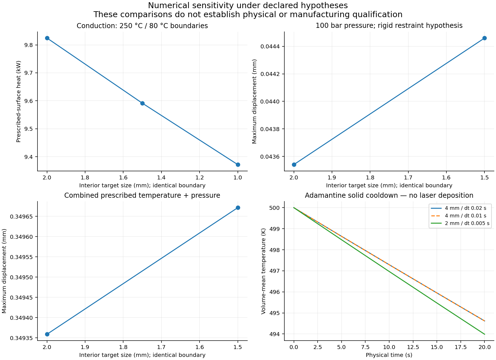

# 935/Xtreme: conditional geometry and executed simulations, 2026-10-29–30

The owner authorised explicit hypotheses to continue beyond the missing
specimen and manufacturing data. This study produced two verified private
3MF exports and executed the numerical cases below. It continues the
[scan repair](935-scan-repair-20261029.md),
[partial editable CAD](935-scan-engineering-20261029.md) and
[printability screen](935-printability-20261029.md).

**This is a monolithic study of the scanned assembly, including attached
hardware and inferred closures. It is not a qualified bare cylinder head,
metal-machine job or approved engine component.** The assumptions do not change
the repository's physical release gates.

## Delivered geometry and evidence

| Private artifact | Checked result |
|---|---|
| `935-head-scan-study-mm.3mf` | Fine reference envelope; 8,614,076 triangles; closed, consistently oriented, vertex manifold, no zero-area faces or self-intersections; every coordinate and index round-trips exactly |
| `935-supported-composite-mm.3mf` | Reference envelope, 1,199 support resources, sacrificial base and coupon; 1,202 checked mesh resources; all supports contact the head and the union contact graph is connected |
| Editable sources | Frozen fine NPZ, rigid frame, provisional fixture parameters and existing partial FreeCAD documents; no complete analytic BRep is claimed |
| Simulation data | Actual native inputs, meshes, fields and logs; the science and Kali archives were freshly extracted and verified against 187 and 184 manifest entries |

The composite preserves intentional overlaps. Under the
[3MF core component rules](https://github.com/3MFConsortium/spec_core/blob/master/3MF%20Core%20Specification.md#42-components),
a consumer must preserve relative placement and unite overlapping components.
It is not a single merged triangle mesh. Its supports and base remain process
hypotheses. A machine-specific importer/build profile has not been qualified.

The [aggregate reports](935-hypothesis-study-20261029/reports/),
[replay instructions and phase ledger](935-hypothesis-study-20261029/REPRODUCE.md)
and [executed auxiliary sources](935-hypothesis-study-20261029/source/)
are public. Raw scans, source coordinates, mesh/CAD files, solver fields and
geometry-bearing figures remain private. Aggregate numerical charts are shown
below; they contain no surface geometry.

## Checked layer contours

The accepted supported contour file is `935-supported-30um.cli`, SHA-256
`3e413b831faa97781a1decdb1830c1973f10df982d0d2b55d594990b426f98e2`.
It contains 4,945 layers at 0.03 mm plus the required empty zero layer,
1,498,156 closed contours and 110,825,890 coordinate pairs. Full on-disk
readback found zero invalid layers. Every component union was independently
compared against GEOS; the largest layer symmetric-difference area was
1.151 × 10⁻⁹ mm². The first 1,089,128,522 bytes of the parallel output also
matched the completed serial prefix exactly.

For the head alone, all 108,994 contours passed, and the slice-volume difference
from the closed 3D surface was 0.00002954%. For the supported union, the
independent layer integral is 1,526,453.9354 mm³; file readback agrees to
2.44 × 10⁻¹⁵ relative difference. This second comparison checks the written
layer geometry, not an independently available exact 3D Boolean volume.

The 10⁻¹² mm integer grid preserves the source CLI decimal resolution for
clipping; it is not a manufacturing accuracy claim. Layer discretisation,
support dimensions and material remain hypotheses. This neutral CLI has no
hatching, exposure, machine profile or physical build qualification.

## Fidelity and geometry assumptions

The original OBJ SHA-256 is
`4623d5d3b73fe3d03ca988a47543a8dd1be7834d3040e6f7efd1e1e95c766486`.
The frozen fine reconstruction SHA-256 is
`bcced05cf880809afc007b546f2f1ceba8fb5b71870ed8dd4fb6ea11bfdeb7aa`.
It encloses 1,106,441.2671 mm³. The rigid build-frame transform and placements are retained in the private package.

The retained bidirectional comparison uses 100,000 area-weighted samples in
each direction. The observed-scan-to-envelope distance has a 0.02477 mm 95th
percentile; 99.52% of samples lie within 0.1 mm. The reverse distance has a
1.4974 mm 95th percentile and an 11.0046 mm maximum. Added closures explain
part of this difference; their distance to an observed surface does not reveal
the true shape of an unobserved surface. The head is therefore not established
as an identical physical replica.

Earlier coarse/fine screens also found different Euler characteristics and
thin regions. The minimum among 500 fine-surface thickness probes was
0.0954 mm; 67 probes were below 0.5 mm. These samples do not certify the
minimum wall or a machine's ability to manufacture it. No hidden gallery,
thread, valve seat, machining allowance or powder-removal route is validated
by the closed envelope.

## Hypothesis register

| Item | Explicit input | Remaining limitation |
|---|---|---|
| Material | Homogeneous generic aluminium: E = 70 GPa, ν = 0.33, thermal expansion 23 µm/(m K), conductivity 150 W/(m K) | No specimen alloy identification, temperature curves, plasticity or fatigue law; attached hardware also receives this surrogate material |
| Pressure | 10 MPa on a selected gas-side footprint | No measured pressure trace or confirmed chamber boundary |
| Structural restraint | All displacement fixed on an assumed rear surface band | No measured stud preload, interfaces, contact or gasket model |
| Conduction | Prescribed 250 °C hot and 80 °C cold patches; remaining surface adiabatic | No experimentally established engine heat balance |
| External air | 15 m/s, 300 K inlet, 400 K isothermal surface, SST turbulence, Pr = 0.71, turbulent Pr = 0.85 | External-envelope study only; no internal-port flow or coupled engine CHT |
| Cooldown | Initially 500 K, ambient 300 K, h = 20 W/(m² K), density 2670 kg/m³, heat capacity 900 J/(kg K), lowest voxel plane restrained | Solid cooldown only; no layer activation, laser path, melt pool, porosity or calibrated residual stress |
| Proposed build | 5 mm plate, 6 mm support spacing, 1.2 mm stem radius, 0.5 mm tip radius, 0.25 mm contact overlap, 30 µm layers | Provisional supports and slicing assumptions; no accepted machine, removal, treatment or inspection profile |

The cylinder/barrel seal, stud/nut clamping path, carrier attachment, intake and
exhaust joints, valve/guide/seat interfaces and spark-plug interface require
specimen-specific acceptance. The editable observations are evidence of visible
features, not a substitute for their datums, tolerances and engineering review.

## Gmsh and CalculiX

Gmsh 4.12.1 produced three positive-volume tetrahedral meshes from the same
2,099,584-triangle coarse boundary. They contain 3,098,918; 3,771,342; and
6,624,763 tetrahedra at interior target sizes of 2, 1.5 and 1 mm. Very poor
boundary tetrahedra remain: minimum SICN is approximately 2.5–2.9 × 10⁻⁶.
Positive element volume alone does not establish engineering mesh quality.

CalculiX 2.23 direct solves were checked against independent elastic and
conduction cube controls. The elastic cube's relative displacement error was
about 10⁻⁶; the conduction cube reproduced the expected ±15 W heat flow.

| Result | 2 mm interior | 1.5 mm interior | 1 mm interior |
|---|---:|---:|---:|
| Pressure maximum displacement, mm | 0.0435404 | 0.0444602 | Timed out after 1800 s; no solution accepted |
| Prescribed hot-surface heat, W | 9824.4147 | 9591.4099 | 9371.9503 |
| Relative heat imbalance | 4.23 × 10⁻⁸ | 2.90 × 10⁻⁹ | 3.12 × 10⁻⁸ |
| Combined maximum displacement, mm | 0.3493590 | 0.3496716 | Not run |
| Combined maximum nodal equivalent stress, MPa | 3555.3 | 1919.5 | Not run |

The stress maxima are dominated by unresolved geometric/restraint
concentrations and change strongly between meshes. They are not material
allowables or evidence that the head can sustain the assumed load. The linear
elastic model does not establish behaviour after yielding.

The comparison uses 1,048,504 identical boundary nodes and identical boundary
masks. Pressure displacement changes by 2.416% in relative L2 norm between
2 and 1.5 mm. Combined displacement changes by 0.361%, but the largest local
change is 0.03380 mm. Thermal local differences reach 20.31 °C and 15.27 °C
between successive meshes, despite small global norms. Temperature solutions
also show small extrapolation/discretisation overshoots outside the prescribed
80–250 °C interval. Full spatial and stress convergence is not established.

## OpenFOAM

OpenFOAM 13 runs the external-air hypothesis on 6,593,936 uniform 2 mm cells.
Strict `checkMesh -allTopology -allGeometry` passes. Refinement subdivided the
original 4 mm staircase obstacle; it does not recover finer fins or establish
geometric convergence. There are no resolved prism boundary layers.

At iteration 600, independent integration of every physical boundary face
found 944.3611 W entering the air from the hot surface. Relative volume-flux
imbalance was 2.66 × 10⁻⁸ and relative heat imbalance was 0.01714%. Temperature
remained between 300 and 399.748 K. These conservation and bound gates passed.

Velocity still changed by 4.394% in relative L2 norm between iterations 550
and 600; temperature RMS change divided by 100 K was 0.2295%. Both exceed the
predeclared 0.1% stationarity limits. The run is therefore an unconverged
exploratory field, not an accepted steady-flow result. Iteration labels are not
elapsed physical seconds. The 550/600 native fields are retained for replay.

The prescribed-conduction heat flow and this external-air heat flow use
different boundary conditions. They do not form a coupled engine heat balance.

## Adamantine

The native solver completed 20 seconds of whole-envelope elastic cooldown on
17,197 four-millimetre and 138,775 two-millimetre hexahedra. The finer run used
four MPI ranks. An independent VTU reader reconstructed the physical volume,
exterior faces and thermal energy rather than relying on a solver success code.

| Result at 20 s | 4 mm / dt 0.02 s | 2 mm / dt 0.005 s |
|---|---:|---:|
| Mean temperature, K | 494.6183 | 493.9864 |
| Maximum displacement, mm | 0.0423551 | 0.0411093 |
| Native scalar stress maximum, MPa | 22.5889 | 33.8129 |
| Relative integrated energy imbalance | 0.01279% | 0.01667% |
| Discrete external area, m² | 0.180800 | 0.204264 |

A second 4 mm run at dt 0.01 s on four MPI ranks agrees with the 4 mm serial
results to the stored field precision. Both timestep and parallel execution
changed, so this is a numerical-agreement check, not an isolated timestep
convergence proof. The area and stress differences across spatial grids remain
material. A prior serial fine run timed out and is retained as a partial run.

## Reconstruction tools and provenance

Qwen supplied a bounded 12 mm diameter, 20 mm height coupon proposal. Its model
and adapter revisions are retained in the private Qwen proposal receipt; this is
not evidence that Qwen reconstructed the whole head. PicoGK executed the head,
fixture and coupon construction at 0.25 mm voxel size and generated contours.
Independent checks found degenerate/nonmanifold geometry in those outputs, so
the PicoGK mesh and its associated CLI are rejected candidates. Their native
archive is retained for reproduction.

The accepted reference export keeps the finer source geometry in double
precision. Casting the transformed head to float32 introduced 49 zero-area
triangles; preserving the double coordinates avoided them. MeshLib fixture
unions and local repairs were also independently checked and rejected when
self-intersections remained. Two CGAL exact head-union trials reached their 2,400-second limits without
an accepted merged output. The validated 3MF composite preserves the reference
geometry and explicit component unions. Failed trials are retained separately.

## Acceptance boundary

The files and calculations support a conditional geometry study. A selected
supplier's public data may supply useful process assumptions, but it does not
identify the scanned specimen or qualify this particular build. No supplier
was contacted and no scan was sent to a supplier.

Physical identity, complete functional interfaces, actual high-temperature
material behaviour, fatigue, a calibrated LPBF build, machining, inspection
and professional engine-part review remain unestablished. The machine-specific
job and engine-use release gates remain false. The reference 3MF's numerical
geometry checks are kept separate from those gates.

## Repository verification

The isolated native Linux checkout was verified against baseline tree
`303a3e0a699ba45ccbc388648db9b898bdbca96a`. It uses the exact
`requirements-check.txt` numerical pins and .NET SDK 9.0.320, downloaded through
the Mac and verified against Microsoft's release metadata before offline
installation on Kali. Only this task's test environment was changed.

The Python suite passed: **5,105 tests, 402 skipped**; the following 10-test and
7-test checks also passed. `make check` then stopped at the existing Docker
LPBF-audit target because this Kali user cannot access the Docker daemon
socket. The complete command therefore did not pass, and subsequent targets
were not run. Docker permissions were not changed. Initial attempts with the
host environment and group-writable archive permissions are retained in the
private work log; the corrected run uses the CI dependency set and safe
checkout permissions. These repository checks do not qualify the geometry or
physical simulations.

## Recovery and compute closeout

Both instances created for this increment, `58296618` and `58306265`, were
destroyed after recovery and their absence was independently verified. The
final instance closed at 2026-10-30 00:39:14 UTC. Other resources were untouched.
The actual quoted hourly rates, including reserved disk, were $0.206667 and
$0.30. Each rental retained a $1.50 compute/storage ceiling; the authorised
$30 compute allocation and $5 reserve were unchanged. The reserve floor was
satisfied immediately before final closeout. These ceilings and network rates
are documented in the budget report; they are not a final provider invoice.

The science, Kali, final flow, final geometry and final metadata recoveries
passed 187, 184, 950, 160 and 6 per-entry checks respectively. The final geometry
archive is 4,472,654,497 bytes; all five transferred chunks and the recombined
archive matched their native hashes before fresh extraction. The private
supported CLI is 3,672,421,775 bytes and matches its native readback SHA-256.
The failed PicoGK candidates are retained separately. No geometry was sent to
a supplier and no supplier message or fabrication order was placed.
