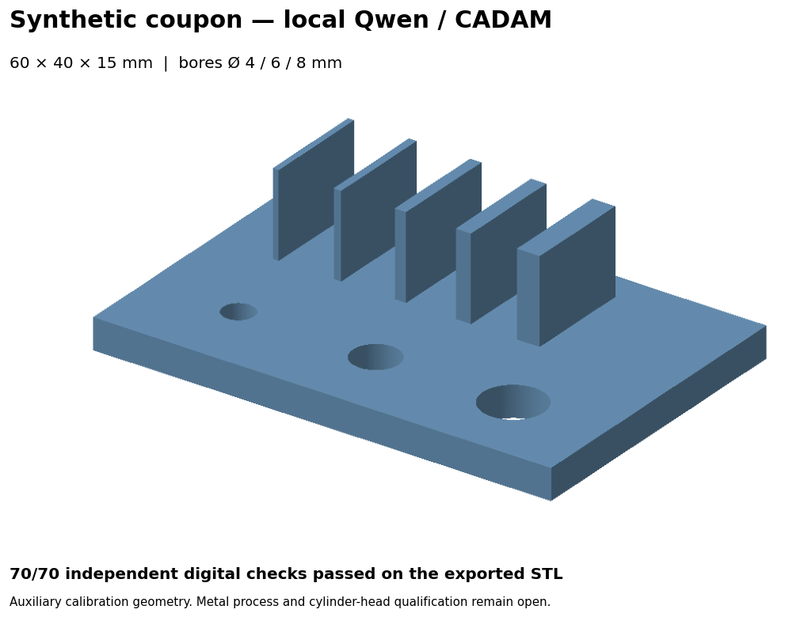

# 935 strip-border cap study and local Qwen recovery — 6 November 2026

The conservative surface study now closes **263 additional complete walks with
474 inferred triangles**, preserving every coordinate, face and provenance field
of the [previous strip candidate](../935-frontier-pairing-20261106/README.md).
Full actual OBJ/NPZ readback, all-face native intersection inspection,
degeneracy/duplicates, edge incidence/winding and every used vertex fan pass.
The result remains incomplete: **96,153 open edges / 1,226 walks**. No complete
faithful head, functional solid or qualified printing job is delivered.

The [scalar receipt](results.json) binds the executed sources, unchanged helpers,
all trial denominators and private capsule. Raw/derived head geometry, source
indices, native proposals and correspondence/distance witnesses remain outside
Git. The owner permits scan transfer to Vast; this increment needs no new rental
or paid Vast resource.

## Admit new strip borders from acquired evidence

The previous candidate has 1,489 walks / 97,153 edges. Of these, 993 walks /
79,232 edges include a new strip border and contain only acquired and strip
origins. The 462 unchanged acquired-only walks are not retried, and 34 older
mixed/cut/omission/contact walks remain outside this policy. This is an explicit
new hypothesis class, not a silent extension of acquired-only cap admission.

An acquired edge recovers its original raw owning triangle. A strip cross-edge
recovers the actual accepted strip pair and **both original acquired owners**.
No inferred cap or strip normal becomes independent scan evidence. Every target
node is checked against its exact raw-source coordinate and index ancestry.
The fixed size/plane limits remain 3–128 edges, box diagonal at most 3 nominal mm,
plane residual at most 0.25 and acquired absolute normal-alignment P10 at least
0.8, with exact simple projected polygon checks. A new signed condition rejects
opposed or tangent acquired owners: minimum signed alignment must exceed zero,
and signed P10 must reach 0.8 in the orientation required to reverse the hole.
This is stricter input admission, not a relaxed repair tolerance.

**304 walks are admitted**. A separate checker independently recovers references
for every one of the 97,153 boundary edges, replays the decisions for all 993
scoped walks and verifies the complete selection. Six literal controls cover
forward fill, reversed contours, opposed layers, mixed/tangent owners and size
refusal. Acquisition ancestry, signed support and source-layer checks remain
distinct from physical identification of the opening.

## Actual constructors, whole-composite checks and retained failures

Fresh native controls verify complete selected-hole filling, preservation of a
second opening and refusal of an interior-edge request. Each of the 304 admitted
walks receives an exact mask and complete parent incident-face halo. Both input
geometry and halo ancestry are independently checked, including any local fan
splits used by the unchanged native constructor. Every native trial exits zero;
all 304 pass independent exact vertex/perimeter, oriented disk/projected-area,
local native predicate and corner-fan inspection.

| Stage | Caps | Added triangles | Result |
|---|---:|---:|---|
| Complete locally passing composite | 304 | 1,034 | Full topology passes; 41 caps exceed sampled source support |
| Entire unsupported caps removed | 41 | 560 | No threshold relaxation or alternate reselection |
| Filtered candidate, fully rechecked | 263 | 474 | Geometry and sampled study checks pass; surface remains open |

The initial maximum added-cap distance is 0.6160816 nominal mm, exceeding the
predeclared 0.25 bound. Whole offending caps are removed; every proposal,
failure and both composites remain private and inspectable. The filtered
candidate has **2,404,967 triangles / 1,248,924 stored vertices**. Its NPZ SHA-256 is
`5df16521c7312927800fa8f12deb57ac0df28fa18fe3fe67c96f3b1e6fc7634a`;
OBJ SHA-256 is
`d57ee6edc9d5fbd851f0cb4d7af0a9a4f363d134f92568a9498a523ca125b2b8`.
It has zero detected intersections, zero-area faces, duplicates, edge/winding
conflicts and nonmanifold used vertices; 18 unused vertices remain unchanged.
Ten components remain, including five single-facet components; the largest has
2,397,655 facets. Their anatomy and selection remain unaccepted.

New caps carry kind 5, `source_strip_cap_curve_ids`, disjoint legacy labels
`40000000 + curve` and explicit immediate-parent rows. Their acquired, fragment
and older hypothesis attribution fields are -1. Every prior channel remains
exact in the parent prefix, including the earlier bounded omission ancestry.
No original scan face is removed or moved by this increment; the conservative
parent still includes the previously documented component and omission choices.

Only the selected complete walks close, removing **1,000 boundary edges**.
All unselected open edges preserve exact coordinates, direction, owner and
origin. Remaining counts are 93,936 acquired / 100 quarantine / 726 declared cut /
six contact bridge / 25 bounded omission / 1,360 strip edges. No new boundary
origin is needed: complete caps leave no unclosed cap perimeter.

Every retained new triangle has the predeclared degree-16 barycentric grid:
**72,522 probes**, maximum **0.2483549 nominal mm**. All 219,476 previous source
and 46,184 omission probes are recomputed and nonincreasing pointwise under a
1e-8 arithmetic guard. The complete source-probe cohort still has a 49.7737
nominal-mm maximum, including provisional component exclusions; the reverse
100,000-point candidate sample has maximum 0.1585877. The reverse sample does
not replace forward coverage. Finite samples are neither Hausdorff bounds nor
measured missing-surface truth, physical calibration or manufacturing tolerances.
Owner-declared source units remain independently uncalibrated.

## Recover and exercise CADAM with local Qwen

The dedicated model target was empty. The recovery downloads the **15 exact
public files / 20,429,174,878 bytes**, verifies all hashes before and after
publication, and preserves the original empty target directory. It uses a fresh
staging directory, four bounded download workers, a 1,200 s deadline and an 8 GiB
disk reserve. It completes in 926.64 s with every worker joined. The recovered
files are read-only; no existing model files, runtime packages, application
authentication or service configuration are overwritten.

The new recovery pins revision
`0c4a20a6437ae5985ddc9eb1a3f122ee6c151c3b` of the
[public model repository](https://huggingface.co/lmstudio-community/Qwen3.6-35B-A3B-MLX-4bit).
[Expected model-file identities](qwen-model-files.json) publish file names, lengths
and SHA-256 values without weights. The earlier installation's historical
upstream revision remains unrecorded; the recovery establishes this revision's
actual matching bytes. MLX 0.32.3 / MLX-LM 0.31.3 / Python 3.12.13 are reused.
Five installed application/launcher/sandbox/verifier files still match the prior
installation manifest. The approved launchers serve only the expected dedicated
model on 127.0.0.1:4320 and CADAM on 127.0.0.1:4319 with the existing offline and
loopback-only controls. Those authorised local services are left running.

The **real CADAM browser generation path** is exercised on the existing synthetic
coupon contract: 60 × 40 × 15 mm, bores Ø4/6/8 and five fins of thickness
0.8/1/1.5/2/3 mm. Qwen generates 670 tokens from 649 prompt tokens in 40.76 s.
The actual generated source compiles in CADAM's local viewer, exports SCAD/STL,
and passes **70/70 independent digital checks** through the application.
The downloaded STL is then independently rechecked with the unchanged native
verifier and exact contract: 70/70, measured volume 10,513.8402 mm³. Model output
does not provide its own acceptance evidence. The generation receipt correctly
starts with dimensional acceptance false; the separate measurement report owns
the subsequent digital verdict.

STL SHA-256 is `9e4dba550ad6ea406a8b7300791e8ababd5c26fa96c830c3f9905ff5fc21bfbe`;
SCAD SHA-256 is `45cdef0e1f2b887272aca1196455476e2e8d06dd81c1b780525e2ab3276acf53`.
The [frozen independent verifier](helpers/verify_coupon.py) and
[dimension contract](helpers/contract.json) remain separate from the model.
This coupon test does not replay whole-mesh self-intersections, measure a
physical print, qualify metal manufacture or validate the cylinder-head shape.
No private scan or external inference service is used.

This image renders the downloaded STL. A first painter-order preview produced
occlusion artefacts; the retained second renderer uses a depth buffer. Both
rendering sources remain reproducible; the geometry bytes and digital verdict
are unchanged. This is auxiliary calibration geometry, not a head preview.

## Execution and reproducibility

| Phase | Concrete inputs / runtime / command | Outputs / checks / state |
|---|---|---|
| Source admission | Exact previous mesh/boundary proof, raw arrays and accepted strip-pair ancestry; isolated Python; `admit_strip_caps.py --job … --output …` | All 1,489 decisions and acquired-owner chains; executed |
| Independent admission | Same acquired sources, recorded decisions; `verify_strip_cap_admission.py --job … --admission … --output …` | All boundary references, all 993 scoped decisions and controls; executed |
| Native preparation/trials | Independently admitted selection, unchanged atlas/native binary/bounded runner; `prepare_strip_caps.py`, then `construct_strip_caps.py --job … --prepared … --output …` | Complete masks/haloes, all 304 native proposals and child receipts; executed |
| Independent local inspection | Prepared source masks and actual native output; `inspect_strip_caps.py --job … --prepared … --constructed … --output …` | Exact source/halo/perimeter/projected-area, local predicates and fans; executed |
| Full composite and filtering | Locally accepted patches; `assemble_strip_cap_candidate.py`, existing full `inspect_intersections.py`, then `audit_strip_cap_candidate.py` | Actual exports, full topology, components, every-patch/source/omission distances; executed before and after whole-cap filtering |
| Kali read-only replay | Hash-checked parent and final NPZ streams; unchanged `verify_streamed_source.py` | Independent complete prefix/edge/winding/duplicate/degenerate checks; executed |
| Local model recovery/test | Exact public model file manifest and empty dedicated target; `restore_local_qwen.py --job …`, then approved launcher and CADAM browser | Actual byte recovery, real generation, exported STL, native 70-check replay; executed |
| Complete head CAD/physics/AM | Prescribed Qwen/CADAM/PicoGK/STEP/Gmsh/OpenFOAM/CalculiX/Adamantine chain | Complete source interpretation and admissible closed domains remain prerequisites; not delivered by these surface/coupon tests |

Eight bounded scientific execution groups complete with every owned scientific
child reaped. They retain pre-execution ledgers, a 600 s shared group deadline,
sampled 4 GiB child RSS ceiling and 4 GiB local disk reserve. Scientific helpers
reuse the isolated runtime and unchanged libigl 2.6.3 addon; no package installs.

Kali1 independently reads **112,130,809 hash-checked parent/candidate bytes** into
RAM over the existing trusted Thunderbolt SSH identity. Python 3.14.7 / NumPy
2.3.5 reproduces exact entire parent prefix/provenance, full edge incidence and
winding, duplicates/degeneracy, 96,153 open edges and 18 unused vertices. It uses
two CPUs, a 4 GiB address-space cap, a 110 s remote deadline and 1,426,628 KiB
peak RSS, completing in 6.41 s. No persistent payload files or runtime are
installed there; its low persistent disk reserve remains unresolved. This witness
does not claim Linux replay of intersections or vertex fans. The SSH child is
reaped; authorised persistent CADAM/Qwen services are a separate category.

The frozen private capsule has **2,540 payload files / 397,723,989 bytes**, manifest
`b8b75edc302a7a6b3b59f6b313644f5bead17cae6911b3ff420b8fa76f8ed3b8`, rehashed
after freezing. Public model weights live outside that capsule and Git. Ten
executed source files and 12 reused helper/data files are explicitly bound in
the receipt. Public CI checks synthetic/repository contracts, not the private scan.

## Next work and full-goal limits

The remaining 1,226 walks retain their previous shapes: completing selected caps
does not make the other failed admissions new experiments. Preserve all 41
support refusals and older native/strip/cap failures. Further reconstruction needs
a new source-supported curved-band or local-surface method with its own upstream
audit, controls and provenance, not another sweep on unchanged refused inputs.

Follow the [scan workflow](../../architecture/scan-repair-workflow.md),
[engineering workflow](../../architecture/engineering-workflow.md) and
[CADAM role](../../architecture/cadam-local-qwen.md). Complete faithful editable
head geometry, accepted specimen identity/units/interfaces and internal passages,
loads, converged/correlated physics, material/machine/powder/support/toolpath
qualification, physical build/metrology and professional engineering review
remain open. The older hypothetical Gmsh domain's 996 failing minSICN cells are
not repaired by this surface work. G0–G5 and manufacturing authorisation remain
false; the full goal stays active. No supplier message, new Vast rental/spend,
external AI/CAD scan transfer, merge, print or release occurs. The original
$35 total / $30 compute / $5 reserve limit and scan-on-Vast permission persist.
