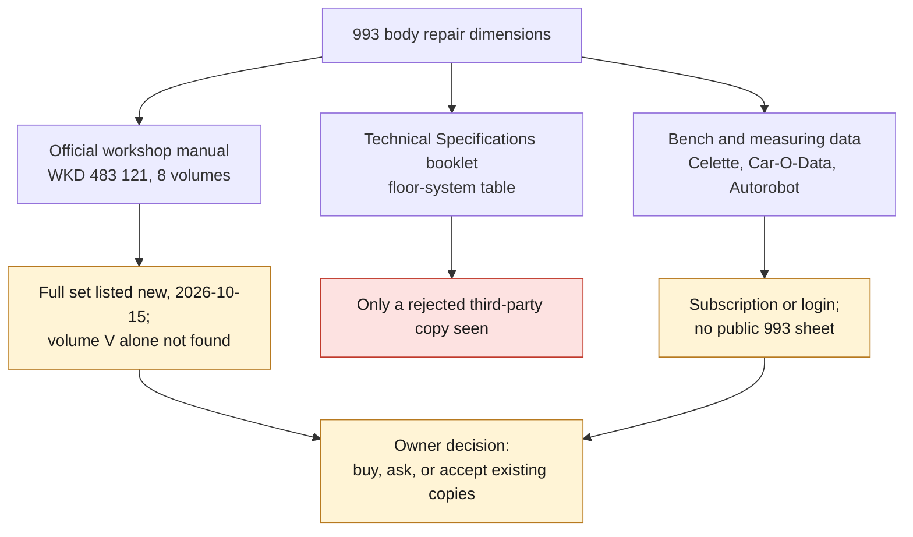

# 993 body dimensions: sources, rights and open decisions

Status on 2026-10-15, for issue #10 ("obtain the 993 body repair dimensions
legally"). Nothing here is legal advice: it records what the project assumes,
what it has checked and what only the owner can decide.

## What the project assumes

- **A factual value is not the document.** A dimension, a tolerance or a
  reference number, recorded with the page or plate it comes from, is treated as
  a fact the project may cite. The document itself — scans, PDFs, plates,
  drawings, or a table reproduced as a whole — is never committed and never
  redistributed. This is the rule the existing records already follow
  (`SRC-PORSCHE-WORKSHOP-MANUAL-993`, `SRC-PORSCHE-WORKSHOP-MANUAL-964-VOL5-BODY`:
  redistribution prohibited, facts only with their location).
- **The assumption is the project's, not the publisher's.** No reuse terms of a
  Porsche, Celette, Car-O-Liner or Autorobot publication have been read, because
  none is public. Publishing transcribed values beyond internal use stays an
  open rights question (see the checklist below).
- **A copy is not a licence.** A file being reachable on a forum, an aggregator
  or a public repository says nothing about the right to use it.

## The copies already used

Both workshop-manual records state that the digitized copy consulted was read
locally, was not added to the repository, and has **undocumented provenance**.
Every manual value in the catalogue — `MEAS-MANUAL-993-ALL` (2,496 values) and
`MEAS-MANUAL-964-BODY-CONTROL` (50 values) — therefore rests on copies whose
origin is not documented. Accepting those copies as the project's reference, or
replacing them with an authorized copy, is an **owner decision**; until it is
taken, these values are transcriptions from an undocumented copy, not checked
references.

## Where the body values come from, and why they do not validate the 993

- The only body-repair control dimensions in the catalogue are **964** values:
  `catalog/measurements/MEAS-MANUAL-964-BODY-CONTROL.json`, transcribed from
  volume V plates 50-02, 50-03, 50-05 and 50-05a of the 964 manual
  (`SRC-PORSCHE-WORKSHOP-MANUAL-964-VOL5-BODY`).
- They do not validate the 993. The 993 has a new rear axle, and the only 993
  floor table seen so far differs from the 964 table in dimension B and in its
  point numbering (contradiction `CTR-0002`). A forum thread offered as a
  964/993 cross-check gives three incompatible values (`CTR-0001`).
- `MEAS-MANUAL-993-ALL` contains **no 993 underbody or floor-assembly
  dimension**. Its body pages (PDF pages 746 to 874 of the consulted copy) hold
  panel-repair procedures; page 755 carries seven thread designations of
  reception points (`MNL-OCR-1601` to `MNL-OCR-1607`) without any dimension
  value.
- The 993 floor table transcribed in the Phase 1 inventory comes from a
  third-party copy of the Porsche *Technical Specifications* booklet (94 and 95
  model years, printed page 110), which that same inventory rejects and which
  the catalogue also registers as an available official source (`CTR-0003`).

*Diagram: the three routes to 993 body dimensions and their state on
2026-10-15, restated from the checklist below. It is not a plan to buy
anything.*

## Issue #10 checklist, status on 2026-10-15

| item | status | evidence |
|---|---|---|
| Identify a purchasable official edition of volume V | **partial** — the English eight-volume set WKD 483 121 is listed new by one vendor at $1,038.64 (currency not named); no vendor read offers volume V on its own or gives it its own reference | `SRC-STODDARD-993-WORKSHOP-MANUAL-WKD483121`; the Pelican Parts URL of `SRC-PORSCHE-WORKSHOP-MANUAL-993` is closed to Claude agents by robots.txt; the Porsche Shop category pages could not be read (script-loaded grid, `SRC-PORSCHE-SHOP-TECHLIT`); the former US Classic shop does not resolve (`SRC-PORSCHE-CLASSICSHOP-USA`); the German set WKD483110 is only known from `SRC-PORSCHE-LITERATURE-CATALOGUE-DE`. Dated observations: `catalog/registers/993-source-classification.json` |
| Confirm whether Car-O-Data has a 993 sheet | **open** — not confirmed: more than 18,000 vehicles, yearly subscription, no public vehicle list | `SRC-CAR-O-LINER-CAR-O-DATA`. Same result for Autorobot (`SRC-AUTOROBOT-MEASURING-DATA-SERVICE`, extranet subscription), Spanesi (`SRC-SPANESI-WINTOUCH-VEHICLE-DATA`) and Globaljig (`SRC-BELLINI-GLOBALJIG-VEHICLE-DATA`). The public Chief (rotarysolutions.com) and Blackhawk (blackhawkcollision.com) pages read on 2026-10-15 show no vehicle list; the Josam site covers heavy vehicles only |
| Identify the exact Celette set or sheet reference | **open** — 564.320 is the 964 base set (documentation behind a login); a rental listing gives 564.330 "Typ 964 / Zusatz 993"; a search result gives 564.307 "Complementary set for Porsche 993" on a Celette page that refused connections | `SRC-CELETTE-564-320-964-JIG`, `SRC-RICHTSATZ-MIETEN-993-CELETTE`, `SRC-CELETTE-564-307-993-COMPLEMENTARY-SET`, contradiction `CTR-0017`; the MZx 964/993 composite set is listed out of stock at $5,600 with no reference (`SRC-CELETTE-MZX-964-993-JIGS`); Celette charts seen so far are assembly lists, not coordinates (`SRC-CELETTE-551-300-911-JIG-CHARTS`) |
| Document internal-use and publication rights | **open** — the project's assumption is written above; no publisher's terms are public, so the right to publish transcribed values is not established | this note; the `rights` block of each record |
| Never import a forum or aggregator copy without authorisation | **holds** — none imported | rejected: the manual hosts listed in `docs/PHASE1_SOURCE_INVENTORY.md`, the PDF hosts that appear in search results, the forum attachment behind a login (`SRC-RENNLIST-993-BODY-DIMENSIONS-PDF`), and the files named as 993 workshop repair manual volumes I to IV in the public archive behind the `*-PUBSTACK` records, which were not downloaded |

## Owner decisions

1. Accept the locally consulted 964 and 993 manual copies as the project's
   reference, or replace them with an authorized copy.
2. Whether to buy the WKD 483 121 set, or to ask a Porsche Centre whether
   volume V is sold on its own. No purchase has been made.
3. Whether to write to Celette (564.307 against 564.330, and the reuse terms of
   any sheet), to a Car-O-Liner or Autorobot distributor, or to a subscribed body
   shop for a single 993 sheet and its terms.
4. What to do with `SRC-PORSCHE-993-SPEC-BOOKLET-PUBSTACK`, a digest-pinned
   record of a copy the Phase 1 inventory rejects (`CTR-0003`), and with the
   floor-table values transcribed from that copy in the Phase 1 inventory.

Until one of these decisions is taken, no 993 body dimension enters the
catalogue, and no 964 body value is used as a 993 value.
