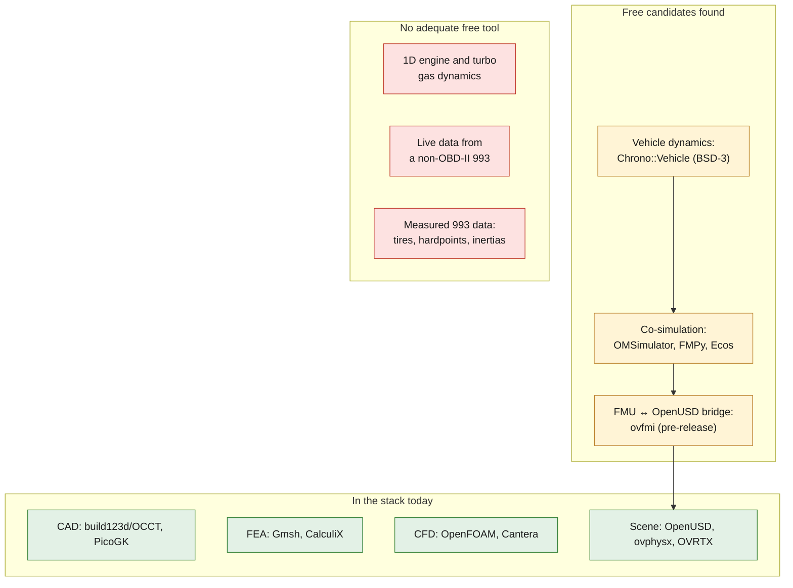

# Tools for a physically correlated 993 digital twin: research, 6 November 2026

Fact-checked web research run on 2026-11-06 (5 search angles, 20 sources
fetched, 25 claims put to three independent verifiers each: 22 confirmed,
3 refuted). It concentrates on the twin layers the repository **does not have
yet**: vehicle dynamics and multibody, system co-simulation, 1D engine gas
dynamics, operational data acquisition and NVIDIA licensing. Tool choices for
the layers already in use are in [TOOLCHAIN.md](../TOOLCHAIN.md) and
[AGENT_TOOL_GUIDE.md](../AGENT_TOOL_GUIDE.md).

Nothing here is installed or selected by this note. A tool enters the stack
through an issue and a recorded decision, with its licence recorded first.

## Where the gaps are

*Diagram: the findings below grouped by twin layer. Green is in use, amber is a
candidate the research found, red has no adequate free tool. It adds no claim
beyond the findings.*

## Findings

### Vehicle dynamics and multibody: Chrono::Vehicle

- **Licence:** BSD-3 (OSI). **Confidence:** high (3-0).
- A vehicle is a hierarchy of subsystems, each an instance of a predefined
  template. There are templates for the MacPherson strut, semi-trailing arm,
  multi-link, rack-and-pinion steering and 2WD/4WD shaft drivelines, set up in
  C++ or JSON. A 993 (front strut, rear multi-link) would be assembled from
  these.
  ([Serban et al. 2019](https://inderscience.com/filter.php?aid=97096),
  [API overview](https://api.projectchrono.org/vehicle_overview.html),
  [projectchrono.org](https://projectchrono.org/))
- **Templates give topology only.** Every hardpoint, mass, inertia, spring,
  damper, bushing and tire parameter must come from measured or published
  data. The 993's rear multi-link may need a custom subsystem.
- **Tires** (confidence medium, 2-1): Pacejka 89, Pacejka 2002, TMeasy,
  TMsimple and Fiala. Pac02 loads Adams/Car-compatible TIR files
  ([tire docs](https://api.projectchrono.org/wheeled_tire.html)). Fiala is not
  recommended for handling work. No TIR data was found for 993-era tires.
  Whether Pac02 implements the inflation-pressure and large-camber terms is
  **unresolved**: the verifiers disagreed (see "Refuted and disputed").
- **Validation is code-to-code only** (high, 3-0). The published validation
  compares Chrono with ADAMS/Car on a simplified demo vehicle
  ([TR-2016-15](http://sbel.wisc.edu/documents/TR-2016-15.pdf)) and the Fiala
  tire with ADAMS ([TR-2015-13](http://sbel.wisc.edu/documents/TR-2015-13.pdf),
  [validation page](https://projectchrono.org/validation)). Nothing on that
  page compares against measured vehicle or tire data. A 993 twin would have to
  run its own correlation.
- **FMI** (high, 3-0): an FMI module with FMI 2.0 and 3.0 namespaces. It exports
  Chrono models as **co-simulation** FMUs and imports external FMUs. The vehicle
  FMU has no tires, so it must be coupled to driver and tire FMUs. The module
  needs a static-library build
  ([FMI module](https://api.projectchrono.org/group__chrono__fmi.html),
  [Multibody Syst. Dyn. 2025](https://link.springer.com/article/10.1007/s11044-025-10106-9)).

### System co-simulation (FMI / SSP)

| Tool | Licence | FMI support | Model exchange | SSP | Source |
|---|---|---|---|---|---|
| FMPy | BSD | 1.0/2.0/3.0 | yes | — | [JOSS 8182, Table 1](https://www.theoj.org/joss-papers/joss.08182/10.21105.joss.08182.pdf) |
| OMSimulator (OpenModelica) | OSMC-PL (AGPL-3.0 option since 2026) | 2.0; 3.0 experimental | yes | disputed, test before relying on it | [OMSimulator docs](https://openmodelica.org/doc/OpenModelicaUsersGuide/latest/omsimulator.html) |
| OSP / libcosim | MPL-2.0 | 1.0/2.0 co-simulation | no | — | [libcosim](https://github.com/open-simulation-platform/libcosim) |
| Ecos (NTNU) | MIT | 1.0/2.0; 3.0 partial | no | 1.0 import | [Ecos](https://github.com/Ecos-platform/ecos) |

Confidence high (3-0). The comparison table was written by the Ecos author, but
every value the verifiers checked held.

- **SSP 2.0** was released on 2024-12-20. It adds direct Modelica components
  and FMI 3.0 (virtual-ECU) interconnection
  ([announcement](https://modelica.org/news/2025-01-08-ssp-20-released/),
  [spec](https://ssp-standard.org/docs/2.0)). The free tools found implement
  only SSP 1.0. **FMI 2.0 co-simulation is the only level common to Chrono,
  OMSimulator, Ecos and ovfmi.**
- **NVIDIA ovfmi 0.2.0** (Apache-2.0, pre-release, August 2026; confidence
  medium) loads FMI 2.0/3.0 co-simulation FMUs and SSP 1.0 archives from an
  OpenUSD stage, stepping them through FMPy
  ([PyPI](https://pypi.org/project/ovfmi/)). It is the candidate bridge between
  FMU system models and the project's OpenUSD/ovphysx scene. Its API and schema
  may change between minor versions; the source is a single vendor page.

### 1D engine and turbo gas dynamics: gap

- **OpenWAM** is GPLv3 C++ 1D gas dynamics for combustion engines (CMT, UPV).
  It was last updated on SourceForge in November 2016 (release 2.1/2.2 from
  2014), has no official GitHub repository, and its turbocharger model is
  undocumented in the sources checked
  ([SourceForge](https://sourceforge.net/projects/openwam)). Confidence medium
  (3-0).
- Its old documentation URL now serves **VEMOD**, CMT's 0D/1D tool, which states
  no licence and is validated on a 1.6 L Diesel
  ([openwam.webs.upv.es/docs](https://openwam.webs.upv.es/docs/)).
- **Provenance trap:** an unrelated 2026 robotics project also called OpenWAM is
  on GitHub and PyPI.
- So no maintained free tool covers the air-cooled M64 or the twin-turbo
  M64/60. The current 0D bench model and Cantera fixtures remain uncorrelated.
- **Correction, 2026-11-10:** this survey missed a tool the repository already
  runs. Aeolus1D 0.3.3 (MIT, alpha) is in the digest-pinned F39 image used for
  the 917 wave-action network checks
  ([917 reference engine](../../twins/reference-917-engine/README.md)). Only a
  Sod shock-tube smoke qualifies it, so the gap above, a *validated* 1D engine
  and turbo tool, still stands.

### Operational data acquisition: gap for most 993s

- **python-OBD** (GPL-2.0) streams standard PIDs and reads trouble codes through
  ELM327 adapters ([GitHub](https://github.com/brendan-w/python-OBD)). It only
  helps on 993s that are actually OBD-II compliant. According to **forum**
  sources (low confidence), those are mainly 1996+ US cars; 1995 cars use the
  19-pin OBD-I connector.
- Standard PIDs do not include the cylinder-head and oil temperatures an
  air-cooled twin needs (this part of a claim was refuted as unsourced, so treat
  it as an open question, not a finding).
- No free tool was found for the proprietary 19-pin / K-line Motronic
  protocol of non-OBD-II cars.

### NVIDIA licensing

- **Isaac Sim** source on GitHub is Apache-2.0, but building or running it needs
  the Omniverse Kit SDK and assets under the proprietary NVIDIA Isaac Sim
  Additional Software and Materials License. Classify it as
  **free-but-proprietary at runtime**
  ([licence FAQ](https://docs.isaacsim.omniverse.nvidia.com/latest/common/license-faq.html)).
  Confidence high (3-0).

## Refuted and disputed

- *Refuted 0-3:* "Chrono's Pacejka 2002 omits the inflation-pressure and
  large-camber terms". Another verifier read the same docs the other way.
  **Unresolved until the `ChPac02Tire` source is read.**
- *Refuted 0-3 against the v2.1 page:* "OMSimulator exports and loads SSP".
  Other verifiers quote the current docs listing SSP import and export.
  **Test it before relying on it.**
- *Refuted 0-3:* a claim that the python-OBD docs cover the 993 OBD-II limits
  and the missing temperatures. The docs say nothing about the 993.

## Not covered by this research

The 22 confirmed claims don't address photogrammetry (COLMAP, GLOMAP, Meshroom),
scan processing (Open3D, CloudCompare, MeshLab), CAD, structural FEA
(Code_Aster, Elmer, FEniCS), OpenRadioss, SU2 or FluidX3D, MBDyn, Exudyn,
Modelica vehicle libraries, Kit or SimReady, PhysicsNeMo or Warp, the
time-series and state layer (InfluxDB, TimescaleDB, Eclipse Ditto, Kalman
filter libraries) or AM process simulation (adamantine, ExaCA). Their maturity,
licence and GPU needs are **not verified here**.

## Open questions

1. Is there a maintained free 1D engine and turbo code for the M64 and M64/60
   (an OpenWAM fork, Modelica engine libraries, or a 1D solver coupled to
   Cantera)? What is VEMOD's licence?
2. Which Magic Formula versions does Chrono's Pac02 TIR loader accept? Does any
   published TIR or TMeasy data exist for 993-era 17-inch and 18-inch tires?
3. What free tool can read live data from non-OBD-II 993s (Motronic, 19-pin or
   K-line)? Which add-on sensor and CAN logging stack would supply oil and
   cylinder-head temperatures?
4. Has anyone shown a Chrono FMU → OMSimulator or Ecos → ovfmi chain on an
   OpenUSD stage end to end?

## What the twin needs that no tool supplies

No source shows a free vehicle-dynamics tool validated against measured data
for a 993 or a comparable car. Correlation needs measured hardpoints,
inertias, tire data and road or track logs. Under
[ADR 0019](../decisions/0019-accept-contributed-measurements.md) these can now
come from outside contributors, through the capture protocol.
