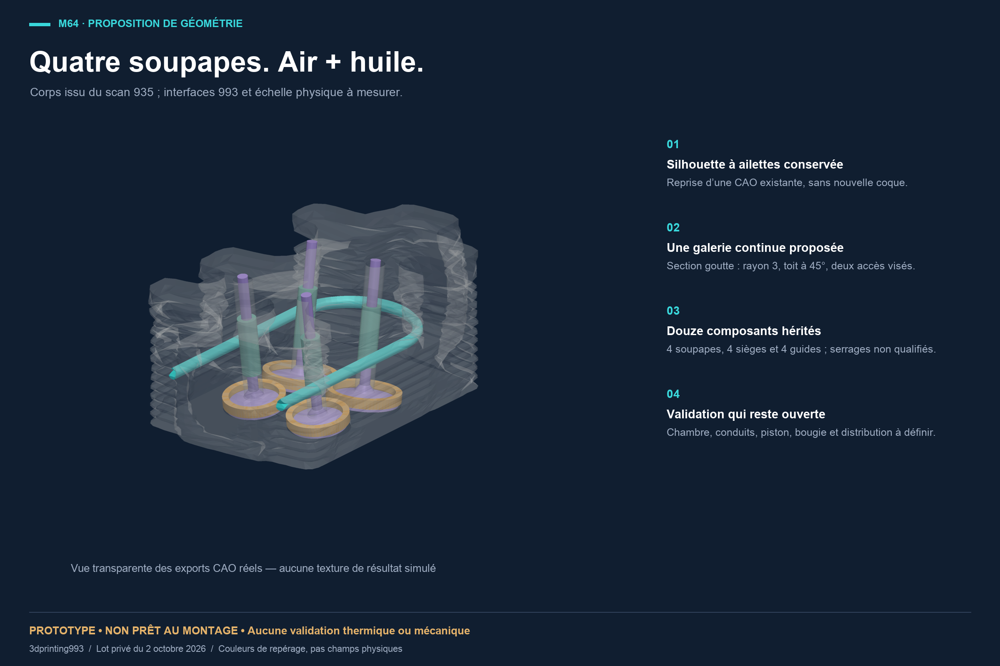
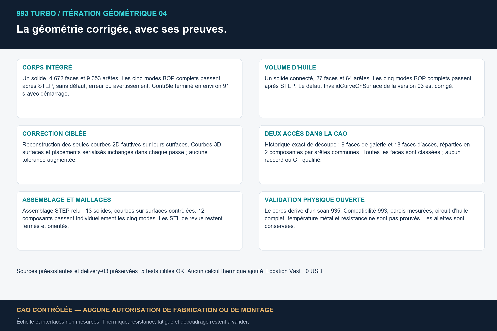
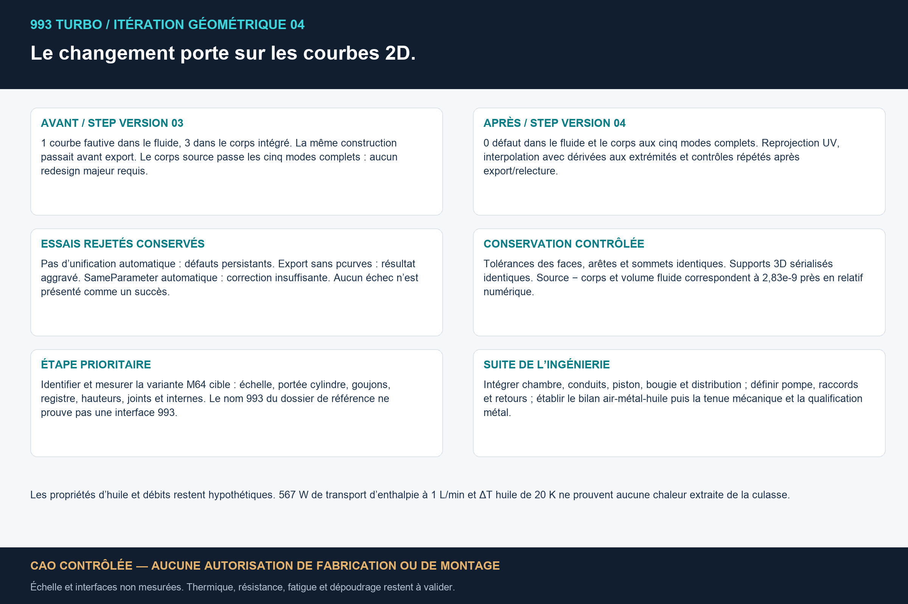
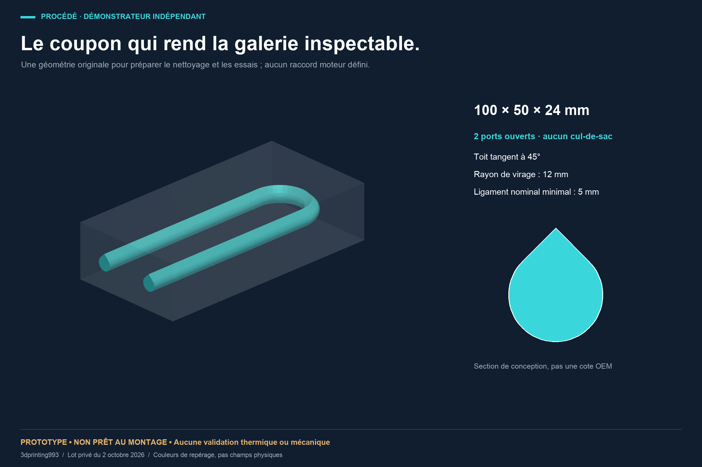
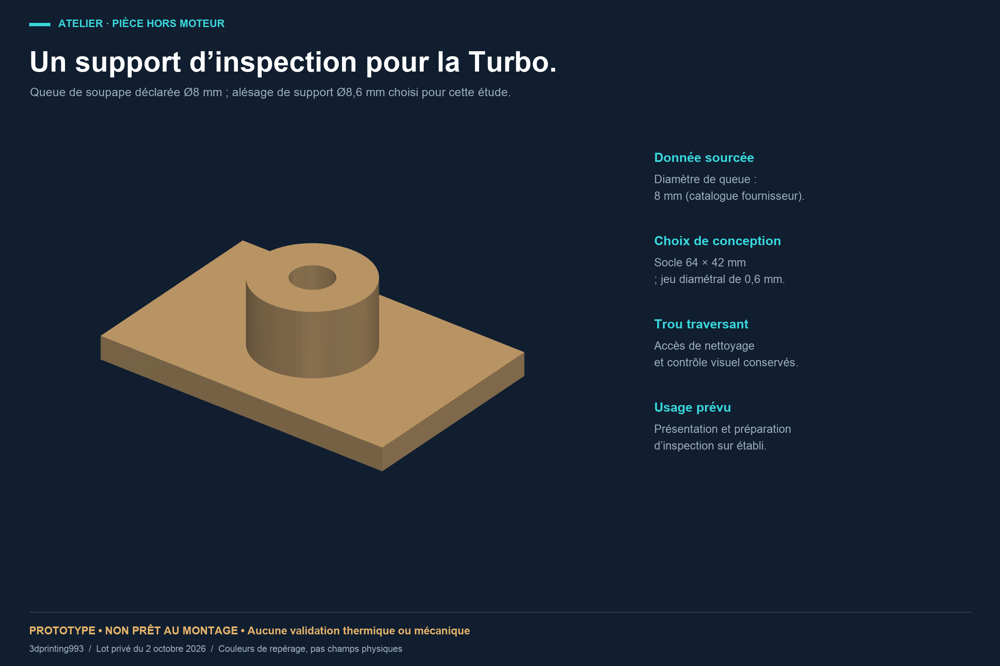
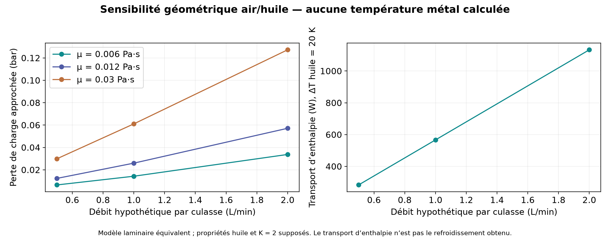

# Four-valve cylinder head: air + oil study for the 993

> English translation of [`993-air-oil-20261002/README.md`](993-air-oil-20261002/README.md),
> added on 2026-11-05 (issue #428). The French original is pinned by SHA-256 in
> [`delivery-manifest.json`](993-air-oil-20261002/delivery-manifest.json), and
> `verify_delivery.py` rejects any unlisted file inside the delivery folder, so
> the original stays unchanged and this translation lives beside the folder.
> Where the two differ, the pinned French original is authoritative.

A proposed oil gallery in a four-valve cylinder-head CAD, with its fins kept, a
review assembly and two original workshop prototypes. The models shown are
those of the corrected iteration of October 2, 2026. **No part has been
manufactured, fitted or validated on an engine.**



The body comes from a reconstruction derived from the Wolfe Classics 935 scan;
the four valves, four seats and four guides already existed in earlier work.
This study adds a continuous gallery and corrects curve-on-surface defects after
STEP export. **A 935 cylinder head does not prove a 993 interface: the physical
scale and the M64 interfaces remain to be measured.** Neither the folder name
nor the valve count demonstrates that compatibility.

## Review files

The STEP files are the primary CAD files. The STLs are for visualization and
carry the `concept-only` suffix. On GitHub, opening a file gives access to its
download button.

| Model | CAD | Review mesh |
|---|---|---|
| Finned body with proposed gallery | [STEP, 15.4 MB](993-air-oil-20261002/cad/head-4v-air-oil-proposal.step) | [STL, 4.2 MB](993-air-oil-20261002/cad/head-4v-air-oil-proposal-concept-only.stl) |
| Review assembly: body + 12 components | [STEP, 15.6 MB](993-air-oil-20261002/cad/head-4v-air-oil-assembly.step) | context components in [cad/](993-air-oil-20261002/cad/) |
| Connected fluid volume in the body | [STEP](993-air-oil-20261002/cad/head-fluid-domain.step) | [STL](993-air-oil-20261002/cad/head-fluid-domain-concept-only.stl) |
| U-gallery design tool | [STEP](993-air-oil-20261002/cad/head-oil-tool.step) | [STL](993-air-oil-20261002/cad/head-oil-tool-concept-only.stl) |
| Original gallery coupon | [STEP](993-air-oil-20261002/cad/oil-gallery-coupon.step) | [STL](993-air-oil-20261002/cad/oil-gallery-coupon-concept-only.stl) |
| Coupon fluid volume | [STEP](993-air-oil-20261002/cad/coupon-fluid-domain.step) | [STL](993-air-oil-20261002/cad/coupon-fluid-domain-concept-only.stl) |
| Original valve display stand | [STEP](993-air-oil-20261002/cad/turbo-valve-inspection-stand.step) | [STL](993-air-oil-20261002/cad/turbo-valve-inspection-stand-concept-only.stl) |

[Illustrated report, 6 pages, 1.3 MB](993-air-oil-20261002/993-air-oil-review.pdf) ·
[Workshop prototypes, PDF](993-air-oil-20261002/original-workshop-prototypes.pdf) ·
[Workshop prototypes, ZIP](993-air-oil-20261002/original-workshop-prototypes.zip) ·
[Manifest and SHA-256 digests](993-air-oil-20261002/delivery-manifest.json)

The plates were produced during the private preparation of the batch; their
"private batch" mentions describe that preparation. Publication of this
selection was then explicitly authorized. The images show the real exports;
their colors identify components, with no simulated thermal or mechanical field.

## What was checked



| Object or check | Observed result | Evidence |
|---|---|---|
| Corrected body after STEP | 1 solid, 4,672 faces, 9,653 edges; five BOP modes with no defect, error or warning | [native body report](993-air-oil-20261002/checks/body-native-BOP.json) |
| Corrected fluid after STEP | 1 connected solid, 27 faces, 64 edges; five BOP modes with no defect, error or warning | [native fluid report](993-air-oil-20261002/checks/fluid-native-BOP.json) |
| Assembly after STEP | 13 solids; `CurveOnSurfaceMode` check passed | [assembly report](993-air-oil-20261002/checks/assembly-curve-check.json) |
| Inherited components | 12 individual five-mode checks passed | [component reports](993-air-oil-20261002/checks/component-native-checks.json) |
| Fluid access in the CAD | 9 gallery faces and 18 access faces, in 2 connected groups; 27 faces classified | [topological history](993-air-oil-20261002/checks/opening-topology-check.json) |
| Numerical volume conservation | removed volume ≈ fluid volume; relative difference 2.83 × 10⁻⁹ | [batch verification](993-air-oil-20261002/checks/verification.json) |
| Coupon and stand | valid BReps before/after STEP and BOP checks passed | [additional checks](993-air-oil-20261002/checks/additional-checks.json) |
| Individual published STLs | closed and oriented; no open or non-manifold edge and no null triangle after merging only identical coordinates | [batch verification](993-air-oil-20261002/checks/verification.json) |

The five modes are `SelfInterMode`, `SmallEdgeMode`, `RebuildFaceMode`,
`ContinuityMode` and `CurveOnSurfaceMode`. The native reports are tied to the
SHA-256 of the delivered STEPs. Self-intersection of the assembly compound was
not tested: its context components may be in contact. Continuous
self-intersections of the STLs were not tested.

CAD kernel validity establishes verified geometric consistency; it does not
certify the physical part, its accuracy, its strength or its fit.

### Curve-on-surface correction



The previous STEP version had three `InvalidCurveOnSurface` defects in the body
and one in the fluid. Only the affected 2D curves were reprojected onto their
surfaces and interpolated with end derivatives. Face, edge and vertex
tolerances stayed identical; the serialized sections of placements, 3D curves
and surfaces kept their digests in each pass. The fluid needed two passes.

The evidence keeps the [earlier body diagnostics](993-air-oil-20261002/checks/previous-body-curve-diagnostic.json)
and [fluid diagnostics](993-air-oil-20261002/checks/previous-fluid-curve-diagnostic.json), as well as the
reports of the [body correction](993-air-oil-20261002/checks/body-repair.json), the
[first fluid pass](993-air-oil-20261002/checks/fluid-repair-first.json) and the
[second fluid pass](993-air-oil-20261002/checks/fluid-repair-second.json).
The old STEPs and the geometries of rejected experiments are excluded from this
selection. The final checks apply to the new published STEPs.

## Two independent workshop prototypes



The coupon measures **100 × 50 × 24 mm**. Its gallery has a design radius of
3 mm, a 45° tangent roof, a 12 mm radius bend and two open accesses.
The minimum nominal ligament is 5 mm. These choices prepare cleaning,
inspection and process trials; depowdering and internal LPBF quality are not
demonstrated. No material or machine parameter set is qualified.



The stand has a **64 × 42 mm** base, a height of **19 mm** and a **8.6 mm**
passage, chosen from a documentary nominal stem of 8 mm and a design diametral
clearance of 0.6 mm. The reference is the
[Partworks record archived in the catalogue](../../catalog/sources/src-partworks-993-exhaust-valve-dimensions.json).
It is a bench stand; neither its accuracy nor its fit on a real valve is
validated. These two original shapes contain no geometry from the cylinder-head
scan.

## What the hydraulic calculation means



At **1 L/min**, with an assumed dynamic viscosity of **0.012 Pa·s**, the
model gives about **0.026 bar** pressure drop and **567 W of enthalpy transport
capacity** for an assumed oil temperature rise of **20 K**.
The model uses `64/Re`, the drop-shaped section and its hydraulic diameter, a
tool length of 397.38 mm and an assumed minor-loss coefficient of 2. That
length includes the part of the tool outside the body.

This sensitivity calculation uses an equivalent circular approximation.
It gives **no heat actually extracted from the cylinder head, no metal
temperature and no thermal margin**. The real oil, temperatures, pump,
fittings, branches and return circuit remain to be defined.
The assumptions and nine cases are in [verification.json](993-air-oil-20261002/checks/verification.json).

## Physical limits and priority steps

The body's millimeter remains the assumption **1 scan unit = 1 mm**, with no
confirming measurement. The wall check sampled 1,863 points with a minimum of
3.318 scan units, excluding the access zone `y < -70`. It does not certify a
continuous minimum thickness or hot strength. The two accesses are established
for the reconstructed CAD; they do not prove a sealed fitting or a measured
gallery in a real cylinder head.

1. Identify the target M64 variant and measure its scale, cylinder seat, studs,
   register, heights and gasket interfaces.
2. Integrate chamber, ports, spark plug, piston and valve train; check
   clearances and interfaces before freezing a geometry.
3. Define oil supply, fittings, sealing and return; establish the
   combustion–metal–air–oil balance and measured boundary conditions.
4. Define and qualify alloy, metal process, orientation, cleaning, heat
   treatment, machining, inspection, fatigue and test plan with a professional
   review.

The PicoGK work already in the project is separate work. This batch uses
build123d/OpenCascade for CAD and PyVista/VTK for renders; no new PicoGK, CFD,
thermal or structural calculation is claimed here.
The status of the [parts catalogue](../../catalog/parts/) is unchanged.

## Provenance, rights and reproduction

The [Wolfe Classics register](../../catalog/sources/src-wolfe-classics-935-billet-cylinder-head-scan.json)
attributes the scan to its vendor, records the open reuse confirmed by the
owner and states that the exact licence text or identifier remains to be
archived. The owner explicitly authorized this publication of the generated
derivatives, renders, report and code on October 2, 2026. **The raw OBJ scan
stays private and outside Git.** This agreement creates no additional licence
from the vendor. The [dated provenance supplement](../research/wolfe-classics-935-billet-cylinder-head-scan.md#complément-de-provenance--publication-autorisée-le-2-octobre-2026)
documents the limited replacement of the earlier instruction; the source record
frozen by the engineering contract keeps its digest. The project's rights are
those of the [current licence](993-air-oil-20261002/LICENSE);
the old MIT mentions of the local packages do not apply to this publication.
Public viewing is not authorization to manufacture, reuse or redistribute.

The prototypes' code and parameters are in [source/](993-air-oil-20261002/source/).
In an environment already equipped with build123d 0.11.1, NumPy, trimesh and
rtree, from the `993-air-oil-20261002/` folder:

```sh
python3 -B -m unittest discover -s source -p test_geometry.py -v
python3 -B source/build.py --original-only --project-root . --output replay-new
python3 -B verify_delivery.py
```

`--original-only` reads no cylinder-head geometry. The complete reconstruction
of the body requires the two private source CADs whose digests appear in the
parameters; they are not added to this batch. `build.py` builds the gallery and
the booleans; the correction and the post-STEP checks must then be run
separately. The correction code is in [repair/](993-air-oil-20261002/repair/).
To re-check the public files, in the same environment:

```sh
python3 -B repair/bounded_check.py cad/head-4v-air-oil-proposal.step audit-body-new --timeout 420
python3 -B repair/bounded_check.py cad/head-fluid-domain.step audit-fluid-new --timeout 60
```

Each output must be new. The five design tests passed during preparation; the
physical results all remain unvalidated. The manifest ties the public files to
their digests. The production code SHAs present in the reports designate the
original private batch; the public build script and its parameters have only
documentation and path adaptations. No geometric result was regenerated for
this publication.
