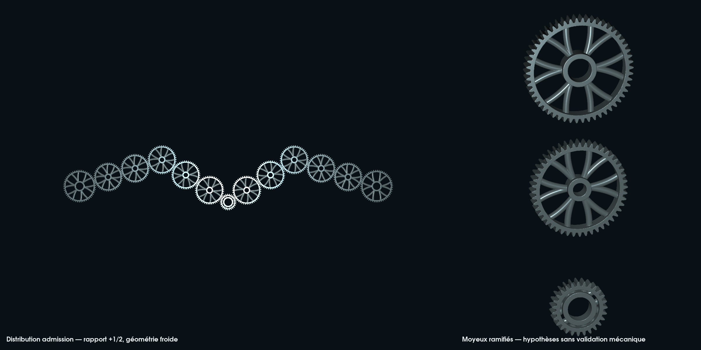
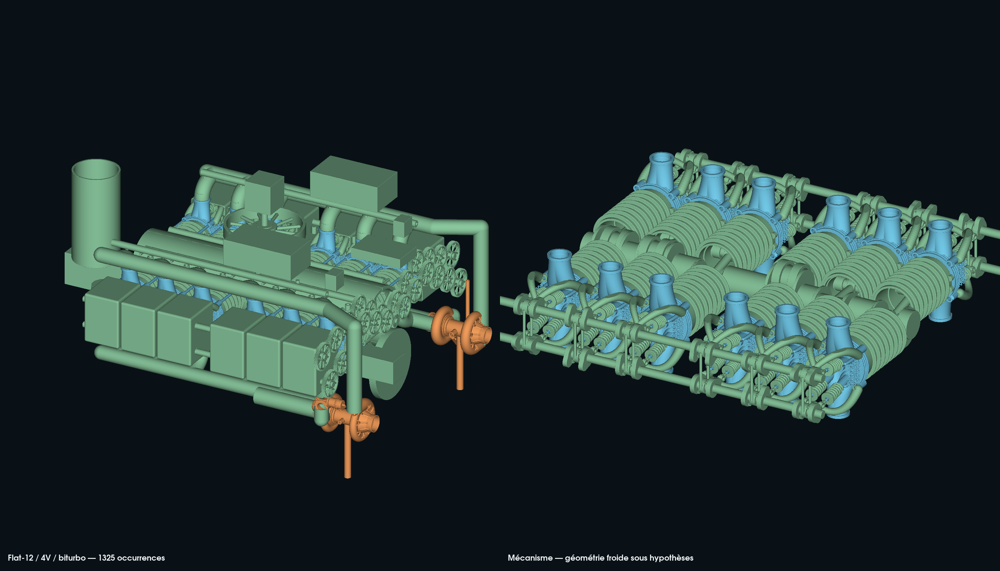

# Distribution dentée pour le flat-12 4V biturbo

Cette étude poursuit les [culasses bioniques](../head-bionic/README.md) mergées
avec la PR #148. Elle remplace les dix anneaux de distribution placés sur les
anciens axes et l'arbre intermédiaire provisoire. Les quatre nouveaux trains
rejoignent les axes de cames du moteur livré, sans déplacer les culasses.
Les paliers, fixations, retenues et liaisons en couple restent ouverts dans le
[contrat d'interface](interface-contract.json).

## Géométrie et optimisation sous hypothèses

- Dentures extérieures en développante : module **1,5 mm**, angle de pression
  **20°**, largeur **12 mm**, jeu circulaire nominal total **0,4 mm**.
- Deux pignons de vilebrequin de **27 dents**, vingt intermédiaires de **48 dents**
  et quatre roues de came de **54 dents**, dans deux plans à X = 400 et 424 mm.
- Recherche de 1, 3, 5 ou 7 intermédiaires par came : **5** est le plus petit
  nombre qui atteint les axes et conserve le sens positif. Les six engrènements
  donnent exactement **+½ tour de came par tour de vilebrequin**.
- Entaxes calculés à partir des rayons primitifs ; indexation des dents calculée
  pour chaque liaison. Les enveloppes des roues non adjacentes sont séparées.
- Deux épaisseurs de nervures courbes ramifiées, rayons 2,5 et 3,5 mm, comparées
  à un témoin plein pour chaque denture. Sélection par volume parmi les variantes
  dont le maillage est fermé et connexe. Ce classement n'est pas une optimisation
  de résistance ou de fatigue.

Les variantes à rayon de nervure 2,5 mm ont le plus petit volume dans cette
recherche. À 0,25 mm, la réduction par rapport au témoin plein est :

| roue | volume candidat (mm³) | réduction de volume |
|---|---:|---:|
| 27 dents | 10039.99 | 14.77 % |
| 48 dents | 18608.64 | 60.50 % |
| 54 dents | 21635.55 | 62.59 % |

Ces gains sont géométriques. La tenue des nervures à la flexion, aux inversions
de couple et à la fatigue n'est pas calculée.

Les formules de géométrie s'appuient sur la documentation technique primaire
[KHK, calcul des dimensions](https://khkgears.net/gear-knowledge/gear-technical-reference/calculation-gear-dimensions/).
Aucun modèle externe de denture n'est importé. Les profils éditables sont dans
[drive.py](drive.py) ; le [générateur](run.py) réutilise l'exécuteur CSG PicoGK
C# existant et ses primitives de création de solides et de nervures.

## Contrôles et limites

Les dentures sont générées nativement à deux résolutions, **0,5 et 0,25 mm**.
Les audits indépendants contrôlent volume positif, fermeture, orientation,
absence de faces répétées et une composante. Seules les faces exactement nulles
peuvent être retirées, sans déplacement de sommet.

Les [deux premiers essais](rejected-trial-001.json), avec 0,4 puis 0,8 mm de jeu,
ont été rejetés : les maillages se recouvraient jusqu'à 1,2243 puis 0,9191 mm³.
Les profils avant ajout des nervures étaient séparés aux positions testées.
Un contrôle bionique moins témoin plein a révélé des volumes hors du témoin :
les extrémités arrondies des nervures dépassaient le pied des dents. La troisième
variante limite le centre de chaque extrémité au rayon de pied moins le rayon
de nervure moins 0,3 mm, et revient au jeu hypothétique de 0,4 mm.

Trois types d'engrènement à 0,25 mm sont testés sur 48 positions chacun, soit **144**
intersections booléennes de maillages natifs. Les équations d'indexation et de
rapport sont vérifiées séparément sur 721 positions de vilebrequin pour les
quatre trains. Les 144 essais de contact sont échantillonnés : ils ne démontrent
pas l'absence d'interférence continue ni l'absence d'auto-intersection.

Le contrôle [bionique moins témoin plein](check_web.py) est aussi conservé :
il donne un résidu maximal de **0,007024 mm³**, donc la contenance native stricte
reste **non validée**. Sur la roue de 27 dents, le résidu est localisé au bord
de l'alésage, près des faces axiales, et non au pied des dents. Aucun seuil de
qualification n'est introduit pour transformer ce résultat en réussite.

Le pied de dent est un raccord radial provisoire, sans congé généré par outil.
Les développantes polygonisées puis voxelisées ne définissent ni qualité de
rectification, ni tolérances, ni jeu réel à chaud. Les bouts d'arbres cylindriques
et les axes d'intermédiaires représentent des volumes d'implantation : aucune
clavette, cannelure, précharge de roulement ou retenue axiale n'est qualifiée.
Le contrôle global d'interférences du moteur, les supports de distribution, la
lubrification, les charges de denture et la dynamique torsionnelle restent à faire.

**Aucun alliage ni procédé n'est sélectionné.** La matière des roues doit être
choisie après définition des efforts, usure, traitement thermique et finition ;
les nervures doivent ensuite être évaluées avec ce matériau et le procédé réel.
Un STL fermé ne constitue pas une autorisation de fabriquer un moteur fonctionnel.

## Reproduction et livraison

L'exécution prend la livraison privée précédente et un nouveau dossier dans
`work/`, vérifie les hashes des fichiers réutilisés et conserve les turbos
inchangés. Elle refuse d'écraser un dossier existant. Les scans et maillages
privés restent hors Git ; le dépôt contient les sources, le reçu de contrôle
et une image issue des triangles réels.

```sh
PYTHONPATH=work/917-head-clearance-20261012/runtime \
work/917-picogk-20261010/qa-venv/bin/python \
models/917-engine-reconstruction/cam-drive/run.py \
  --previous /chemin/vers/la/livraison/917-bionic-head-20261012 \
  --output work/917-cam-drive-new-run \
  --dotnet /chemin/vers/dotnet
```





L’aperçu moteur utilise la fonction `engine` du [rendu existant](../head-bionic/render.py)
sur le nouveau GLB : 142 définitions, 1 325 occurrences. Les 39 prototypes et
78 occurrences des turbos bioniques sont conservés avec les mêmes STL.

Le [reçu d'exécution](execution-20261012.json) lie les contrôles, sources et image
par SHA-256. La livraison locale contient l'assemblage GLB à surfaces pleines,
les STL par pièce, les VDB natifs, l'index des placements et les rapports.
