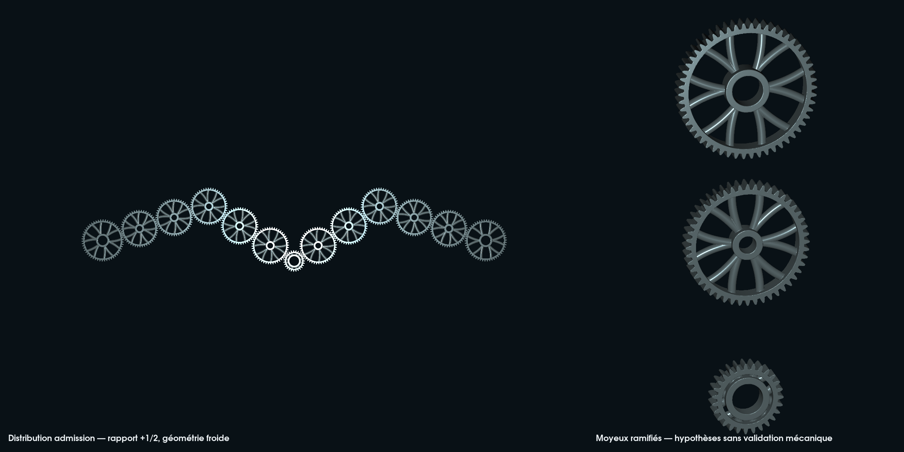
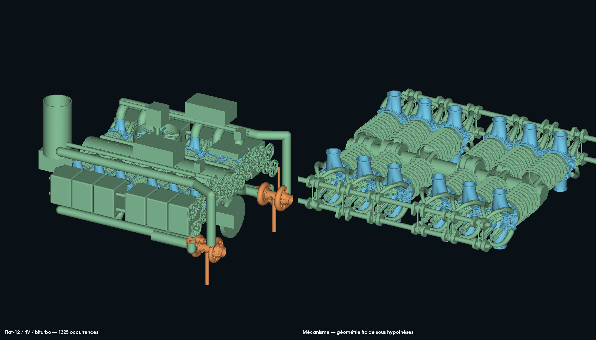

# Gear-driven valve train for the twin-turbo 4V flat-12

This study continues the [bionic cylinder heads](../head-bionic/README.md) merged
with PR #148. It replaces the ten timing rings placed on the
old axes and the provisional intermediate shaft. The four new trains
reach the camshaft axes of the delivered engine, without moving the cylinder heads.
Bearings, fasteners, retention and torque-carrying connections remain open in the
[interface contract](interface-contract.json).

## Geometry and optimisation under assumptions

- External involute teeth: module **1.5 mm**, pressure angle
  **20°**, face width **12 mm**, total nominal circular backlash **0.4 mm**.
- Two crankshaft pinions of **27 teeth**, twenty idlers of **48 teeth**
  and four cam gears of **54 teeth**, in two planes at X = 400 and 424 mm.
- Search over 1, 3, 5 or 7 idlers per cam: **5** is the smallest
  number that reaches the axes and keeps the positive direction. The six meshes
  give exactly **+½ cam turn per crankshaft turn**.
- Centre distances computed from the pitch radii; tooth indexing computed
  for each connection. The envelopes of non-adjacent gears are separated.
- Two thicknesses of branched curved ribs, radii 2.5 and 3.5 mm, compared
  with a solid witness for each gear. Selection by volume among the variants
  whose mesh is closed and connected. This ranking is not a strength or fatigue
  optimisation.

The variants with a 2.5 mm rib radius have the smallest volume in this
search. At 0.25 mm, the reduction relative to the solid witness is:

| gear | candidate volume (mm³) | volume reduction |
|---|---:|---:|
| 27 teeth | 10039.99 | 14.77 % |
| 48 teeth | 18608.64 | 60.50 % |
| 54 teeth | 21635.55 | 62.59 % |

These gains are geometric. The ribs' resistance to bending, torque
reversals and fatigue is not computed.

The geometry formulae rely on primary technical documentation
[KHK, calculation of gear dimensions](https://khkgears.net/gear-knowledge/gear-technical-reference/calculation-gear-dimensions/).
No external tooth model is imported. The editable profiles are in
[drive.py](drive.py); the [generator](run.py) reuses the existing PicoGK C# CSG
executor and its primitives for creating solids and ribs.

## Checks and limits

The teeth are generated natively at two resolutions, **0.5 and 0.25 mm**.
The independent audits check positive volume, closure, orientation,
absence of repeated faces and a single component. Only exactly zero-area faces
may be removed, without moving any vertex.

The [first two trials](rejected-trial-001.json), with 0.4 then 0.8 mm backlash,
were rejected: the meshes overlapped by up to 1.2243 then 0.9191 mm³.
The profiles before the ribs were added were separated at the tested positions.
A bionic-minus-solid-witness check revealed volumes outside the witness:
the rounded ends of the ribs protruded past the tooth roots. The third
variant limits the centre of each end to the root radius minus the rib
radius minus 0.3 mm, and returns to the hypothetical 0.4 mm backlash.

Three mesh types at 0.25 mm are tested over 48 positions each, i.e. **144**
Boolean intersections of native meshes. The indexing and ratio
equations are verified separately over 721 crankshaft positions for the
four trains. The 144 contact trials are sampled: they do not demonstrate
the absence of continuous interference or the absence of self-intersection.

The [bionic-minus-solid-witness](check_web.py) check is also kept:
it gives a maximum residual of **0.007024 mm³**, so strict native containment
remains **not validated**. On the 27-tooth gear, the residual is located at the edge
of the bore, near the axial faces, and not at the tooth root. No qualification
threshold is introduced to turn this result into a pass.

The tooth root is a provisional radial blend, with no tool-generated fillet.
The polygonised then voxelised involutes define neither grinding quality,
nor tolerances, nor real hot backlash. The cylindrical shaft stubs
and idler axles represent packaging volumes: no
key, spline, bearing preload or axial retention is qualified.
The global engine interference check, the timing supports,
lubrication, tooth loads and torsional dynamics remain to be done.

**No alloy or process is selected.** The gear material must be
chosen after defining loads, wear, heat treatment and finish;
the ribs must then be assessed with that material and the real process.
A closed STL is not an authorisation to manufacture a functional engine.

## Reproduction and delivery

The run takes the previous private delivery and a new directory in
`work/`, verifies the hashes of the reused files and keeps the turbos
unchanged. It refuses to overwrite an existing directory. The private scans and meshes
stay outside Git; the repository contains the sources, the check receipt
and an image produced from the real triangles.

```sh
PYTHONPATH=work/917-head-clearance-20261012/runtime \
work/917-picogk-20261010/qa-venv/bin/python \
models/917-engine-reconstruction/cam-drive/run.py \
  --previous /chemin/vers/la/livraison/917-bionic-head-20261012 \
  --output work/917-cam-drive-new-run \
  --dotnet /chemin/vers/dotnet
```





The engine preview uses the `engine` function of the [existing renderer](../head-bionic/render.py)
on the new GLB: 142 definitions, 1,325 instances. The 39 prototypes and
78 instances of the bionic turbos are kept with the same STLs.

The [execution receipt](execution-20261012.json) binds the checks, sources and image
by SHA-256. The local delivery contains the solid-surface GLB assembly,
the per-part STLs, the native VDBs, the placement index and the reports.
