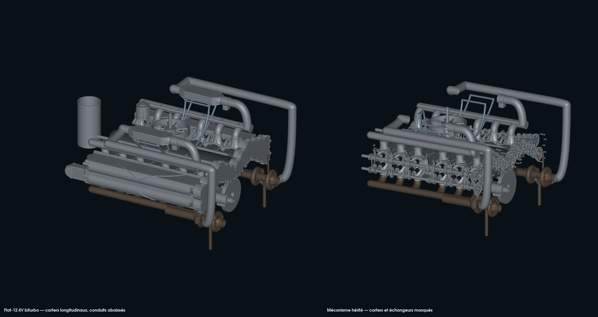
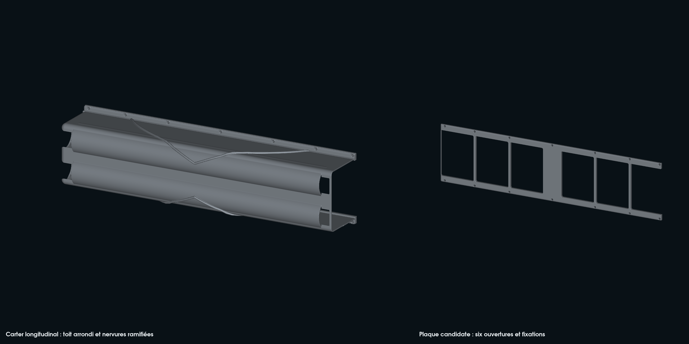

# Longitudinal covers and more compact forced induction

This step applies the observations from the [three videos](../museum-reference-analysis.md)
to the 4V biturbo engine, after PR #196 was merged. The videos give the general
shapes; no dimension is extracted from their images.

## Native build on the Mac

The [C# program](Bank.cs) uses PicoGK 2.3, the `Sdf.Vox` implicit fields,
rounded boxes, `Lattice.AddBeam` beams, Bézier curves and Booleans on native
VDBs. The solids are exported at 1 and 0.5 mm. The
[generator](run.py) keeps the sources actually used in each run directory
before launching the kernel. Outputs stay under `work/`, and a run refuses to
overwrite an existing directory.

- Two longitudinal covers replace the twelve individual covers. The roof
  has two rounded volumes around the camshaft lines, joined by a continuous
  skin; the cavities are subtracted after the ribs.
- Two adapter plates have six openings aligned with the candidate cylinder
  heads of each bank. Centers and poses come from the inherited assembly,
  not from an estimate on the museum's exploded views.
- The branches are projected onto the outer skin before voxelization to keep a
  continuous connection between the roots and the top. Their shape is not the
  result of a stress analysis.
- Fourteen screw positions per bank reuse the native screw prototype already
  generated, with bosses that clear their heads from the collar. Bores, poses
  and a candidate space for a washer are represented; thread, seats, washers,
  preload and retention remain to be defined.
- The native fields of the timing case and the wheel envelopes are reserved
  around the new covers. The front transition of the negative bank stops at
  the candidate plane X = 389.37 mm. Its joint and sealing with the timing case
  remain open. The last opening of the plate reaches its front edge: the gasket
  perimeter is not closed at that point. A case transition must resolve this
  defect before a functional enclosure.
- The two forced-induction ducts keep their ends and their inlet/outlet radii;
  their long section moves from Z = 335 to 270 mm. The centerline maximum moves
  from 335 to 295 mm, because of the retained final port. The centerline length
  decreases by about 3.05 % and 2.86 % depending on the bank. These gains
  demonstrate neither increased flow nor reduced pressure loss.

The cylinder heads, valves, turbochargers and their poses are protected by the
hashes of the previous delivery and by a comparison of the assembly records.
The timing drive remains at the end: the central architecture identified in the
references still needs independent mechanical sources.

## Material comparison and checks

The nominal 3 mm walls are compared with a 5 mm witness, with the same outer
envelopes, ribs, fasteners, clearances and candidate interfaces. The volumes
come from the audited native triangles. The comparison concerns the cover
material; it does not rank the variants by strength or fatigue. The adapter
plates are not thinned in this comparison.

The [October 13 receipt](execution-20261013.json) describes the local run on
the ARM64 Mac: **157 prototypes / 1,419 instances**, 12 cylinder heads,
48 valves and 39 turbocharger prototypes retained. The 1,387 inherited records
left after removing the old covers keep their poses and metadata.

| Cover | Volume at 3 mm, mm³ | 5 mm witness, mm³ | Volume reduction |
|---|---:|---:|---:|
| Positive bank | 1,013,150.52 | 1,644,654.24 | 38.40 % |
| Negative bank | 950,896.00 | 1,545,564.05 | 38.48 % |

All 640 check groups pass: 520 groups are disjoint by bounding boxes and 120
Boolean triangle intersections give zero volume. The 12 connection checks also
pass. Unchanged outputs reuse their topological witness tied to the same STL
files; the others receive a new audit. The assembly contacts are all recomputed
in this step.





The audit reuses the repository's independent witness: finite coordinates,
positive volume, closure, orientation, no repeated faces and a single surface
component per solid. Only exactly zero-area faces may be removed, without
moving vertices or deleting a small component. The two camshaft clearances per
bank are exported separately, each connected.

The new covers and plates are compared with every inherited family at the
recorded cold poses. The transformed bounding boxes serve only to exclude
disjoint pairs; the other pairs go through a triangle Boolean. The camshafts
also have a conservative rotation clearance. The contacts of the modified ducts
and the connection checks are redone. Unchanged pairs, the full valve–piston
cycle and hot effects are not rechecked here. Preservation of triangles and
poses is checked during the GLB export.

The first trial of covers was rejected: detached fragments and small residual
surfaces near the field junctions. The correction distinguishes the levels of
the roof and its cavity and reworks the front transition. A following trial
stopped the inherited duct generator, which only accepted 0.5 mm; the new step
generates the ducts in its own program at two resolutions without modifying
that inherited source. A trial was then interrupted before assembly to project
the ribs onto the skin and add the wall witness. The files, receipts and
sources of these trials remain in the private diagnostics.
The first 3 mm wall was also rejected: the rounded body no longer joined the
flange. A native collar connects these two regions before the cavity is
subtracted; no detached component is deleted from the mesh.
The following trial passes the surface audits but fails at assembly: about
1,106.67 mm³ of overlap with the bearing caps and 854.9 mm³ with the screw
heads per bank. The central cavity is raised for the existing caps, and bosses
move the candidate seats of the screw heads.
The next check clears the caps but still detects about 996 mm³ of overlap
between the screw heads and the wall per bank. The screws move onto widened
flanges, outside the wall, without changing their prototype.
A last check still locates about 16.6 mm³ per bank on four rib roots in contact
with the screw heads. The roots are moved longitudinally to clear the
fasteners; the walls remain continuous.

The `--audit-from work/previous-run` option can reuse a part audit if the newly
generated STL files have the same SHA-256 as the outputs already audited. The
new VDB is checked against its own generation receipt; no VDB equivalence is
inferred from reusing the STL witness. The oriented-face witness is rechecked;
any modified part receives a new full audit. The receipts distinguish reused
witnesses from checks that were redone. This reuse does not cover the assembly
contacts.

## Reproduction

```sh
PYTHONPATH=work/917-head-clearance-20261012/runtime \
work/917-picogk-20261010/qa-venv/bin/python \
models/917-engine-reconstruction/compact-packaging/run.py \
  --previous /path/to/the/delivery/917-mechanical-detail-20261012 \
  --output work/917-compact-new-run \
  --dotnet /path/to/dotnet

PYTHONPATH=work/917-solid-surfaces-20261011/runtime \
work/917-picogk-20261010/qa-venv/bin/python \
models/917-engine-reconstruction/compact-packaging/render.py \
work/917-compact-new-run
```

The measured interfaces and their qualification remain open in the
[contract](interface-contract.json). Alloy, process, depowdering, surface finish,
machining, lubrication, sealing, mechanical strength and professional validation
are not established. These files are a reproducible study, with no authorization
to manufacture for engine service or to start the engine.

The figure titles in [render.py](render.py) and the two images stay in French:
their digests are recorded by the October 13 receipt, and changing them would
require a new native run.
