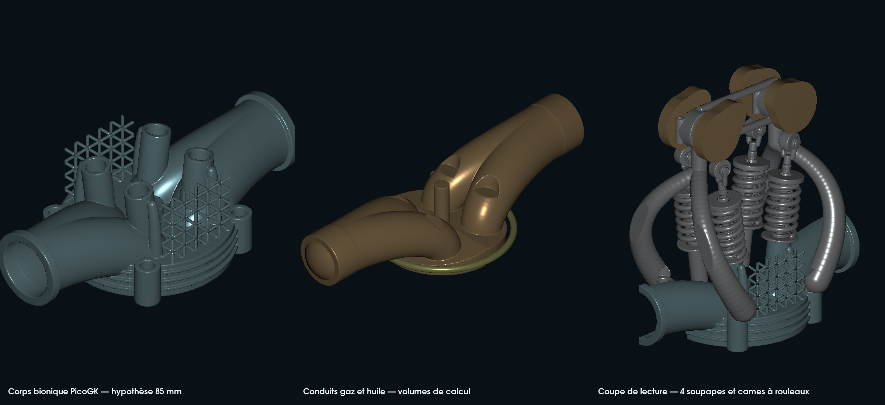
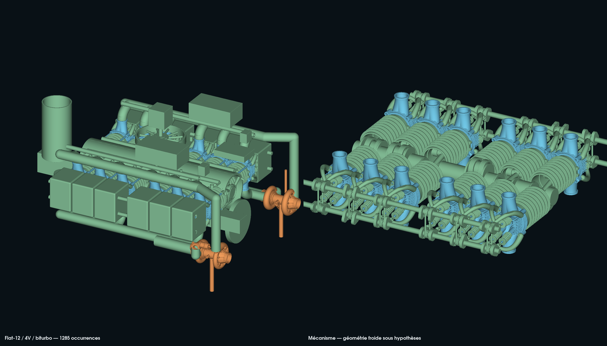

# Culasse bionique 4V et distribution du flat-12

Cette variante poursuit l'[assemblage 917 moderne 4V/biturbo](../assembly/README.md)
avec une culasse paramétrique adaptée à l'alésage documentaire de 85 mm.
Les quatre soupapes ont une face, une portée à 45°, une tulipe, une tige et
des gorges de clavettes. Les sièges, guides, conduits, supports de distribution
et fixations sont générés autour de leurs axes. Le dessin provient du code
du dépôt, sans extraction ni publication du scan privé.



À gauche : corps et réseau bionique. Au centre : domaines gaz et huile.
À droite : coupe de lecture et train de soupapes. Couleurs de lecture ;
aucun matériau n'est qualifié. Le rendu utilise les triangles complets,
avec surfaces opaques et sans échantillonnage de points.



L'assemblage contient **137 définitions et 1 285 occurrences**. Les blocs
rectangulaires représentent des organes achetés dont les interfaces restent
à définir ; la vue du mécanisme les masque pour examiner les pièces générées.

## Résultats numériques du 12 octobre

Le [relevé d'exécution](execution-20261012.json) lie les sources, les images,
les contrôles et les exports privés par SHA-256. Les 53 exports de culasse et
de contrôle passent l'audit aux grilles de 1 et 0,5 mm ; les onze dérivés natifs
de l'assemblage passent aussi. Le réseau à brins de 2 mm est retenu parmi les
trois variantes fermées.

| Mesure géométrique sous hypothèses | Résultat |
|---|---:|
| Volume de culasse, grille 0,5 mm | 200 107,83 mm³ |
| Référence avec zones pleines | 233 538,19 mm³ |
| Réduction de volume de matière | **14,31 %** |
| Masse mobile équivalente acier | 100,35 g, plafond de recherche 110 g |
| Rapport volumétrique géométrique estimé | 8,17:1 |

Les poses examinées donnent zéro recouvrement volumique soupape–piston,
soupape–cylindre et soupape–culasse. Les deux embouchures planes examinées
donnent aussi zéro recouvrement volumique avec la culasse. **456 cas de contact**
sur les douze phases de cylindre vérifient le porte-paliers, les cames,
couvercles de palier, galets, fourches, coupelles, ressorts et fixations.
Ils ne constituent pas un balayage continu ni un contrôle global du moteur.

Les versions rejetées conservent leurs témoins : bouchons de conduits,
fragments/arêtes non manifold, domaine conforme non fermé, fond de logement
touchant les tiges, et supports touchant coupelles, galets et fixations.
Les corrections sont faites à la génération. Le domaine gaz natif conserve
un petit recouvrement de peau triangulée avec le corps ; le domaine CFD reste
non qualifié malgré le témoin érodé sans intersection.

Les tests ciblés vérifient les recherches, le cycle, les profils de came,
la borne de jeu et la fermeture des portes de qualification. Sur le Mac,
`make check` rencontre les deux comparaisons flottantes connues des dossiers
impeller/stator 993 inchangés. La validation GitHub Linux est rapportée
séparément dans la PR ; aucun résultat CI n'est déduit des contrôles locaux.

## Optimisations réellement calculées

| Recherche bornée | Objectif | Contraintes et résultat retenu |
|---|---|---|
| 625 implantations 4V | Maximiser l'aire totale des faces | Soupapes 31/29 mm, demi-entraxe 18,25 mm, rangées à ±17,75 mm ; ligament de sièges 2,5 mm et marge radiale conservatrice 1,54 mm |
| 540 configurations de lois/précharge | Maximiser l'intégrale de section de rideau, puis réduire la contrainte de ressort | Levées 9,5/10 mm, durée principale 240° vilebrequin, centres 120°/600°, précharge 550 N ; scénario hypothétique 8 000 tr/min, 2 bar adverses, masse mobile plafonnée à 0,11 kg |
| Trois diamètres de réseau BCC | Minimiser le volume géométrique parmi les maillages acceptés | Réseau à maille 10 mm, brins 2/2,5/3 mm ; comparaison avec les mêmes zones remplies en volume plein |
| Profils des quatre arbres à cames | Construire l'enveloppe d'un galet de rayon 8 mm | Décalage selon la normale de la courbe des centres de galet ; angle de pression idéal inférieur à 27°, rayon de courbure positif minimal supérieur à 18,8 mm |

La distribution utilise la loi C² existante du dépôt. Le cycle de 720° attribue
douze PMH de combustion séparés de 60°, cohérents avec les phases des manetons
de l'assemblage. Cet ordre est **une hypothèse nouvelle**, pas l'ordre d'allumage
historique Porsche. Le profil de came utilise la levée de came avant jeu ; les
soupapes et ressorts utilisent la levée après jeu. Les ressorts sont régénérés
à la hauteur de chaque pose, sans écraser ou dilater le diamètre du fil.

L'optimisation de matière est une comparaison de volumes. Les branches
de Bézier et le réseau BCC réutilisent `Sdf.Bezier`, `Sdf.LatticeIn` et
`Lattice.AddBeam`, déjà présents dans le dépôt et exécutés par PicoGK.
Ce travail n'exécute pas une optimisation par contraintes, une FEA ou une CFD.
Il ne revendique aucune utilisation de Noyron. La bibliothèque publique
[LEAP 71 LatticeLibrary](https://github.com/leap71/LEAP71_LatticeLibrary)
reste une référence de méthode ; aucune dépendance supplémentaire n'est importée.

## Interfaces et limites du calcul

Le joint proposé mesure 1,25 mm. Le plan de culasse est à 211,25 mm de l'axe
du vilebrequin ; le jeu axial piston–plan de culasse proposé au PMH est 3,25 mm.
Les goujons D8/L169, les écrous non filetés, les bossages de carter, les douilles
de positionnement et les paliers séparés sont **des coordonnées de conception**.
Les tolérances, filetages, serrages, charges et mesures restent inconnus.
Les contacts proposés ne constituent pas un dossier de fixation validé.
Le [contrat d'interfaces ouvert](interface-contract.json) conserve séparément
les mesures, charges et revues manquantes ; les sorties géométriques ne les
remplissent pas et n'autorisent aucune fabrication.

La borne continue du modèle rigide piston/plan/soupape inclut une majoration
analytique de la variation entre échantillons de 0,25°. Elle dépasse 4,42/4,56 mm
en conservant un jeu de base plus défavorable de 2 mm. Elle ne couvre ni
déformation, dilatation, rebond, défaut de suivi, tolérances ni distribution réelle.
La marge quasi statique des ressorts est échantillonnée ; leur contrainte de
cisaillement calculée atteint environ 1 149 MPa sous les hypothèses retenues.
Sans nuance et données de fatigue à chaud, ces ressorts ne sont pas qualifiés.
Les hélices affichées restent des représentations d'enroulement : extrémités
fermées/rectifiées, nombre de spires actives réel et courbe effort–course
doivent être définis et vérifiés sur le ressort retenu.

Le contrôle de maillage indépendant conserve tous les sommets et triangles
non dégénérés. Seuls les triangles dont le produit vectoriel est exactement
nul sont retirés, avec témoin. Un maillage non fermé, une composante isolée ou
une arête non manifold entraîne le rejet ; aucune réparation supplémentaire
n'est admise. Les essais rejetés sont conservés dans `work/`.

Les domaines gaz et solide issus de champs indépendants peuvent se chevaucher
sur leur peau triangulée. L'essai de domaine conforme par soustraction booléenne
est rejeté : sa sortie n'est pas fermée. Un domaine gaz réduit de 0,5 mm par
érosion native sert uniquement de **témoin de séparation déclaré**. Il n'est
pas le passage physique et ne corrige pas le corps. Le domaine CFD conforme
reste à construire ; aucune épreuve d'étanchéité physique n'est réalisée.
Les intersections utilisent Manifold
sur triangles flottants ; ce n'est pas une métrologie ni un calcul BRep exact.

Les deux turbos et leurs 39 prototypes chacun sont conservés par SHA-256.
Leur adéquation débit/pression/vitesse et leur tenue restent ouvertes.
Les nouveaux collecteurs suivent les sorties de culasse. Le moteur conserve
des ébauches d'engrenages et des enveloppes d'organes achetés ; son entraînement
de distribution, ses circuits complets et sa nomenclature de fabrication
ne sont pas terminés. Le contrôle global de toutes les interférences reste ouvert.

## Matières et fabrication : pistes à qualifier

| Famille | Piste de procédé | Preuve requise avant choix réel |
|---|---|---|
| Corps de culasse, carters, collecteurs froids | Comparer fonderie/usinage et LPBF aluminium ; AlSi10Mg ou AlF357 comme candidats | Températures, fatigue thermomécanique, conductivité, porosité, traitement, surépaisseurs, sièges/guide, CT/CMM et épreuves de pression |
| Collecteurs chauds et carter turbine | Étudier un alliage nickel avec procédé fournisseur | Température locale, oxydation, fatigue, fluage, soudabilité, traitement et éprouvettes du procédé exact |
| Soupapes, ressorts, clavettes, guides et sièges | Pièces spécialisées avec usinage/rectification et traitements adaptés | Nuance fournisseur, jeu à chaud, contact, fatigue et compatibilité tribologique |
| Vilebrequin, bielles, arbres et engrenages | Comparer forge/usinage aux solutions additives | Charges, équilibrage, trempe, rectification, lubrification, denture et essais de fatigue |

[EOS aluminium](https://www.eos.info/metal-solutions/metal-materials/aluminium)
et [EOS IN718](https://www.eos.info/metal-solutions/metal-materials/data-sheets/mds-eos-nickelalloy-in718)
documentent des matières/procédés additifs disponibles ; ils ne qualifient
aucune pièce de ce moteur. La sélection réelle d'alliage et de procédé reste
`null`. L'équivalent acier utilisé pour la masse mobile est une hypothèse
de calcul de 7 850 kg/m³, pas une spécification d'achat.

La prochaine validation mécanique exige les mesures des axes, plans, perçages
et appuis, le régime/boost cible et les charges. Viennent ensuite la revue
professionnelle, la chaîne matière/procédé, les contacts et jeux à chaud,
les calculs thermiques/structurels/écoulement et le banc instrumenté.
**Aucune autorisation de fabrication fonctionnelle ni de démarrage.**

## Reproduction locale

Le code C# est la source géométrique modifiable ; STL/VDB/GLB sont des dérivés,
sans historique STEP. Python utilise les dépendances numériques déjà employées
dans les études du dépôt : NumPy, trimesh, SciPy, matplotlib et Manifold3D.
VTK sert uniquement au rendu. PicoGK 2.3.0/Core 26.2 et .NET 9 exécutent les volumes.
Les exports restent dans un nouveau dossier ignoré `work/` ; les fichiers
précédents et les anciennes preuves liées par hash ne sont pas modifiés.

```bash
"$PYTHON" models/917-engine-reconstruction/head-bionic/study.py \
  --previous /chemin/vers/livraison-4v-biturbo \
  --output work/917-bionic-head/nouvelle-execution --dotnet "$DOTNET"
"$PYTHON" models/917-engine-reconstruction/head-bionic/verify.py \
  work/917-bionic-head/nouvelle-execution --previous /chemin/vers/livraison-4v-biturbo
"$PYTHON" models/917-engine-reconstruction/head-bionic/render.py \
  work/917-bionic-head/nouvelle-execution
python3 -m unittest discover -s tests -p test_917_bionic_head.py -v
```

Les sorties contiennent le détail de chaque candidat, les reçus natifs, les
audits indépendants, les contacts examinés, les profils de cames, les pièces,
les matrices d'assemblage et le GLB contrôlé par réouverture. Les résultats
publiés décrivent uniquement la portée de ces vérifications numériques.
