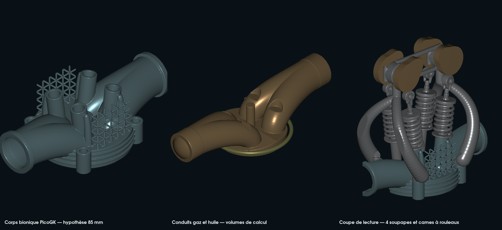
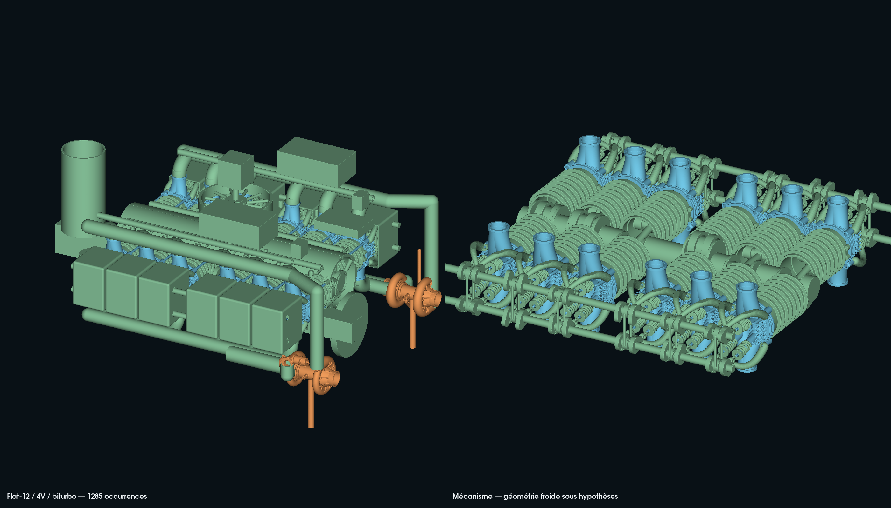

# Bionic 4V cylinder head and flat-12 valvetrain

This variant continues the [modern 917 4V/biturbo assembly](../assembly/README.md)
with a parametric cylinder head adapted to the documentary bore of 85 mm.
The four valves have a face, a 45° seat face, a tulip, a stem and collet
grooves. The seats, guides, ports, valvetrain supports and fasteners are
generated around their axes. The drawing comes from the repository's code,
with no extraction or publication of the private scan.



Left: body and bionic network. Centre: gas and oil domains.
Right: reading section and valve train. Reading colours; no material is
qualified. The render uses the complete triangles, with opaque surfaces and
no point sampling.



The assembly contains **137 definitions and 1,285 instances**. The
rectangular blocks represent bought-in units whose interfaces remain to be
defined; the mechanism view hides them to examine the generated parts.

## Numerical results of 12 October

The [execution record](execution-20261012.json) links the sources, images,
checks and private exports by SHA-256. The 53 cylinder head and check exports
pass the audit at the 1 and 0.5 mm grids; the eleven native derivatives of
the assembly pass as well. The network with 2 mm struts is retained among the
three closed variants.

| Geometric measure under hypotheses | Result |
|---|---:|
| Cylinder head volume, 0.5 mm grid | 200,107.83 mm³ |
| Reference with solid zones | 233,538.19 mm³ |
| Material volume reduction | **14.31 %** |
| Steel-equivalent moving mass | 100.35 g, research ceiling 110 g |
| Estimated geometric compression ratio | 8.17:1 |

The poses examined give zero volumetric overlap valve–piston,
valve–cylinder and valve–cylinder head. The two planar port mouths examined
also give zero volumetric overlap with the cylinder head. **456 contact cases**
over the twelve cylinder phases check the bearing carrier, cams, bearing caps,
rollers, forks, spring caps, springs and fasteners.
They constitute neither a continuous sweep nor a global check of the engine.

The rejected versions keep their witnesses: port plugs, non-manifold
fragments/edges, unclosed conforming domain, pocket floor touching the stems,
and supports touching spring caps, rollers and fasteners.
The corrections are made at generation. The native gas domain keeps a small
overlap of triangulated skin with the body; the CFD domain remains
unqualified despite the eroded witness without intersection.

The targeted tests check the searches, the cycle, the cam profiles, the
clearance bound and the closure of the qualification gates. On the Mac,
`make check` hits the two known floating-point comparisons of the unchanged
993 impeller/stator dossiers. The GitHub Linux validation is reported
separately in the PR; no CI result is inferred from the local checks.

## Optimisations actually computed

| Bounded search | Objective | Constraints and retained result |
|---|---|---|
| 625 4V layouts | Maximise the total face area | Valves 31/29 mm, half spacing 18.25 mm, rows at ±17.75 mm; seat ligament 2.5 mm and conservative radial margin 1.54 mm |
| 540 law/preload configurations | Maximise the curtain area integral, then reduce spring stress | Lifts 9.5/10 mm, main duration 240° crankshaft, centres 120°/600°, preload 550 N; hypothetical scenario 8,000 rpm, 2 bar adverse, moving mass capped at 0.11 kg |
| Three BCC lattice diameters | Minimise the geometric volume among the accepted meshes | 10 mm lattice cell, struts 2/2.5/3 mm; comparison with the same zones filled as solid volume |
| Profiles of the four camshafts | Build the envelope of an 8 mm radius roller | Offset along the normal of the roller centre curve; ideal pressure angle below 27°, minimum positive radius of curvature above 18.8 mm |

The valvetrain uses the repository's existing C² law. The 720° cycle assigns
twelve combustion TDCs separated by 60°, consistent with the crankpin phasing
of the assembly. This order is **a new hypothesis**, not Porsche's historical
firing order. The cam profile uses the cam lift before clearance; the valves
and springs use the lift after clearance. The springs are regenerated at the
height of each pose, without squashing or dilating the wire diameter.

The material optimisation is a comparison of volumes. The Bézier branches and
the BCC lattice reuse `Sdf.Bezier`, `Sdf.LatticeIn` and `Lattice.AddBeam`,
already in the repository and executed by PicoGK.
This work does not run a stress-based optimisation, FEA or CFD.
It claims no use of Noyron. The public
[LEAP 71 LatticeLibrary](https://github.com/leap71/LEAP71_LatticeLibrary)
remains a method reference; no additional dependency is imported.

## Interfaces and limits of the calculation

The proposed gasket is 1.25 mm thick. The cylinder head plane is at 211.25 mm
from the crankshaft axis; the proposed axial piston–cylinder head plane
clearance at TDC is 3.25 mm. The D8/L169 studs, unthreaded nuts, case bosses,
locating dowels and separate bearings are **design coordinates**.
Tolerances, threads, tightening, loads and measurements remain unknown.
The proposed contacts do not constitute a validated fastening dossier.
The [open interface contract](interface-contract.json) keeps the missing
measurements, loads and reviews separately; the geometric outputs do not fill
them and authorise no manufacturing.

The continuous bound of the rigid piston/plane/valve model includes an
analytical upper bound on the variation between samples of 0.25°. It exceeds
4.42/4.56 mm while keeping a more unfavourable base clearance of 2 mm. It
covers neither deformation, expansion, bounce, loss of follow, tolerances nor
real timing. The quasi-static margin of the springs is sampled; their computed
shear stress reaches about 1,149 MPa under the retained hypotheses.
Without grade and hot fatigue data, these springs are not qualified.
The helices shown remain coil representations: closed/ground ends, real
number of active coils and force–travel curve must be defined and verified on
the spring retained.

The independent mesh check keeps all non-degenerate vertices and triangles.
Only triangles whose cross product is exactly zero are removed, with a
witness. An unclosed mesh, an isolated component or a non-manifold edge leads
to rejection; no further repair is admitted. The rejected trials are kept in
`work/`.

The gas and solid domains derived from independent fields may overlap on
their triangulated skin. The conforming-domain trial by Boolean subtraction
is rejected: its output is not closed. A gas domain reduced by 0.5 mm by
native erosion serves only as a **declared separation witness**. It is not
the physical passage and does not correct the body. The conforming CFD domain
remains to be built; no physical sealing test is carried out.
The intersections use Manifold on floating-point triangles; this is neither
metrology nor an exact BRep calculation.

The two turbos and their 39 prototypes each are preserved by SHA-256.
Their flow/pressure/speed suitability and their strength remain open.
The new manifolds follow the cylinder head outlets. The engine keeps gear
blanks and bought-in unit envelopes; its valvetrain drive, its complete
circuits and its manufacturing bill of materials are not finished. The global
check of all interferences remains open.

## Materials and manufacturing: leads to qualify

| Family | Process lead | Evidence required before a real choice |
|---|---|---|
| Cylinder head body, cases, cold manifolds | Compare casting/machining and aluminium LPBF; AlSi10Mg or AlF357 as candidates | Temperatures, thermomechanical fatigue, conductivity, porosity, treatment, machining allowances, seats/guides, CT/CMM and pressure tests |
| Hot manifolds and turbine housing | Study a nickel alloy with a supplier process | Local temperature, oxidation, fatigue, creep, weldability, treatment and test specimens of the exact process |
| Valves, springs, collets, guides and seats | Specialised parts with machining/grinding and suitable treatments | Supplier grade, hot clearance, contact, fatigue and tribological compatibility |
| Crankshaft, connecting rods, shafts and gears | Compare forging/machining with additive solutions | Loads, balancing, hardening, grinding, lubrication, gear teeth and fatigue tests |

[EOS aluminium](https://www.eos.info/metal-solutions/metal-materials/aluminium)
and [EOS IN718](https://www.eos.info/metal-solutions/metal-materials/data-sheets/mds-eos-nickelalloy-in718)
document available additive materials/processes; they qualify no part of this
engine. The real alloy and process selection remains `null`. The steel
equivalent used for the moving mass is a calculation hypothesis of
7,850 kg/m³, not a purchasing specification.

The next mechanical validation requires measurements of the axes, planes,
holes and supports, the target speed/boost and the loads. Then come the
professional review, the material/process chain, hot contacts and clearances,
thermal/structural/flow calculations and the instrumented test bench.
**No authorisation for functional manufacturing or engine start-up.**

## Local reproduction

The C# code is the editable geometric source; STL/VDB/GLB are derivatives,
with no STEP history. Python uses the numerical dependencies already used in
the repository's studies: NumPy, trimesh, SciPy, matplotlib and Manifold3D.
VTK is used only for rendering. PicoGK 2.3.0/Core 26.2 and .NET 9 execute the
volumes. The exports stay in a new ignored `work/` directory; the previous
files and the earlier evidence linked by hash are not modified.

```bash
"$PYTHON" models/917-engine-reconstruction/head-bionic/study.py \
  --previous /chemin/vers/livraison-4v-biturbo \
  --output work/917-bionic-head/nouvelle-execution --dotnet "$DOTNET"
"$PYTHON" models/917-engine-reconstruction/head-bionic/verify.py \
  work/917-bionic-head/nouvelle-execution --previous /chemin/vers/livraison-4v-biturbo
"$PYTHON" models/917-engine-reconstruction/head-bionic/render.py \
  work/917-bionic-head/nouvelle-execution
python3 -m unittest discover -s tests -p test_917_bionic_head.py -v
```

The outputs contain the detail of each candidate, the native receipts, the
independent audits, the contacts examined, the cam profiles, the parts, the
assembly matrices and the GLB checked by reopening. The published results
describe only the scope of these numerical checks.
