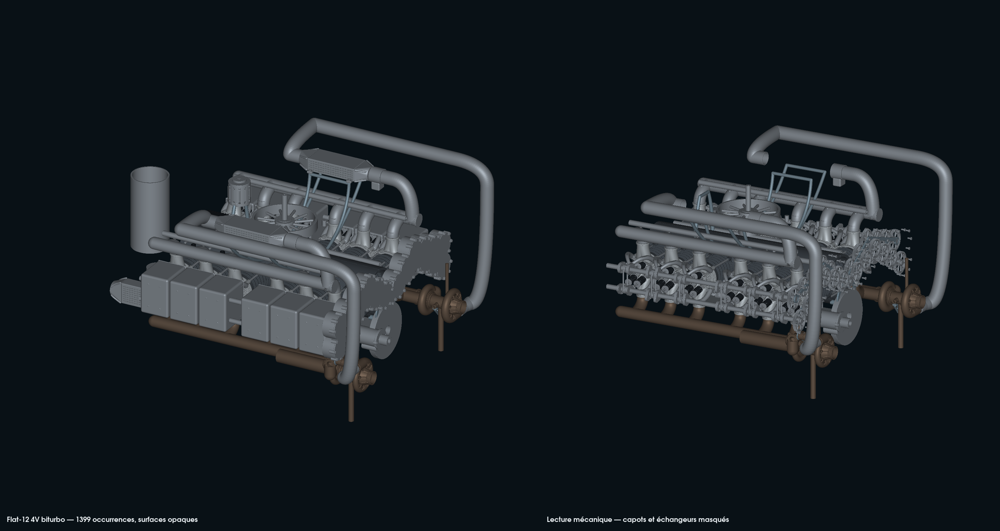
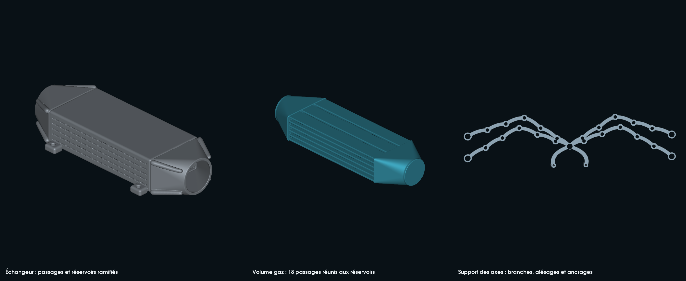

# Reconstruction mécanique détaillée du flat-12 4V biturbo

Cette étape répond au problème des accessoires cubiques et de la distribution
ouverte dans la [version précédente](../cam-drive/README.md), mergée avec la
PR #165. Elle modifie la géométrie des pièces et leur implantation.
Les sources de toutes les étapes antérieures restent conservées.

## Pièces effectivement reconstruites dans PicoGK

- **Échangeurs** : corps à passages traversants, circulation de gaz suivant X,
  passages d'air transversaux et réservoirs profilés. Le réservoir reçoit des
  nervures courbes projetées sur sa peau extérieure, puis son volume de gaz
  est retranché du solide. Les conduits internes sont modélisés ; aucune
  performance thermique ou perte de charge n'est calculée.
- **Suralimentation** : les deux sorties candidates des turbos rejoignent les
  échangeurs. Les retours passent par les papillons et rejoignent les collecteurs
  des culasses. Les trajets contournent le carter de distribution ; les anciens
  tronçons qui reliaient directement les turbos aux collecteurs sont supprimés.
  Les sorties suivent l'axe tangentiel réel de la géométrie F0. Le conduit
  commence par un manchon de rayon extérieur 18 mm et intérieur 15,5 mm,
  au plan axial candidat Y = 52,25 mm du compresseur, puis s'élargit vers
  22,5 mm. Ce choix évite la volute voisine de la lèvre arrondie ; il exige
  encore un joint et des interfaces mesurées.
  Deux bouchons ferment les anciens bouts de collecteur après découpe ; des
  sondes volumiques contrôlent ces bouchons et le passage des retours.
- **Distribution** : carter ajusté aux enveloppes des roues, dégagement du
  carter moteur, plaque arrière, support ramifié des axes, couvercle démontable,
  vis à tête hexagonale et nouveaux volumes d'axes. Les alésages reprennent les
  axes de la géométrie candidate ; ils ne sont pas des mesures Porsche.
- **Accessoires** : alternateur ventilé avec poulie, démarreur cylindrique à nez
  et solénoïde, boîtier de commande à ailettes et papillons à conduit traversant.
  Ces représentations restent des candidats d'encombrement de dispositifs
  électriques achetés ; leurs rotors, bobinages et électroniques ne sont pas conçus.
- **Lubrification** : sept corps de pompe lobés et leurs couvercles percés,
  réserve d'engrenages et raccords. Les anciennes roues de pompe restent des
  ébauches sans denture : ce circuit n'est pas une pompe fonctionnelle qualifiée.
- **Habillage et supports** : couvre-culasses creux arrondis, nervures, semelle
  inférieure nervurée, supports bioniques des échangeurs et de l'alternateur.

Les branches utilisent les fonctions existantes `Sdf.Bezier`, les poutres
natives `Lattice.AddBeam`, les champs implicites et les booléens PicoGK.
Le [programme C#](Program.cs) est éditable ; [run.py](run.py) assemble les
pièces, réutilise le générateur CSG du dépôt et vérifie les fichiers hérités
par SHA-256. La bionique est une géométrie construite dans le noyau.

## Contrôles et versions rejetées

Les solides sont générés à **1 et 0,5 mm**. Chaque sortie doit avoir un volume
positif, des coordonnées finies, une frontière fermée et orientée et une seule
composante. L'audit ne retire que les faces exactement nulles, sans déplacement
de sommet. Les trois premiers essais sont conservés dans les diagnostics :
ils ont été rejetés pour des petites cavités isolées dans les réservoirs,
des surfaces dégénérées du couvre-culasse et d’un corps de pompe, des parois
de carter séparées et une jonction de vis seulement tangente. Les jonctions et réserves ont été
corrigées dans les sources.
Le septième essai conserve aussi le rejet des deux raccords de turbo : leur
premier axe était erroné et causait un recouvrement de 498 mm³ par banc.
L'essai suivant corrige l'axe et ajoute le manchon de transition ; les turbos
hérités restent inchangés.
Le huitième essai a ensuite révélé un recouvrement de 2 941 mm³ entre des
bossages du carter et l'enveloppe de rotation de la distribution d'échappement.
La correction retranche des réserves natives de tous les pignons après les
bossages, à 1 et 0,5 mm, avant de refaire les contrôles froids. L'essai neuf
reprend les autres solides acceptés et régénère les deux collecteurs bouchonnés.
Les deux corrections qui réimportaient le carter STL ont échoué à la fermeture
du maillage. [Housing.cs](Housing.cs) reprend donc le champ VDB natif, retranche
les réserves de rotation et exporte un nouveau solide, sans réparation de faces.
Deux premiers bouchons ont aussi été rejetés : non-manifold pour le premier,
puis deux cavités fermées d'environ 0,0000014 mm³ près de la jonction. Le
bouchon final recouvre la jonction de X = 370,13 à 377,13 mm ; le passage de
retour est retranché après cette union. Les deux collecteurs finaux passent
la fermeture, l'orientation et l'exigence d'une seule composante de surface.
Le premier manchon orienté correctement recouvrait encore la volute de
229 mm³ par banc. L'essai dix reprend les autres pièces et réduit et décale
son entrée. Les contrôles des deux manchons et des raccords sont refaits ;
les contrôles inchangés sont repris après vérification des hashes de tous
les autres prototypes et des poses. Le reçu distingue ces deux catégories.

Le [contrôle indépendant](verify.py) compare les enveloppes de rotation complètes
des cames et des roues avec les corps fixes, les conduits avec le carter de
distribution et les mécanismes froids avec le nouveau couvre-culasse.
Les enveloppes de rotation sont des disques conservateurs, pas un calcul de
contact entre dents. Le transport en GLB conserve les triangles et les poses. Les raccordements
papillon/collecteur, échangeur/conduit et turbo/conduit ont aussi un contrôle
de recouvrement froid ; ce contrôle ne qualifie pas les joints ni l’étanchéité.

Le [témoin dense de support](frame_control.py) conserve les ancrages et alésages
nominaux pour une comparaison de volume de matière. Ce contrôle ne prouve ni
raideur, ni tenue des supports, ni comportement des roulements, ni fatigue.
Le volume du support ramifié est inférieur de **74,76 %** au témoin dense
construit aux mêmes alésages et ancrages nominaux.

Les canaux de pression et d'air ont une séparation analytique nominale minimale
de **1,75 mm** dans les corps des échangeurs. La paroi nominale des réservoirs
varie de **2,5 à 4 mm**. Ce sont des paramètres de conception, sans tolérance
ni résistance approuvée ; leur convergence métrologique et leur pression
d'épreuve restent ouvertes. Aucun domaine CFD conforme n'est qualifié.

## Réalisme, provenance et limites

Porsche décrit le moteur historique à cylindres horizontaux et sa configuration
à 180° dans sa [notice de 2009](https://www.porsche.com/usa/aboutporsche/pressreleases/pag/?id=2009-03-09&pool=international-de),
et l'évolution turbo dans [son dossier historique](https://newsroom.porsche.com/en/2024/history/porsche-turbo-technology-engine-construction-vision-christophorus-411-36786.html).
Ces sources orientent l'architecture générale ; elles ne fournissent ni les
interfaces ni les cotes de cette variante moderne quatre soupapes.
Aucun modèle ni photographie de ces pages n'est importé.

Les [interfaces physiques](interface-contract.json), matériaux, procédés,
traitements, roulements, retenues, fixations, hydraulique, calculs thermiques,
charges dynamiques et essais restent ouverts. Les ancrages touchant le carter
sont des propositions, à mesurer et revoir avant fabrication. Le contrôle
d'interférences complet du moteur, des organes mobiles sur tout le cycle et de
l'implantation véhicule n'est pas réalisé. Les couleurs des aperçus facilitent
la lecture ; elles ne certifient aucun alliage.
Les grandes boucles de suralimentation et plusieurs ancrages restent des
études d'implantation. Leur encombrement doit encore être affiné avec les
interfaces mesurées et les contraintes du véhicule.
Le [dossier matériaux et qualification LPBF existant](../../../twins/reference-917-engine/material-lpbf-qualification-f49.json)
reste la base de sélection des éprouvettes. Il n'attribue pas automatiquement
un alliage ou un procédé approuvé aux pièces de cette nouvelle étape.

**Cette étude n'autorise ni fabrication d'un moteur fonctionnel ni démarrage.**

## Reproduction

```sh
PYTHONPATH=work/917-head-clearance-20261012/runtime \
work/917-picogk-20261010/qa-venv/bin/python \
models/917-engine-reconstruction/mechanical-detail/run.py \
  --previous /chemin/vers/la/livraison/917-cam-drive-20261012 \
  --output work/917-mechanical-new-run \
  --dotnet /chemin/vers/dotnet

PYTHONPATH=work/917-head-clearance-20261012/runtime \
work/917-picogk-20261010/qa-venv/bin/python \
models/917-engine-reconstruction/mechanical-detail/check_connections.py \
  work/917-mechanical-new-run

PYTHONPATH=work/917-head-clearance-20261012/runtime \
work/917-picogk-20261010/qa-venv/bin/python \
models/917-engine-reconstruction/mechanical-detail/frame_control.py \
  work/917-mechanical-new-run /chemin/vers/dotnet
```

Pour retoucher les conduits sans régénérer les corps déjà contrôlés, l’option
`--native-from /chemin/vers/le/run-native-validé` vérifie les sources C#,
la configuration, les hashes STL/VDB et l’identité des faces orientées avec le
témoin indépendant. Elle refuse une sortie rejetée ou modifiée. Les conduits
et les branches sont construits par groupes de poutres `Lattice` dans
[Route.cs](Route.cs), avec une seule soustraction de la lumière interne.
La découpe du collecteur utilise ses bornes réelles pour limiter le travail
voxel ; les anciennes sources et leurs hashes restent traçables.

Les maillages privés, VDB et fichiers d'exécution restent dans `work/`.
Les répertoires `housing-clearance-vdb-1` et `housing-clearance-vdb-0.5` contiennent
les carters corrigés ; les corps initiaux de `native-*` restent des témoins
intermédiaires conservés, et l'assemblage utilise le carter corrigé à 0,5 mm.
Le dépôt contient les sources, le [reçu d'exécution](execution-20261012.json)
et les aperçus issus des triangles réels, sans nuages de points.




