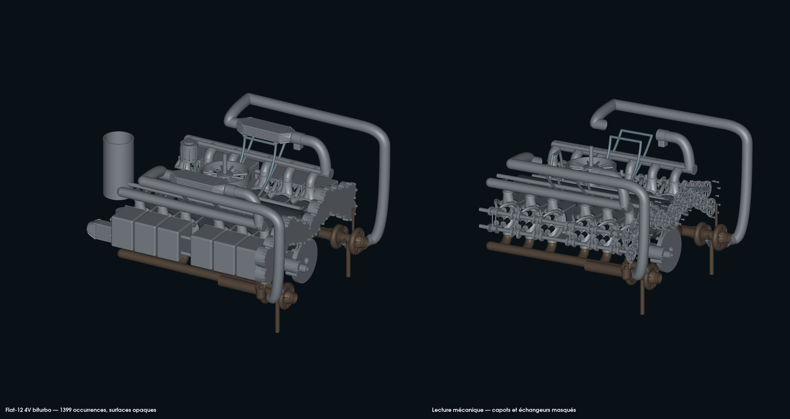
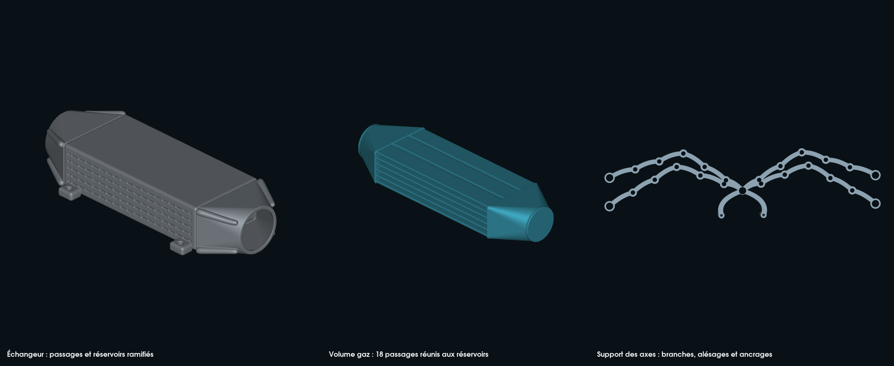

# Detailed mechanical reconstruction of the twin-turbo 4V flat-12

This step addresses the problem of the cubic accessories and the open
valve train in the [previous version](../cam-drive/README.md), merged with
PR #165. It modifies the geometry of the parts and their layout.
The sources of all earlier steps remain preserved.

## Parts actually reconstructed in PicoGK

- **Heat exchangers**: bodies with through passages, gas flow along X,
  transverse air passages and profiled tanks. The tank receives curved
  ribs projected onto its outer skin, then its gas volume
  is subtracted from the solid. The internal ducts are modelled; no
  thermal performance or pressure drop is calculated.
- **Forced induction**: the two candidate turbo outlets join the
  heat exchangers. The returns pass through the throttles and join the cylinder-head
  manifolds. The routes go around the timing case; the old
  sections that connected the turbos directly to the manifolds are removed.
  The outlets follow the real tangential axis of the F0 geometry. The duct
  starts with a sleeve of outer radius 18 mm and inner radius 15.5 mm,
  at the candidate axial plane Y = 52.25 mm of the compressor, then widens to
  22.5 mm. This choice avoids the volute next to the rounded lip; it still
  requires a seal and measured interfaces.
  Two plugs close the old manifold ends after cutting; volumetric
  probes check these plugs and the passage of the returns.
- **Valve train**: case fitted to the wheel envelopes, clearance from the
  engine case, rear plate, branched shaft support, removable cover,
  hexagon-head screws and new shaft volumes. The bores follow the
  axes of the candidate geometry; they are not Porsche measurements.
- **Accessories**: ventilated alternator with pulley, cylindrical starter with nose
  and solenoid, finned control unit and throttles with through duct.
  These representations remain packaging candidates for bought-in electrical
  devices; their rotors, windings and electronics are not designed.
- **Lubrication**: seven lobed pump bodies and their drilled covers,
  gear clearance pockets and fittings. The old pump wheels remain
  blanks without teeth: this circuit is not a qualified functional pump.
- **Covers and supports**: rounded hollow valve covers, ribs, ribbed lower
  sole plate, bionic supports for the heat exchangers and the alternator.

The branches use the existing `Sdf.Bezier` functions, the native
`Lattice.AddBeam` beams, implicit fields and PicoGK Booleans.
The [C# program](Program.cs) is editable; [run.py](run.py) assembles the
parts, reuses the repository's CSG generator and verifies the inherited files
by SHA-256. The bionics are geometry built in the kernel.

## Checks and rejected versions

The solids are generated at **1 and 0.5 mm**. Each output must have a positive
volume, finite coordinates, a closed and oriented boundary and a single
component. The audit removes only exactly-zero faces, without moving
any vertex. The first three trials are kept in the diagnostics:
they were rejected for small isolated cavities in the tanks,
degenerate surfaces of the valve cover and of a pump body, separated case
walls and a screw junction that was only tangent. The junctions and clearance pockets were
corrected in the sources.
The seventh trial also keeps the rejection of the two turbo connections: their
first axis was wrong and caused an overlap of 498 mm³ per bank.
The next trial corrects the axis and adds the transition sleeve; the inherited
turbos remain unchanged.
The eighth trial then revealed an overlap of 2,941 mm³ between
case bosses and the rotation envelope of the exhaust valve train.
The correction subtracts native clearance pockets for all the sprockets after the
bosses, at 1 and 0.5 mm, before redoing the cold checks. Trial nine
reuses the other accepted solids and regenerates the two plugged manifolds.
The two corrections that reimported the STL case failed at mesh
closure. [Housing.cs](Housing.cs) therefore reuses the native VDB field, subtracts
the rotation clearances and exports a new solid, without face repair.
Two first plugs were also rejected: non-manifold for the first,
then two closed cavities of about 0.0000014 mm³ near the junction. The
final plug covers the junction from X = 370.13 to 377.13 mm; the return
passage is subtracted after this union. The two final manifolds pass
closure, orientation and the requirement of a single surface component.
The first correctly oriented sleeve still overlapped the volute by
229 mm³ per bank. Trial ten reuses the other parts and reduces and shifts
its inlet. The checks of the two sleeves and of the connections are redone;
the unchanged checks are reused after verification of the hashes of all
the other prototypes and poses. The receipt distinguishes these two categories.

The [independent check](verify.py) compares the complete rotation envelopes
of the cams and wheels with the fixed bodies, the ducts with the timing
case and the cold mechanisms with the new valve cover.
The rotation envelopes are conservative discs, not a tooth contact
calculation. Transport to GLB preserves the triangles and poses. The
throttle/manifold, heat exchanger/duct and turbo/duct connections also have a cold
overlap check; this check does not qualify the seals or the sealing.

The [dense support witness](frame_control.py) keeps the nominal anchors and bores
for a comparison of material volume. This check proves neither
stiffness, nor strength of the supports, nor bearing behaviour, nor fatigue.
The volume of the branched support is **74.76 %** lower than the dense witness
built with the same nominal bores and anchors.

The pressure and air channels have a minimum nominal analytical separation
of **1.75 mm** in the heat-exchanger bodies. The nominal tank wall
varies from **2.5 to 4 mm**. These are design parameters, without approved tolerance
or strength; their metrological convergence and their proof
pressure remain open. No compliant CFD domain is qualified.

## Realism, provenance and limits

Porsche describes the historical engine with horizontal cylinders and its 180°
configuration in its [2009 release](https://www.porsche.com/usa/aboutporsche/pressreleases/pag/?id=2009-03-09&pool=international-de),
and the turbo evolution in [its historical dossier](https://newsroom.porsche.com/en/2024/history/porsche-turbo-technology-engine-construction-vision-christophorus-411-36786.html).
These sources guide the general architecture; they provide neither the
interfaces nor the dimensions of this modern four-valve variant.
No model or photograph from these pages is imported.

The [physical interfaces](interface-contract.json), materials, processes,
treatments, bearings, retainers, fasteners, hydraulics, thermal calculations,
dynamic loads and tests remain open. The anchors touching the case
are proposals, to be measured and reviewed before manufacture. The complete
interference check of the engine, of the moving parts over the whole cycle and of the
vehicle layout has not been carried out. The colours of the previews aid
reading; they certify no alloy.
The large forced-induction loops and several anchors remain
layout studies. Their packaging must still be refined with the
measured interfaces and the vehicle constraints.
The [existing materials and LPBF qualification dossier](../../../twins/reference-917-engine/material-lpbf-qualification-f49.json)
remains the basis for selecting test specimens. It does not automatically assign
an approved alloy or process to the parts of this new step.

**This study authorises neither the manufacture of a functional engine nor starting it.**

## Reproduction

```sh
PYTHONPATH=work/917-head-clearance-20261012/runtime \
work/917-picogk-20261010/qa-venv/bin/python \
models/917-engine-reconstruction/mechanical-detail/run.py \
  --previous /chemin/vers/la/livraison/917-cam-drive-20261012 \
  --output work/917-mechanical-new-run \
  --dotnet /chemin/vers/dotnet

PYTHONPATH=work/917-head-clearance-20261012/runtime \
work/917-picogk-20261010/qa-venv/bin/python \
models/917-engine-reconstruction/mechanical-detail/check_connections.py \
  work/917-mechanical-new-run

PYTHONPATH=work/917-head-clearance-20261012/runtime \
work/917-picogk-20261010/qa-venv/bin/python \
models/917-engine-reconstruction/mechanical-detail/frame_control.py \
  work/917-mechanical-new-run /chemin/vers/dotnet
```

To rework the ducts without regenerating the already checked bodies, the option
`--native-from /chemin/vers/le/run-native-validé` verifies the C# sources,
the configuration, the STL/VDB hashes and the identity of the oriented faces with the
independent witness. It refuses a rejected or modified output. The ducts
and branches are built by groups of `Lattice` beams in
[Route.cs](Route.cs), with a single subtraction of the internal bore.
The manifold cut uses its real bounds to limit the voxel
work; the old sources and their hashes remain traceable.

The private meshes, VDB and run files remain in `work/`.
The directories `housing-clearance-vdb-1` and `housing-clearance-vdb-0.5` contain
the corrected cases; the initial bodies of `native-*` remain preserved intermediate
witnesses, and the assembly uses the corrected 0.5 mm case.
The repository contains the sources, the [run receipt](execution-20261012.json)
and the previews taken from the real triangles, without point clouds.




