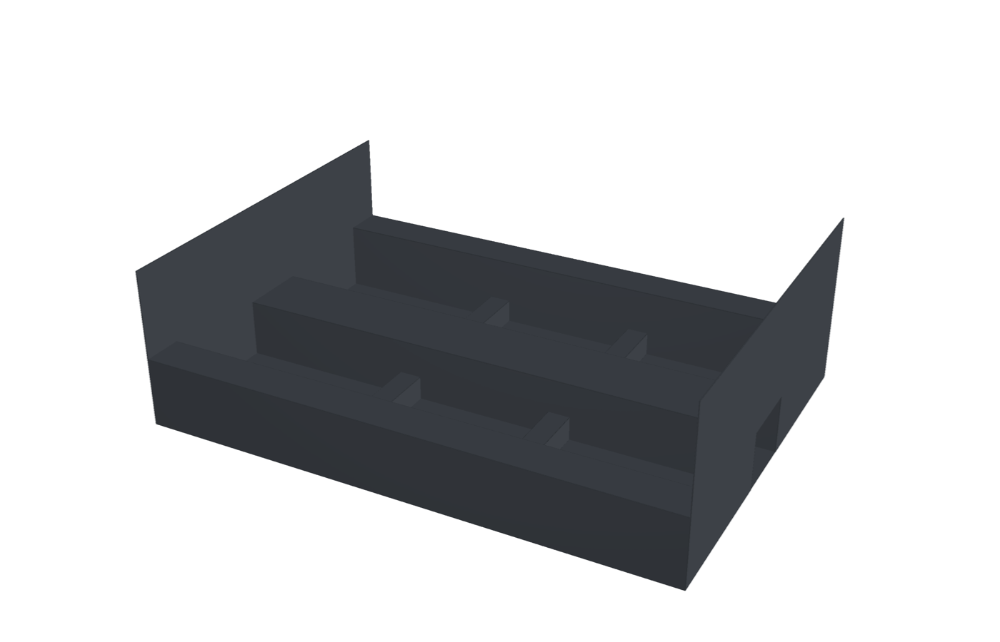
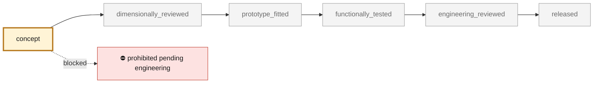
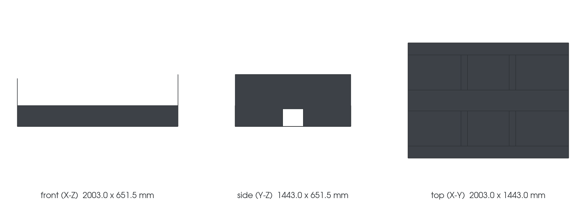

<!-- generated by scripts/render_part_pages.py - do not edit by hand -->

# 964 central carbon cell, F1 assumption-only study

**`964-CENTRAL-CELL-ASSUMED-F1`** · Porsche 964 · 1989–1994

  

> [!CAUTION]
> **Not ready to print, and not a copy of the original part.** The model shown here is a
> concept block for studying the part in software:
> - validation status `concept`: nothing has been checked against a real part;
> - geometry `estimated`: its dimensions are estimated design variables, not measured on the original part;
> - safety class `prohibited_pending_engineering`;
> - no part in this repository is released — read [SAFETY.md](../../docs/SAFETY.md).

<table><tr>
<td width="50%" valign="top">
<b>Original part</b>  
The original part is documented — pictures, catalogue entries or published data — on these pages. They are copyrighted, so they are linked here, not copied:  
↗ <a href="https://github.com/cluster2600/porscheparts/tree/main/twins/964-chassis/assumed-cell-20261106">Owner-authorized assumption-only central-cell study</a> 
</td>
<td width="50%" valign="top" align="center">
<b>This repository's concept model</b>  
 
Concept CAD block, 2003.0 × 1443.0 × 651.5 mm — <b>not</b> the original part, not a print file, not evidence of fit.
</td>
</tr></table>

> [!CAUTION]
> **Prohibited pending engineering** — risk, or insufficient data. Never published as a released part.

## What it is

Editable clean-sheet central-tub concept with floor regions, sills, a driveline service tunnel, bulkheads and seat-crossmember load paths. Geometry, interfaces, material properties and loads are declared design hypotheses; this is not a reconstruction of the donor or a copy of a commercial monocoque.

## What it does on the car

Hypothesis-only architecture, editable geometry and conditional torsion/bending studies; no vehicle fitment, manufacture or road/track release

## At a glance

| | |
|---|---|
| Porsche part numbers | not recorded |
| variants | `Carrera_2_study_scope_only` |
| candidate material | undecided |
| candidate process | undecided |
| safety class | `prohibited_pending_engineering` |
| validation status | `concept` |
| geometry | estimated, master PicoGK |

## Where it stands

*Validation ladder of `catalog/schemas/part.schema.json`; this record is at `concept`.*

## Views

*Orthographic views of the same concept CAD, with its bounding dimensions — not drawings of the original part.*

## What's in this folder

| folder | what it holds | files |
|---|---|---|
| `derived/` | CAD exports generated from the source (STEP for CAD tools, STL for meshing) | [`derived/assumed-cell.step`](derived/assumed-cell.step) |
| `media/` | concept-model views rendered from the CAD by `scripts/render_part_previews.py` — not pictures of the original | [`media/preview.json`](media/preview.json), [`media/preview.png`](media/preview.png), [`media/views.png`](media/views.png) |

## Read more

- **Full description page**, with sources and evidence: [docs/pieces/964-central-cell-assumed-f1.md](../../docs/pieces/964-central-cell-assumed-f1.md)
- **Catalogue record** (source of truth): [`catalog/parts/964-central-cell-assumed-f1.json`](../../catalog/parts/964-central-cell-assumed-f1.json)
- **Safety rules**: [SAFETY.md](../../docs/SAFETY.md)

---

*This page is generated from the catalogue record by `scripts/render_part_pages.py` and checked by `make check`. Edit the record, not this page.*
