<!-- generated by scripts/render_part_pages.py - do not edit by hand -->

# 993 Turbo charge-air tract transcribed parts (group 107-45) - PET-transcribed identity set

**`993-CA-CHARGE-PIPE-SET-PET-0001`** · Porsche 993 · 1995–1998

  

> [!CAUTION]
> **Not ready to print, and not a copy of the original part.** The model shown here is a
> concept block for studying the part in software:
> - validation status `concept`: nothing has been checked against a real part;
> - geometry `estimated`: its dimensions are estimated design variables, not measured on the original part;
> - safety class `non_critical`;
> - no part in this repository is released — read [SAFETY.md](../../SAFETY.md).

<table><tr>
<td width="50%" valign="top">
<b>Original part</b>  
The original part is documented — pictures, catalogue entries or published data — on these pages. They are copyrighted, so they are linked here, not copied:  
↗ <a href="https://porschefanatics.com/oem/993/107-45/">Porsche Fanatics local dataset - data/oem-listed.json, PET illustration 107-45 lines (993)</a> 
↗ <a href="https://www.porsche.at/media/Kwc_Basic_DownloadTag_Component/4740-45397-124814-downloadTag/default/f5000535/1729608718/kat017-d-911-98-katalog.pdf">Porsche Austria PET - groupe 107-45 echangeur d'air 993 (KAT 17 official read)</a> 
</td>
<td width="50%" valign="top" align="center">
<b>Catalogue study status</b>  
 
No CAD geometry to show. This is a status card, <b>not</b> a part rendering or a print file.
</td>
</tr></table>

> [!NOTE]
> **Non-critical** — trim, or a part whose failure creates no immediate hazard. Published only after dimensional and fit validation.

## What it is

Identity-only catalogue record grouping the charge-air (group 107-45, 'charge air cooler') line items transcribed per-line from the local PET transcriptions and relevant to the M64 charge-air subsystem: charge air cooler 993 110 330 53 (pos 1), air guide 993 110 340 53 and 993 110 340 54 (pos 2), bracket 993 110 110 50 and 993 110 110 52 (pos 5), sleeve 993 110 111 50 (pos 10), temperature sensor 993 606 114 00 (pos 12), pressure hoses 993 110 633 56 and 993 110 632 56 (pos 19), with their clamps 999 512 648 02 and 999 512 647 02 (pos 20/21). Both independent catalogue transcriptions (KAT 17 and Porsche Classic KAT 517 USA) agree on these positions and numbers. No dimensions, flow cross-sections, pressure ratings or geometry are claimed.

## What it does on the car

Identity anchor for the charge-air subsystem of the M64 digital twin; no manufacturing, fitment or engine use is authorized by this record

## At a glance

| | |
|---|---|
| Porsche part numbers | 99311033053, 99311034053, 99311034054, 99311011050, 99311011052, 99311011150, 99360611400, 99311063356, 99311063256 |
| variants | `993_Turbo` |
| candidate material | unknown per line item (hoses are rubber/composite assemblies per the PET description 'pressure hose') |
| candidate process | undecided |
| safety class | `non_critical` |
| validation status | `concept` |
| geometry | estimated, master none |

## Where it stands

```mermaid
flowchart LR
    L0["concept"]
    L1["dimensionally_reviewed"]
    L2["prototype_fitted"]
    L3["functionally_tested"]
    L4["engineering_reviewed"]
    L5["released"]
    L0 --> L1 --> L2 --> L3 --> L4 --> L5
    classDef here fill:#fff4d6,stroke:#b7791f,color:#1a1a1a,stroke-width:3px;
    classDef done fill:#e3f1e6,stroke:#2e7d32,color:#1a1a1a;
    classDef todo fill:#f4f4f4,stroke:#9e9e9e,color:#6b6b6b;
    classDef stop fill:#fde2e1,stroke:#c0392b,color:#1a1a1a;
    class L0 here
    class L1 todo
    class L2 todo
    class L3 todo
    class L4 todo
    class L5 todo
```

*Validation ladder of `catalog/schemas/part.schema.json`; this record is at `concept`.*

## What's in this folder

| folder | what it holds | files |
|---|---|---|
| `media/` | concept-model views rendered from the CAD by `scripts/render_part_previews.py` — not pictures of the original | [`media/preview.json`](media/preview.json), [`media/preview.png`](media/preview.png) |

## Read more

- **Full description page**, with sources and evidence: [docs/pieces/993-ca-charge-pipe-set-pet-0001.md](../../docs/pieces/993-ca-charge-pipe-set-pet-0001.md)
- **Catalogue record** (source of truth): [`catalog/parts/993-ca-charge-pipe-set-pet-0001.json`](../../catalog/parts/993-ca-charge-pipe-set-pet-0001.json)
- **Safety rules**: [SAFETY.md](../../SAFETY.md)

---

*This page is generated from the catalogue record by `scripts/render_part_pages.py` and checked by `make check`. Edit the record, not this page.*
