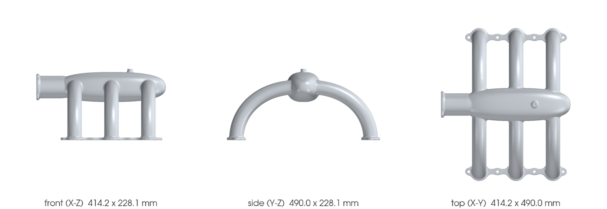

<!-- generated by scripts/render_part_pages.py - do not edit by hand -->

# 993 Turbo turbocharging intake tract (group 107-20) - PET-transcribed identity set

**`993-CA-TURBO-INTAKE-MANIFOLD-PET-0001`** · Porsche 993 · 1995–1998

  

> [!CAUTION]
> **Not ready to print, and not a copy of the original part.** The model shown here is a
> concept block for studying the part in software:
> - validation status `concept`: nothing has been checked against a real part;
> - geometry `estimated`: its dimensions are estimated design variables, not measured on the original part;
> - safety class `non_critical`;
> - no part in this repository is released — read [SAFETY.md](../../SAFETY.md).

<table><tr>
<td width="50%" valign="top">
<b>Original part</b>  
The original part is documented — pictures, catalogue entries or published data — on these pages. They are copyrighted, so they are linked here, not copied:  
↗ <a href="https://porschefanatics.com/oem/993/107-20/">Porsche Fanatics local dataset - data/oem-listed.json, PET illustration 107-20 lines (993)</a> 
↗ <a href="https://porschefanatics.com/oem/993/202-16/">Porsche Fanatics - releve PET des groupes turbo 993</a> 
</td>
<td width="50%" valign="top" align="center">
<b>This repository's concept model</b>  
 
Concept CAD block, 414.2 × 490.0 × 228.1 mm — <b>not</b> the original part, not a print file, not evidence of fit.
</td>
</tr></table>

> [!NOTE]
> **Non-critical** — trim, or a part whose failure creates no immediate hazard. Published only after dimensional and fit validation.

## What it is

Identity-only catalogue record for the charge-air side lines of PET group 107-20 ('turbocharging'): intake manifold 993 110 062 50 and 993 110 062 51 (pos 1), intake manifolds 993 110 631 54 (pos 18) and 993 110 630 52 / 993 110 630 53 (pos 21), shut-off valve 993 110 337 50 / -51 (pos 10), pressure transmitter 993 606 103 00 / -01 (pos 14), mass air flow meter 993 606 124 01 (pos 6), hoses 993 110 113 52 and 993 110 114 51 (pos 31/32), rubber sleeves and clamps. Transcribed per-line from the local PET transcriptions; the main engine-side numbers (pos 1, 18, 21) and the valve (pos 10) appear in both independent catalogue transcriptions (KAT 17 and Porsche Classic KAT 517 USA), the sensor revisions and hose lines likewise. No dimensions or geometry are claimed.

## What it does on the car

Identity anchor for the charge-air and intake subsystems of the M64 digital twin; no manufacturing, fitment or engine use is authorized by this record

## At a glance

| | |
|---|---|
| Porsche part numbers | 99311006250, 99311006251, 99311063154, 99311063052, 99311063053, 99311033750, 99311033751, 99360612401, 99360610300, 99360610301, 99311011352, 99311011451 |
| variants | `993_Turbo` |
| candidate material | unknown |
| candidate process | undecided |
| safety class | `non_critical` |
| validation status | `concept` |
| geometry | estimated, master PicoGK |

## Where it stands

*Validation ladder of `catalog/schemas/part.schema.json`; this record is at `concept`.*

## Views

*Orthographic views of the same concept CAD, with its bounding dimensions — not drawings of the original part.*

## Bionic gyroid-core model

*PicoGK variant ([`GyroidCore.cs`](../../parts/picogk-catalog/bionic/GyroidCore.cs)): no zone of this part holds three 13.5 mm gyroid cells inside its skin, so it stays solid (core only where three cells fit). Not a print file.*

## What's in this folder

| folder | what it holds | files |
|---|---|---|
| `derived/` | CAD exports generated from the source (STEP for CAD tools, STL for meshing) | [`derived/993-ca-turbo-intake-manifold-pet-0001-picogk-gyroid.json`](derived/993-ca-turbo-intake-manifold-pet-0001-picogk-gyroid.json), [`derived/993-ca-turbo-intake-manifold-pet-0001-picogk.json`](derived/993-ca-turbo-intake-manifold-pet-0001-picogk.json), [`derived/993-ca-turbo-intake-manifold-pet-0001-picogk.stl`](derived/993-ca-turbo-intake-manifold-pet-0001-picogk.stl) |
| `media/` | concept-model views rendered from the CAD by `scripts/render_part_previews.py` — not pictures of the original | [`media/gyroid.json`](media/gyroid.json), [`media/gyroid.png`](media/gyroid.png), [`media/preview.json`](media/preview.json), [`media/preview.png`](media/preview.png), [`media/views.png`](media/views.png) |
| `source/` | parametric source — the editable master that generates the geometry | [`source/gyroid.json`](source/gyroid.json), [`source/picogk.json`](source/picogk.json) |

## Read more

- **Full description page**, with sources and evidence: [docs/pieces/993-ca-turbo-intake-manifold-pet-0001.md](../../docs/pieces/993-ca-turbo-intake-manifold-pet-0001.md)
- **Catalogue record** (source of truth): [`catalog/parts/993-ca-turbo-intake-manifold-pet-0001.json`](../../catalog/parts/993-ca-turbo-intake-manifold-pet-0001.json)
- **Safety rules**: [SAFETY.md](../../SAFETY.md)

---

*This page is generated from the catalogue record by `scripts/render_part_pages.py` and checked by `make check`. Edit the record, not this page.*
