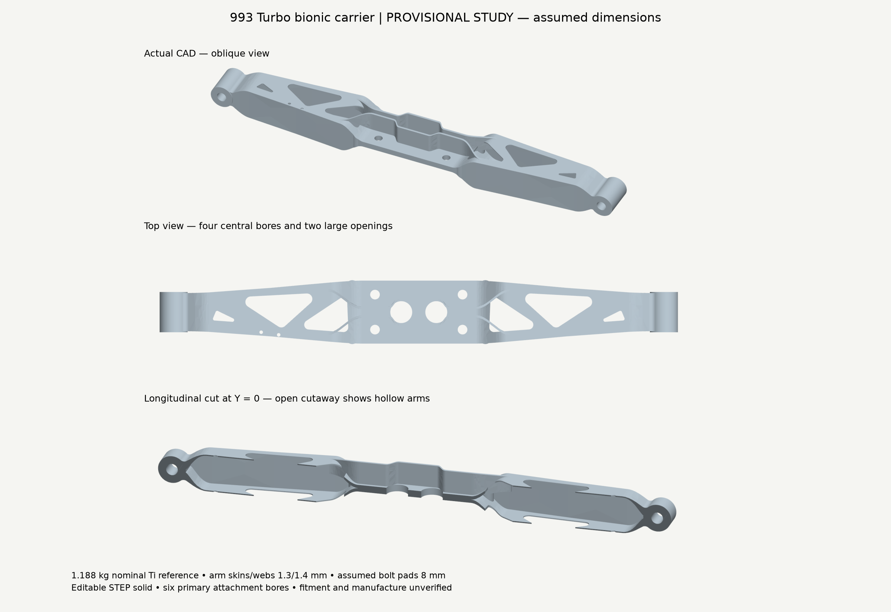
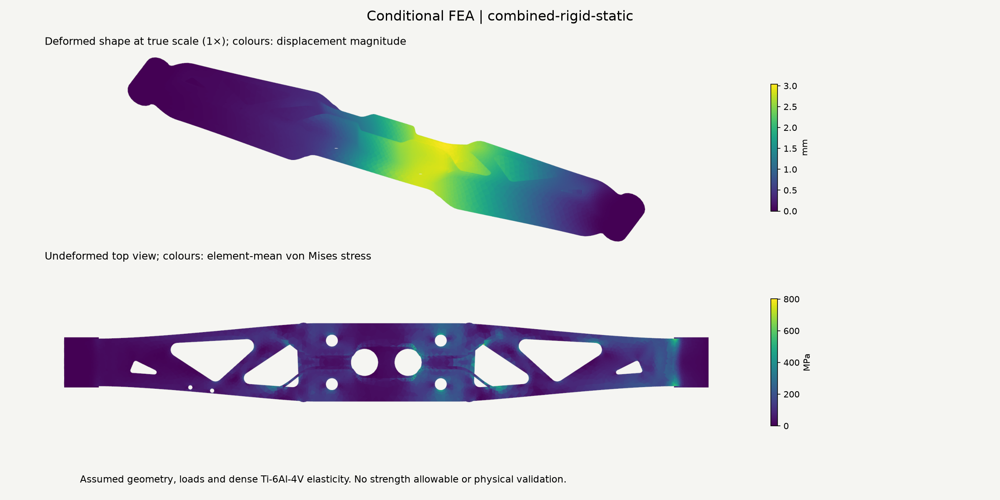
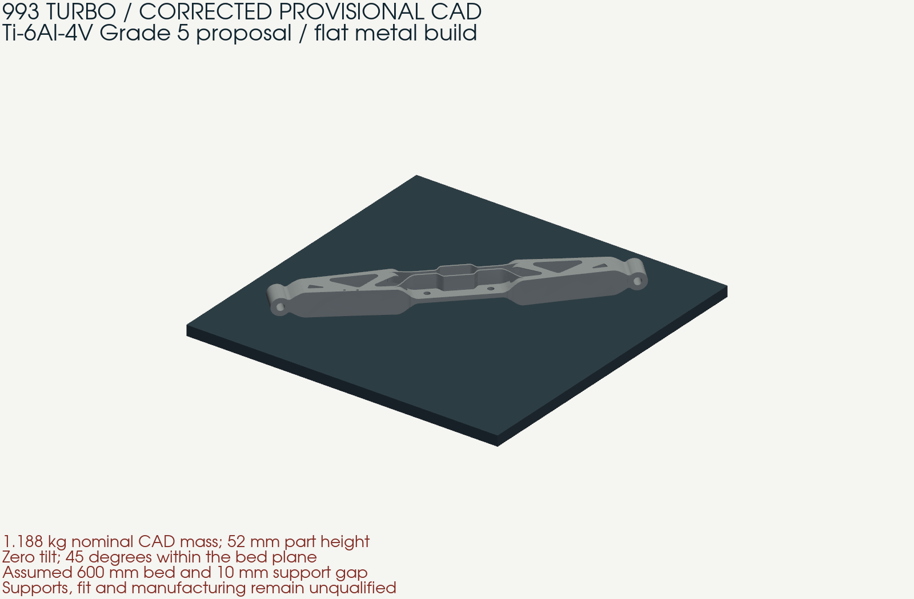

# Corrected provisional 993 Turbo carrier

13 October 2026. **V6f fixes the hypothetical assembly mismatch and meets the
1.2 kg nominal mass ceiling. Structural acceptance remains rejected.** This is
a continuation of the separate V5 study, not a revision of the historical R9
publication. Real Porsche mounting dimensions remain unknown.

The editable [STEP](../../../derived/correction-20261013/carrier.step),
[flat STEP](../../../derived/correction-20261013/carrier-flat.step),
[flat preview GLB](../../../derived/correction-20261013/carrier-flat.glb),
[selected parameters](selected-study.json) and [numerical receipts](results.json)
describe the same selected geometry. Raw solver files, intermediate failures
and the VDB remain in `work/carrier-correction-20261013/`; their
[inventory](raw-inventory.json) records file hashes and sizes.



## Corrections and independent inspection

The [frozen study contract](interface-study.json) pins the pre-existing F0 bracket
`99311510352` without modifying it. The required load path is engine → separate
bracket → four central attachments → carrier arms → two end mounts → body.
The bracket-to-engine interfaces and installed assembly transform are unmeasured.

- Central holes now use the F0 comparator's **100 × 40 mm** pattern, replacing
  V5's incompatible 96 × 46 mm. These are hypothetical study dimensions.
- The assumed central pad remains **8 mm**. Independent STEP cylindrical-face
  inspection finds all four bores at the required coordinates and Z = ±4 mm.
- The actual F0 STL bore sections fit those axes within **0.000476 mm** numerical
  residual. Whole-pair Manifold intersection is zero; full nominal 20 mm shanks
  pass sampled and Boolean interference checks. This residual is not a physical
  manufacturing tolerance.
- Four radius-12.5 mm tool columns are unobstructed. Full-depth secondary cuts
  correct the retained 12 mm access-gauge conflict.
- Six local BRep comparisons against the frozen V5 export preserve the two end
  bores and four end seating regions. The inspector evaluates exported geometry,
  not the generator's declared dimensions.
- Deeper hollow arms, smaller outer windows, local root pads and 6 mm eye-root
  blends redistribute material. The calculated mass is **1.188331 kg**, assuming
  dense Ti-6Al-4V at 4.42 g/cm³. The 1.0 kg preference is unmet; only about 11.7 g
  remains to the 1.2 kg ceiling before any net manufacturing allowance.

The **20 − 8 − 8 = 4 mm** nominal bolt budget remains insufficient evidence of
thread engagement: the actual joint arrangement, pad thicknesses, washers and
grip are unknown. This study cannot establish use of the original bolts on a
real engine. Packaging is also unverified: overall height increased from V5's
40 mm to **52 mm**, while the central clamping pad stayed 8 mm.

## Retained design comparisons

All numerical rows below use the same meshing settings, dense-reference material,
4 kN downward force and 850 N·m about model Y with fixed end-bore nodes. Meshes
are independently regenerated, not identical. Global peaks alone are not a
converged strength comparison.

| Variant | Nominal kg | Displacement mm | Peak von Mises MPa | Decision |
| --- | ---: | ---: | ---: | --- |
| Retained V5, mesh-9 | 1.184764 | 3.8262 | 984.68 | Earlier failed baseline |
| V6a | 1.172362 | 3.5084 | 982.30 | Little peak improvement |
| V6b | 1.228385 | — | — | Exceeds mass ceiling; not solved |
| V6c | 1.114952 | 3.8686 | 1121.69 | Thinning worsens response |
| V6d | 1.190462 | 3.2814 | 1040.70 | Root hotspot remains |
| V6e / V6e2 | — | — | — | Spherical root patches fail strict STEP roundtrip |
| V6e3 | 1.202660 | — | — | Cylindrical patches pass STEP but exceed mass |
| V6e4 | 1.185829 | 3.0606 | 806.19 | Further eye-root improvement needed |
| **V6f** | **1.188331** | **2.9902** | **740.86** | Selected for further study; structurally rejected |

Adaptive OCC volume integration uses a 1e-8 relative STEP-readback gate. V6e2
still differed by 1.78e-6 under adaptive integration and was discarded; the gate
was not weakened. Cylindrical root pads replaced the spherical construction.
Executed generator snapshots and failed exports remain in the raw inventory.

## Mechanical, torsion and fatigue-demand results

**Thirteen mesh-9 jobs and two mesh-7 refinement jobs** were executed on V6f with
CalculiX 2.21. The study includes three force directions, three pure moment
directions, reversed combined torque, two mount stiffness assumptions, geometric
nonlinearity, eigenvalue buckling and bare-carrier modes. Positive C3D10 Jacobians,
reaction equilibrium, compliance reciprocity and tensor superposition were checked.
The six-basis Maxwell reciprocity residual is 7.73e-11.

| Combined case | Displacement mm | Peak von Mises MPa |
| --- | ---: | ---: |
| Fixed bores, mesh-9 | 2.9902 | 740.86 |
| Fixed bores, finer mesh-7 | 3.0390 | 800.63 |
| Assumed 1,000 N/mm mount supports, mesh-9 | 18.7329 | 1988.76 |
| Assumed 1,000 N/mm mount supports, mesh-7 | 18.9291 | 2082.84 |
| Assumed 10,000 N/mm mount supports, mesh-9 | 15.7495 | 1917.90 |
| Fixed bores, geometric nonlinearity, mesh-9 | 3.0169 | 696.82 |

Refinement increases the fixed-fixture peak by **8.1%** and displacement by
**1.6%**. Mesh convergence is **not established**. Softer mounting changes the
load path substantially; excessive linear-elastic stresses are a rejection
signal, not credible post-yield predictions. No process-specific allowable,
validated stiffness, contact/preload model or design safety factor is established.

Pure moments of 850 N·m identify numerical response about each model axis; they
are not a measured vehicle load spectrum. First fixed-fixture buckling factor
is 6.071. First bare-carrier mode is 309.525 Hz and excludes engine/body inertia;
neither result qualifies the installed powertrain.
The corresponding uncoupled diagonal stiffnesses about X/Y/Z are
299.73 / 735.71 / 6,540.31 N·m per degree; the receipt retains all coupling terms.

Tensor-based fatigue demand at integration points is retained:

| Assumed cycle | Maximum equivalent stress amplitude MPa |
| --- | ---: |
| Gravity load to combined load | 341.64 |
| Gravity plus reversing 850 N·m about Y | 625.71 |
| Gravity plus reversing 100 N·m about X | 159.88 |

Mean tensors are recorded, but no unsupported mean-stress correction, S–N curve,
life in cycles, load-spectrum equivalence or fatigue pass is invented.



## Flat metal-print diagnostics

The proposed metal is **Ti-6Al-4V Grade 5**, manufactured by metal LPBF, with no
out-of-plane tilt. A 45° rotation within the bed plane is permitted. The study
uses a 600 mm square envelope, a 20 mm platform and a 10 mm support gap, all
unconfirmed process assumptions. See the precise required bed size in the receipt.
The flat square-bed requirement, including assumed margins, is **471.134 mm**;
the geometry does not fit a 400 or 450 mm square bed in this orientation.

The actual surface produces **866 nonempty part contours at 60 µm**; all close.
Midpoint volume error is −0.1451%; a separate 6 µm numerical integration audit
reduces it to −0.0140%. This does not change the proposed machine layer thickness.
No support toolpaths, laser scan vectors or qualified job file were generated.

A fresh whole-part inherent-contraction control was run on V6f: assumed in-plane
strain −0.001, build-axis strain −0.0005 and equivalent support modulus 1 GPa.
After release, registered deformation is **0.30375 mm** and residual stress is
numerically near zero, as expected for uniform free contraction. This is a
control calculation, **not a staged build-distortion prediction**. The earlier
staged activation problem and physical process calibration remain unresolved;
their results are not transferred to V6f.

Supplier parameter set, orientation coupons, stress relief/HIP schedule, machining
allowances, powder evacuation, surface finish, inspection and galvanic isolation
must still be established for this geometry. No fatigue allowable follows from a
generic Grade 5 coupon value. Thin 1.3/1.4 mm skins/webs remain design assumptions.



## Native ShapeKernel, LatticeLibrary and VDB

The installed Mac ARM64 libraries were compiled and executed. ShapeKernel masks
protect assumed interfaces. LatticeLibrary generated a separate 16 mm-cell,
2 mm-beam BCC trial. Its native mass is **1.279846 kg** and its extracted surface
has **three connected components** after exact zero-area removal. It is rejected
for both mass and connectivity; no accepted export or mechanics is claimed for it.

The selected geometry remains the STEP master. Its native voxel representation
weighs 1.193065 kg, while its explicitly normalized native STL weighs 1.190925 kg;
these discretized representations do not replace the 1.188331 kg BRep value.
Exactly **four zero-area faces** were removed from that baseline extraction.
No positive-area face was removed; signed volume is unchanged and the readback
is one closed, consistently oriented component. Raw exports are retained.

Seven VDB fields roundtrip: five geometry fields, **49,271 stress bins** and
**94,108 displacement bins**. The source is the new V6f mesh-9 combined solve,
verified through STEP/STL/mesh/deck/result hashes. Peak magnitude is preserved
when samples share a 0.5 mm bin. Empty bins mean unknown. This is a sparse
diagnostic transfer, not a conservative interpolation or a solve of the BCC trial.

## Reproduction and next decision

Use the recorded Python package versions and native library hashes. Run from the
repository root; substitute a fresh output folder. Preserve every failed output.
`PY` below means the project CAD/FEA Python environment, and `OUT` a fresh local
work directory. The owned CalculiX container must match the recorded image ID.
Set `CARRIER_STUDY_CONTAINER` to its name. This run used an isolated container
with networking disabled, two available CPUs and 8 GiB RAM; each solve used
one thread. Native code was built with .NET 9.0.317 and the 76 library/runtime
file hashes in the receipt were checked again after execution.

```sh
$PY parts/993-eng-carrier-0001/source/bionic-20261011/correction-20261013/reproduce.py parts/993-eng-carrier-0001/source/bionic-20261011/correction-20261013/selected-study.json "$OUT/v6f"
$PY parts/993-eng-carrier-0001/source/bionic-20261011/correction-20261013/inspect_candidate.py "$OUT/v6f"
$PY parts/993-eng-carrier-0001/source/bionic-20261011/simulate.py "$OUT/v6f" --mesh 9
$PY parts/993-eng-carrier-0001/source/bionic-20261011/correction-20261013/mechanics.py "$OUT/v6f/mesh-9" --run
$PY parts/993-eng-carrier-0001/source/bionic-20261011/correction-20261013/flat_diagnostics.py "$OUT/v6f" "$OUT/flat"
```

The `native/CarrierCorrection.csproj` uses the installed `LeapRoot` libraries.
`prepare_fields.py` takes a verified mesh folder and a fresh transfer folder;
the native executable takes the corrected STL, `samples.json` and a fresh output
folder. `audit_native.py` performs explicit export checks. The complete retained
receipt distinguishes their geometry identities.

The next structural revision must be guided by actual mount rotational/translational
stiffness and measured bracket/bolt geometry, then rerun with contact and preload.
The present supported and unsupported assumptions are explicit. Repository tests
and a future merge can accept the study record; they cannot accept this carrier
for engine installation or manufacture.
