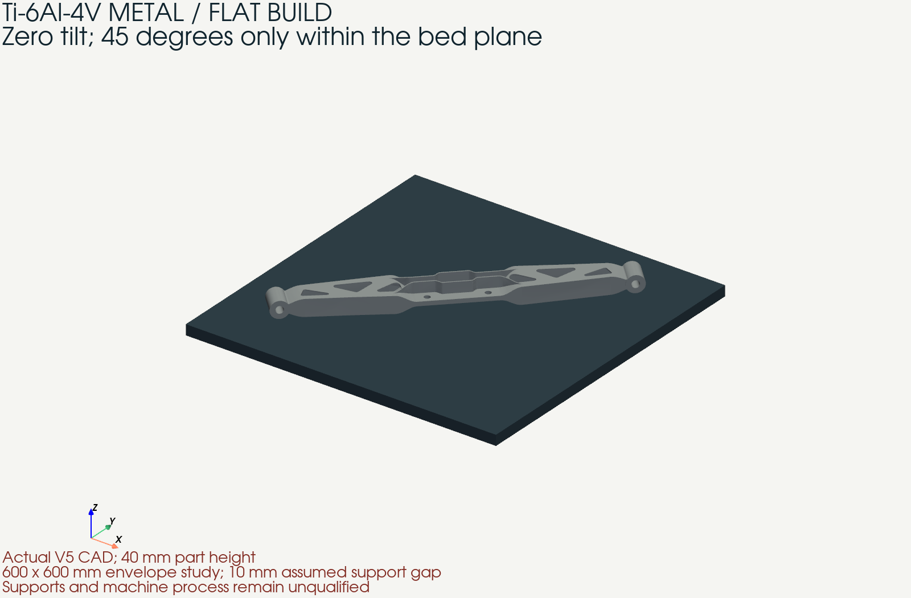

# V5 carrier: flat metal build correction

12 October 2026. The owner requires this carrier to be **printed flat**. The
proposed metal remains **Ti-6Al-4V Grade 5**. In the earlier mechanics report,
*plasticity* means permanent deformation of titanium; it never specifies a
polymer. The former tilted placement and EOS M 400-4 process proposal are
superseded as the current manufacturing direction and retained as history.

## Flat placement and unchanged geometry

The source is the same V5 solid, nominally 1.184764 kg at the reference density,
with the assumed 8 mm central bolt seats. This change is a rigid transform only:
original XY remains horizontal, original Z points up, and rotation about Z is
45 degrees. No hole, seat, joint thickness, rib or end eye is modified. The
independent OEM interface measurements remain missing.

| Placement quantity | Calculated or assumed value |
| --- | --- |
| Out-of-plane tilt | **0 degrees** |
| In-plane rotation | 45 degrees |
| Part height | 40.000 mm |
| Flat XY bounding box | 451.129 × 451.129 mm |
| Assumed XY clearance | 10 mm per edge |
| Required square bed with that clearance | **471.129 × 471.129 mm** |
| Study envelope | 600 × 600 × 600 mm |
| Assumed platform / support gap | 20 mm / 10 mm |
| Lowest / highest part surface above machine origin | 30 mm / 70 mm |

Neither a 400 mm nor a 450 mm square bed fits this flat placement. A 600 mm
square metal LPBF envelope fits geometrically. Nikon's
[NXG XII 600 announcement](https://nikon-slm-solutions.com/newsroom/divergent-technologies-accelerates-their-ramp-in-am-capacity-with-the-purchase-of-3-slm-nxg-xii-600s/)
provides an example of that nominal envelope, not a selected supplier or a
qualified Grade 5 process. The 10 mm margins, support gap and platform thickness
are assumptions; real exclusions and recoater clearances require supplier review.

The [placement source](flat_build.py) rejects tilt and inadequate bed clearance.
It checks that STEP readback retains one valid solid and its volume. The
[flat STEP](../../derived/bionic-flat-20261012/carrier-flat.step) and
[CAD render](../../derived/bionic-flat-20261012/flat-build.png) are generated from
the actual study solid. The render omits support geometry, which is not designed.
Input/output hashes and placement measurements are in [flat-results.json](flat-results.json);
the [orientation contract](flat-orientation.json) records the transform.



## Material and process boundaries

The exact proposed alloy is Ti-6Al-4V **Grade 5**, not an unspecified titanium
and not Grade 23 ELI. The historical [EOS process card](material-process.json)
records one machine-specific coupon condition. Its scan parameters, 800 C / 2 h
heat treatment and strength figures are not transferred to a larger printer.
For the flat study the supplier, parameter set, heat-treatment sequence and
qualified material card remain unset. Sixty-micrometre slices are a study
resolution, not a released machine recipe.

The support-removal sequence, stress relief before release, any HIP treatment,
machining allowance and finished surfaces must be defined together with the
supplier. The finished central stack must retain the measured original-fastener
geometry; longer bolts are not proposed. The existing inspection, surface-finish,
fatigue, traceability and galvanic-isolation requirements remain applicable.
Finished reference mass excludes support material and machining stock.

## Numerical continuation

The independent unit-cube test passes on the actual CalculiX 2.21 runtime:
1 MPa axial stress and 1 N reaction. The flat slicing and printing diagnostics
are recorded separately in the result receipt. Solver completion alone does not
establish a calibrated residual-stress or distortion prediction.

At the assumed 60 micrometre slice resolution, 666 part contours are nonempty
and all close (834 intervals including the support gap). Midpoint volume is
0.228% below the STL volume, outside the earlier 0.1% screen. Flat horizontal
faces produce grid quantisation: a separate 6 micrometre integration audit
reduces that discrepancy to 0.0225%. This audit does not change the proposed
machine layer height or create support contours, laser vectors or a job file.

Two flat staged runs and the separate whole-part contraction control completed
on CalculiX 2.21. The same coarse mesh, 0.10% in-plane / 0.05% vertical inherent
contraction and uncalibrated equivalent supports are used in each. Displacement
below has rigid translation/rotation removed; uniform shrinkage remains.

| Deposition groups | Maximum registered deformation after release (mm) | Maximum von Mises after release (MPa) | Largest von Mises at any step (MPa) |
| --- | ---: | ---: | ---: |
| 1: whole-part control | 0.29994 | approximately zero | 199.32 |
| 16: staged diagnostic | 1.71594 | 740.37 | 1,898.63 |
| 32: staged diagnostic | 1.77619 | 712.16 | 2,016.97 |

Changing from 16 to 32 groups changes released deformation by **3.51%**. This
two-point sensitivity does not establish convergence or physical accuracy. Both
staged elastic runs exceed the historical 955 MPa coupon comparison during
deposition; neither is accepted for a residual-stress prediction or CAD
compensation. The whole-part control's near-zero released stress verifies a
limited analytical case, not the staged process or material model.

The 37,824 tetrahedra have a median vertical span of 3.118 mm and a maximum of
10.697 mm. With centroid-based activation, 72.53% cross their assigned 2.5 mm
macro-slab at 16 groups; 99.41% cross their assigned 1.25 mm slab at 32 groups.
This comparison varies activation grouping on a fixed mesh. It does not prove
spatial convergence or resolve the physical deposition layers. The next numerical
check needs a mesh aligned with the deposition groups, followed by comparison
with measured coupon release distortion and process-specific material/support
data before considering geometry compensation.

Complete native inputs, outputs and convergence histories are retained locally
in `work/carrier-flat-build-20261012/`, with a raw solver archive and SHA-256
manifest. The [result receipt](flat-results.json) identifies the source files,
solver image/binary, package versions, activation audit and raw archive digest.

Changing orientation does not fix the V5 structural rejection. The unchanged
solid still has the conditional combined-load demands reported in the
[40-solve mechanical study](comprehensive-review.md): approximately 1,034 MPa
with fixed eyes and 2,002 MPa with assumed soft mounts. Those runs were not
repeated because no geometry or structural boundary condition changed. The
1.0 kg target remains missed; only the 1.2 kg fallback ceiling is met.

No OEM fit, original-bolt compatibility, fatigue life, printer qualification,
professional structural acceptance or manufacturing release is established.

## Reproduction

Use a new output directory and the retained V5 source/mesh folder from the
comprehensive study. The installed CAD environment needs the same build123d,
trimesh and PyVista versions used by the earlier sources. This preserves the
existing BRep geometry; it is not a migration to a different geometry kernel.

```sh
python flat_build.py /absolute/path/comprehensive-study /absolute/path/new-flat-study
python slice_print.py --selfcheck
python slice_print.py /absolute/path/new-flat-study
python verify.py /absolute/path/new-flat-study/benchmark
python print_simulation.py /absolute/path/new-flat-study/v5/mesh-9 /absolute/path/new-flat-study/printing-16 --orientation /absolute/path/new-flat-study/print-orientation.json --layers 16
```

The solver container selected by `CARRIER_STUDY_CONTAINER` must provide
CalculiX 2.21. Use one and 32 macro-layers in separate output directories for
the whole-part control and activation sensitivity. These macro-layers are
numerical groups of existing tetrahedra, not physical 60 micrometre layers.
