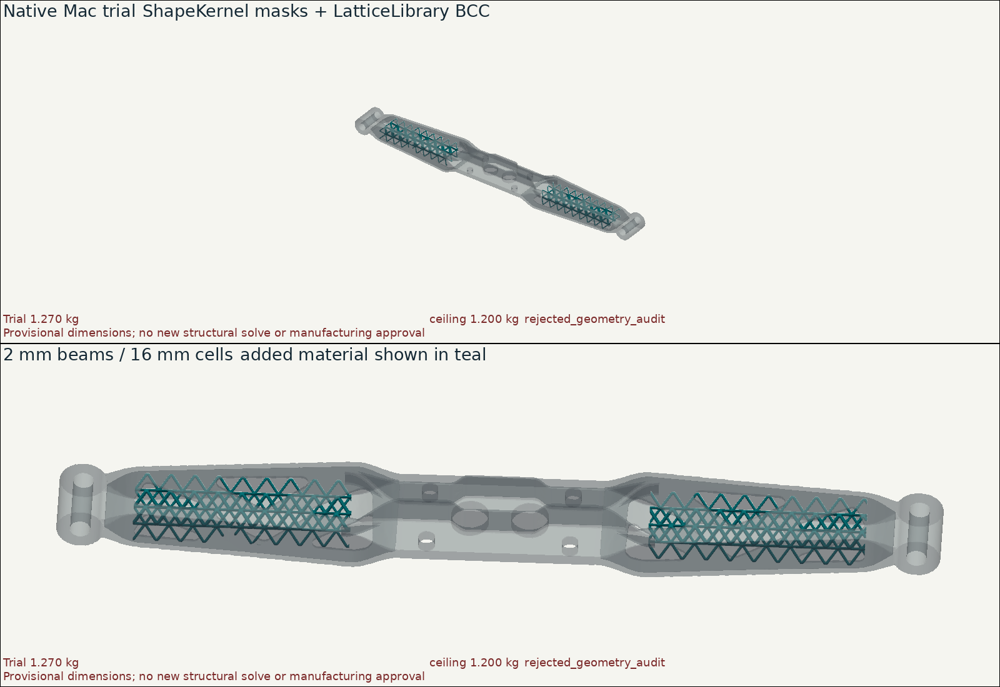

# Native Mac LEAP71 carrier and solver-field trial

The installed ShapeKernel, LatticeLibrary and PicoGK/OpenVDB runtime were used
on the actual frozen V5 study on 12 October 2026. This is a reproducible native
application, not just the installation's synthetic availability check.

**The BCC bracing trial is rejected: native nominal Ti-6Al-4V mass is
1.274582 kg, above the owner's 1.2 kg ceiling.** Its mechanical response has not
been solved. The original V5 structural rejection and the incompatible
[virtual bracket assembly](../virtual-fit-review.md) remain unresolved.



## Executed operations

- Load the exact original V5 STL, SHA-256
  `22e8ba507dbd91827810bda54cfee7fcfe4723f98365100e5d567cb2d0d746f0`,
  and voxelise it on a 0.5 mm grid in its original solver coordinate frame.
- Use ShapeKernel `BaseBox`, `BaseCylinder` and `LocalFrame` to protect the
  central joint, end eyes and two secondary holes. These are masks around
  the existing assumed geometry, not measured Porsche interfaces.
- Use LatticeLibrary `RegularCellArray`, `BodyCentreLattice` and
  `ConstantBeamThickness` for 16 mm BCC cells and 2 mm diameter beams, clipped
  to two assumed arm domains. Union this material with V5, retaining the
  reference separately. The trial does not change pad thickness or relocate
  holes. It is an unoptimised bracing test, not a stress-driven topology optimum.
- Export five named geometry fields, a sparse scalar field of V5 element
  stress maxima, and a sparse vector field of V5 nodal displacements.
- Reload the seven-field VDB: all five geometry comparisons pass and all
  **37,792 scalar values and 72,231 vector values** match exactly in float32.
  An absent-bin probe remains absent. Source hashes and units accompany the data.
- Independently inspect the exported surfaces, protected-region vertex
  distances and bore interior probes with Python. See [results.json](results.json)
  for the measured audit. Raw defects remain recorded; a separate diagnostic
  removes only exactly zero-area faces before closed-mesh interior probes.

The original plane remains horizontal. The trial is generated in the solver
frame, before the separate flat-build 45-degree rotation within the bed plane.
No supports, machine parameters or calibrated printing predictions are added.

## Independent geometry findings

The two-way nearest-vertex comparison of protected surfaces checks 288,342
vertices in each direction and finds zero change between the voxel reference
and the BCC trial. All six primary bore gauges return zero solid hits in the
original STL, voxel reference and changed trial. This checks interior probes
in the assumed holes; it does not certify diameter tolerances or OEM fit.

Raw voxel-derived STL files fail the topology screen: the reference has
192 exactly zero-area triangles and the trial has 666. Removing only these
faces in a **separate in-memory diagnostic** yields one closed, consistently
oriented surface for each. The original STL already has one closed surface
and no degenerate triangles. No raw file is silently repaired or admitted;
the extraction result and the normalization result remain separate.

The secondary hole at (-160, -26) mm has 20/576 solid hits in an assumed
12 mm-long, 2 mm-diameter clearance-gauge sweep, identically in all three
geometries. The first hit is at (-160.83147, -26.55557, -6) mm. That sweep extends
beyond the existing 10 mm-deep CAD cutter. It is an unresolved secondary-access
check, not an obstruction introduced by the trellis or evidence about an OEM
fastener. The other secondary gauge has no hits.

The trial's STL volume integral gives 1.269876 kg and the native voxel volume
gives 1.274582 kg at the retained 4.42 g/cm³ density. Both exceed the ceiling;
their difference is not hidden by selecting the lower number. Native extraction
leaves the 40 mm part height unchanged. No voxel-resolution convergence study
or calibrated print simulation is claimed.

## Field meaning and limits

The transferred case is the retained **mesh-9 V5 linear solve with fixed end
bores**, 4,000 N in -Z plus 850 Nm about Y. Its original maxima are 3.826170 mm
displacement and 984.680219 MPa integration-point von Mises stress. It is the
coarser member of the existing mechanical campaign, not a new solve or the
finest V5 result.

`prepare.py` validates the retained mesh and deck hashes. For displacement,
72,440 nodes map to 72,231 grid locations; 209 collisions retain the sample
with greatest vector magnitude, including its direction. For stress, the maximum
of each element's four integration-point values is assigned to its corner
centroid; 37,824 element values map to 37,792 bins, with 32 collisions retaining
the maximum. Original peaks survive within float32 rounding.

The additional grid-position quantisation reaches 0.426049 mm for displacement
and 0.419030 mm for stress centroids. Those are **not bounds on interpolation
error or on the displacement of a stress peak from its integration point**.
Empty bins mean unknown. No averaging, tensor transfer or FE interpolation is
claimed. These sparse diagnostic fields must not be used directly as a
conservative mapping for another solve.

Every mechanical field is explicitly named `V5.*` and records the V5 geometry
hash. The changed `Study.BCC_trial` has no stress, stiffness, torsion, fatigue
or print result. A successful VDB roundtrip establishes storage fidelity only.

## Source, runtime and outputs

The existing installation is read-only under `~/Developer/PicoGK`.
The 76 used source/runtime files matched its installation hash receipt.

| Component | Retained revision |
| --- | --- |
| [PicoGK](https://github.com/leap71/PicoGK) | `0e6cf6b6f4993ec16dbcd72d8f27f26b999980f3`, managed 2.3.0 / native 26.2 |
| [ShapeKernel](https://github.com/leap71/LEAP71_ShapeKernel) | `554bce4791d2676ed00bd6704f6eb010111a7fd3` |
| [LatticeLibrary](https://github.com/leap71/LEAP71_LatticeLibrary) | `81c3c7b2064c19e573c38d76ac09bf1cd2f562d5` |

These upstream sources carry Apache-2.0 notices and remain in the installation;
they are not copied into this change. The build uses .NET SDK 9.0.317 on ARM64,
with zero errors and 35 upstream obsolete-API warnings. Native execution took
10.68 seconds. The runtime's reported peak working set of zero is unavailable
telemetry, not a measured zero-memory claim.

The local `work/carrier-leap71-20261012/` directory retains:

- `transfer/`: sparse input samples and their mapping/loss receipt.
- `run-001/`: `carrier-fields.vdb`, baseline/candidate/addition STL files,
  native results, independent audit and actual-geometry PNG.
- `app/`: the executed native/managed application; `toolchain.json`: upstream
  revisions and file hashes. Large native artifacts remain outside Git.

Editable source is [Program.cs](Program.cs), [Carrier.csproj](Carrier.csproj),
[prepare.py](prepare.py) and [audit.py](audit.py). The existing STEP master is
unchanged; voxel exports are derived representations, not editable BRep recovery.

## Reproduction

Use Python 3.11+ with the existing NumPy, SciPy, trimesh, rtree and PyVista
environment. `V5_SOLVER` must point to the retained `v5/mesh-9` directory and
`V5_STL` to its original sibling `carrier.stl`; they are not invented fixtures.
Use fresh output directories on every run. From the repository root:

```sh
SRC=parts/993-eng-carrier-0001/source/bionic-20261011/native-leap71
OUT=work/carrier-leap71-repeat
python "$SRC/prepare.py" "$V5_SOLVER" "$V5_STL" "$OUT/transfer"
dotnet build "$SRC/Carrier.csproj" -c Release -o "$OUT/app" \
  -p:BaseIntermediateOutputPath="$PWD/$OUT/obj/" \
  --configfile "$HOME/Developer/PicoGK/Workbench/NuGet.Config"
dotnet "$OUT/app/Carrier.dll" "$V5_STL" "$OUT/transfer/samples.json" "$OUT/run"
python "$SRC/audit.py" "$OUT/run" "$OUT/transfer" "$V5_STL"
PYTHONPATH=tests python -m unittest test_carrier_native_leap71 -v
```

The default `LeapRoot` is the installed Mac directory; override the MSBuild
property only when using another copy with separately checked provenance.

## Engineering decision

Adding a regular BCC core to an already near-limit carrier spends too much
mass. This trial is not selected and its beams are not thinned blindly to meet
the scale reading. A future candidate needs material redistribution and its
own structural/joint/fatigue checks. Real attachment measurements, bolt stack,
LPBF Grade 5 process qualification, powder evacuation, machining and inspection
remain required. No manufacturing or vehicle-fit approval follows from this work.
