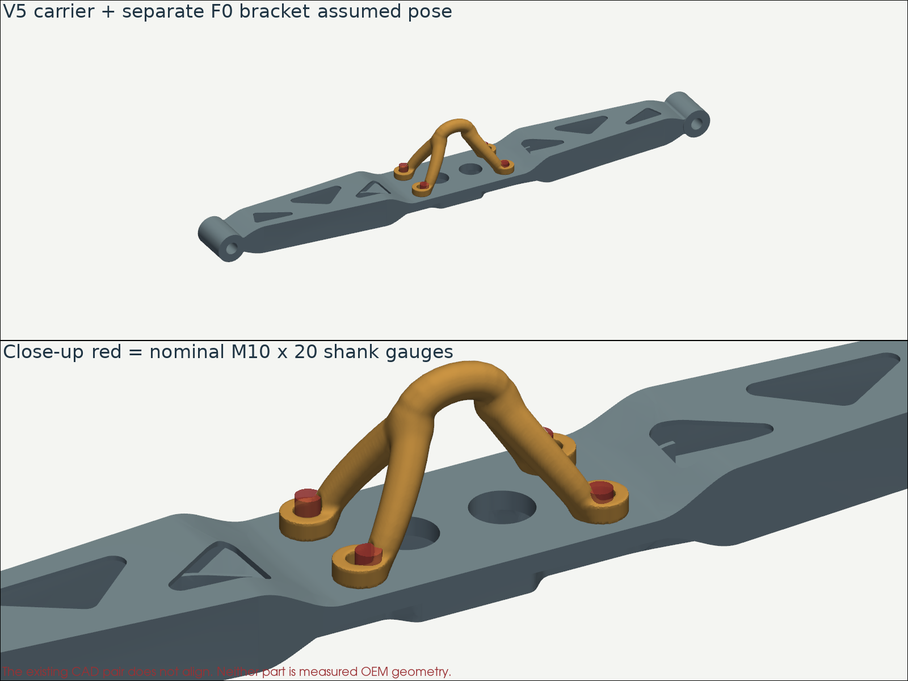
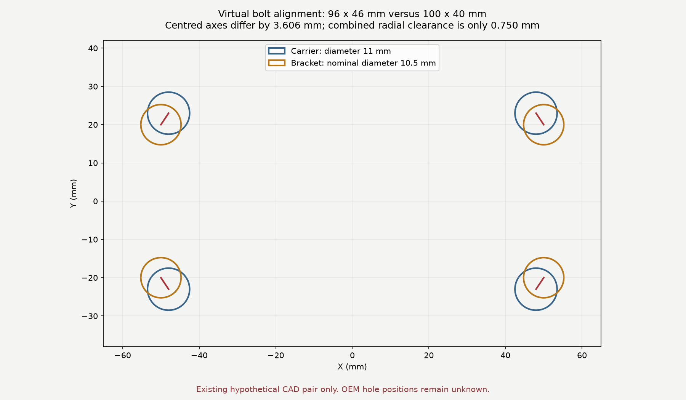

# Virtual assembly trial — retained V5 carrier and separate F0 bracket

The existing CAD pair **does not accept four straight nominal M10 bolts** under
the parallel mating-face assumption. This is a comparison of two independently
authored, unmeasured studies. It is not a trial against an OEM bracket, an engine
scan or a measured vehicle. Neither original geometry was changed.

The load path to be established remains engine → bracket `993 115 103 52` →
four bolted joints → carrier `993 115 021 53` → two mountings → body, with the
gearbox support also carrying load. The independent
[interface contract](../../../../twins/993-engine-mount-system-f0/interface-contract.json)
still has unknown engine-side attachment geometry and no measured OEM datums.



The blue-grey solid is the unchanged V5 carrier. Gold is the separate existing
F0 concept bracket; its shape must not be mistaken for the original Porsche
bracket. Red cylinders are 10 mm diameter, 20 mm long shank gauges, without bolt
heads, threads, nuts or washers. The bracket is flipped onto the assumed front
face at Z = −4 mm. This pose is illustrative, not a measured vehicle transform.

## Executed checks

| Check | Result | Meaning |
| --- | --- | --- |
| Carrier holes extracted from STEP cylindrical faces | 96 × 46 mm rectangular pattern, diameter 11 mm, 8 mm pad | Actual CAD dimensions; still design assumptions |
| Bracket holes checked in its STL section at Z = 4 mm | Centres within 0.05 mm of the separate 100 × 40 mm pattern; nominal diameter 10.5 mm | Confirms the stored mesh corresponds to that study, not OEM geometry |
| Centred alignment | 3.6056 mm axis error at all four joints | The displayed pose cannot accept the bolts |
| Every hole assignment, using rigid-invariant pair distances | At least one axis must miss by at least 3.0 mm under any rigid placement | Translation or rotation cannot resolve the pattern mismatch |
| Available nominal radial clearance | (11 − 10)/2 + (10.5 − 10)/2 = 0.75 mm | Too small for that lower bound, with bolts normal to parallel faces |
| Actual bracket interference witnesses | 65 of 216 interior shank sample points penetrate the bracket at each of four joints | Positive collision evidence; sampling does not certify complete clearance |
| Nominal bolt-length budget | 20 − 8 − 8 = 4 mm | Only 4 mm remains for washers, nut and protrusion in this assumed stack; thread engagement is unverified |
| GLB export/readback | Six mesh components; bounds agree within 0.0001 mm | Viewable assembly retained in metres; report and CAD use millimetres |



The 3.0 mm lower bound follows from the triangle inequality: if every centre
were within e of its mate, no pair distance could differ by more than 2e. All
24 assignments are checked. This necessary-condition test can reject a pair;
passing it alone could never establish a fit. Tilting the bolts or forcing the
parts is not an admissible remedy for this mating-face study.

The original V5 STEP, bracket STL, input receipts, interface contract and script
are SHA-256 identified in the [result record](../../derived/virtual-fit-20261012/results.json).
The [GLB assembly](../../derived/virtual-fit-20261012/virtual-assembly.glb) contains
both retained surfaces and the four gauges. It uses the installation study pose,
not the flat print-bed pose; the flat manufacturing requirement is unchanged.

## What this trial cannot establish

No complete engine, exhaust, body or engine-mount assembly was tested. Complete
part-to-part collision, socket access, installation paths, real joint stack,
thread runout, preload and bolt strength were not assessed. The bracket-to-engine
interface remains unknown. The four mounting holes added to the carrier do not
by themselves establish engine attachment.

The next input is a measured original bracket or a traceable CAD/scan with its
carrier-side holes, axes and mating faces. Its engine-side interface and the
installed surrounding geometry are also needed for a complete virtual fit.
The current mismatch does not establish that the real Porsche bracket has this
pattern. Changing the two studies to agree would only create another hypothesis.

V5's earlier structural rejection remains in force. No fitment or manufacturing
approval follows from this trial.

## Reproduce

Use the existing CAD environment with build123d, trimesh, rtree, NumPy, PyVista
and matplotlib. The output directory must be new:

```sh
python parts/993-eng-carrier-0001/source/bionic-20261011/virtual_fit.py work/carrier-virtual-fit-new
python -m unittest discover -s tests -p 'test_carrier_virtual_fit.py' -v
```

The checks include a known incompatible pair, a rotated/reordered matching
pattern which cannot grant OEM acceptance, invalid geometry and an oversized
bolt. Actual execution also checks STEP volume, source hashes, the bracket's
closed mesh, a known inside/outside cube witness and GLB readback.
