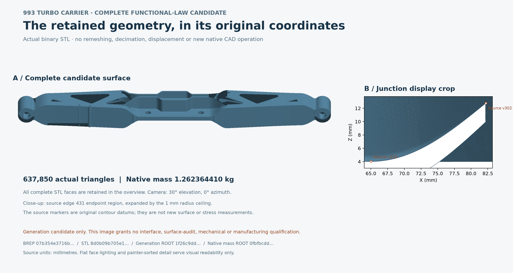

# Figure 30: actual complete functional-law candidate

[PDF](carrier-functional-law-candidate.pdf) / [SVG](carrier-functional-law-candidate.svg)

The overview uses every one of the actual 637,850 STL triangles of the 07b354
BREP generation candidate, in its original millimetre coordinates. The second
panel projects all 3,979 triangles whose AABBs intersect the original source-edge
431 endpoint region expanded by the 1 mm radius ceiling. It is a conservative
display crop, not a section, wall-thickness, stress or boundary-membership test.
The markers are retained source vertices 302 and 210, not new measurements.

The separate native mass receipt is 1.2623644100871174 kg at 4,420 kg/m3.
Flat face lighting is presentation only. This image grants no interface,
surface-audit, mechanical or manufacturing qualification. Later check results
must be read in their own receipts; no earlier C1 mechanics is transferred.

The actual accepted render closed RC0 with all 5,259 runtime files and 598
imported package origins verified. The [ROOT closeout](proofs/render/root-terminal-review-001.json)
records direct PNG and rasterized PDF-page review: English text, axes and source
markers were legible, with no observed clipping, overlap or missing glyphs.
The original post-export runtime refusals from revisions 002 and 003 remain
retained; their identical pixels were not retrospectively accepted.

[Reproduction and limits](REPRODUCTION.md) separates byte verification from a
new render. The [complete inventory](archive.json) covers every payload and
excludes itself. The actual STL and installed graphics runtime remain explicit
external dependencies; no CAD, field archive, STL or runtime binary is copied.
