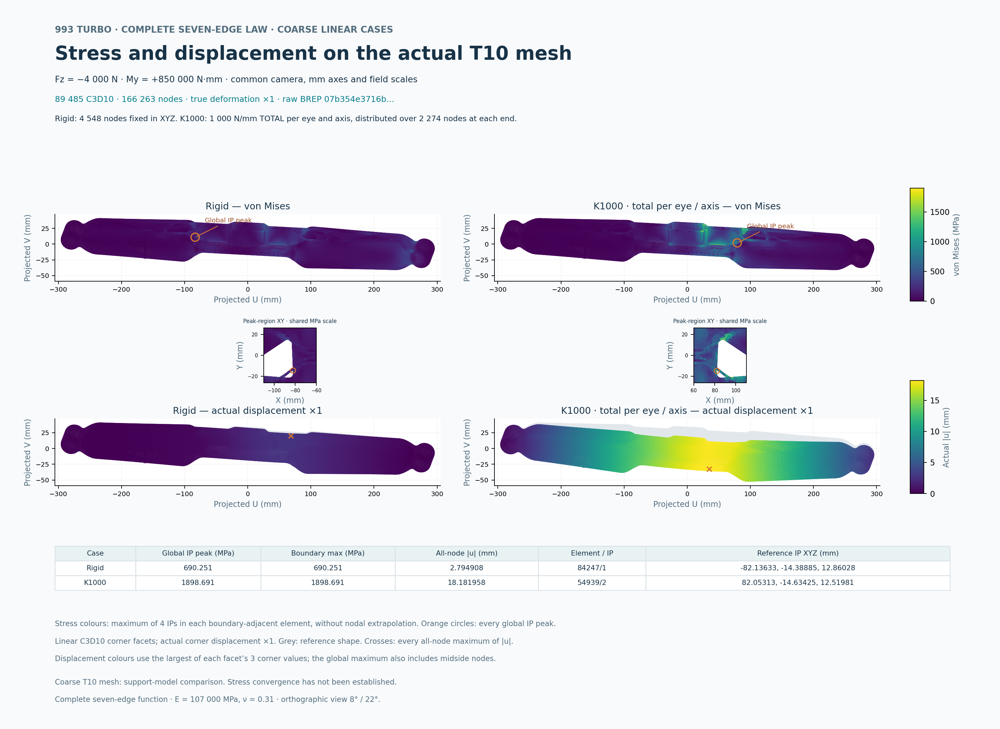

# Figure 31: current complete-law coarse stress and displacement

[PDF](carrier-complete-function-stress-displacement.pdf) / [SVG](carrier-complete-function-stress-displacement.svg)

The four panels show the two actual current 07b354 coarse calculations on the
same 166,263-node, 89,485-T10 mesh. Both use Fz = -4,000 N and My = +850,000 N mm,
E = 107,000 MPa and Poisson ratio 0.31. K1000 means 1,000 N/mm total per eye
and per axis, distributed over its 2,274 nodes; it is not 1,000 N/mm per node.

| Retained support case | Global integration-point VM (MPa) | All-node displacement (mm) | Independent energy error |
| --- | ---: | ---: | ---: |
| Rigid | 690.2505709153038 | 2.794907687412681 | 8.28704060928942e-9 |
| K1000 | 1898.6913525112475 | 18.181958162667613 | 1.2120040526752973e-8 |

The colour scales and orthographic camera are common. Every one of the 47,282
boundary corner facets is submitted to each panel. Stress colour is the maximum
of the four integration-point values of its adjacent T10; displacement colour
uses its corner nodes and the drawn displacement is true scale, x1. The table
and markers separately retain all global integration-point ties and all-node
maxima, including midside nodes. The two local insets are display projections.
These are coarse results; stress convergence is not established.

The [render closeout](proofs/render/root-terminal-review-001.json) and separate
[PNG/PDF review](proofs/render/root-visual-review-001.json) bind the actual exports.
The [two-case FEA closeout](proofs/FEA/root-solver-terminal-review-001.json) binds
the original results, independent energy audits and owned-container removal.
Earlier stock and candidate refusals remain in the retained evidence; no prior
revision's stress field is transferred to this figure.

[Reproduction](REPRODUCTION.md) separates stored-byte verification from a new
render. The [complete inventory](archive.json) excludes itself. Actual field,
mesh and deck bodies and the 219-file plotting runtime remain explicitly
external; no DAT, FRD, field archive, CAD, mesh or runtime binary is copied here.
