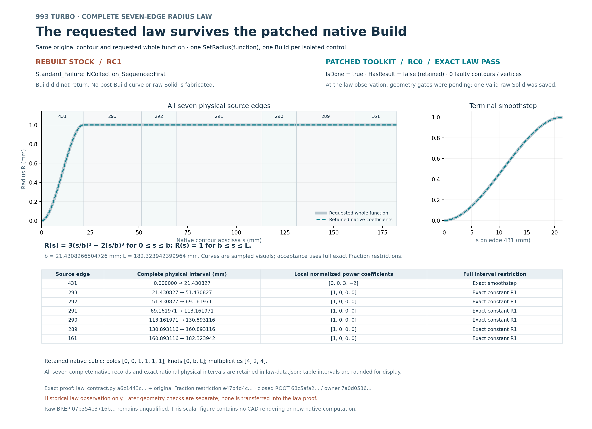

# Figure 29: complete seven-edge radius law

This English scalar figure uses the two closed native control observations.
The rebuilt stock control returned RC1 before Build returned: no post-Build
curve is invented. The patched control returned RC0 and retained the complete
requested law on all seven original physical edges. IsDone=true and
HasResult=false are retained exactly as observed.

[PDF](carrier-seven-edge-radius-law.pdf) / [SVG](carrier-seven-edge-radius-law.svg)

The main graph, edge-431 detail and seven-row table are sampled visualizations.
The full exact Fraction proof is separate: all native poles, knots,
multiplicities and physical intervals remain in [law-data.json](data/law-data.json).
The requested cubic is smoothstep on edge 431 and exactly R1 on the other six.
The table's physical-interval decimals are rounded for display.

At the law observation, geometry gates were pending. That historical snapshot
is retained; later geometry receipts are not transferred into the law proof.
The raw native BREP is unqualified by this figure. No Cut, mass, interfaces,
surface, STEP, mesh, FEA or physical qualification is granted here.

The [native ROOT closure](proofs/native/root-terminal-review-001.json) and
[render ROOT closure](proofs/render/root-render-terminal-review-001.json)
retain the actual control returns, full proof and independent PNG review.
The PDF was not reviewed as a raster image. The [complete inventory](archive.json)
covers every copied payload and excludes itself.

[Reproduction and limits](REPRODUCTION.md) separates stored evidence from a
new plot execution. No native geometry, field archive or runtime binary is
duplicated in this figure capsule.
