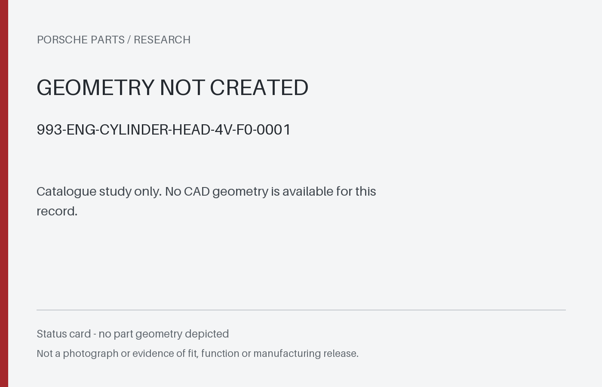
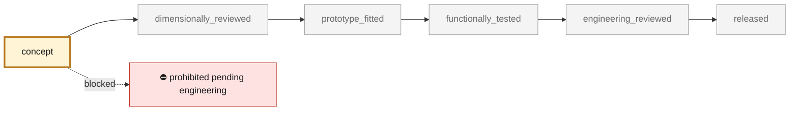
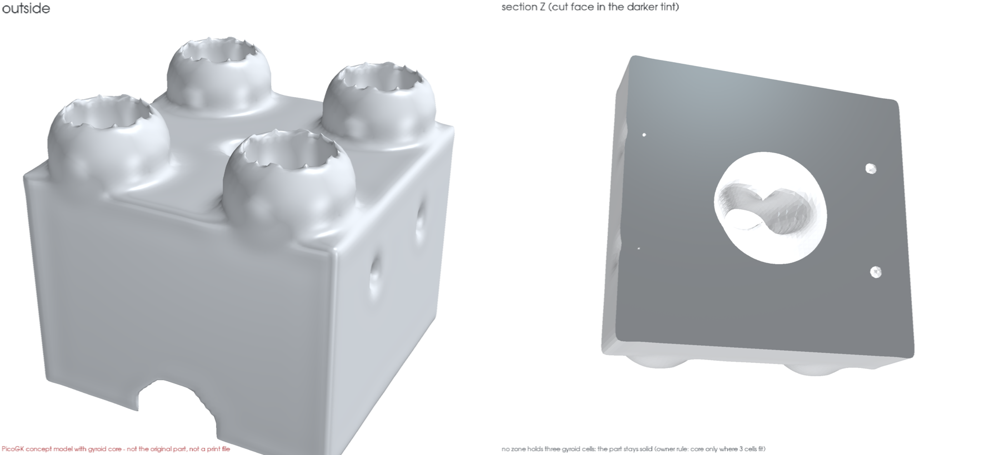

<!-- generated by scripts/render_part_pages.py - do not edit by hand -->

# M64 four-valve water-cooled cylinder head — creation preparation

**`993-ENG-CYLINDER-HEAD-4V-F0-0001`** · Porsche 993 · 1995–1998

  

> [!CAUTION]
> **Not ready to print, and not a copy of the original part.** The model shown here is a
> concept block for studying the part in software:
> - validation status `concept`: nothing has been checked against a real part;
> - geometry `mixed`: its dimensions are partly sourced, partly assumed, not measured on the original part;
> - safety class `prohibited_pending_engineering`;
> - no part in this repository is released — read [SAFETY.md](../../SAFETY.md).

<table><tr>
<td width="50%" valign="top">
<b>Original part</b>  
The original part is documented — pictures, catalogue entries or published data — on these pages. They are copyrighted, so they are linked here, not copied:  
↗ <a href="https://porschefanatics.com/engine/993/">PorscheFanatics — 993 engine specification</a> 
↗ <a href="https://porschefanatics.com/parts/swindon-24v-head-kit-m64/">PorscheFanatics — Swindon M64 24-valve head kit</a> 
↗ <a href="https://swindonpowertrain.com/products/24-valve-porsche-911-m64-cylinder-head-kit/">Swindon Powertrain — M64 24-valve cylinder head kit</a> 
↗ <a href="https://newsroom.porsche.com/dam/jcr:a6f33b52-c47d-47b4-98c1-7e963661f587/40%20Years%20Group%20C.pdf">Porsche — 40 Years Group C, pages 18–19</a> 
</td>
<td width="50%" valign="top" align="center">
<b>Catalogue study status</b>  
 
No CAD geometry to show. This is a status card, <b>not</b> a part rendering or a print file.
</td>
</tr></table>

> [!CAUTION]
> **Prohibited pending engineering** — risk, or insufficient data. Never published as a released part.

## What it is

Direction decided on October 12, 2026: a new four-valve water-cooled cylinder head, inspired by the 956/962 C Group C engines. The bionic fins remain an earlier, retained study. The private geometry derived from the 935 proxy is intact; the first proposed passages do not constitute a qualified sealed water jacket.

## What it does on the car

Documentary preparation, controlled CAD research and numerical verification only; no manufacturing or engine installation.

## At a glance

| | |
|---|---|
| Porsche part numbers | not recorded |
| variants | `993_Turbo_M64_60_research_target_fitment_unverified` |
| candidate material | not selected |
| candidate process | undecided |
| safety class | `prohibited_pending_engineering` |
| validation status | `concept` |
| geometry | mixed, master none |

## Where it stands

*Validation ladder of `catalog/schemas/part.schema.json`; this record is at `concept`.*

## Bionic gyroid-core model

*PicoGK variant ([`GyroidCore.cs`](../../parts/picogk-catalog/bionic/GyroidCore.cs)): no zone of this part holds three 45 mm gyroid cells inside its skin, so it stays solid (core only where three cells fit). Not a print file.*

## What's in this folder

| folder | what it holds | files |
|---|---|---|
| `derived/` | CAD exports generated from the source (STEP for CAD tools, STL for meshing) | [`derived/993-eng-cylinder-head-4v-f0-0001-picogk-gyroid.json`](derived/993-eng-cylinder-head-4v-f0-0001-picogk-gyroid.json) |
| `media/` | concept-model views rendered from the CAD by `scripts/render_part_previews.py` — not pictures of the original | [`media/gyroid.json`](media/gyroid.json), [`media/gyroid.png`](media/gyroid.png), [`media/preview.json`](media/preview.json), [`media/preview.png`](media/preview.png) |
| `source/` | parametric source — the editable master that generates the geometry | [`source/gyroid.json`](source/gyroid.json) |

## Read more

- **Full description page**, with sources and evidence: [docs/pieces/993-eng-cylinder-head-4v-f0-0001.md](../../docs/pieces/993-eng-cylinder-head-4v-f0-0001.md)
- **Catalogue record** (source of truth): [`catalog/parts/993-eng-cylinder-head-4v-f0-0001.json`](../../catalog/parts/993-eng-cylinder-head-4v-f0-0001.json)
- **Safety rules**: [SAFETY.md](../../SAFETY.md)

---

*This page is generated from the catalogue record by `scripts/render_part_pages.py` and checked by `make check`. Edit the record, not this page.*
