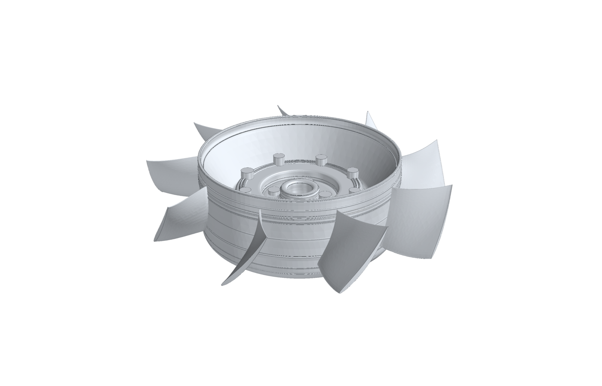
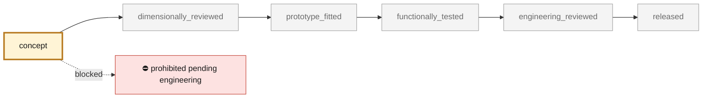
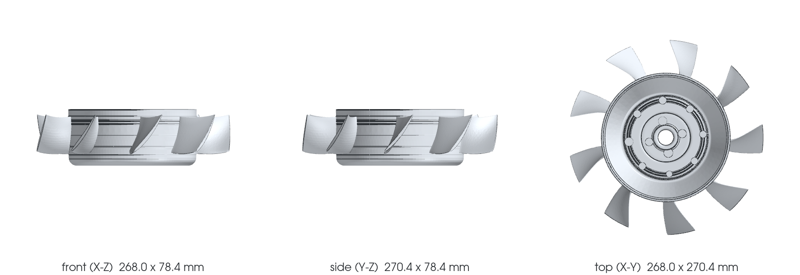

<!-- generated by scripts/render_part_pages.py - do not edit by hand -->

# Flat (horizontal) engine cooling fan rotor for a 993, WE43 concept F0 in the envelope of the scanned 935 flat fan

**`993-ENG-FLAT-FAN-ROTOR-WE43-F0-0001`** · Porsche 993 · 1994–1998

  

> [!CAUTION]
> **Not ready to print, and not a copy of the original part.** The model shown here is a
> concept block for studying the part in software:
> - validation status `concept`: nothing has been checked against a real part;
> - geometry `mixed`: its dimensions are partly sourced, partly assumed, not measured on the original part;
> - safety class `prohibited_pending_engineering`;
> - no part in this repository is released — read [SAFETY.md](../../docs/SAFETY.md).

<table><tr>
<td width="50%" valign="top">
<b>Original part</b>  
The original part is documented — pictures, catalogue entries or published data — on these pages. They are copyrighted, so they are linked here, not copied:  
↗ <a href="https://github.com/cluster2600/porscheparts/tree/main/twins/935-horizontal-fan-cad-twin">935 horizontal fan, top-down CAD twin (this repository)</a> 
↗ <a href="https://ferdinandmagazine.com/porsche-flat-fan-kit">Ferdinand magazine - EB Motorsport flat fan kit</a> 
↗ <a href="https://jimtorresracing.com/for-sale/reproduction-flat-fan">Jim Torres Racing - reproduction 935 flat fan</a> 
↗ <a href="https://www.carscoops.com/2022/08/gunther-werks-project-tornado-is-a-carbon-bodied-porsche-993-turbo-restomod-with-up-to-700-hp/">Gunther Werks 993-based cars (press)</a> 
</td>
<td width="50%" valign="top" align="center">
<b>This repository's concept model</b>  
 
Concept CAD block, 268.0 × 270.4 × 78.4 mm — <b>not</b> the original part, not a print file, not evidence of fit.
</td>
</tr></table>

> [!CAUTION]
> **Prohibited pending engineering** — risk, or insufficient data. Never published as a released part.

## What it is

Concept rotor for a flat-fan conversion of a 993 engine, the layout of the 935 and of Gunther Werks' 993-based cars: the fan lies horizontally above the engine, driven through a right-angle drive, with the alternator moved off the fan shaft. It is an original design, not a copy of any product. It keeps the envelope and interfaces of the one flat-fan rotor this repository has measured, the 935 rotor rebuilt top-down from a private scan (twins/935-horizontal-fan-cad-twin): 270.5 mm tip diameter, drum hub r 89.3 mm, the two drive dogs and the fastener pattern, the same axial band. Inside it, nine new blades are drawn from velocity triangles with the F1 method, and the hub section the scanner could not see is designed as a 2.5 mm shell. A one-dimensional blade-element model, applied to both rotors on the 993 duty inferred by the F1 study (2.34 m3/s at 2,155 Pa) with a stator, estimates that the new rotor needs about 8 % less shaft power than the fitted 935 rotor and turns at 5,770 instead of 9,100 rpm. These are model estimates, not measurements.

## What it does on the car

F0 design study of a flat-fan rotor for a 993: aerodynamic comparison with the fitted 935 rotor in the same envelope, CAD for packaging and further study; no manufacture, rotation, installation or start-up authorized

## At a glance

| | |
|---|---|
| Porsche part numbers | not recorded |
| variants | `993_Carrera`, `993_Carrera_4`, `flat_fan_conversion_study` |
| candidate material | WE43 LPBF, solutionized and aged, for comparison |
| candidate process | LPBF |
| safety class | `prohibited_pending_engineering` |
| validation status | `concept` |
| geometry | mixed, master build123d |

## Where it stands

*Validation ladder of `catalog/schemas/part.schema.json`; this record is at `concept`.*

## Views

*Orthographic views of the same concept CAD, with its bounding dimensions — not drawings of the original part.*

## What's in this folder

| folder | what it holds | files |
|---|---|---|
| `evidence/` | screens, reports and manifests — **pinned by SHA-256, never edited by hand** | [`evidence/cad-summary.json`](evidence/cad-summary.json), [`evidence/flat-fan-993-f0.json`](evidence/flat-fan-993-f0.json) |
| `media/` | concept-model views rendered from the CAD by `scripts/render_part_previews.py` — not pictures of the original | [`media/preview.json`](media/preview.json), [`media/preview.png`](media/preview.png), [`media/views.png`](media/views.png) |
| `source/` | parametric source — the editable master that generates the geometry | [`source/build_flat_fan_993.py`](source/build_flat_fan_993.py), [`source/flat_fan_993_f0.py`](source/flat_fan_993_f0.py) |

## Read more

- **Full description page**, with sources and evidence: [docs/parts/993-eng-flat-fan-rotor-we43-f0-0001.md](../../docs/parts/993-eng-flat-fan-rotor-we43-f0-0001.md)
- **Catalogue record** (source of truth): [`catalog/parts/993-eng-flat-fan-rotor-we43-f0-0001.json`](../../catalog/parts/993-eng-flat-fan-rotor-we43-f0-0001.json)
- **Design dossier**: [993_FLAT_FAN_ROTOR_F0](../../docs/993/993_FLAT_FAN_ROTOR_F0.md)
- **Safety rules**: [SAFETY.md](../../docs/SAFETY.md)

---

*This page is generated from the catalogue record by `scripts/render_part_pages.py` and checked by `make check`. Edit the record, not this page.*
