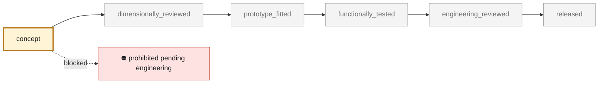
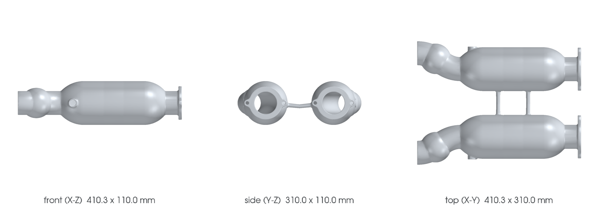

<!-- generated by scripts/render_part_pages.py - do not edit by hand -->

# 993 Turbo catalytic converters (front muffler section), left and right - PET-transcribed identity

**`993-EXH-CAT-CONVERTER-PAIR-PET-0001`** · Porsche 993 · 1995–1998

  

> [!CAUTION]
> **Not ready to print, and not a copy of the original part.** The model shown here is a
> concept block for studying the part in software:
> - validation status `concept`: nothing has been checked against a real part;
> - geometry `estimated`: its dimensions are estimated design variables, not measured on the original part;
> - safety class `prohibited_pending_engineering`;
> - no part in this repository is released — read [SAFETY.md](../../docs/SAFETY.md).

<table><tr>
<td width="50%" valign="top">
<b>Original part</b>  
The original part is documented — pictures, catalogue entries or published data — on these pages. They are copyrighted, so they are linked here, not copied:  
↗ <a href="https://porschefanatics.com/oem/993/202-15/">Porsche Fanatics local dataset - data/oem-listed.json, PET illustration 202-15 lines (993)</a> 
↗ <a href="https://porschefanatics.com/oem/993/202-15/">Porsche 993 Workshop Manual - Heat exchanger / catalytic converter torque page 61</a> 
</td>
<td width="50%" valign="top" align="center">
<b>This repository's concept model</b>  
 
Concept CAD block, 410.3 × 310.0 × 110.0 mm — <b>not</b> the original part, not a print file, not evidence of fit.
</td>
</tr></table>

> [!CAUTION]
> **Prohibited pending engineering** — risk, or insufficient data. Never published as a released part.

## What it is

Identity-only catalogue record for the two Turbo catalytic converter / front muffler sections, transcribed per-line from the local PET transcriptions: illustration 202-15 (exhaust system, Turbo) position 14 = 993 113 213 57 and position 15 = 993 113 214 57 in the KAT 17 transcription, with position 15 also listed as 993 113 214 58 in the Porsche Classic KAT 517 USA transcription. Same-assembly context transcribed at the same positions: tail pipes (pos 12/13), oxygen sensors 993 606 128 01 (pos 20) and 993 606 127 01 (pos 22), converter cover 993 113 247 51 (pos 19). No dimensions, substrate data, cell counts, pressure drop or geometry are claimed.

## What it does on the car

Identity anchor for the exhaust subsystem of the M64 digital twin; no manufacturing, fitment or engine use is authorized by this record

## At a glance

| | |
|---|---|
| Porsche part numbers | 99311321357, 99311321457, 99311321458 |
| variants | `993_Turbo` |
| candidate material | unknown |
| candidate process | undecided |
| safety class | `prohibited_pending_engineering` |
| validation status | `concept` |
| geometry | estimated, master PicoGK |

## Where it stands

*Validation ladder of `catalog/schemas/part.schema.json`; this record is at `concept`.*

## Views

*Orthographic views of the same concept CAD, with its bounding dimensions — not drawings of the original part.*

## Bionic gyroid-core model

*PicoGK variant ([`GyroidCore.cs`](../../parts/picogk-catalog/bionic/GyroidCore.cs)): no zone of this part holds three 13.5 mm gyroid cells inside its skin, so it stays solid (core only where three cells fit). Not a print file.*

## What's in this folder

| folder | what it holds | files |
|---|---|---|
| `derived/` | CAD exports generated from the source (STEP for CAD tools, STL for meshing) | [`derived/993-exh-cat-converter-pair-pet-0001-picogk-gyroid.json`](derived/993-exh-cat-converter-pair-pet-0001-picogk-gyroid.json), [`derived/993-exh-cat-converter-pair-pet-0001-picogk.json`](derived/993-exh-cat-converter-pair-pet-0001-picogk.json), [`derived/993-exh-cat-converter-pair-pet-0001-picogk.stl`](derived/993-exh-cat-converter-pair-pet-0001-picogk.stl) |
| `media/` | concept-model views rendered from the CAD by `scripts/render_part_previews.py` — not pictures of the original; labelled AI studio illustration and provenance, not a photograph | [`media/gyroid.json`](media/gyroid.json), [`media/gyroid.png`](media/gyroid.png), [`media/photo-concept.png`](media/photo-concept.png), [`media/photo.json`](media/photo.json), [`media/preview.json`](media/preview.json), [`media/preview.png`](media/preview.png), [`media/views.png`](media/views.png) |
| `source/` | parametric source — the editable master that generates the geometry | [`source/gyroid.json`](source/gyroid.json), [`source/picogk.json`](source/picogk.json) |

## Read more

- **Full description page**, with sources and evidence: [docs/pieces/993-exh-cat-converter-pair-pet-0001.md](../../docs/pieces/993-exh-cat-converter-pair-pet-0001.md)
- **Catalogue record** (source of truth): [`catalog/parts/993-exh-cat-converter-pair-pet-0001.json`](../../catalog/parts/993-exh-cat-converter-pair-pet-0001.json)
- **Safety rules**: [SAFETY.md](../../docs/SAFETY.md)

---

*This page is generated from the catalogue record by `scripts/render_part_pages.py` and checked by `make check`. Edit the record, not this page.*
