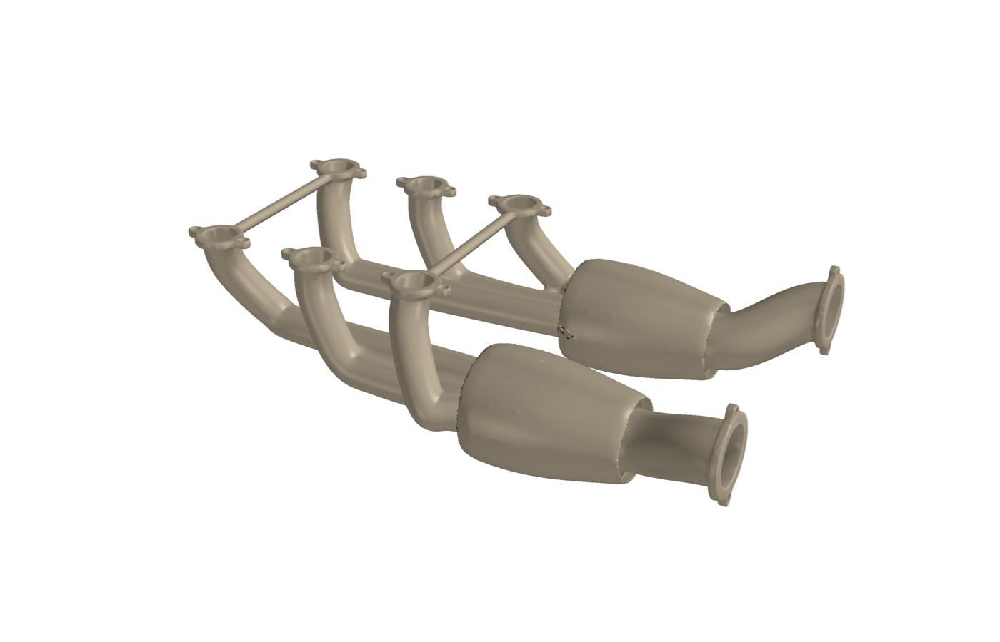
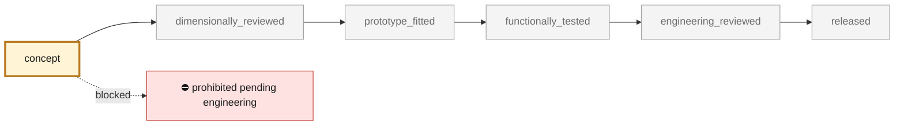
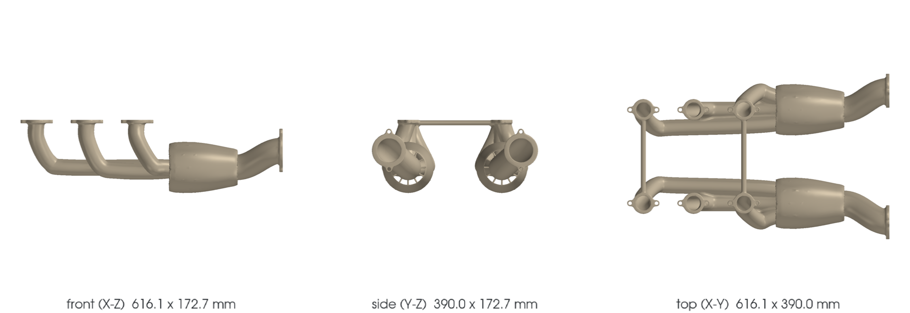
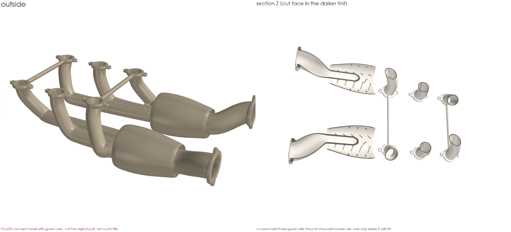

<!-- generated by scripts/render_part_pages.py - do not edit by hand -->

# 993 Turbo exhaust heat exchangers (manifolds), left and right - PET-transcribed identity

**`993-EXH-HEAT-EXCHANGER-PAIR-PET-0001`** · Porsche 993 · 1995–1998

  

> [!CAUTION]
> **Not ready to print, and not a copy of the original part.** The model shown here is a
> concept block for studying the part in software:
> - validation status `concept`: nothing has been checked against a real part;
> - geometry `estimated`: its dimensions are estimated design variables, not measured on the original part;
> - safety class `prohibited_pending_engineering`;
> - no part in this repository is released — read [SAFETY.md](../../docs/SAFETY.md).

<table><tr>
<td width="50%" valign="top">
<b>Original part</b>  
The original part is documented — pictures, catalogue entries or published data — on these pages. They are copyrighted, so they are linked here, not copied:  
↗ <a href="https://porschefanatics.com/oem/993/202-10/">Porsche Fanatics local dataset - data/oem-listed.json, PET illustration 202-10 lines (993)</a> 
↗ <a href="https://assets-v2.porsche.com/us/-/media/Project/PCOM/SharedSite/PorscheClassic/Original-Parts-Catalogue/PDF-EN-US/KAT517_USA_911_98_KATALOG">Porsche PET 993 - Turbo heat exchangers illustration 202-10 (Porsche Classic KAT 517)</a> 
↗ <a href="https://porschefanatics.com/oem/993/202-10/">Porsche 993 Workshop Manual - Exhaust system torque page 61</a> 
</td>
<td width="50%" valign="top" align="center">
<b>This repository's concept model</b>  
 
Concept CAD block, 616.1 × 390.0 × 172.7 mm — <b>not</b> the original part, not a print file, not evidence of fit.
</td>
</tr></table>

> [!CAUTION]
> **Prohibited pending engineering** — risk, or insufficient data. Never published as a released part.

## What it is

Identity-only catalogue record for the two Turbo exhaust heat exchangers (exhaust manifolds with integrated catalysis in the Turbo line), transcribed per-line from the local PET transcriptions: illustration 202-10 (exhaust system, Turbo) position 1 left 993 211 039 55 and position 2 right 993 211 040 55, confirmed independently by two Porsche PET catalogue transcriptions (KAT 17 and Porsche Classic KAT 517 USA, which lists the -56 suffixes). The record carries part number, group, position, applicability and catalogue context only: no dimensions, materials, wall thicknesses, flow data or geometry are claimed. Quantity per car is not carried by the local transcription; the engine uses one unit per bank (2 per car).

## What it does on the car

Identity anchor for the exhaust subsystem of the M64 digital twin; no manufacturing, fitment or engine use is authorized by this record

## At a glance

| | |
|---|---|
| Porsche part numbers | 99321103955, 99321104055, 99321103956, 99321104056 |
| variants | `993_Turbo` |
| candidate material | unknown (an IN625 aftermarket offer exists, see 993-ENG-EXHAUST-MANIFOLD-IN625-F0-0001) |
| candidate process | undecided |
| safety class | `prohibited_pending_engineering` |
| validation status | `concept` |
| geometry | estimated, master PicoGK |

## Where it stands

*Validation ladder of `catalog/schemas/part.schema.json`; this record is at `concept`.*

## Views

*Orthographic views of the same concept CAD, with its bounding dimensions — not drawings of the original part.*

## Bionic gyroid-core model

*PicoGK variant ([`GyroidCore.cs`](../../parts/picogk-catalog/bionic/GyroidCore.cs)): no zone of this part holds three 13.5 mm gyroid cells inside its skin, so it stays solid (core only where three cells fit). Not a print file.*

## What's in this folder

| folder | what it holds | files |
|---|---|---|
| `derived/` | CAD exports generated from the source (STEP for CAD tools, STL for meshing) | [`derived/993-exh-heat-exchanger-pair-pet-0001-picogk-gyroid.json`](derived/993-exh-heat-exchanger-pair-pet-0001-picogk-gyroid.json), [`derived/993-exh-heat-exchanger-pair-pet-0001-picogk.json`](derived/993-exh-heat-exchanger-pair-pet-0001-picogk.json), [`derived/993-exh-heat-exchanger-pair-pet-0001-picogk.stl`](derived/993-exh-heat-exchanger-pair-pet-0001-picogk.stl) |
| `media/` | concept-model views rendered from the CAD by `scripts/render_part_previews.py` — not pictures of the original | [`media/gyroid.json`](media/gyroid.json), [`media/gyroid.png`](media/gyroid.png), [`media/preview.json`](media/preview.json), [`media/preview.png`](media/preview.png), [`media/views.png`](media/views.png) |
| `source/` | parametric source — the editable master that generates the geometry | [`source/gyroid.json`](source/gyroid.json), [`source/picogk.json`](source/picogk.json) |

## Read more

- **Full description page**, with sources and evidence: [docs/pieces/993-exh-heat-exchanger-pair-pet-0001.md](../../docs/pieces/993-exh-heat-exchanger-pair-pet-0001.md)
- **Catalogue record** (source of truth): [`catalog/parts/993-exh-heat-exchanger-pair-pet-0001.json`](../../catalog/parts/993-exh-heat-exchanger-pair-pet-0001.json)
- **Safety rules**: [SAFETY.md](../../docs/SAFETY.md)

---

*This page is generated from the catalogue record by `scripts/render_part_pages.py` and checked by `make check`. Edit the record, not this page.*
