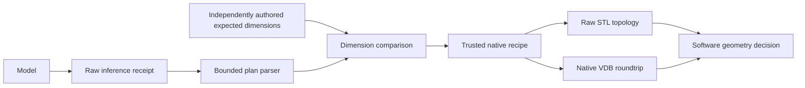

# Native validation of Qwen's PicoGK proposals

The [plan adapter](../qwen-picogk-20261012/RESULTS.md) is merged in
[PR 190](https://github.com/cluster2600/porscheparts/pull/190), after successful
CI, as `0b5e21f3072b22e1032109bbd3454f197967935e`. This continuation makes its
bounded proposals usable through an independent software geometry screen.
It does not change model weights, serving defaults or any part catalogue.

The model emits numeric plans for five owner-authored recipes. Correct numbers
and successful compilation do not ensure a sound exported mesh. The previous
final evaluation already found ThreadCutter exports failing the raw mesh
screen. The new command rejects these exports individually, retaining the
original files and the reason for rejection.

## What must pass

1. The inference receipt must record a complete accepted response. Its raw JSON
   is parsed again with the existing bounded parser. The receipt's cached plan
   and claimed geometry/qualification flags cannot determine acceptance.
2. Recipe and dimensions must match a separate, independently authored expected
   plan. Prepare this file from the request **before inference**. The caller
   must establish its provenance; separate filenames alone cannot prove that
   dimensions were measured or authored independently.
3. The trusted host executes the fixed recipe. Existing material/void probes,
   STL reload and applicable analytic-volume checks must pass.
4. The original native voxel field is saved as `model_geometry` in VDB and
   loaded by name. Field type, voxel size, SI metadata, native field equality,
   volume and bounds must survive the roundtrip. No field is rebuilt from STL.
5. The independent [raw STL auditor](../../twins/m64-cylinder-head/source/picogk-local-junction/audit_mesh.py)
   must report a closed, consistently oriented surface with positive signed
   volume and no exactly zero-area faces. It indexes exactly equal coordinates;
   it does not round vertices, remove faces or repair the mesh.



All checks must pass for `accepted_synthetic_geometry`. Every report retains
`manufacturing_qualified=false`. A rejection exits with status 2. Existing
output directories cannot be overwritten. Native failures retain their logs.
The complete source/runtime binding is checked before and after execution.

## Local use

Use the existing CAD Python with NumPy and trimesh; no dependency is added.
Preparation requires the original frozen local dataset/source preparation and
the [pinned library profile](../qwen-picogk-20261012/library-profile.json).
This implementation uses the existing local Mac SDK paths from `pilot.py`.

```sh
/Users/maxime/projects/3dprinting993/work/cad-recode-tools-venv/bin/python \
  training/qwen-picogk-native-gate/gate.py --prepare \
  --source-work /Users/maxime/Documents/PicoGK-Model-Optimization/2026-10-12-r2 \
  --work /absolute/path/to/a/new-native-gate-directory
```

Preparation checks the original frozen inputs, derives a private copy of the
trusted host with one VDB witness call, and compiles its 87 pinned library
sources plus the two host files. It preserves the original host and training
receipts. Its generated source, executable, runtime and auditor are hash-bound
in a new `FROZEN.json`; no model-supplied code enters the build.

For a synthetic pipe request of length 1.8 cm, outer diameter 1.4 cm and bore
diameter 0.6 cm, first author a separate `expected.json`:

```json
{"recipe":"pipe","parameters_mm":[18,7,3],"missing":[]}
```

Run the existing [inference command](../qwen-picogk-20261012/README.md) to produce
`proposal.json`. Then check it using an unused output directory:

```sh
/Users/maxime/projects/3dprinting993/work/cad-recode-tools-venv/bin/python \
  training/qwen-picogk-native-gate/gate.py \
  --work /absolute/path/to/the/prepared-native-gate-directory \
  --receipt /absolute/path/to/proposal.json \
  --expected /absolute/path/to/expected.json \
  --output /absolute/path/to/a/new-geometry-directory --voxel-mm 0.5
```

The output contains `report.json`, the plan, native log/metrics, unchanged raw
STL, native VDB and VDB comparison. Only 0.5 and 1.0 mm resolutions are admitted.
The model does not choose the resolution. Keep all exports, including rejected
ones, with the request and independently authored contract.

## Measured continuation

[results.json](results.json) records ten authored native witnesses at two
resolutions and one additional model-to-geometry pipe smoke request. These are
software regression witnesses with shared recipes, not an unseen benchmark of
general library mastery. The pipe contract and protocol were saved before
inference. The existing final 24 model cases remain exposed regression data.

The native and VDB checks pass 10/10; raw topology passes 9/10. The thread at
0.5 mm is rejected although its dimensions, native probes and VDB are correct.
Its 1.0 mm export passes this raw screen. This is an individual export result,
not evidence that coarse threads are preferable or that a thread standard is
met. The fresh model pipe returns `[18,7,3]` mm and passes the full chain.

Eight malformed, mismatched, incomplete or missing-interface inputs are
rejected before geometry executes. A second call targeting the existing
accepted pipe directory fails without changing its raw STL. The small boundary
self-check also runs in CI without the private SDK.

The two focused Python checks pass. Full `make check` with the existing CAD
Python stops with an abort in the unrelated existing OpenUSD native test, after
two existing floating-result failures and a local Docker audit error. Its run
did not complete. The same OpenUSD file passes 3/3 checks when run alone; the
full-suite native-runtime interaction remains unresolved. The system-Python
recheck completes 3,798 tests in 253 seconds, with two floating-result failures,
26 SciPy/Python-3.10 errors and 229 skips. These local full runs are not green.
Strict documentation links pass across 884 Markdown files. GitHub CI is a
separate publication check; this experiment snapshot does not claim its result.

## Remaining work

This screen does not detect every self-intersection, establish clearances,
measure OEM interfaces, validate materials or prove fatigue/thermal performance.
VDB equality proves serialization fidelity, not correct physics or geometry.
Full HelixHeatX, additional lattice/boolean/frame operations, scalar/vector
fields, CFD/FEA and manufacturing review require their own contracts and checks.
Native export defects need geometry/kernel investigation; more training cannot
repair an unchanged trusted export recipe. New learning should use fresh task
families and a new closed evaluation, retaining this adapter as a reference.

## Status after the qualified command (2026-10-14)

[PR 257](https://github.com/cluster2600/porscheparts/pull/257) merged a
[qualified plan command](../qwen-picogk-qualified-20261014/README.md) that is now
the installed command on the project Mac; the legacy command remains its rollback.
This gate still accepts only legacy [inference](../qwen-picogk-20261012/ask.py)
receipts. A qualified receipt records `plan` and `semantic_intent_verified` but
neither `raw_response` nor `structure_passed`, so the gate refuses it before any
geometry executes. A unit test keeps this refusal visible. Both paths compare
plans with the same `pilot.matches`; no second matching rule is introduced.

Admitting qualified receipts means changing `gate.py`. [results.json](results.json)
pins its SHA-256, so the ten native witnesses and the model smoke would have to be
re-run on the Mac rather than re-hashed. The
[Mac setup notes](../../docs/PICOGK_MAC_SETUP.md) also record that the prepared
gate manifest references two coding-008 checkpoint files that are no longer
available. `verify` re-hashes every manifest entry, so that prepared directory
would fail closed. Neither re-run was attempted from this repository.

CI now also checks, without the private runtime, that the recorded source digests
match the committed `gate.py`, `VdbWitness.cs` and auditor, that every summary
count follows the recorded witnesses, that the raw-mesh decisions follow the
auditor's rule recomputed from the recorded topology, and that the eight negative
inputs never executed geometry.
