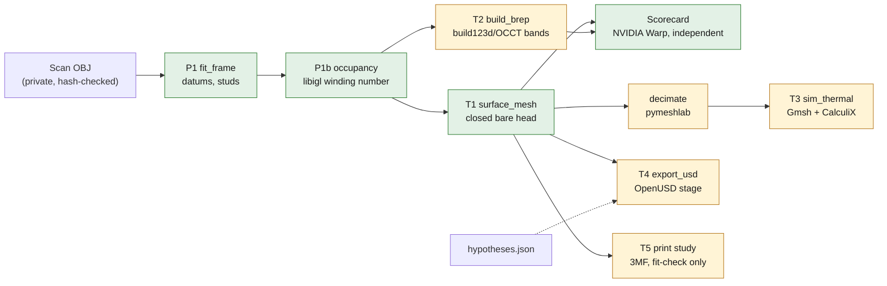

# 935 cylinder head: CAD twin, rebuilt top-down

> **Study twin. Not measured, not functional, not released.** It reconstructs
> the Wolfe Classics 935 Xtreme head scan (SHA-256 `4623d5d3…c766486`,
> 1 OBJ unit = 1 mm by owner instruction, no physical calibration). Unobserved
> geometry is closed by declared hypotheses listed in
> [hypotheses.json](hypotheses.json); none is a measurement.

## Why this directory exists

The earlier line repaired the scan from the bottom up: about seventy studies
under `docs/research/935-*` tried to admit, one evidence class at a time,
surfaces for the scan's 928 open boundary loops. On 2026-11-06 the owner froze
that line ([notice](../reference-935-cylinder-head/README.md)). Two measured
facts motivated the change:

- 87 loops of 20 mm or more hold 67% of the 99,876 open edges. They sit at fin
  roots and deep in the ports, where the scanner never looked. They are
  occlusions, not defects; no local admission rule can fill them honestly.
- The machined faces of the scan are excellent: the deck plane fits at
  0.040 mm RMS over 3,573 mm². The head is mostly plates, cylinders and
  extrusions along its bore axis, so it fits naturally top-down.

The twin is therefore built from fitted datums and an inside/outside field,
and progress is measured by one number that can only rise: the share of the
acquired scan surface the twin explains within tolerance.

## Chain and selected tools

| Role | Selected tool | Script |
|---|---|---|
| Datums, stud separation | NumPy/SciPy fits on acquired facets | [fit_frame.py](source/fit_frame.py) |
| Inside/outside of the open scan | libigl fast winding number (CGAL/MeshLib/libigl scan route) | [occupancy.py](source/occupancy.py) |
| Closed bare-head surface | scikit-image marching cubes, trimesh checks | [surface_mesh.py](source/surface_mesh.py) |
| Editable B-rep | build123d 0.13 / OCCT (OCP 8.0.1) | [build_brep.py](source/build_brep.py) |
| Independent scorecard | NVIDIA Warp BVH queries, trimesh oracle | [score_twin.py](source/score_twin.py) |
| Simulation surface | pymeshlab topology-preserving decimation (recon image) | [decimate.py](source/decimate.py) |
| Thermal FE screen | Gmsh HXT + CalculiX 2.21 (cadsim image) | [sim_thermal.py](source/sim_thermal.py) |
| OpenUSD stage | OpenUSD 26.11 (`usd-core`) + ComplianceChecker | [export_usd.py](source/export_usd.py) |

The private inputs and outputs live under `work/935-cad-twin/` (ignored by
Git). Only code, fitted scalar parameters and statistics are committed, as
the owner decided on 2026-11-06; the STEP, meshes and USD stay private and
rebuild from the code. [run_twin.sh](source/run_twin.sh) replays the chain.

## Results

### P1 datums ([frame.json](params/frame.json))

| Datum | Fit on acquired facets |
|---|---|
| Deck (combustion face), defines Z | plane, 3,573 mm², RMS 0.040 mm, p95 0.068 mm |
| Register recess | Ø113.88 mm, radial RMS 0.29 mm |
| Chamber shoulder | Ø92.80 mm, radial RMS 0.22 mm |
| High-B / low-B flange planes | RMS 0.33 / 0.14 mm; within 0.17° / 0.48° of the frame |
| Cam-housing side | not one plane: pads on several levels over about 4 mm |
| Studs (hardware) | 10 rods, Ø6.4–8.0 mm fits of threaded M8-class studs: 6 cam-side (4 × ≈51 mm, 2 × ≈20 mm proud), 2 per flange (≈21–23 mm) |

Two short rod-like features (Ø4.6 × 7 mm and Ø6.4 × 8.7 mm proud) fail the
stud test and stay in the body, flagged as H08.

### T1 closed bare-head surface

The libigl winding-number field at 0.25 mm gives 1,095,128 mm³ inside. Of
that, 239,664 mm³ of voxels have 0.2 < w < 0.8: the surface transition band
plus the unobserved regions. Marching cubes yields a single **watertight,
consistently wound** surface of 7.08 M triangles enclosing 1,095,597 mm³.
Its genus is 437, far above what a real head needs: closure handles in the
unobserved fin gaps and passages, part of the H01/H02/H04 footprint.

### Independent scorecard ([scorecard-t1.json](params/scorecard-t1.json))

| Metric | T1 |
|---|---|
| Acquired scan area within 0.1 mm of the twin | 89.5% |
| Acquired scan area within 0.2 mm of the twin | **99.4%** of 146,967 mm² (studs excluded) |
| Scan → twin distance | median 0.044, p95 0.118, p99 0.166 mm |
| Twin area supported by the scan (≤ 0.2 mm) | **87.9%** |
| Twin area inferred (hypotheses) | 12.1%, 21,450 mm² |
| Warp vs trimesh oracle on 5,000 samples | max difference 1.2e-5 mm |

The 0.1 mm residual is mostly the 0.25 mm voxel pitch, not the scan. By
zone, the deck, fin and cam bands score alike (p95 0.114–0.130 mm).

### T2 editable B-rep: measured negative result

The band-stack B-rep was tried on a 10 mm slab (z 20–30 mm) and stopped
rather than tuned:

| Variant | Cost | Outcome |
|---|---|---|
| B-spline loops (approximation) | > 120 s for one band | stopped |
| B-spline loops (periodic interpolation, 0.5 mm) | 190 s for one band | invalid solid, 35% excess volume |
| Polygon loops (0.05 mm), glue fuse tree | 0.64 s per band, 230 s fuse for 90 prisms | 41 slices gave 41 bands; fused result invalid (13 solids, 55k faces) |

Sloped port and dome walls defeat band merging, and OCCT cannot glue
hundreds of dense prisms into one valid solid. A full-body editable B-rep
therefore needs a real feature tree: each fin as one extrusion of its
observed mid-plane outline, a revolved deck/register/chamber, and ports as
lofts through observed sections. That is the next milestone. T1 already
carries simulation, print and USD.

## Phase ledger

| Phase | Inputs | Output | Check | State |
|---|---|---|---|---|
| P0 freeze | owner decision | notices in the old twin README and `docs/ARCHIVE.md` | — | done |
| P1 datums | scan | [params/frame.json](params/frame.json) | plane/circle residuals recorded | done |
| P1b occupancy | scan, frame | private winding-number grid; [summary](params/occupancy-summary.json) | ambiguous volume reported | done |
| T1 surface | occupancy | private closed surface; [summary](params/t1-surface-summary.json) | watertight, winding, genus | see results |
| Scorecard T1 | scan, frame, T1 | [scorecard-t1.json](params/scorecard-t1.json) | Warp vs trimesh oracle | see results |
| T2 B-rep v0 | occupancy | private STEP; [summary](params/t2-brep-summary.json) | BRepCheck, scorecard | see results |
| T3 thermal | T1 decimated | private FE files; [result](params/thermal-screen.json) | mesh quality, solver return | see results |
| T4 USD | T1, frame, hypotheses | private `.usdc`; [summary](params/usd-summary.json) | OpenUSD compliance | see results |
| v1 features | frame, scan | analytic deck, register, stud passages, flanges, chamber, ports | per-feature scorecard | next |
| Port CFD | v1 ports | OpenFOAM steady port flow | mesh/flux convergence | blocked by v1 ports |
| SimReady | T2 STEP | NVIDIA usd-convert-cad + omni.asset_validator | validator report | needs the 10 GB image on X1/Kali |
| AM study | T1/T2 | PicoGK supports, Adamantine cooldown | as in the earlier study | after v1 |

## Limits

- Distances are to the acquired surface. They say nothing about unobserved
  geometry, the specimen's true dimensions, its material or its function.
- The studs are hardware fitted as cylinders; their threads and tapped holes
  are hypotheses (H03).
- The thermal case is a declared hypothesis set, uncorrelated with an engine.
- Engine use, metal manufacture and any interface claim remain prohibited
  without the evidence named in the repository rules.
