# 935 cylinder head: CAD twin, rebuilt top-down

> **Study twin. Not measured, not functional, not released.** It reconstructs
> the Wolfe Classics 935 Xtreme head scan (SHA-256 `4623d5d3…c766486`,
> 1 OBJ unit = 1 mm by owner instruction, no physical calibration). Unobserved
> geometry is closed by declared hypotheses listed in
> [hypotheses.json](hypotheses.json); none is a measurement.

## State on 2026-11-11

| Body | What it is | Scan within 0.2 mm | p95 | What runs on it |
|---|---|---|---|---|
| T1s | reference surface: marching cubes of the occupancy, snapped onto the scan | 99.5% | 0.015 mm | thermal screen, OpenUSD stage, 3MF, AM screen |
| **v2** | **CAD body: a loft through sections, one closed solid, regenerated from code** | **97.4%** | **0.157 mm** | thermal screen, OpenUSD stage, 3MF, all rebuilt from it; packaged with a collider and a display material as `.usda` and `.usdz` |
| v1 | analytic features: deck plate and two port lofts as B-rep, prism stack | 69.9% | 0.846 mm | STEP → OpenUSD with the NVIDIA converter |

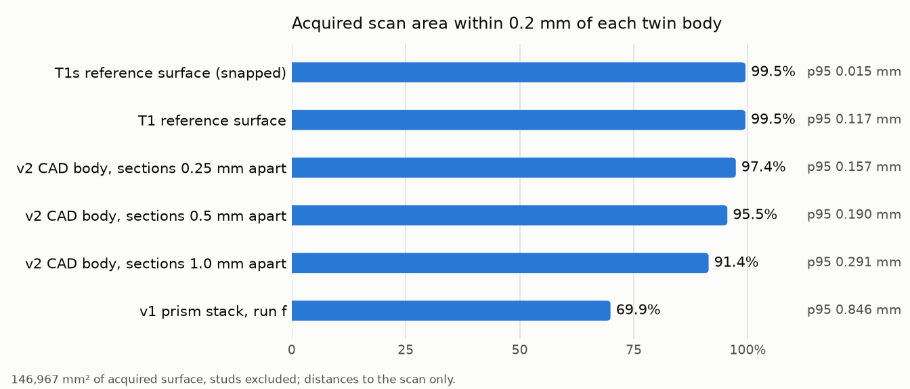

Every row of the [phase ledger](#phase-ledger) is closed or closed with a
stated blocker. What the twin still does not have:

- **A B-rep of the whole body.** v2 is a triangle solid; only the deck plate
  and the two port lofts are B-rep.
- **A valve train.** The guides, seats, throats, plug bores and stud passages
  are now [fitted where the scanner reached them](#machined-features-fitted-with-the-assigned-tool-checked-with-cloudcompare-windows-fits-check):
  two valve axes, 25.9° and 29.9° from the bore axis, a guide bore of 8.51 mm
  and seats near 45° and 49°. CloudCompare confirms 4 of the 32 fits within
  0.2 mm, so they are nominal sizes and axes, not inspected surfaces. No
  valve, seat insert or guide is modelled in a body (H05), no port-flow domain
  is admissible and no port CFD was run.
- **Any physical calibration.** Every distance is to the scan, whose scale is
  an owner instruction. The 993 workshop manual does not contradict that
  scale, but it describes another head.
- **An alloy and a machine for the print study.** Published conductivities
  are [ranked on two thermal screens](#alloy-and-machine-for-a-simulated-lpbf-print-candidates-bare-head-ranking-assembly-case-assembly-ranking-literature-machines-993-comparison),
  and every candidate runs above the published head-temperature limit at the
  declared load. No Chinese maker publishes a complete data set. Nothing is
  selected.

## Why this directory exists

The earlier line repaired the scan from the bottom up: about seventy studies
under `docs/research/935-*` tried to admit, one evidence class at a time,
surfaces for the scan's 928 open boundary loops. On 2026-11-06 the owner froze
that line ([notice](../reference-935-cylinder-head/README.md)). Two measured
facts motivated the change:

- 87 loops of 20 mm or more hold 67% of the 99,876 open edges. They sit at fin
  roots and deep in the ports, where the scanner never looked. They are
  occlusions, not defects; no local admission rule can fill them honestly.
- The machined faces of the scan are excellent: the deck plane fits at
  0.040 mm RMS over 3,573 mm². The head is mostly plates, cylinders and
  extrusions along its bore axis, so it fits naturally top-down.

The twin is therefore built from fitted datums and an inside/outside field,
and progress is measured by one number that can only rise: the share of the
acquired scan surface the twin explains within tolerance.

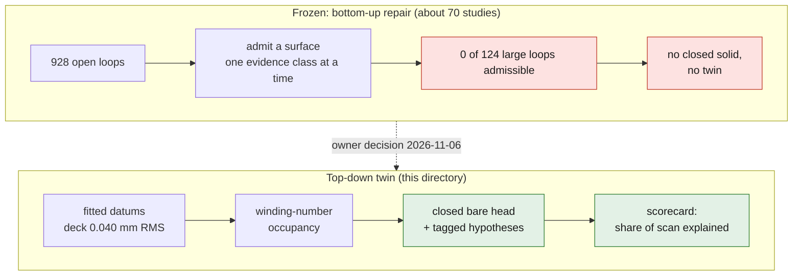

Every surface of the twin belongs to exactly one evidence class, and only one
class can count as observed:

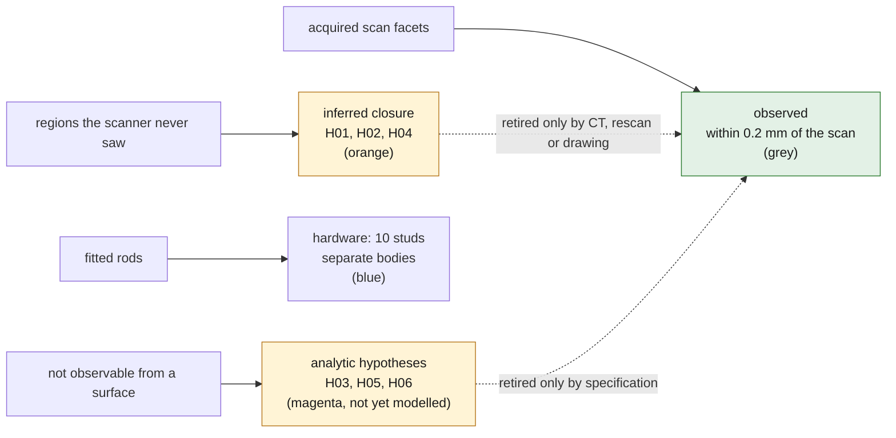

## Chain and selected tools

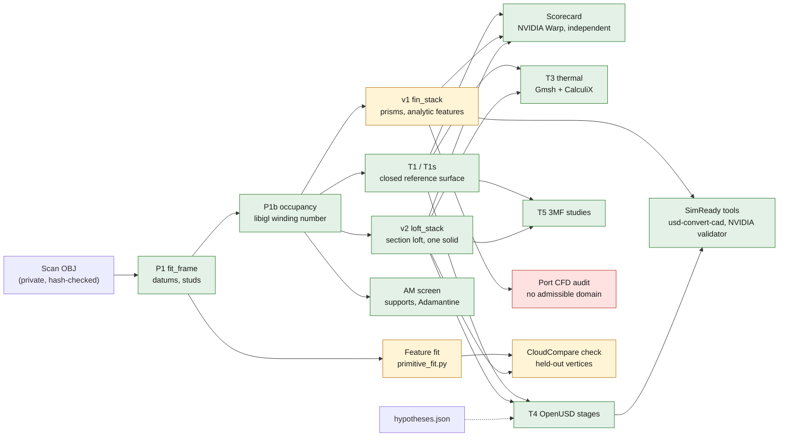

*Diagram: the chain as run. T1s is the reference surface; v2 is the CAD body
and feeds the same tiers; v1 holds the analytic features and stops at 69.9%.
The feature fit is amber because CloudCompare confirms 4 of its 32 features.*

| Role | Selected tool | Script |
|---|---|---|
| Datums, stud separation | NumPy/SciPy fits on acquired facets | [fit_frame.py](source/fit_frame.py) |
| Inside/outside of the open scan | libigl fast winding number (CGAL/MeshLib/libigl scan route) | [occupancy.py](source/occupancy.py) |
| Closed bare-head surface | scikit-image marching cubes, trimesh checks | [surface_mesh.py](source/surface_mesh.py) |
| Editable B-rep | build123d 0.13 / OCCT (OCP 8.0.1) | [build_brep.py](source/build_brep.py) |
| Fin faces, port sections | NumPy/SciPy fits on acquired facets and on the occupancy field | [fit_fins.py](source/fit_fins.py), [fit_ports.py](source/fit_ports.py) |
| Body stack, port lofts | build123d / OCCT, one process per band | [fin_stack.py](source/fin_stack.py), [port_loft.py](source/port_loft.py) |
| Independent scorecard | NVIDIA Warp BVH queries, trimesh oracle | [score_twin.py](source/score_twin.py) |
| Simulation surface | pymeshlab topology-preserving decimation (recon image) | [decimate.py](source/decimate.py) |
| Thermal FE screen | Gmsh HXT + CalculiX 2.21 (cadsim image) | [sim_thermal.py](source/sim_thermal.py) |
| OpenUSD stage | OpenUSD 26.11 (`usd-core`) + its 30 validators | [export_usd.py](source/export_usd.py) |
| CAD body (v2) | Shapely sections, `manifold3d` 3.5 union (double precision) | [loft_stack.py](source/loft_stack.py) |
| Occupancy of the CAD body | NumPy plane cut and scan-line fill | [loft_occupancy.py](source/loft_occupancy.py) |
| Thermal comparison | joins solver result, surface report and energy balance | [thermal_summary.py](source/thermal_summary.py) |
| STEP → OpenUSD, NVIDIA validation | `usd-convert-cad` 0.2.0, `usd-validation-nvidia` 1.21.0 (two separate venvs) | [simready_convert.py](source/simready_convert.py), [simready_check.py](source/simready_check.py) |
| LPBF orientation screen | NumPy voxel columns on the occupancy grid | [am_supports.py](source/am_supports.py) |
| Cooldown screen | Adamantine 1.1.9 (`rombur/adamantine:1.1`) with an independent VTU reader | [am_cooldown.py](source/am_cooldown.py) |
| Port-flow admissibility | reads the port fit and the hypotheses register | [audit_port_domain.py](source/audit_port_domain.py) |
| Revolved machined features | [`primitive_fit.py`](../../benchmarks/scan-primitive-fitting/primitive_fit.py), the assigned cylinder and cone fit, in its own locked environment | [fit_features.py](source/fit_features.py) |
| Independent deviation of each feature and of the v2 body | CloudCompare 2.13.2 in the `free-tools-cloudcompare` image, no network | [check_features.py](source/check_features.py) |
| Asset package: collider, display material, `.usda` and `.usdz` | OpenUSD 26.11 (`UsdPhysics`, `UsdShade`, `UsdUtils`), then both validators | [export_simready.py](source/export_simready.py) |
| Alloy ranking on the bare head | CalculiX 2.21 on the deck of the CAD-body screen, conductivity replaced (cadsim image) | [alloy_thermal.py](source/alloy_thermal.py) |
| Alloy ranking in the assembly | hypothesis solids on the occupancy lattice, Gmsh HXT, CalculiX with four materials and five films | [assembly_thermal.py](source/assembly_thermal.py) |
| Six-view render of the body, read by the agent | `preview.py` of the `cad-skill` skill (trimesh, pyrender, EGL under `xvfb-run`) | none: the script is the skill's |

The private inputs and outputs live under `work/935-cad-twin/` (ignored by
Git). Only code, fitted scalar parameters and statistics are committed, as
the owner decided on 2026-11-06; the STEP, meshes and USD stay private and
rebuild from the code. [run_twin.sh](source/run_twin.sh) replays the chain.

## Results

### P1 datums ([frame.json](params/frame.json))

| Datum | Fit on acquired facets |
|---|---|
| Deck (combustion face), defines Z | plane, 3,573 mm², RMS 0.040 mm, p95 0.068 mm |
| Register recess | Ø113.88 mm, radial RMS 0.29 mm |
| Chamber shoulder | Ø92.80 mm, radial RMS 0.22 mm |
| High-B / low-B flange planes | RMS 0.33 / 0.14 mm; within 0.17° / 0.48° of the frame |
| Cam-housing side | not one plane: pads on several levels over about 4 mm |
| Studs (hardware) | 10 rods, Ø6.4–8.0 mm fits of threaded M8-class studs: 6 cam-side (4 × ≈51 mm, 2 × ≈20 mm proud), 2 per flange (≈21–23 mm) |

Two short rod-like features (Ø4.6 × 7 mm and Ø6.4 × 8.7 mm proud) fail the
stud test and stay in the body, flagged as H08.

### The stud repair of 2026-11-11 ([occupancy](params/occupancy-summary.json))

The first render of the v2 body showed five slivers, 1.3 to 5.1 mm wide,
standing 18 to 26 mm above the cam face beside three of the four long
studs. They were stud, not head. `occupancy.py` removed the facets within
0.8 mm of each fitted stud cylinder, but the studs are scanned as smeared
shells: their vertices lie up to 3.7 mm off the fitted cylinder (radial RMS
0.33 to 0.81 mm). 8,881 stud facets, 497 mm², stayed in the "bare" head,
and the winding number closed them into slivers.

The rule now also removes, above the height from which `fit_frame.py` fitted
each rod (6 mm beyond its face), every facet inside the rod's own cluster:
its radius plus its largest radial residual. No facet lies within 3 mm
outside that envelope on any of the ten studs, so the envelope separates
stud from head without a tuned margin. The independent checker applies the
same rule from `frame.json`, in its own code.

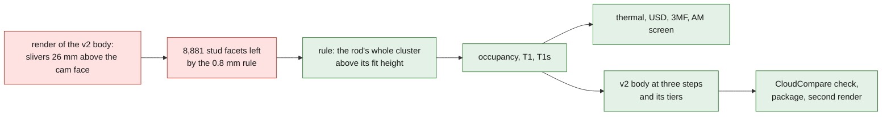

*Diagram: what the repair rebuilt. Everything from the occupancy field down
was run again in a new private folder; the state before it is kept in the
private release `935-head-cad-twin-work-20261111`.*

| Quantity | Before | After |
|---|---|---|
| Stud facets removed | 144,731 | 153,612 |
| Top of the body above the deck | 113.8 mm | 94.6 mm |
| Largest scan-to-body distance (v2) | 48.5 mm | 5.5 mm |
| v2 body, scan within 0.2 mm / p95 | 97.31% / 0.1579 mm | 97.37% / 0.1572 mm |
| Thermal minimum, 1.0 / 0.75 mm surface | 146.6 / 127.5 °C, not converged | 154.3 / 154.6 °C |
| Deck-up support envelope | 883,849 mm³ | 511,388 mm³ |
| Edges shared by more than two faces once welded (v2) | 23 | 5 |

Two earlier readings were the residue and not the head: the thermal minimum
"on thin fin tips", and the scan facets up to 48 mm from every body.

Not rebuilt, and kept as measured before the repair: the v1 runs a to h,
their scorecards and error breakdown, the T2 slab, the deck plate and the
two port lofts with their SimReady conversions, and the fTetWild and
decimation trials. The fin faces and the port sections were fitted again:
the fin levels moved by at most 0.003 mm and the port section radii by at
most 0.06 mm. The v1 bodies were built from the earlier fits.
One enclosed "cavity" of 7,393 mm³ on the cam side is gone from the port
fit: the stud residue had closed it.

What the repair does not reach: below the fit height the 0.8 mm rule still
applies, and stubs up to 5.5 mm tall remain beside three studs. The two
short rods of H08 are unchanged.

### T1 closed bare-head surface

The libigl winding-number field at 0.25 mm gives 1,094,498 mm³ inside. Of
that, 238,787 mm³ of voxels have 0.2 < w < 0.8: the surface transition band
plus the unobserved regions. Marching cubes yields a single **watertight,
consistently wound** surface of 7.05 M triangles enclosing 1,094,988 mm³.
Its genus is 430, far above what a real head needs: closure handles in the
unobserved fin gaps and passages, part of the H01/H02/H04 footprint.

### Independent scorecard ([scorecard-t1.json](params/scorecard-t1.json))

The checker shares no code with the producers. It re-reads the original OBJ,
re-derives the hardware exclusion and measures with its own Warp kernel; a
trimesh oracle re-measures a random sample:

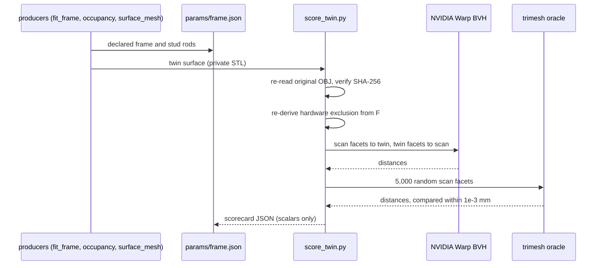

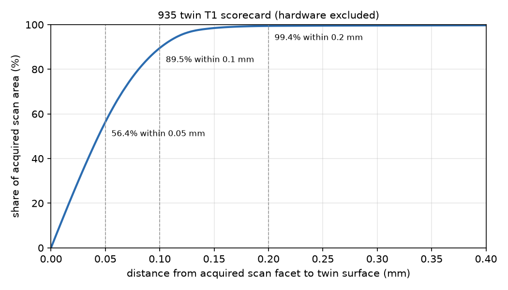

| Metric | T1 |
|---|---|
| Acquired scan area within 0.1 mm of the twin | 89.7% |
| Acquired scan area within 0.2 mm of the twin | **99.5%** of 146,470 mm² (studs excluded) |
| Scan → twin distance | median 0.043, p95 0.117, p99 0.163 mm |
| Twin area supported by the scan (≤ 0.2 mm) | **88.0%** |
| Twin area inferred (hypotheses) | 12.0%, 21,179 mm² |
| Warp vs trimesh oracle on 5,000 samples | max difference 1.3e-5 mm |

The 0.1 mm residual of T1 is the 0.25 mm voxel pitch, not the scan. By
zone, the deck, fin and cam bands score alike (p95 0.113–0.129 mm).

### T1s: observed vertices snapped onto the scan ([summary](params/t1s-snap-summary.json), [scorecard](params/scorecard-t1s.json))

[snap_surface.py](source/snap_surface.py) moves each T1 vertex whose closest
scan point is within 0.3 mm onto that point (2.97 M of 3.52 M vertices),
rejecting any triangle that would turn by more than 60°. It runs until
rejection converges (17 rounds). Snapping both sides of the thinnest walls
folded 4,053 faces, so
[unsnap_intersections.py](source/unsnap_intersections.py) returns those
vertices and one ring around them to T1 until pymeshlab finds no
self-intersection (4 rounds, 5,745 vertices). Connectivity never changes.

| Metric | T1 | **T1s** |
|---|---|---|
| Scan area within 0.1 mm | 89.7% | **99.1%** |
| Scan → twin p95 | 0.117 mm | **0.015 mm** |
| Twin area supported by the scan | 88.0% | 87.5% |
| Watertight, consistent winding, self-intersections | yes, yes, 0 | yes, yes, 0 |

T1s is the reference twin surface.

### T3 steady thermal screen ([thermal-screen.json](params/thermal-screen.json))

Declared hypothesis case, uncorrelated with any engine: generic cast
aluminium (k = 150 W/m·K), chamber wall fixed at 220 °C, every other face
cooled by air at 40 °C with h = 80 W/m²·K. Mesh: Gmsh HXT inside the
marching-cubes surface of the occupancy field coarsened to 1.0 mm (399k
triangles, watertight, genus 10). Solver: CalculiX 2.21, iterative Cholesky.

| Quantity | 1.0 mm surface | 0.75 mm surface |
|---|---|---|
| Tetrahedra / nodes | 4,928,248 / 889,267 | 9,603,449 / 1,720,334 |
| Elements with minSICN < 0.1 (none inverted) | 0.41% | 0.36% |
| Temperature min / mean / p95 / max (°C) | 154.3 / 189.3 / 214.6 / 220.0 | 154.6 / 188.3 / 214.5 / 220.0 |
| Heat entering at the chamber | 1,641.7 W | 1,679.4 W |
| Convective loss recomputed independently | 1,646.3 W (0.28%) | 1,682.6 W (0.19%) |

The levels agree: mean within 0.5%, p95 within 0.03%, heat within 2.3%, and
the minimum within 0.3 °C. Both the surface and the mesh change between
levels, so this is a resolution check rather than a pure mesh study.

Until 2026-11-11 the minimum read 146.6 and 127.5 °C and was recorded as not
converged, on "thin fin tips". It sat on the stud residue described under
[the stud repair](#the-stud-repair-of-2026-11-11-occupancy): slivers a few millimetres
wide standing 26 mm clear of the head. With the studs properly removed the
two levels give 154.3 and 154.6 °C.

The first attempt failed because the deck used node set `NALL` before
defining it ([attempt 1](params/thermal-attempt-1.json)). The deck writer now
defines it. fTetWild was stopped after 2 h 42 min of CPU without output.

### T4 OpenUSD stage ([usd-summary.json](params/usd-summary.json), [NVIDIA validation](params/simready-validate-t4-stage.json))

`/Head935` (Z-up, millimetres) holds:

- the T1s display surface (600,000 triangles on 299,141 welded points) with
  one authored normal per face and an indexed per-face colour: grey is
  observed, orange inferred (12.7% of area);
- the 10 studs as hardware cylinders;
- the datums as customData.

All 30 OpenUSD 26 validators report no finding. The NVIDIA validator
(42 rules) reports no failure or error and one warning: one non-manifold
vertex in the decimated display surface. The stage of 2026-11-10, decimated
from the surface that still carried the stud residue, passed with no issue;
the warning is left as measured. The first stage, written on 2026-11-09,
passed the OpenUSD validators but failed the NVIDIA ones: no normals on a
mesh without subdivision, three points per triangle, and an unindexed
colour. [export_usd.py](source/export_usd.py) now welds the points, authors
the normals and indexes the colour.

### T5 print study ([print-summary.json](params/print-summary.json))

A single-object 3MF of T1s in millimetres: 7,050,948 triangles, watertight,
consistent winding. A streaming re-read gives exactly the same volume
(1,094,605.2 mm³). The file is labelled as a fit-check study object, never
an engine part or a metal build file.

### T2 editable B-rep: measured negative result

The band-stack B-rep was tried on a 10 mm slab (z 20–30 mm) and stopped
rather than tuned:

| Variant | Cost | Outcome |
|---|---|---|
| B-spline loops (approximation) | > 120 s for one band | stopped |
| B-spline loops (periodic interpolation, 0.5 mm) | 190 s for one band | invalid solid, 35% excess volume |
| Polygon loops (0.05 mm), glue fuse tree | 0.64 s per band, 230 s fuse for 90 prisms | 41 slices gave 41 bands; fused result invalid (13 solids, 55k faces) |

The slab was built with a `slice_region` that dropped islands standing inside
holes (see the v2 body below); the trial has not been repeated.

Sloped port and dome walls defeat band merging, and OCCT cannot glue
hundreds of dense prisms into one valid solid. A full-body editable B-rep
therefore needs a real feature tree: each fin as one extrusion of its
observed mid-plane outline, a revolved deck/register/chamber, and ports as
lofts through observed sections. That feature tree is v1 below; it stops at
69.9% within 0.2 mm, and the body is now the v2 section loft.

### v1 feature tree: deck-plate baseline ([features](params/deck-features.json), [score](params/deck-features-score.json))

[deck_features.py](source/deck_features.py) starts the editable feature tree
on the deck zone. It fits analytic features to acquired facets:

- the outer sides and corner radius (6.3 mm);
- the register recess Ø113.88 mm with its floor at z = 2.17 mm;
- the four stud passages (from iteration 2, Ø10.58–10.93 mm).

It builds them as a valid 16-face build123d solid (private STEP), and scores
that zone with the scorecard's Warp kernel. Progress is tracked per iteration:

| Iteration | Change | Median | p95 | Within 0.2 mm |
|---|---|---|---|---|
| 0 baseline | plate, register recess, 2 passages | 0.78 mm | 5.62 mm | 31% |
| 1 | chamber dome: sphere R 56.44 mm fitted to 48,013 facets (RMS 0.24 mm), cut inside the Ø92.80 shoulder | 0.43 mm | 4.00 mm | 41% |
| 2 | four stud passages found by seeding at the recorded pattern: Ø10.58–10.93 mm on about 86.2 × 85.6 mm. The two "passages" of iteration 0 were other features | **0.29 mm** | **3.05 mm** | **45%** |

| 3 (not adopted) | valve throats fitted: Ø47.94 and Ø46.48 mm, axes about 22° from Z, radial RMS 0.23 / 0.31 mm. Cutting them, with or without a coaxial "boss" (Ø≈30 mm, RMS 0.59 mm, not credible), lowered the score | 0.31 mm | 3.29 / 3.20 mm | 44% |

| 4 | two-level outline: deck face y −65.15…71.10 mm, body steps out at z = 2.75 mm (272 mm² of step faces) | **0.22 mm** | **2.72 mm** | **49%** (81% within 1 mm) |

Iteration 3 is kept as data in the features file, but not in the solid. The throat fits look right; the score drops because the port
interior beyond them (guide bosses, seat rings) is not modelled yet.

Remaining gaps: port interiors behind the throats, the plug bores, the
flange bosses on the outline, and the plate-top level.
Each fix must raise this score; T1s (p95 0.015 mm) stays the reference
surface meanwhile.

### v1 body stack: fins, port lofts and chamber dome ([fin faces](params/fin-faces.json), [port fit](params/port-fit.json), [loft check](params/port-loft-check.json), [error breakdown](params/error-breakdown-v1-stack-f-shell.json))

[fin_stack.py](source/fin_stack.py) builds the whole body as one extrusion per
interval between measured horizontal faces. Each band's sketch is the
occupancy contour at its mid-level; fitted features are then cut from the
bands. The bands stay a compound of individually valid solids. Every run is
kept with its summary and scorecard (`params/v1-body-stack-<run>-summary.json`,
`params/scorecard-v1-stack-<run>[-shell].json`):

| Run | Change | Scored on | p50 | p95 | Within 0.2 mm | Within 0.5 mm | Within 1 mm | Twin area supported |
|---|---|---|---|---|---|---|---|---|
| a | levels from a 0.1 mm detector only | compound | 0.96 mm | 9.65 mm | 28.3% | 39.3% | 50.8% | n/a |
| b | fin faces fitted by [fit_fins.py](source/fit_fins.py) added as boundaries | compound | 0.26 mm | 1.62 mm | 44.1% | 66.9% | 85.6% | n/a |
| c | extrusion direction fixed (see below) | shell | 0.11 mm | 0.90 mm | 65.2% | 84.7% | 96.7% | 56.9% |
| d | 13 fin faces as tilted planes | shell | 0.11 mm | 0.90 mm | 64.8% | 85.7% | 96.6% | 58.1% |
| e | two port lofts cut in | shell | 0.10 mm | 0.87 mm | 67.9% | 87.1% | 96.8% | 57.8% |
| **f** | chamber dome cut, thick cam-side band split | shell | 0.10 mm | 0.85 mm | 69.9% | 88.3% | 96.9% | 59.9% |
| g | trial: interpolated sketches and dome ended at 42 mm | shell | 0.10 mm | 0.87 mm | 69.3% | 87.9% | 96.8% | 59.0% |
| h | trial: interpolated sketches only | shell | 0.10 mm | 0.86 mm | 69.7% | 88.1% | 96.8% | 59.7% |

The first five columns are scan → twin on the whole acquired surface
(146,967 mm², studs excluded by the rule in force before the stud repair).
**Run f is the last v1 run**; the CAD body is now v2, below. Runs a to h were built with a `slice_region` that dropped
every island standing inside a hole: the land inside the sealing groove and
the valve-guide bosses in the spring pockets are missing from them. They are
kept as measured and have not been repeated.

**Compound and shell.** The compound's tessellation contains the faces two
touching bands share, 1.2 to 1.4 million mm² of them. A scan facet lying on
such a hidden face scores as explained although the model has material on both
sides. From run c on, `fin_stack.py` also writes the outer shell: of each pair
of caps meeting on a boundary, only the parts the other band does not cover
are kept. Scored on the shell, run e reads p95 0.87 mm and 67.9% within
0.2 mm, against 0.74 mm and 69.8% on its compound. The compound scorecards of
runs c to e are kept beside the shell ones; runs a and b predate the shell and
their figures are optimistic by a similar margin.

What each step found:

- **Fins (a → b).** The fins are plates normal to the bore axis: 13 top and 15
  bottom faces, median top pitch 5.74 mm. Their faces are cast and spread over
  1 to 2 mm of Z, so the 0.1 mm detector of run a found levels near only 7 of
  the 28 and left single bands from z = 7.6 to 38.1 mm and from 50.0 to
  69.4 mm. `fit_fins.py` histograms up-facing and down-facing facets
  separately at 0.25 mm and fits every face as a level and as a plane.
- **A defect in `band_solid` (b → c).** `extrude()` followed the face normal,
  which the contour orientation decides, so every band of runs a and b sat one
  thickness below its interval (asked 41.80–44.12 mm, built 39.48–41.80 mm).
  The direction is now explicit, checked at build time and covered by a test.
  Runs a and b are kept as measured. The T2 slab trial above used the same
  function and has not been repeated.
- **Tilt (c → d): neutral.** The top faces tilt by a median 0.53° towards
  azimuth ≈ 40° in XY, a steady ramp of about 1.8 mm across the head; the
  bottom faces are flat (median 0.10°). A face becomes a tilted plane when its
  plane fit has at most 0.8 of the level fit's RMS and tilts at least 0.3°;
  one candidate (z = 78.97 mm) is demoted because it would cross its
  neighbour. On the shell the tilt gains 1.0 point within 0.5 mm and loses
  0.4 point within 0.2 mm. It is kept because the ramp is measured, not
  because it scores.
- **Ports (d → e).** [fit_ports.py](source/fit_ports.py) finds the enclosed
  cavities of the occupancy field, follows the two that reach a flange face and
  measures a 48-ray section every 3 mm. [port_loft.py](source/port_loft.py)
  lofts them through periodic splines and adopts a loft only when it explains
  more of its own wall than the stack does. The ports are named by flange
  side; which one is intake is not established.
- **Chamber dome and cam side (e → f).** The fitted sphere (R 56.44 mm) is cut
  inside the fitted shoulder; each band first regains the dome footprint
  where the occupancy is material at the band's top, so valve pockets stay
  open. The 48 mm band above z = 87.2 mm is split at two occupancy steps
  (92.9 and 94.4 mm). The deck zone goes from 70.0% to 75.2% within 0.2 mm.
- **Two rejected trials (g, h).** Ending the dome at 42 mm, where a flat ring
  at the register floor starts to replace the sphere, restores that ring but
  gives up the sphere in rings where most facets still follow it. Taking each
  sketch from the occupancy interpolated at the exact mid-level, instead of
  the nearest 0.25 mm slice, also scores lower. Both stay available as options
  and neither is adopted.

| Port | Loft | Wall seen by the scanner | Port-wall scan within 0.2 mm: stack d → loft |
|---|---|---|---|
| `port_y_minus` | 18 sections, 51 mm, Ø 41–43 mm equivalent | 77% of wall points | 40.8% → 96.2% (5,591 mm²) |
| `port_y_plus` | 9 sections, 24 mm, Ø 38–41 mm equivalent | 92% of wall points | 43.4% → 90.0% (3,017 mm²) |

Each loft stops where its section stops being a tube, before the valve pocket.
The unseen share of each wall is winding-number closure, i.e. hypothesis H04.
The section profiles are geometry and stay private. The other 7 enclosed
cavities above 5,000 mm³ (two of them sit on stud passages) give no run
of closed sections and are not lofted: they are open pockets, not tubes, and
need a different feature.

The bands are built and tessellated in a process pool, and the STEP is written
only on request. The body of run b takes 58 s with 8 workers against 295 s
serially; run f, with its tilt, loft and dome cuts in 34 bands, takes about
5 minutes with 12 workers.

Where run f still misses, from [error_breakdown.py](source/error_breakdown.py)
on its shell, in points of the whole scan area:

| Surface class (facet normal) | Scan area | Within 0.2 mm | Points outside 0.2 mm | Points outside 0.5 mm |
|---|---|---|---|---|
| sloped, 0.17 ≤ \|n_z\| ≤ 0.94 | 39.1% | 60.9% | 15.3 | 5.4 |
| up-facing horizontal | 21.0% | 66.3% | 7.1 | 2.7 |
| down-facing horizontal | 15.1% | 68.6% | 4.7 | 2.4 |
| vertical walls | 24.8% | 88.1% | 3.0 | 1.1 |

- The sloped class is mostly the fin edges: about 15% of the scan area lies
  on the rounded or chamfered rims of the 12 fins, which the prisms leave
  square. The corner is roughly 1.3 mm wide by 0.6 mm high, the same size as
  the scatter of the cast faces it starts from, so a rim feature has to be
  fitted per fin and cannot be a single radius.
- The horizontal classes are the cast fin faces themselves: their plane fits
  leave 0.25 to 0.6 mm RMS, so a planar face cannot bring them all within
  0.2 mm. Within 0.5 mm the whole model stands at 88.3%.
- Still staircase: the port bends and valve pockets beyond the lofts, and
  the other enclosed pockets.
- A few hundred mm² above z = 94 mm (the largest errors, up to 48 mm) belong
  to thin features the mid-level sketch of that band misses.

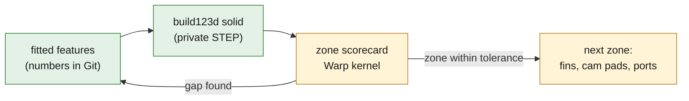

### v2 body: a loft through sections, closed into one solid ([summary](params/v2-loft-s025-summary.json), [scorecard](params/scorecard-v2-loft-s025.json), [error breakdown](params/error-breakdown-v2-loft-s025.json))

Run f stops at 69.9% within 0.2 mm because of what the scan shows the head to
be. Its fins are shallow rounded ribs and its pockets are curved, so most
walls slope, and the cast faces are not planes within tolerance (their plane
fits leave 0.25 to 0.6 mm RMS). A prism leaves a stair on every sloped wall.
[loft_stack.py](source/loft_stack.py) therefore keeps as exact features only
what the scan supports and lofts the rest:

- **Datum faces.** The 54 levels of the 0.02 mm detector (deck, groove floor,
  cam-side pads) are planes across which the section jumps. The body is a
  prism for 0.25 mm on either side of each, because the occupancy grid cannot
  place a wall closer than one voxel to a face.
- **Ruled bands.** Between two faces, sections are taken at most `--step`
  apart; each is the occupancy contour at that exact height. A ring is ruled to
  the ring of the next section that it overlaps. An unpaired ring stays
  vertical and ends on a flat cap. A band in which a ring of 20 mm or more
  finds no partner is split at mid-height, down to 0.125 mm, so that a change
  of topology costs a thin prism instead of a thick one.
- **One solid.** Every polygon of every band is a closed, oriented triangle
  mesh. Manifold unites them. The result is checked again with trimesh and
  scored by the independent checker.

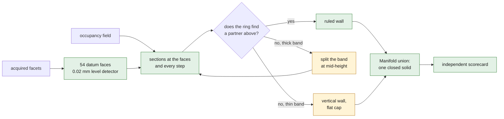

*Diagram: how one band of the v2 body is built. Only a ring with no partner in
a band already 0.125 mm thin becomes a stair step.*

| Sections at most | Bands (split) | Ring length ruled | p50 | p95 | Within 0.1 mm | Within 0.2 mm | Within 0.5 mm | Triangles |
|---|---|---|---|---|---|---|---|---|
| 1.0 mm apart | 157 (36) | 94.9% | 0.052 mm | 0.291 mm | 76.4% | 91.4% | 98.3% | 1.68 M |
| 0.5 mm apart | 241 (48) | 95.7% | 0.048 mm | 0.190 mm | 81.2% | 95.5% | 99.5% | 1.85 M |
| **0.25 mm apart** | 410 (0) | 96.8% | 0.045 mm | **0.157 mm** | 84.6% | **97.4%** | 99.6% | 2.26 M |
| v1 run f, for comparison | 69 | none | 0.099 mm | 0.846 mm | 50.2% | 69.9% | 88.3% | |
| T1, for comparison | | | 0.043 mm | 0.117 mm | 89.7% | 99.5% | 99.8% | 7.05 M |

All three bodies are watertight, consistently wound single solids, and the
checker's oracle agrees within 5e-5 mm on each. **The 0.25 mm body is the
reference CAD body**: 1,095,426 mm³ against 1,094,498 mm³ in the occupancy
field (+0.08%), genus 112, and p95 0.134 / 0.162 / 0.158 mm in the deck, fin
and cam zones.

Where the reference body still misses, in points of the whole scan area:

| Surface class (facet normal) | Scan area | Within 0.2 mm | Points outside 0.2 mm | Points outside 0.5 mm |
|---|---|---|---|---|
| up-facing horizontal | 21.1% | 94.9% | 1.08 | 0.11 |
| sloped | 39.2% | 98.5% | 0.61 | 0.12 |
| vertical walls | 24.6% | 97.3% | 0.66 | 0.18 |
| down-facing horizontal | 15.1% | 98.2% | 0.28 | 0.01 |

The sloped class, 15.3 points outside 0.2 mm in run f, is down to 0.61. The
largest remaining class is the up-facing cast surfaces, which sit between two
sections.

Found on the way, each measured:

- **A defect in `slice_region`.** It united the even rings and subtracted the
  odd ones in one step, which removed every island standing inside a hole. At
  z = 2.3 mm that is the 1,229 mm² land between the chamber and the sealing
  groove; higher up it is the valve-guide bosses in the spring pockets. The
  first loft showed the land missing as a ring 0.9 mm off. Rings are now
  applied from the largest to the smallest, with a test. Every body built
  before the fix lacks those islands (T2 slab, v1 runs a to h).
- **The pairing rule.** A fixed overlap of one half let the two halves of a
  splitting body pair with the whole, and ruling across that folded the wall:
  one band lost 44% of its volume. A whole-ring distance was too strict the
  other way: one small island joining the 900 mm outline disqualified it, and
  only 24% of ring length was ruled. The adopted threshold is the overlap left
  when the ring moves sideways along its whole length by four band
  thicknesses, or by 0.6 mm if that is more.
- **Small unpaired holes.** A hole with no partner, under a wall that leans
  over it, made the polygon invalid and the whole polygon fell back to a
  prism: 27% of ring length. The polygon is now ruled without such holes and
  each is subtracted as a prism (143 holes in the reference body).
- **Needle triangles and the checker.** Long straight walls and the caps of the
  union gave triangles tens of millimetres long and a fraction of a millimetre
  wide. The checker's single-precision kernel lost up to 0.02 mm on them and
  its oracle failed. Section edges are now at most 1 mm and body edges at most
  2 mm; the surface does not move and the scores are unchanged.
- **Rejected: flipping edges to remove flat triangles.** On the body of
  2026-11-10 it changed the genus from 108 to 107, so it is not used. 35
  triangles without area remain in the reference body.

Limits of the v2 body:

- **Its surface area is 14% above the reference surface** (192,794 against
  168,408 mm² for T1s), and 81.9% of it is supported by the scan against
  87.5%. Stair steps remain where rings are unpaired, mostly in unobserved
  regions where the occupancy contour changes from one section to the next.
  Anything that integrates over the raw surface inherits that excess.
- **83 detached pieces (66 mm³ in total) are dropped** and 76 enclosed voids
  (370 mm³) are kept. 0.13% of the scan area is farther than 1 mm from the
  body, against 0.06% for T1.
- **It keeps stud stubs and touches itself at four points.** See the visual
  check under the package section: stubs up to 5.5 mm tall beside three
  removed studs, and 5 non-manifold edges for any tool that welds vertices.
- **It is a triangle solid, not a B-rep.** It regenerates from the code and
  the parameters in about three minutes. As a B-rep it would need one face
  per wall triangle, about 3 million for the reference body, so no STEP is
  written. The B-rep parts of the twin are the v1 deck plate and the two
  port lofts.
- **The analytic chamber sphere and the port lofts are not cut into it.** The
  sphere leaves 0.24 mm RMS on the chamber wall, so the sections describe the
  chamber better; the port lofts stay separate features.

### Tiers rebuilt from the CAD body ([thermal](params/thermal-screen-cad.json), [USD](params/usd-cad-summary.json), [3MF](params/print-cad-summary.json))

The same chain that ran on the scan-derived surface runs on the v2 body.
[loft_occupancy.py](source/loft_occupancy.py) first writes the body's occupancy
on the lattice of the scan occupancy; its volume matches the solid within
0.04%.

| Thermal screen, 1.0 mm surface | From the scan occupancy (T3) | From the v2 CAD body |
|---|---|---|
| Surface triangles / genus / volume | 399,142 / 10 / 1,096,788 mm³ | 396,244 / 8 / 1,095,610 mm³ |
| Tetrahedra / nodes | 4,928,248 / 889,267 | 4,542,800 / 827,179 |
| Elements with minSICN < 0.1 (none inverted) | 0.41% | 0.56% |
| Temperature min / mean / p95 / max (°C) | 154.3 / 189.3 / 214.6 / 220.0 | 155.7 / 188.8 / 214.7 / 220.0 |
| Heat entering at the chamber | 1,641.7 W | 1,635.8 W |
| Convective loss recomputed independently | 1,646.3 W (0.28%) | 1,640.4 W (0.28%) |
| Cooled area | 142,664 mm² | 142,166 mm² |

The CAD body reproduces the scan-derived screen: the mean differs by
0.53 °C, the 95th percentile by 0.12 °C, the minimum by 1.4 °C, the heat by
0.36% and the cooled area by 0.35%. Same declared
hypothesis case, uncorrelated with any engine. Passing through the 1.0 mm
surface also removes the stair steps, which is why the 14% area excess of the
raw body does not appear here.

A binary occupancy averages to multiples of 1/64, so the iso-level 0.5 fell
exactly on grid values, marching cubes emitted folded facets and Gmsh HXT
refused the surface. The level is now 31.5/64 for such a grid.

| Tier | From T1s | From the v2 CAD body |
|---|---|---|
| OpenUSD stage, 30 OpenUSD validators | 0 findings | 0 findings |
| OpenUSD stage, NVIDIA validator (42 rules) | 0 failures, 0 errors, 1 warning | 0 failures, 0 errors, 2 warnings |
| Stage mesh | 600,000 triangles, 12.7% of area inferred | 2,262,390 triangles, 18.0% inferred |
| 3MF study | 7,050,948 triangles, watertight, exact round trip | 2,262,390 triangles, watertight, exact round trip (1,095,426.1 mm³) |

The two warnings on the CAD stage are the 35 triangles without area and
points that coincide in single precision
([report](params/simready-validate-cad-stage.json)). They are left as
measured: removing the triangles would open the surface. The 3MF is written
from the double-precision body; written from its single-precision STL, the
read-back was not watertight.

### The CAD body as a simulation-ready package ([asset](params/simready-asset.json), [NVIDIA: usda](params/simready-validate-asset-usda.json), [usdz](params/simready-validate-asset-usdz.json), [visual check](params/v2-body-visual-check.json))

The CAD-body stage is geometry with evidence colours. A physics or rendering
application also expects a collider, a bound material and one file to load.
[export_simready.py](source/export_simready.py) adds them in a text root layer
and leaves the geometry layer byte for byte as it was:

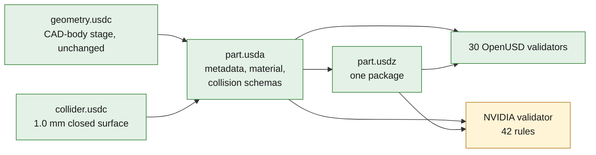

*Diagram: the package is three layers. The NVIDIA box is amber for the two
warnings the geometry layer already carried; the package adds none.*

| Item | In the package |
|---|---|
| Stage | default prim `/Head935`, kind component, Z-up, 0.001 m per unit, 1 kg per unit |
| Render mesh | `BareHead`, 2,262,390 triangles, one normal per face, evidence colours |
| Material | `Looks/EvidenceDisplay`, a `UsdPreviewSurface` that reads the evidence colour; bound to the body and the 10 studs |
| Collider | `Collision/BareHead`, guide purpose, 396,244 triangles (the 1.0 mm surface of the thermal screen), `UsdPhysics` collision with convex decomposition; volume 1.00017 of the render body |
| OpenUSD validators (30) | no finding on `part.usda` or on `part.usdz` |
| NVIDIA validator (42 rules) | 0 failures, 0 errors, 2 warnings on each: 35 triangles without area and co-located points, both on `BareHead` and both inherited |
| Read back from the `.usdz` | identical to the layers |

Not authored, on purpose: **no mass, density or rigid body**, because the
alloy is unknown, and **no physical material**. The bound material displays
the observed and inferred classes; it is not a material of the part. No
physics was run on the package, and the NVIDIA skill named for this step
(`omniverse-cad-to-sim-ready`) is not installed on the host, so its rules
were not consulted.

**Visual check.** The six-view render shows a recognisable head: fins, both
ports, spring pockets with guide bosses, the chamber with two throats and
two plug bores, four stud bosses. The first render, on 2026-11-11, also
showed what the scores did not: five slivers standing up to 26 mm above the
cam face. They led to [the stud repair](#the-stud-repair-of-2026-11-11-occupancy); the
figures below are from the body rebuilt after it.

- **Stud residue is down to stubs.** Nothing stands more than 5.5 mm above
  the cam face beside the studs, against 26 mm before. The stubs sit below
  the height from which the studs were fitted, where the repair does not
  reach, beside three of the four long studs.
- **The renderer's strict gate still refuses the body.** Its loader welds
  vertices and drops degenerate triangles before testing. As built the body
  is watertight (2,262,390 triangles); after trimesh's default processing 4
  vertices merge and 5 edges are shared by more than two faces, against 10
  and 23 before the repair. The solid touches itself at those points. A
  slicer or mesher that welds will see the same thing; the 3MF and the
  thermal surface were built without welding.

### SimReady tools: STEP → OpenUSD and NVIDIA validation ([deck plate](params/simready-deck-plate.json), [ports](params/simready-ports.json))

The NVIDIA converter and validator run on this host from wheels, in two
separate virtual environments (`usd-convert-cad` 0.2.0, which embeds HOOPS
Exchange and its own OpenUSD; `usd-validation-nvidia` 1.21.0 with OpenUSD
26.8). The 10 GB image, a GPU and credentials are not needed for this step.
[simready_convert.py](source/simready_convert.py) converts and validates;
[simready_check.py](source/simready_check.py) then reloads each stage with
plain `usd-core` in the twin environment and compares it with the STEP as
OCCT reads it. Gates set beforehand: bounding box within 0.1 mm, volume
within 1%.

| B-rep input | Triangles | NVIDIA validator | Bounding box vs STEP | Volume vs STEP |
|---|---|---|---|---|
| v1 deck plate | 1,632 | pass, 0 issues | 0.000 mm | +0.17% |
| `port_y_minus` loft | 5,784 | pass, 0 issues | 0.022 mm | −0.18% |
| `port_y_plus` loft | 6,484 | pass, 0 issues | 0.020 mm | −0.06% |

Every stage is authored in millimetres, Z-up. What the independent check
found and the validator did not:

- With the default tessellation the deck plate has 50 edges used once, about
  140 mm of zero-width T-junctions. `--accurate-tessellation` removes them
  there but raises one validator warning on `port_y_minus` (3 non-manifold
  vertices, an indexing artefact: the mesh is closed once welded by
  position). Neither setting is clean on all three inputs; the default is
  kept and the other run is recorded
  ([deck](params/simready-deck-plate-accurate-tessellation.json),
  [ports](params/simready-ports-accurate-tessellation.json)).
- build123d's `.volume` is off by +0.17% and −0.21% on the two lofts against
  an adaptive OCCT integration. The loft volumes in
  [port-loft-check.json](params/port-loft-check.json) carry that error.

A validator pass shows a well-formed stage. It is not a SimReady profile
conformance, and the Material and Physics agents and RTX renders were not
attempted. The v2 body has no STEP, so it enters this tier only as the USD
stage above.

### AM screen: orientations and cooldown ([supports](params/am-supports.json), [cooldown](params/am-cooldown.json))

A geometric LPBF screen of the bare body under declared hypotheses, on the
scan-derived occupancy. It designs no support, chooses no orientation and
qualifies no material or process.

[am_supports.py](source/am_supports.py) counts, per build direction, the
surface within 45° of the plate and the air column under it, at the 0.25 mm
pitch. Its analytic witnesses (a T block, a cube with a through-hole and an
enclosed sphere, a vented sphere) are reproduced within 2.5%.

| Build direction | Height | Overhang below 45° | Support envelope (÷ part volume) | Lands on plate / on part |
|---|---|---|---|---|
| deck down (+Z) | 95.25 mm | 38,109 mm² | 444,124 mm³ (0.41) | 275,936 / 168,188 mm³ |
| deck up (−Z) | 95.25 mm | 40,779 mm² | 511,388 mm³ (0.47) | 347,079 / 164,309 mm³ |
| flange y− down (+Y) | 229.0 mm | 15,002 mm² | 423,397 mm³ (0.39) | 205,339 / 218,057 mm³ |
| flange y+ down (−Y) | 229.0 mm | 13,897 mm² | 473,952 mm³ (0.43) | 252,287 / 221,665 mm³ |
| side x− down (+X) | 121.25 mm | 23,492 mm² | 418,503 mm³ (0.38) | 169,079 / 249,424 mm³ |
| side x+ down (−X) | 121.25 mm | 23,034 mm² | 466,010 mm³ (0.43) | 213,110 / 252,900 mm³ |

- The overhang area agrees with a separate count on the T1s triangles within
  +0.2% to −8.8%.
- Enclosed volume is 10.0 mm³ in 184 voids, the largest 1.0 mm³: the ports
  and pockets are open to the outside. On a 0.5 mm grid the figure is
  54.8 mm³, so it depends on the pitch.
- Between 32% (deck up) and 60% (side x− down) of the support envelope
  lands on the part itself, not on the plate.
- The flange directions do not put the flange on the plate: the named faces
  sit 5.6 and 33.7 mm above the lowest point.
- Before the stud repair the deck-up envelope read 883,849 mm³ (0.81 of the
  part volume): the columns under the stud residue, 114.5 mm tall, made up
  the difference.

[am_cooldown.py](source/am_cooldown.py) runs 20 s of convective cooldown in
Adamantine on hexahedra of the occupancy, from a uniform 500 K into 300 K
air with h = 20 W/m²K, generic AlSi10Mg-class constants, clamped on the deck
side. An independent reader re-derives volume, area and energy from the VTU
files only.

| At 20 s | 4 mm hexahedra | 2 mm hexahedra |
|---|---|---|
| Hexahedra / nodes | 16,944 / 22,078 | 137,344 / 160,912 |
| Volume | 1,084,416 mm³ | 1,098,752 mm³ |
| Exterior area | 162,048 mm² | 187,832 mm² |
| Mean temperature | 495.09 K | 494.40 K |
| Largest displacement | 0.018 mm | 0.021 mm |
| Energy imbalance | 1.1e-4 | 1.5e-4 |

- The mean temperature follows the discrete area over volume, and the
  stair-step area does not converge: it is 3.8% below the T1s area at 4 mm
  and 11.5% above it at 2 mm. A lumped estimate on the T1s surface gives
  494.94 K, between the two. The difference between the levels is therefore
  not a discretisation error estimate.
- The solver's von Mises maximum rose 40% with refinement (25.8 to 36.2 MPa).
  It sits at re-entrant voxel corners and is not a stress.
- A 20 × 12 × 8 mm witness block gives 483.522 K against 483.518 K lumped.
- The image tagged 1.1 holds source version 1.1.9; this is not the native
  build of the 2026-10-29 study, and that study's body still had its studs,
  so the two are not comparable like for like.

### Machined features: fitted with the assigned tool, checked with CloudCompare ([windows](params/feature-rois.json), [fits](params/feature-fits.json), [check](params/feature-check.json))

Until 2026-11-10 the repository had no assigned tool for fitting a bore or a
valve seat to a scan, and the twin's own circle fits were the only numbers on
its machined features. [fit_features.py](source/fit_features.py) now runs the
assigned tool on 32 windows of the acquired scan: one tube per feature, drawn
by hand on radius-against-station plots and selecting points by position
only. The noise given to the tool is the RMS of the deck plane, 0.040 mm.
Half of the vertices of each window are fitted. The other half goes to
[check_features.py](source/check_features.py), where CloudCompare measures it
against the fitted primitive.

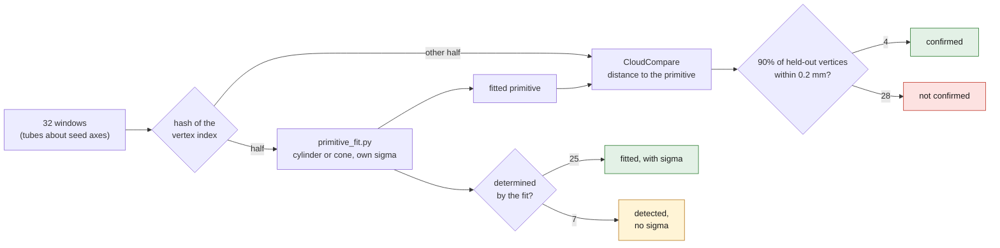

*Diagram: every window is split before fitting, so the check never measures a
vertex the fit saw. The acceptance was fixed before the first check run.*

**The check, first.** A feature is confirmed when at least 90% of its
held-out vertices within 0.5 mm of the primitive lie within 0.2 mm, the
twin's tolerance. **4 of 32 pass**: the throat and the seat of `valve_y_plus`
and the two plug seat faces. The other 28 hold between 63% and 90% within
0.2 mm, with a median distance of 0.03 to 0.13 mm and a 95th percentile of
0.29 to 0.46 mm. The fit's own residual, 0.03 to 0.06 mm RMS, does not show
this: it only counts the vertices inside its 0.12 mm band. The numbers below
are therefore nominal sizes and axes of the scanned features. None is an
inspected surface, and the tool's standard deviations are lower bounds.

**Valve train**, in the twin frame. The valves are named by flange side;
which one is the intake is not established.

| | `valve_y_minus` | `valve_y_plus` |
|---|---|---|
| Axis datum | guide bore, acquired at both ends, one cylinder over 48.8 mm | line through the throat centre and the cam-end guide centre, 65.9 mm apart |
| Axis to the bore axis | 25.89° | 29.89° |
| Guide bore | Ø8.51 mm (σ 0.008 mm) | Ø8.55 mm about the datum, cam end only |
| Guide outside diameter, cam end | Ø12.89 mm | Ø13.02 mm about the datum |
| Throat | Ø45.81 mm, detected only: a barrel profile that five rival cones share | Ø38.45 mm, 1.9° cone, **confirmed** |
| Seat | cone of 45.5° ± 0.14° about its own axis, 46.6° about the guide axis, Ø49.0 mm at mid-band | 49.0°, Ø43.1 mm, detected only, **confirmed** |
| Seat centre off the valve axis | 0.46 mm | 0.36 mm |
| Spring seat normal to the valve axis | 0.30° | 1.61° |

The two valve axes make 55.76° with each other.

- **Only one guide bore is seen at both ends.** On `valve_y_plus` the port
  end of the guide is not acquired, and its cam-end features, 8 to 11 mm
  long, point 3.2° to 4.3° away from the line through the two centres while
  reporting 0.4° to 1.3°. The same two-centre construction on `valve_y_minus`
  lies 0.42° from its guide bore axis, so the `valve_y_plus` axis is good to
  about half a degree, not to the 0.02° of the other valve.
- **This scan does not give seat run-out.** The seat centres sit 0.36 and
  0.46 mm from their valve axes, the plug wells 0.67 and 0.77 mm from their
  thread bores. A band 3.8 mm long cannot tell an offset from a tilt, and the
  scan locates one small feature against another to a few tenths of a
  millimetre at best. A valve job needs the specimen on a bench.

**Plugs, studs and register.**

| Feature | Fitted on the scan |
|---|---|
| Plug thread bores | Ø11.49 mm (0.34° cone) and Ø11.28 mm, 29.19° and 28.61° from the bore axis, 57.76° from each other |
| Plug chamber-side reliefs, wells | Ø14.26 and Ø14.39 mm; Ø24.7 mm (90 fitted vertices) and Ø25.4 mm (detected only) |
| Plug seat faces | planes 1.41° and 1.58° off their thread-bore axes, both **confirmed** |
| Stud passages | Ø10.50 (detected), Ø10.96 (0.74° cone), Ø10.51 (detected) and Ø10.51 mm (0.40° cone) |
| Stud counterbores | Ø24.44, Ø25.22 (135° of arc), Ø24.27 and Ø24.26 mm (detected) |
| Register recess | Ø113.36 mm on 212° of arc. The circle fit of P1 gave 113.88 mm with 0.29 mm RMS on every facet of the band |

Found on the way:

- **Seven features come back detected, not determined.** Their surface does
  not hold one cylinder or cone inside the 0.12 mm band, so the tool reports
  two rival models that share nearly every vertex and refuses both refits.
  Two stud passages seen over 354° and 37 mm are in that state. The record
  keeps the first estimate without any uncertainty.
- **The deck's noise understates the noise in a bore.** That is the reading
  of the check above; the fits were not rerun with another value.
- **The windows were drawn twice.** The first pass had 39 windows about axes
  read from plots. The second pass redrew the valve windows about the fitted
  axes, narrowed the two seat windows to the 45° band and dropped seven
  windows: four stud seat faces and the port end of the `valve_y_plus` guide,
  which hold too few vertices, the chamber shoulder, whose window caught the
  dome, and one duplicate. The check ran on the final table only, so its
  acceptance could not steer the windows.

**The v2 body, measured by a second tool** ([record](params/cloudcompare-v2-body.json)).
CloudCompare on 200,000 scan facets drawn by area gives a median of
0.0456 mm, a 95th percentile of 0.1571 mm and 97.36% within 0.2 mm. The Warp
scorecard reads 0.0454 mm, 0.1572 mm and 97.37%. The scorecard's arithmetic
is reproduced; the scan itself is not checked by this.

What these fits do not change: no feature is cut into the v2 body, H02, H05
and H06 keep their status in [hypotheses.json](hypotheses.json), and the
port-flow audit below still fails its third gate.

Not run on this head, each for a stated reason:

- **Fatigue post-processing (pyLife).** There is no stress history, because
  the only solve is a steady temperature field under a declared case, and no
  S-N data is admitted for the alloy, which is itself unknown.
- **Valve-train dynamics.** No tool is installed (Chrono is a candidate
  only), and there is no valve, spring or cam.
- **A dimensioned drawing.** No tool is assigned, and 28 of the 32 features
  it would dimension are not confirmed.

### Alloy and machine for a simulated LPBF print ([candidates](params/alloy-candidates.json), [bare-head ranking](params/alloy-thermal.json), [assembly case](params/assembly-case.json), [assembly ranking](params/assembly-thermal.json), [literature](params/thermal-literature-bounds.json), [machines](params/lpbf-machine-survey.json), [993 comparison](params/published-993-comparison.json))

The owner's brief of 2026-11-11: a full-size study print, the alloy chosen by
simulated heat dissipation, the machine from a maker in mainland China that
publishes its data, and hypotheses wherever data is missing. This section
records what public sources give and what two thermal screens say. No alloy
and no machine is selected here.

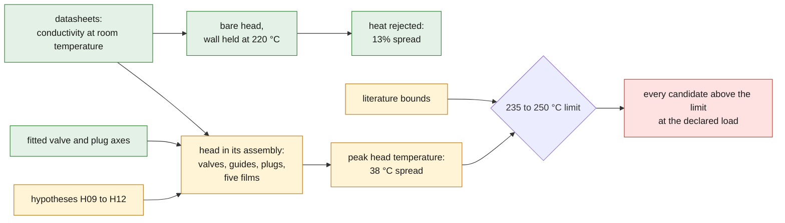

*Diagram: two screens on the same conductivities. The assembly screen is
amber because every body and boundary it adds is a hypothesis.*

**Published conductivities.** 18 entries on 12 distinct values, each with
its source, its method (measured, or calculated from resistivity) and whether
the value was re-read in the downloaded file. Rows marked * rest on the
research pass alone. All are room-temperature values; none is published at
150 to 250 °C. A20X publishes no conductivity and the CP1 datasheets give
electrical conductivity only, so neither is ranked from a datasheet.

**Two screens.** The bare-head screen holds the chamber wall at 220 °C and
asks how much heat leaves. The assembly screen adds two closed valves, two
guides and two plugs as hypothesis solids about the fitted axes. It puts gas
films on the chamber and the exhaust port, a cool film in the inlet port, a
contact film in the register recess and air everywhere else, and asks how hot
the head alloy gets. Its mesh has 4,755,655 tetrahedra in one watertight
united body.

| W/(m·K) | Alloy and condition | Bare head: heat | Fin efficiency | Assembly: peak alloy | Valve bridge | Exhaust valve |
|---|---|---|---|---|---|---|
| 170 | AlSi10Mg stress relieved, high (3D Systems); AlSi7Mg, high (Eplus3D) | 1,674 W | 81.8% | **273 °C** | 258 °C | 498 °C |
| 165 | AlSi10Mg T6, vertical (EOS) | 1,665 W | 81.3% | **275 °C** | 260 °C | 499 °C |
| 160 | AlSi10Mg stress relieved (EOS)*; AlSi10Mg stress relieved, low (3D Systems); Aheadd CP1 (blog figure)* | 1,656 W | 80.9% | **276 °C** | 261 °C | 500 °C |
| 155 | AlSi10Mg T6, horizontal (EOS)* | 1,646 W | 80.4% | **278 °C** | 263 °C | 501 °C |
| 150 | AlSi7Mg T6 (EOS)*; AlSi7Mg, low (Eplus3D); generic value of the earlier screens | 1,636 W | 79.9% | **280 °C** | 264 °C | 502 °C |
| 140 | AlSi7Mg as built (EOS) | 1,614 W | 78.8% | **284 °C** | 268 °C | 504 °C |
| 132 | Al5X1 heat treated (EOS) | 1,594 W | 77.9% | **288 °C** | 272 °C | 507 °C |
| 130 | AlSi10Mg as printed, high (3D Systems) | 1,589 W | 77.6% | **289 °C** | 272 °C | 507 °C |
| 120 | AlSi10Mg as printed, low (3D Systems) | 1,562 W | 76.3% | **294 °C** | 277 °C | 510 °C |
| 110 | AlSi10Mg as built, horizontal (EOS) | 1,530 W | 74.8% | **300 °C** | 283 °C | 514 °C |
| 100 | AlSi10Mg as built, vertical (EOS); Al-Mg-Sc, high (3D Systems) | 1,495 W | 73.0% | **307 °C** | 289 °C | 517 °C |
| 95 | Al-Mg-Sc, low (3D Systems) | 1,475 W | 72.1% | **311 °C** | 293 °C | 520 °C |

- **Heat treatment matters more than the alloy.** AlSi10Mg goes from 100 to
  110 W/(m·K) as built to 155 to 165 after stress relief or T6. That is worth
  11% more heat on the bare head and 32 °C on the peak in the
  assembly.
- **Conductivity counts for more in the assembly.** On the bare head the
  whole range moves the heat by 13%, because the air side limits it:
  an isothermal body would reject 2,047 W. In the assembly the same range
  moves the peak by 38 °C, from 273 to 311 °C.
- **The strongest alloy is the worst conductor.** Al-Mg-Sc sits last in both
  screens.
- **The peak is at the exhaust seat** for 130 W/(m·K) and above, and on the
  chamber roof between the exhaust seat and a plug below that.
- **Check.** The 150 W/(m·K) solve of the bare head reproduces the CAD-body
  screen exactly (1,635.8 W).

**The declared load against the literature.** No factory or peer-reviewed
head temperature, heat balance or fan power of the 911 engine could be
opened. What is citable is generic. It bounds the case without calibrating
it:

| Quantity | Declared or computed, at 150 W/(m·K) | Published |
|---|---|---|
| Heat into the assembly | 3,290 W (2,080 chamber, 1,209 exhaust port) | cooling heat 0.6 to 0.8 × brake power, shared by head, barrel and oil (Mackerle); the 993 makes 33 kW per cylinder |
| Heat out | 2,691 W to air, 479 W to the charge, 119 W to the cylinder | no split published for the 911 |
| Chamber wall loading | 242 kW/m² | about 465 kW/m² (Mackerle) |
| Exhaust port film | 700 °C | gas about 800 °C at the valve, 600 °C at the port exit (Heywood) |
| Air-side coefficient | 150 W/(m²·K) | at most 116 to 233 W/(m²·K) (Mackerle) |
| Exhaust valve | 502 °C | about 700 °C (Heywood) |
| Peak head alloy, all candidates | 273 to 311 °C | limit 235 °C, hot spots 250 °C (Mackerle); under about 300 °C (Heywood) |

- **Every candidate is above Mackerle's limit at the declared load.** At
  half the gas-side coefficients the peak is 188 to 214 °C. At one and a
  half times it is 336 to 381 °C, with 4,364 W entering.
- **The chamber load is probably low, and the head still runs hot.** The
  declared chamber loading is about half the published one, and the computed
  exhaust valve is about 200 °C cooler than the textbook value. A higher load
  makes the alloy hotter still. The model has no oil cooling and no barrel,
  which a real air-cooled head relies on. That, not the alloy, is the first
  thing the screen is missing.
- **No strength is ranked.** Published strength at temperature exists for a
  few of these alloys only, and none at the condition of its conductivity.

**Machine.** No maker read publishes everything a build simulation needs.

| Maker, machine | Envelope (mm) | Lasers | Spot | Layer | Oxygen | Parameters |
|---|---|---|---|---|---|---|
| Eplus3D EP-M260 | 260 × 260 × 390 | 500 or 700 W, single or dual | 70–100 µm | 20–120 µm | ≤ 100 ppm | open stated on the EP-M300 sheet only |
| Kings M280 | 250 × 250 × 320 | IPG 2 × 500 W, 1064 nm | not published | 20–100 µm | not published | packages supplied |
| Farsoon FS273M | 275 × 275 × 355 | 1 or 2 × 500 W | not published | 20–100 µm | not published | "open machine key parameters" |
| Laseradd DiMetal-280 | 250 × 250 × 300 | 500 W × 1 or 2 | not published | 20–100 µm | not published | not published |
| BLT A300 / A320 | 250 × 250 × 300 | 500 W or 2 × 500 W | not published | not published | not published | not published |
| HBD 400 | 350 × 400 × 400 | 4 or 6 × 500 / 1000 W | not published | not published | not published | not published |

Eplus3D publishes the most: the only spot size and oxygen level in a
datasheet, and the only aluminium conductivity from a Chinese maker (150 to
170 W/(m·K) for AlSi7Mg, condition not stated). The Eplus3D, Kings and
Farsoon datasheets were re-read here; the other three rows rest on the
research pass. Not published by anyone: absorptivity, hatch spacing and scan
strategy, the power and speed used per alloy, beam profile, powder-bed
properties and temperature-dependent material data. A build simulation will
need each of them as a declared hypothesis.

**The 993 manual as a cross-check of the scale.** The manual describes
another head, so nothing in it calibrates this one. The two fitted seat
diameters (49.0 and 43.1 mm at mid-band) fall on the manual's two valve heads
(49 and 42.5 mm) within about 1.5%, and one seat angle matches (45.5° against
45°). That does not contradict the scale of 1 unit = 1 mm, and it suggests
`valve_y_minus` is the inlet (H09). Two things differ: the scan's guide bore
reads 8.51 mm against 8.00 to 8.015 mm, and the plug bores (11.3 to 11.5 mm)
are too small for the manual's M14 thread.

### Port CFD: upstream audit, no solver run ([audit](params/port-cfd-audit.json))

A port-flow number needs a closed duct from the flange to the chamber, walls
traceable to acquired data, and the valve, seat and guide in place.
[audit_port_domain.py](source/audit_port_domain.py) checks those three gates
on what the twin holds:

| Port | Centreline | Closed sections | Lofted | Wall observed on the loft | Valve, seat, guide |
|---|---|---|---|---|---|
| `port_y_minus` | 90 mm | 21 of 31 | 51 mm (57%) | 77% | not modelled (H05) |
| `port_y_plus` | 54 mm | 10 of 19 | 24 mm (44%) | 92% | not modelled (H05) |

**Verdict: no admissible fluid domain.** Each port fails all three gates.
Beyond the lofted part the sections open into the valve pocket, 8% to 23% of
the lofted wall is winding-number closure, and without a valve the throat is
an open hole. A flow number on this domain would record the closure
hypotheses and the missing valve, not the port, so no solver was run. The
row reopens with registered sections of the bend and pocket (H04) and the
valve, seat and guide geometry (H05).

## Phase ledger

| Phase | Inputs | Output | Check | State |
|---|---|---|---|---|
| P0 freeze | owner decision | notices in the old twin README and `docs/ARCHIVE.md` | — | done |
| P1 datums | scan | [params/frame.json](params/frame.json) | plane/circle residuals recorded | done |
| P1b occupancy | scan, frame | private winding-number grid; [summary](params/occupancy-summary.json) | ambiguous volume reported | done |
| T1 surface | occupancy | private closed surface; [summary](params/t1-surface-summary.json) | watertight, winding, genus | done |
| Scorecard T1 | scan, frame, T1 | [scorecard-t1.json](params/scorecard-t1.json) | Warp vs trimesh oracle | done: 99.5% within 0.2 mm |
| T1s snap | T1, scan | private snapped surface; [summary](params/t1s-snap-summary.json) | connectivity unchanged, watertight, 0 self-intersections | done: p95 0.015 mm ([scorecard](params/scorecard-t1s.json)) |
| T2 B-rep v0 | occupancy | none | BRepCheck | measured negative result (see above) |
| Simulation surface | occupancy at 0.75 mm | private; [summary](params/sim-surface-mc075-summary.json) | watertight, genus 21 | done |
| T3 thermal | 1.0 mm surface | private deck and fields; [result](params/thermal-screen.json) | mesh quality, solver return, energy balance 0.28% | done at two levels; mean, p95 and minimum agree (minimum within 0.3 °C) |
| Screenshots | T1, scan, thermal | private renders (observed/inferred, scan deviation, thermal field); public [scorecard chart](media/scorecard-t1-cdf.png) | visual review | done |
| T4 USD | T1s, frame, hypotheses | private `.usdc`; [summary](params/usd-summary.json) | 30 OpenUSD validators, NVIDIA validator | done: 0 OpenUSD findings; NVIDIA 0 failures, 1 warning (one non-manifold vertex) |
| T5 print | T1s | private 3MF; [summary](params/print-summary.json) | streaming round trip | done, exact volume |
| v1 features | frame, scan | deck plate: [features](params/deck-features.json) | zone scorecard | iteration 4: p95 2.72 mm (chamber, four passages, two-level outline); kept as the analytic B-rep part |
| v1 body stack | occupancy, scan, fin faces, port sections, deck features | private compound of band solids and its outer shell; [run f summary](params/v1-body-stack-f-summary.json) | whole-scan scorecard on the shell, per run | closed at run f: p95 0.85 mm, 69.9% within 0.2 mm; superseded as the body by v2 |
| v2 body | occupancy, datum faces | private closed solid; [summary](params/v2-loft-s025-summary.json) | manifold status, watertight, volume; whole-scan [scorecard](params/scorecard-v2-loft-s025.json) with oracle; three section steps | done: p95 0.157 mm, 97.4% within 0.2 mm; area 14% above T1s; no B-rep |
| Thermal from CAD | v2 body occupancy at 1.0 mm | private deck and fields; [result](params/thermal-screen-cad.json) | energy balance 0.28%; comparison with T3 at the same pitch | done: mean −0.53 °C, heat −0.36% against T3 |
| USD and 3MF from CAD | v2 body | private `.usdc` and 3MF; [USD](params/usd-cad-summary.json), [3MF](params/print-cad-summary.json) | 30 OpenUSD validators, NVIDIA validator; streaming round trip | done: 0 OpenUSD findings; NVIDIA 0 failures, 2 warnings (35 flat triangles, co-located points); 3MF exact |
| Port CFD | port fit, hypotheses | [audit](params/port-cfd-audit.json) | three admissibility gates | closed by audit: no admissible domain, no solver run; reopens with H04 and H05 evidence |
| SimReady tools | v1 deck plate STEP, two port loft STEPs, both stages | private stages; [deck](params/simready-deck-plate.json), [ports](params/simready-ports.json) | NVIDIA validator; independent bounding box and volume against the STEP | done for the three B-rep inputs (pass) and both stages; profile conformance, agents and RTX not attempted; no STEP of the v2 body |
| AM screen | occupancy | [supports](params/am-supports.json), [cooldown](params/am-cooldown.json) | analytic witnesses within 2.5%; independent VTU reader, energy imbalance 1.5e-4 | done as a screen: six orientations, two cooldown levels; no orientation chosen, no support designed |
| Feature fit | bare scan, frame, [32 windows](params/feature-rois.json) | [feature-fits.json](params/feature-fits.json); private vertex split | the tool's own `determined` flag and standard deviations; two-centre construction against a guide bore axis (0.42°) | done: 25 determined, 7 detected only; two valve axes, guide bore, seats, plug bores, stud passages |
| Feature check | fits, held-out half of each window | [feature-check.json](params/feature-check.json); private clouds and receipts | CloudCompare distances; acceptance fixed beforehand (90% within 0.2 mm) | done: **4 of 32 confirmed**; the fits are nominal, not inspected |
| Body check by a second tool | v2 body, 200,000 scan facets | [cloudcompare-v2-body.json](params/cloudcompare-v2-body.json) | CloudCompare against the Warp scorecard | done: 97.36% against 97.37% within 0.2 mm, p95 0.1571 against 0.1572 mm |
| Asset package | CAD-body stage, 1.0 mm surface | private `part.usda`, `part.usdz` and two binary layers; [summary](params/simready-asset.json) | 30 OpenUSD validators and the NVIDIA validator on both forms; read-back of the package | done: 0 OpenUSD findings; NVIDIA 0 failures, the 2 inherited warnings; no mass, no physics run |
| Visual check of the v2 body | double-precision 3MF | private six-view render; [record](params/v2-body-visual-check.json) | read by the agent; the renderer's strict watertight gate | done twice: the first reading found stud slivers up to 26 mm tall and led to the stud repair; after it, stubs of 5.5 mm and 5 non-manifold edges once vertices are welded |
| Alloy candidates and machine survey | public datasheets and pages read on 2026-11-11 | [candidates](params/alloy-candidates.json), [machines](params/lpbf-machine-survey.json), [literature](params/thermal-literature-bounds.json) | each value marked re-read or reported only; source URL and file hash | done as a survey: no alloy or machine selected; no maker publishes a complete data set |
| Alloy ranking, bare head | CAD-body thermal deck, candidate conductivities | [alloy-thermal.json](params/alloy-thermal.json) | same mesh and case; 150 W/(m·K) reproduces the CAD screen; energy balance 0.3% | done: 1,475 W to 1,674 W, a 13% spread |
| Alloy ranking, assembly | CAD body, fitted axes, [declared case](params/assembly-case.json), H09 to H12 | private occupancy, surface and decks; [assembly-thermal.json](params/assembly-thermal.json) | watertight union; film areas and heat by group; load at 0.5 and 1.5 | done as a hypothesis screen: peak head alloy 273 to 311 °C, above the 235 to 250 °C limit for every candidate |
| 993 manual cross-check | fitted features, workshop-manual catalogue | [published-993-comparison.json](params/published-993-comparison.json) | same-dimension flag on each row | done: scale not contradicted; not a calibration |
| Fatigue, valve-train dynamics, drawing | none | none | — | not run: no stress history or S-N data, no installed dynamics tool, no confirmed features to dimension |

## Limits

- Distances are to the acquired surface. They say nothing about unobserved
  geometry, the specimen's true dimensions, its material or its function.
- The studs are hardware fitted as cylinders; their threads and tapped holes
  are hypotheses (H03).
- The thermal case is a declared hypothesis set, uncorrelated with an engine.
- The v2 body is a triangle solid lofted through sections of the occupancy
  field. Where the scanner saw nothing it reproduces the winding-number
  closure, not the part; 18% of its area is such closure.
- The valve guides, seats and valves are not modelled. The bosses the scan
  shows in the spring pockets are in the v2 body as scanned, without bores
  beyond what was acquired.
- The fitted features are numbers on scan vertices. CloudCompare confirms 4
  of 32 within 0.2 mm; none is a dimension of the specimen, a tolerance, a
  fit or a thread, and the valve named by a flange side is not identified as
  intake or exhaust.
- The AM numbers are geometric and thermal screens on generic constants.
  They establish no printability, orientation, support scheme or material.
- No port-flow result exists. The audit found no admissible fluid domain.
- The alloy rankings are screens on room-temperature conductivities and
  declared boundaries. The assembly screen's valves, guides and plugs are
  hypothesis solids in perfect contact, with no oil cooling and no barrel.
  It selects no alloy, predicts no engine temperature and says nothing about
  strength.
- The machine survey reads makers' own pages on one day. A datasheet is not
  a qualified process.
- A validator pass, OpenUSD or NVIDIA, shows a well-formed stage only.
- Engine use, metal manufacture and any interface claim remain prohibited
  without the evidence named in the repository rules.
