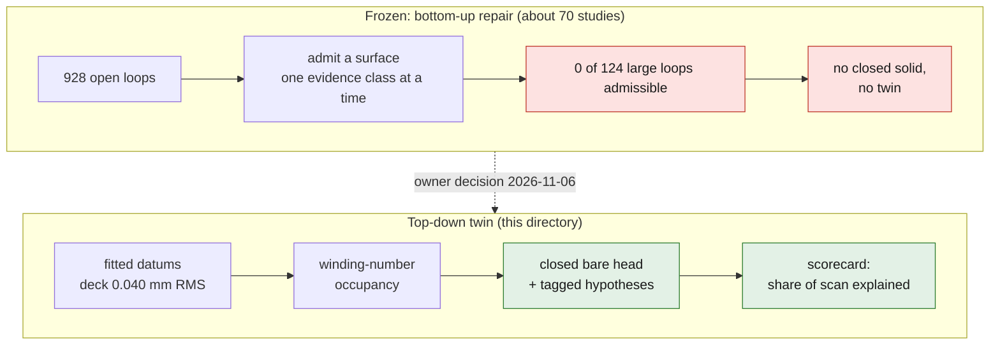
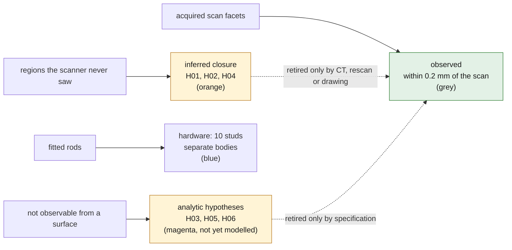
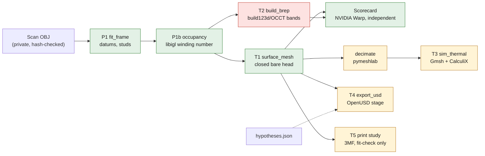
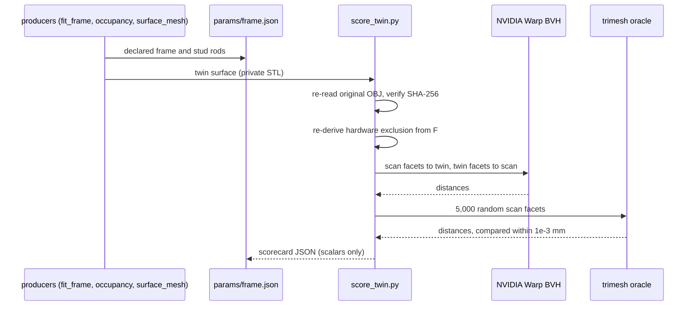
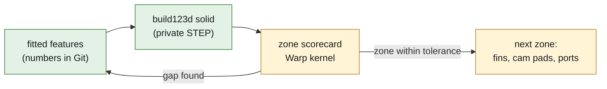

# 935 cylinder head: CAD twin, rebuilt top-down

> **Study twin. Not measured, not functional, not released.** It reconstructs
> the Wolfe Classics 935 Xtreme head scan (SHA-256 `4623d5d3…c766486`,
> 1 OBJ unit = 1 mm by owner instruction, no physical calibration). Unobserved
> geometry is closed by declared hypotheses listed in
> [hypotheses.json](hypotheses.json); none is a measurement.

## Why this directory exists

The earlier line repaired the scan from the bottom up: about seventy studies
under `docs/research/935-*` tried to admit, one evidence class at a time,
surfaces for the scan's 928 open boundary loops. On 2026-11-06 the owner froze
that line ([notice](../reference-935-cylinder-head/README.md)). Two measured
facts motivated the change:

- 87 loops of 20 mm or more hold 67% of the 99,876 open edges. They sit at fin
  roots and deep in the ports, where the scanner never looked. They are
  occlusions, not defects; no local admission rule can fill them honestly.
- The machined faces of the scan are excellent: the deck plane fits at
  0.040 mm RMS over 3,573 mm². The head is mostly plates, cylinders and
  extrusions along its bore axis, so it fits naturally top-down.

The twin is therefore built from fitted datums and an inside/outside field,
and progress is measured by one number that can only rise: the share of the
acquired scan surface the twin explains within tolerance.

Every surface of the twin belongs to exactly one evidence class, and only one
class can count as observed:

## Chain and selected tools

| Role | Selected tool | Script |
|---|---|---|
| Datums, stud separation | NumPy/SciPy fits on acquired facets | [fit_frame.py](source/fit_frame.py) |
| Inside/outside of the open scan | libigl fast winding number (CGAL/MeshLib/libigl scan route) | [occupancy.py](source/occupancy.py) |
| Closed bare-head surface | scikit-image marching cubes, trimesh checks | [surface_mesh.py](source/surface_mesh.py) |
| Editable B-rep | build123d 0.13 / OCCT (OCP 8.0.1) | [build_brep.py](source/build_brep.py) |
| Independent scorecard | NVIDIA Warp BVH queries, trimesh oracle | [score_twin.py](source/score_twin.py) |
| Simulation surface | pymeshlab topology-preserving decimation (recon image) | [decimate.py](source/decimate.py) |
| Thermal FE screen | Gmsh HXT + CalculiX 2.21 (cadsim image) | [sim_thermal.py](source/sim_thermal.py) |
| OpenUSD stage | OpenUSD 26.11 (`usd-core`) + ComplianceChecker | [export_usd.py](source/export_usd.py) |

The private inputs and outputs live under `work/935-cad-twin/` (ignored by
Git). Only code, fitted scalar parameters and statistics are committed, as
the owner decided on 2026-11-06; the STEP, meshes and USD stay private and
rebuild from the code. [run_twin.sh](source/run_twin.sh) replays the chain.

## Results

### P1 datums ([frame.json](params/frame.json))

| Datum | Fit on acquired facets |
|---|---|
| Deck (combustion face), defines Z | plane, 3,573 mm², RMS 0.040 mm, p95 0.068 mm |
| Register recess | Ø113.88 mm, radial RMS 0.29 mm |
| Chamber shoulder | Ø92.80 mm, radial RMS 0.22 mm |
| High-B / low-B flange planes | RMS 0.33 / 0.14 mm; within 0.17° / 0.48° of the frame |
| Cam-housing side | not one plane: pads on several levels over about 4 mm |
| Studs (hardware) | 10 rods, Ø6.4–8.0 mm fits of threaded M8-class studs: 6 cam-side (4 × ≈51 mm, 2 × ≈20 mm proud), 2 per flange (≈21–23 mm) |

Two short rod-like features (Ø4.6 × 7 mm and Ø6.4 × 8.7 mm proud) fail the
stud test and stay in the body, flagged as H08.

### T1 closed bare-head surface

The libigl winding-number field at 0.25 mm gives 1,095,128 mm³ inside. Of
that, 239,664 mm³ of voxels have 0.2 < w < 0.8: the surface transition band
plus the unobserved regions. Marching cubes yields a single **watertight,
consistently wound** surface of 7.08 M triangles enclosing 1,095,597 mm³.
Its genus is 437, far above what a real head needs: closure handles in the
unobserved fin gaps and passages, part of the H01/H02/H04 footprint.

### Independent scorecard ([scorecard-t1.json](params/scorecard-t1.json))

The checker shares no code with the producers. It re-reads the original OBJ,
re-derives the hardware exclusion and measures with its own Warp kernel; a
trimesh oracle re-measures a random sample:

| Metric | T1 |
|---|---|
| Acquired scan area within 0.1 mm of the twin | 89.5% |
| Acquired scan area within 0.2 mm of the twin | **99.4%** of 146,967 mm² (studs excluded) |
| Scan → twin distance | median 0.044, p95 0.118, p99 0.166 mm |
| Twin area supported by the scan (≤ 0.2 mm) | **87.9%** |
| Twin area inferred (hypotheses) | 12.1%, 21,450 mm² |
| Warp vs trimesh oracle on 5,000 samples | max difference 1.2e-5 mm |

The 0.1 mm residual of T1 is the 0.25 mm voxel pitch, not the scan. By
zone, the deck, fin and cam bands score alike (p95 0.114–0.130 mm).

### T1s: observed vertices snapped onto the scan ([summary](params/t1s-snap-summary.json), [scorecard](params/scorecard-t1s.json))

[snap_surface.py](source/snap_surface.py) moves each T1 vertex whose closest
scan point is within 0.3 mm onto that point (2.97 M of 3.54 M vertices),
rejecting any triangle that would turn by more than 60°. It runs until
rejection converges (34 rounds). Snapping both sides of the thinnest walls
folded 4,722 faces, so
[unsnap_intersections.py](source/unsnap_intersections.py) returns those
vertices and one ring around them to T1 until pymeshlab finds no
self-intersection (3 rounds, 6,363 vertices). Connectivity never changes.

| Metric | T1 | **T1s** |
|---|---|---|
| Scan area within 0.1 mm | 89.5% | **99.0%** |
| Scan → twin p95 | 0.118 mm | **0.015 mm** |
| Twin area supported by the scan | 87.9% | 87.4% |
| Watertight, consistent winding, self-intersections | yes, yes, 0 | yes, yes, 0 |

T1s is the reference twin surface.

### T3 steady thermal screen ([thermal-screen.json](params/thermal-screen.json))

Declared hypothesis case, uncorrelated with any engine: generic cast
aluminium (k = 150 W/m·K), chamber wall fixed at 220 °C, every other face
cooled by air at 40 °C with h = 80 W/m²·K. Mesh: Gmsh HXT inside the
marching-cubes surface of the occupancy field coarsened to 1.0 mm (400k
triangles, watertight, genus 9). Solver: CalculiX 2.21, iterative Cholesky.

| Quantity | 1.0 mm surface | 0.75 mm surface |
|---|---|---|
| Tetrahedra / nodes | 4,949,566 / 892,919 | 9,611,548 / 1,721,933 |
| Elements with minSICN < 0.1 (none inverted) | 0.41% | 0.37% |
| Temperature min / mean / p95 / max (°C) | 146.6 / 189.3 / 214.6 / 220.0 | 127.5 / 188.3 / 214.5 / 220.0 |
| Heat entering at the chamber | 1,643.4 W | 1,680.1 W |
| Convective loss recomputed independently | 1,648.0 W (0.28%) | 1,683.3 W (0.19%) |

Global quantities agree between the levels: mean within 0.5%, p95 within
0.04%, heat within 2.2%. The minimum moves by 19 °C. The finer surface
resolves thinner fin tips, so the coldest point depends on geometry
resolution and is **not converged**. Both the surface and the mesh change
between levels, so this is a resolution check rather than a pure mesh study.

The first attempt failed because the deck used node set `NALL` before
defining it ([attempt 1](params/thermal-attempt-1.json)). The deck writer now
defines it. fTetWild was stopped after 2 h 42 min of CPU without output.

### T4 OpenUSD stage ([usd-summary.json](params/usd-summary.json))

`/Head935` (Z-up, millimetres) holds:

- the T1s display surface (600k triangles) with per-face colour: grey is
  observed, orange inferred (12.8% of area);
- the 10 studs as hardware cylinders;
- the datums as customData.

All 30 OpenUSD 26 validators report no finding. The NVIDIA usd-convert-cad
and omni.asset_validator pass needs the SimReady image (10 GB compressed),
which does not fit on this host's disk yet.

### T5 print study ([print-summary.json](params/print-summary.json))

A single-object 3MF of T1s in millimetres: 7,081,318 triangles, watertight,
consistent winding. A streaming re-read gives exactly the same volume
(1,095,212.3 mm³). The file is labelled as a fit-check study object, never
an engine part or a metal build file.

### T2 editable B-rep: measured negative result

The band-stack B-rep was tried on a 10 mm slab (z 20–30 mm) and stopped
rather than tuned:

| Variant | Cost | Outcome |
|---|---|---|
| B-spline loops (approximation) | > 120 s for one band | stopped |
| B-spline loops (periodic interpolation, 0.5 mm) | 190 s for one band | invalid solid, 35% excess volume |
| Polygon loops (0.05 mm), glue fuse tree | 0.64 s per band, 230 s fuse for 90 prisms | 41 slices gave 41 bands; fused result invalid (13 solids, 55k faces) |

Sloped port and dome walls defeat band merging, and OCCT cannot glue
hundreds of dense prisms into one valid solid. A full-body editable B-rep
therefore needs a real feature tree: each fin as one extrusion of its
observed mid-plane outline, a revolved deck/register/chamber, and ports as
lofts through observed sections. That is the next milestone. T1 already
carries simulation, print and USD.

### v1 feature tree: deck-plate baseline ([features](params/deck-features.json), [score](params/deck-features-score.json))

[deck_features.py](source/deck_features.py) starts the editable feature tree
on the deck zone. It fits analytic features to acquired facets:

- the outer sides and corner radius (6.3 mm);
- the register recess Ø113.88 mm with its floor at z = 2.17 mm;
- the stud passages (2 of 4 found, Ø11.4–11.6 mm).

It builds them as a valid 16-face build123d solid (private STEP), and scores
that zone with the scorecard's Warp kernel. Progress is tracked per iteration:

| Iteration | Change | Median | p95 | Within 0.2 mm |
|---|---|---|---|---|
| 0 baseline | plate, register recess, 2 passages | 0.78 mm | 5.62 mm | 31% |
| 1 | chamber dome: sphere R 56.44 mm fitted to 48,013 facets (RMS 0.24 mm), cut inside the Ø92.80 shoulder | **0.43 mm** | **4.00 mm** | **41%** |

Remaining gaps: the valve throats and plug bores in the chamber, the flange
bosses on the outline, two undetected passages, and the plate-top level.
Each fix must raise this score; T1s (p95 0.015 mm) stays the reference
surface meanwhile.

## Phase ledger

| Phase | Inputs | Output | Check | State |
|---|---|---|---|---|
| P0 freeze | owner decision | notices in the old twin README and `docs/ARCHIVE.md` | — | done |
| P1 datums | scan | [params/frame.json](params/frame.json) | plane/circle residuals recorded | done |
| P1b occupancy | scan, frame | private winding-number grid; [summary](params/occupancy-summary.json) | ambiguous volume reported | done |
| T1 surface | occupancy | private closed surface; [summary](params/t1-surface-summary.json) | watertight, winding, genus | done |
| Scorecard T1 | scan, frame, T1 | [scorecard-t1.json](params/scorecard-t1.json) | Warp vs trimesh oracle | done: 99.4% within 0.2 mm |
| T1s snap | T1, scan | private snapped surface; [summary](params/t1s-snap-summary.json) | connectivity unchanged, watertight, 0 self-intersections | done: p95 0.015 mm ([scorecard](params/scorecard-t1s.json)) |
| T2 B-rep v0 | occupancy | none | BRepCheck | measured negative result (see above) |
| Simulation surface | occupancy at 0.75 mm | private; [summary](params/sim-surface-mc075-summary.json) | watertight, genus 21 | done |
| T3 thermal | 1.0 mm surface | private deck and fields; [result](params/thermal-screen.json) | mesh quality, solver return, energy balance 0.28% | done at two levels; means agree, fin-tip minimum not converged |
| Screenshots | T1, scan, thermal | private renders (observed/inferred, scan deviation, thermal field); public [scorecard chart](media/scorecard-t1-cdf.png) | visual review | done |
| T4 USD | T1s, frame, hypotheses | private `.usdc`; [summary](params/usd-summary.json) | 30 OpenUSD validators | done, 0 findings |
| T5 print | T1s | private 3MF; [summary](params/print-summary.json) | streaming round trip | done, exact volume |
| v1 features | frame, scan | deck plate first: [features](params/deck-features.json) | zone scorecard | iteration 1: p95 4.0 mm (chamber cut); throats, outline, passages next; then fins, cam pads, ports |
| Port CFD | v1 ports | OpenFOAM steady port flow | mesh/flux convergence | blocked by v1 ports |
| SimReady | T2 STEP | NVIDIA usd-convert-cad + omni.asset_validator | validator report | needs the 10 GB image on X1/Kali |
| AM study | T1/T2 | PicoGK supports, Adamantine cooldown | as in the earlier study | after v1 |

## Limits

- Distances are to the acquired surface. They say nothing about unobserved
  geometry, the specimen's true dimensions, its material or its function.
- The studs are hardware fitted as cylinders; their threads and tapped holes
  are hypotheses (H03).
- The thermal case is a declared hypothesis set, uncorrelated with an engine.
- Engine use, metal manufacture and any interface claim remain prohibited
  without the evidence named in the repository rules.
