# 935 cylinder head: CAD twin, rebuilt top-down

> **Study twin. Not measured, not functional, not released.** It reconstructs
> the Wolfe Classics 935 Xtreme head scan (SHA-256 `4623d5d3…c766486`,
> 1 OBJ unit = 1 mm by owner instruction, no physical calibration). Unobserved
> geometry is closed by declared hypotheses listed in
> [hypotheses.json](hypotheses.json); none is a measurement.

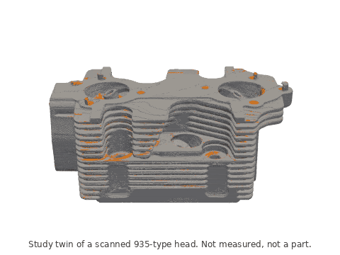

*The v2 CAD body, turning. Grey: within 0.2 mm of the acquired scan. Orange:
closure the scanner never saw. These are renderings of a study twin; no
geometry file is published ([provenance](media/provenance.json)).*

| What was acquired, and what was built from it | Fitted axes and the hypothesis solids |
|---|---|
| 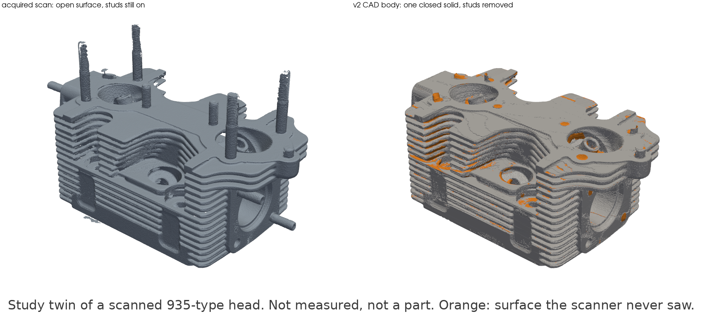 | 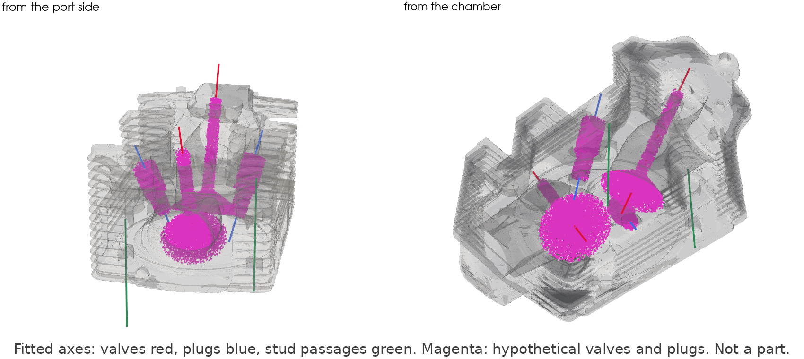 |

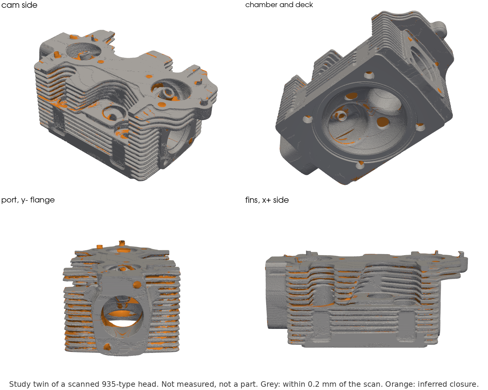

## State on 2026-11-13

| Body | What it is | Scan within 0.2 mm | p95 | What runs on it |
|---|---|---|---|---|
| T1s | reference surface: marching cubes of the occupancy, snapped onto the scan | 99.5% | 0.015 mm | thermal screen, OpenUSD stage, 3MF, AM screen |
| **v2** | **CAD body: a loft through sections, one closed solid, regenerated from code** | **97.4%** | **0.157 mm** | thermal screen, OpenUSD stage, 3MF, all rebuilt from it; packaged with a collider and a display material as `.usda` and `.usdz` |
| v1 | analytic features: deck plate and two port lofts as B-rep, prism stack | 69.9% | 0.846 mm | STEP → OpenUSD with the NVIDIA converter |

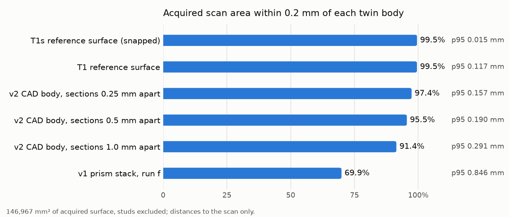

Every row of the [phase ledger](#phase-ledger) is closed or closed with a
stated blocker. What the twin still does not have:

- **A B-rep of the whole body.** v2 is a triangle solid; only the deck plate
  and the two port lofts are B-rep.
- **A valve train.** The guides, seats, throats, plug bores and stud passages
  are now [fitted where the scanner reached them](#machined-features-fitted-with-the-assigned-tool-checked-with-cloudcompare-windows-fits-check):
  two valve axes, 25.9° and 29.9° from the bore axis, a guide bore of 8.51 mm
  and seats near 45° and 49°. CloudCompare confirms 11 of the 32 fits within
  0.2 mm, 7 of them after a [declared re-fit](#the-declared-re-fit-of-the-28-declaration-re-fits-check-standing),
  so they are nominal sizes and axes, not inspected surfaces. Valve, seat
  insert and guide are separate bodies built only from published values of
  other heads and explicit assumptions ([H05, H16](#valves-seats-guides-and-a-declared-port-domain-2026-11-22-case-bodies-port-domain-stop-record-inferred-share)),
  no port-flow domain is admissible and no port CFD was run.
- **Any physical calibration.** Every distance is to the scan, whose scale is
  an owner instruction. The 993 workshop manual does not contradict that
  scale, but it describes another head.
- **An alloy and a machine for the print study.** Published conductivities
  are [ranked on two thermal screens](#alloy-and-machine-for-a-simulated-lpbf-print-candidates-bare-head-ranking-assembly-case-assembly-ranking-strength-trade-off-literature-machines-993-comparison)
  and set beside published strength. Every candidate runs above the published
  head-temperature limit in each of the four load cases: 386 to 428 °C at the
  published wall loading, and still 355 to 408 °C once a barrel, oil on the cam
  side and a conductance at each joint are [added](#heat-paths-in-the-assembly-barrel-oil-and-joints-case-record-chart). Heat-treated AlSi10Mg is the documented middle
  ground and Aheadd CP1 the candidate to verify. No Chinese maker publishes a
  complete data set; the owner accepted the larger Eplus3D EP-M300. Nothing is
  selected.
- **A qualified build.** The print body has a layer screen and a
  [build screen](#build-screen-the-print-body-grown-lump-by-lump-in-calculix-case-witnesses-record):
  43.4 hours on one laser, a largest rise of 60 to 64 K above the plate, and a distortion after
  release of 0.23 to 0.33 mm at the median and 1.62 to 2.87 mm at the largest,
  on 1.5, 2, 3 and 4 mm cells: the median agrees between them, the worst corner
  does not, by a rule written before the finest runs. The 2 and 1.5 mm cells were
  solved by a second program, DOLFINx, which gives CalculiX's numbers on the 4 mm cells.
  Both run on declared process values: no maker's parameters, nothing
  printed. With two or four lasers the hottest region runs
  98 or 138 K above the plate. A
  [support layout](#support-layout-block-supports-laid-out-by-rule-case-witnesses-record)
  by rule exists and one level of the build screen stands on it; no build
  processor has prepared one.

## Why this directory exists

The earlier line repaired the scan from the bottom up: about seventy studies
under `docs/research/935-*` tried to admit, one evidence class at a time,
surfaces for the scan's 928 open boundary loops. On 2026-11-06 the owner froze
that line ([notice](../reference-935-cylinder-head/README.md)). Two measured
facts motivated the change:

- 87 loops of 20 mm or more hold 67% of the 99,876 open edges. They sit at fin
  roots and deep in the ports, where the scanner never looked. They are
  occlusions, not defects; no local admission rule can fill them honestly.
- The machined faces of the scan are excellent: the deck plane fits at
  0.040 mm RMS over 3,573 mm². The head is mostly plates, cylinders and
  extrusions along its bore axis, so it fits naturally top-down.

The twin is therefore built from fitted datums and an inside/outside field,
and progress is measured by one number that can only rise: the share of the
acquired scan surface the twin explains within tolerance.

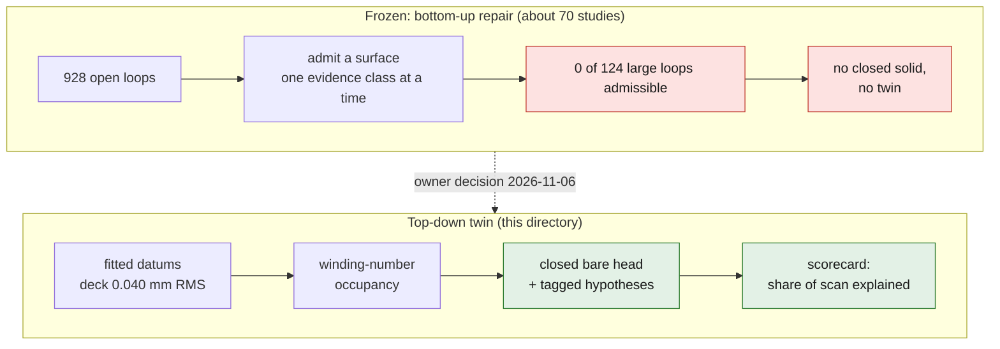

Every surface of the twin belongs to exactly one evidence class, and only one
class can count as observed:

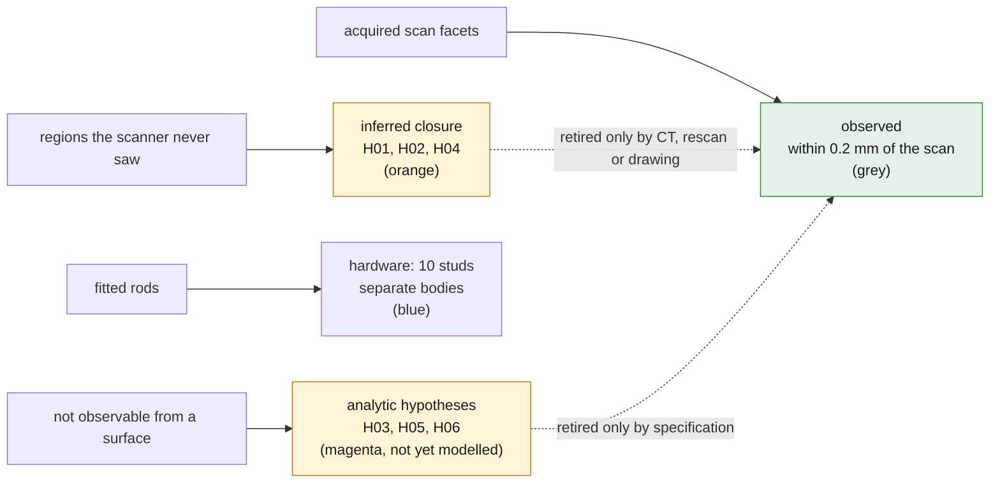

## Chain and selected tools

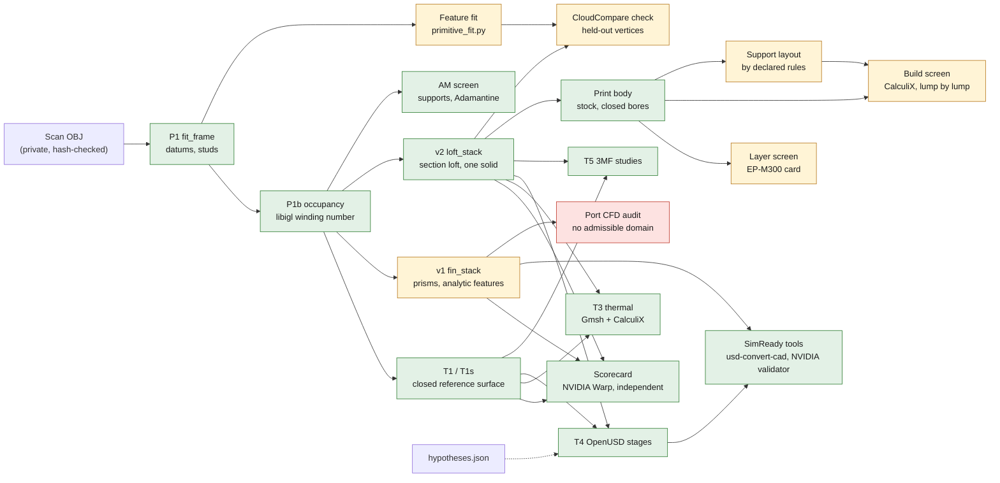

*Diagram: the chain as run. T1s is the reference surface; v2 is the CAD body
and feeds the same tiers; v1 holds the analytic features and stops at 69.9%.
The feature fit is amber because CloudCompare confirms 11 of its 32 features;
the layer screen and the build screen are amber because they run on declared
process values, with every qualification gate closed.*

| Role | Selected tool | Script |
|---|---|---|
| Datums, stud separation | NumPy/SciPy fits on acquired facets | [fit_frame.py](source/fit_frame.py) |
| Inside/outside of the open scan | libigl fast winding number (CGAL/MeshLib/libigl scan route) | [occupancy.py](source/occupancy.py) |
| Closed bare-head surface | scikit-image marching cubes, trimesh checks | [surface_mesh.py](source/surface_mesh.py) |
| Editable B-rep | build123d 0.13 / OCCT (OCP 8.0.1) | [build_brep.py](source/build_brep.py) |
| Fin faces, port sections | NumPy/SciPy fits on acquired facets and on the occupancy field | [fit_fins.py](source/fit_fins.py), [fit_ports.py](source/fit_ports.py) |
| Body stack, port lofts | build123d / OCCT, one process per band | [fin_stack.py](source/fin_stack.py), [port_loft.py](source/port_loft.py) |
| Independent scorecard | NVIDIA Warp BVH queries, trimesh oracle | [score_twin.py](source/score_twin.py) |
| Simulation surface | pymeshlab topology-preserving decimation (recon image) | [decimate.py](source/decimate.py) |
| Thermal FE screen | Gmsh HXT + CalculiX 2.21 (cadsim image) | [sim_thermal.py](source/sim_thermal.py) |
| OpenUSD stage | OpenUSD 26.11 (`usd-core`) + its 30 validators | [export_usd.py](source/export_usd.py) |
| CAD body (v2) | Shapely sections, `manifold3d` 3.5 union (double precision) | [loft_stack.py](source/loft_stack.py) |
| Occupancy of the CAD body | NumPy plane cut and scan-line fill | [loft_occupancy.py](source/loft_occupancy.py) |
| Thermal comparison | joins solver result, surface report and energy balance | [thermal_summary.py](source/thermal_summary.py) |
| STEP → OpenUSD, NVIDIA validation | `usd-convert-cad` 0.2.0, `usd-validation-nvidia` 1.21.0 (two separate venvs) | [simready_convert.py](source/simready_convert.py), [simready_check.py](source/simready_check.py) |
| LPBF orientation screen | NumPy voxel columns on the occupancy grid | [am_supports.py](source/am_supports.py) |
| Cooldown screen | Adamantine 1.1.9 (`rombur/adamantine:1.1`) with an independent VTU reader | [am_cooldown.py](source/am_cooldown.py) |
| Port-flow admissibility | reads the port fit and the hypotheses register | [audit_port_domain.py](source/audit_port_domain.py) |
| Valve, seat insert and guide bodies | build123d revolved profiles on the fitted axes, OCCT booleans for the overlap checks | [valve_seat_guide.py](source/valve_seat_guide.py) |
| Port domain under a declared rule | `manifold3d` hull and union, the audit's own gates | [port_domain.py](source/port_domain.py) |
| Inferred area by region | Open3D 0.20 raycasting distance, fit_ports.py's void labels | [inferred_share.py](source/inferred_share.py) |
| Revolved machined features | [`primitive_fit.py`](../../benchmarks/scan-primitive-fitting/primitive_fit.py), the assigned cylinder and cone fit, in its own locked environment | [fit_features.py](source/fit_features.py) |
| Independent deviation of each feature and of the v2 body | CloudCompare 2.13.2 in the `free-tools-cloudcompare` image, no network | [check_features.py](source/check_features.py) |
| Declared re-fit of the unconfirmed features (#696) | SciPy `least_squares` with a soft-L1 loss, on the fitted half only, under a rule committed before the check | [refit_features.py](source/refit_features.py), [feature_confirmation.py](source/feature_confirmation.py) |
| Asset package: collider, display material, `.usda` and `.usdz` | OpenUSD 26.11 (`UsdPhysics`, `UsdShade`, `UsdUtils`), then both validators | [export_simready.py](source/export_simready.py) |
| Alloy ranking on the bare head | CalculiX 2.21 on the deck of the CAD-body screen, conductivity replaced (cadsim image) | [alloy_thermal.py](source/alloy_thermal.py) |
| Alloy ranking in the assembly | hypothesis solids on the occupancy lattice, Gmsh HXT, CalculiX with four materials and six films, four load cases | [assembly_thermal.py](source/assembly_thermal.py) |
| Heat paths in the assembly | a barrel, oil films and a contact conductance at each joint: split nodes tied by CalculiX node-to-surface contact pairs; four load cases, a sweep of every declared value, a joint witness and a mesh comparison | [assembly_heat_paths.py](source/assembly_heat_paths.py) |
| Thin walls of the print body | SciPy morphological opening of the 0.25 mm occupancy | [wall_check.py](source/wall_check.py) |
| Layer screen in bounded memory | the repository's LPBF layer screen, unmodified, sliced 64 layers and probed 25 points at a time (cadsim image) | [layer_screen.py](source/layer_screen.py) |
| Build screen: temperature, stress and distortion lump by lump | CalculiX 2.21 with element activation (`*MODEL CHANGE`), one thread (cadsim image) | [build_sim.py](source/build_sim.py), [render_build_sim.py](source/render_build_sim.py) |
| Build screen mechanics, second solver | DOLFINx 0.11.0 with PETSc and MUMPS, in the `dolfinx/dolfinx` image pinned by digest, 4 to 16 MPI processes, on this host or a rented machine | [build_sim_dolfinx.py](source/build_sim_dolfinx.py) |
| Support layout by declared rules | NumPy and SciPy on the 0.25 mm occupancy: overhang normals, air columns, labelled bodies, lines of sight | [support_design.py](source/support_design.py), [render_support_design.py](source/render_support_design.py) |
| Drawings, assigned in [TOOLCHAIN.md](../../docs/TOOLCHAIN.md) (#708) | build123d projection and DXF export, ezdxf dimensions and title block, read back with ezdxf; witnessed on a known solid with five planted faults | [drawing_witness.py](source/drawing_witness.py) |
| Melt-pool check of the declared heat input | the reviewed GO-MELT kernel (JAX, CUDA), one explicit level, against Rosenthal's point source | [melt_pool_track.py](source/melt_pool_track.py), [melt_pool_summary.py](source/melt_pool_summary.py) |
| Six-view render of the body, read by the agent | `preview.py` of the `cad-skill` skill (trimesh, pyrender, EGL under `xvfb-run`) | none: the script is the skill's |
| RTX review stills and turntable | OpenUSD 26.11 review scene (cameras, two lights, render products) built locally around the private CAD-body stage; NVIDIA OVRTX 0.3.0 in the admitted SimReady image on a rented RTX 3090. The scene was built on 2026-11-15 and rebuilt on 2026-11-17 with identical hashes; captured on 2026-11-22 ([#707](#profiles-rtx-and-the-two-warnings-on-a-rented-gpu-707)) | [build_review_usd.py](source/build_review_usd.py), [capture_rtx.py](source/capture_rtx.py), [publish_rtx_still.py](source/publish_rtx_still.py) |
| What the two NVIDIA warnings are, and three repairs tried | NumPy on the stage and its double-precision body; manifold3d 3.5 for the library repair | [stage_warnings.py](source/stage_warnings.py) |
| SimReady profile validation, two releases | `simready-validate` 2026.6.5 with Foundation 2026.06.0 (in the image); 2026.10.0 with `simready-foundation-tier-core` 2026.10.0 (PyPI) | [simready_gpu_record.py](source/simready_gpu_record.py) |

The private inputs and outputs live under `work/935-cad-twin/` (ignored by
Git). Code, fitted scalar parameters and statistics are committed, as the
owner decided on 2026-11-06; the STEP, meshes and USD stay private and
rebuild from the code. On 2026-11-11 the owner asked for pictures on this
page: [render_media.py](source/render_media.py) writes captioned renderings
to `media/`, with the scan's licence state in
[provenance.json](media/provenance.json). [run_twin.sh](source/run_twin.sh) replays the chain.

## Results

### P1 datums ([frame.json](params/frame.json))

| Datum | Fit on acquired facets |
|---|---|
| Deck (combustion face), defines Z | plane, 3,573 mm², RMS 0.040 mm, p95 0.068 mm |
| Register recess | Ø113.88 mm, radial RMS 0.29 mm |
| Chamber shoulder | Ø92.80 mm, radial RMS 0.22 mm |
| High-B / low-B flange planes | RMS 0.33 / 0.14 mm; within 0.17° / 0.48° of the frame |
| Cam-housing side | not one plane: pads on several levels over about 4 mm |
| Studs (hardware) | 10 rods, Ø6.4–8.0 mm fits of threaded M8-class studs: 6 cam-side (4 × ≈51 mm, 2 × ≈20 mm proud), 2 per flange (≈21–23 mm) |

Two short rod-like features (Ø4.6 × 7 mm and Ø6.4 × 8.7 mm proud) fail the
stud test and stay in the body, flagged as H08.

### Assumed identity and a check of the scale ([identity](params/specimen-identity.json), [scale check](params/scale-check.json), #692, #693)

**Assumed, not confirmed.** On 2026-11-22 the owner decided that the twin
works on declared assumptions, to be reviewed by Wolfe Classics. Nobody was
contacted. From the seller's listing, the seller's private statement and the
maker's pages, the twin assumes a new Xtreme Cylinder Heads casting, cast then
machined, for a Porsche 935: two valves, two plugs, four head studs, 8 mm
stems and M12 × 1.25 plugs (H18), of the maker's 2.0–2.9 litre program for
the 2.85 L engine, bore at most 92.8 mm (H19). No published figure describes
this specimen; each figure compared so far is marked "same family" or "other
head" in the identity record, which also keeps the 3.0–3.5 litre program
open and lists eleven questions for the reviewer.

| Check of 1 unit = 1 mm | Published | Fitted | Scale s |
|---|---|---|---|
| plug thread bore, confirmed (primary) | M12 × 1.25: crest 10.647 mm, root 12.0 mm | 11.40 mm | 0.934 to 1.053 |
| chamber shoulder (needs H19; not counted) | 2.85 L 935 bore 92.0 to 92.8 mm | 92.80 mm | 0.991 to 1.000 |
| guide bore, not confirmed (discordant) | maker's 8 mm stem; 993 guide 8.00 to 8.015 mm | 8.51 mm | 0.935 to 0.942 |

The unit holds within the primary check's ±6%; the guide bore reads half a
millimetre large and stays unexplained. This is a check against published
values, not a measurement: the twin is not rescaled and #693 stays open.
The search log is in [the research note](../../docs/research/935-identity-scale-20261122.md).

### The stud repair of 2026-11-11 ([occupancy](params/occupancy-summary.json))

The first render of the v2 body showed five slivers, 1.3 to 5.1 mm wide,
standing 18 to 26 mm above the cam face beside three of the four long
studs. They were stud, not head. `occupancy.py` removed the facets within
0.8 mm of each fitted stud cylinder, but the studs are scanned as smeared
shells: their vertices lie up to 3.7 mm off the fitted cylinder (radial RMS
0.33 to 0.81 mm). 8,881 stud facets, 497 mm², stayed in the "bare" head,
and the winding number closed them into slivers.

The rule now also removes, above the height from which `fit_frame.py` fitted
each rod (6 mm beyond its face), every facet inside the rod's own cluster:
its radius plus its largest radial residual. No facet lies within 3 mm
outside that envelope on any of the ten studs, so the envelope separates
stud from head without a tuned margin. The independent checker applies the
same rule from `frame.json`, in its own code.

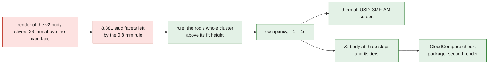

*Diagram: what the repair rebuilt. Everything from the occupancy field down
was run again in a new private folder; the state before it is kept in the
private release `935-head-cad-twin-work-20261111`.*

| Quantity | Before | After |
|---|---|---|
| Stud facets removed | 144,731 | 153,612 |
| Top of the body above the deck | 113.8 mm | 94.6 mm |
| Largest scan-to-body distance (v2) | 48.5 mm | 5.5 mm |
| v2 body, scan within 0.2 mm / p95 | 97.31% / 0.1579 mm | 97.37% / 0.1572 mm |
| Thermal minimum, 1.0 / 0.75 mm surface | 146.6 / 127.5 °C, not converged | 154.3 / 154.6 °C |
| Deck-up support envelope | 883,849 mm³ | 511,388 mm³ |
| Edges shared by more than two faces once welded (v2) | 23 | 5 |

Two earlier readings were the residue and not the head: the thermal minimum
"on thin fin tips", and the scan facets up to 48 mm from every body.

Not rebuilt, and kept as measured before the repair: the v1 runs a to h,
their scorecards and error breakdown, the T2 slab, the deck plate and the
two port lofts with their SimReady conversions, and the fTetWild and
decimation trials. The fin faces and the port sections were fitted again:
the fin levels moved by at most 0.003 mm and the port section radii by at
most 0.06 mm. The v1 bodies were built from the earlier fits.
One enclosed "cavity" of 7,393 mm³ on the cam side is gone from the port
fit: the stud residue had closed it.

What the repair does not reach: below the fit height the 0.8 mm rule still
applies, and stubs up to 5.5 mm tall remain beside three studs. The two
short rods of H08 are unchanged.

### T1 closed bare-head surface

The libigl winding-number field at 0.25 mm gives 1,094,498 mm³ inside. Of
that, 238,787 mm³ of voxels have 0.2 < w < 0.8: the surface transition band
plus the unobserved regions. Marching cubes yields a single **watertight,
consistently wound** surface of 7.05 M triangles enclosing 1,094,988 mm³.
Its genus is 430, far above what a real head needs: closure handles in the
unobserved fin gaps and passages, part of the H01/H02/H04 footprint.

### Independent scorecard ([scorecard-t1.json](params/scorecard-t1.json))

The checker shares no code with the producers. It re-reads the original OBJ,
re-derives the hardware exclusion and measures with its own Warp kernel; a
trimesh oracle re-measures a random sample:

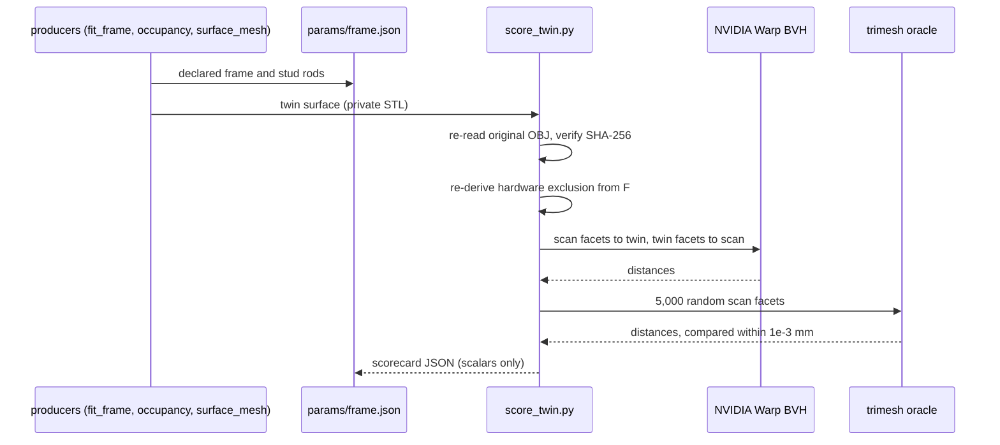

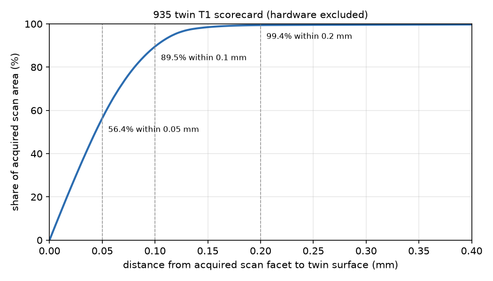

| Metric | T1 |
|---|---|
| Acquired scan area within 0.1 mm of the twin | 89.7% |
| Acquired scan area within 0.2 mm of the twin | **99.5%** of 146,470 mm² (studs excluded) |
| Scan → twin distance | median 0.043, p95 0.117, p99 0.163 mm |
| Twin area supported by the scan (≤ 0.2 mm) | **88.0%** |
| Twin area inferred (hypotheses) | 12.0%, 21,179 mm² |
| Warp vs trimesh oracle on 5,000 samples | max difference 1.3e-5 mm |

The 0.1 mm residual of T1 is the 0.25 mm voxel pitch, not the scan. By
zone, the deck, fin and cam bands score alike (p95 0.113–0.129 mm).

### T1s: observed vertices snapped onto the scan ([summary](params/t1s-snap-summary.json), [scorecard](params/scorecard-t1s.json))

[snap_surface.py](source/snap_surface.py) moves each T1 vertex whose closest
scan point is within 0.3 mm onto that point (2.97 M of 3.52 M vertices),
rejecting any triangle that would turn by more than 60°. It runs until
rejection converges (17 rounds). Snapping both sides of the thinnest walls
folded 4,053 faces, so
[unsnap_intersections.py](source/unsnap_intersections.py) returns those
vertices and one ring around them to T1 until pymeshlab finds no
self-intersection (4 rounds, 5,745 vertices). Connectivity never changes.

| Metric | T1 | **T1s** |
|---|---|---|
| Scan area within 0.1 mm | 89.7% | **99.1%** |
| Scan → twin p95 | 0.117 mm | **0.015 mm** |
| Twin area supported by the scan | 88.0% | 87.5% |
| Watertight, consistent winding, self-intersections | yes, yes, 0 | yes, yes, 0 |

T1s is the reference twin surface.

### T3 steady thermal screen ([thermal-screen.json](params/thermal-screen.json))

Declared hypothesis case, uncorrelated with any engine: generic cast
aluminium (k = 150 W/m·K), chamber wall fixed at 220 °C, every other face
cooled by air at 40 °C with h = 80 W/m²·K. Mesh: Gmsh HXT inside the
marching-cubes surface of the occupancy field coarsened to 1.0 mm (399k
triangles, watertight, genus 10). Solver: CalculiX 2.21, iterative Cholesky.

| Quantity | 1.0 mm surface | 0.75 mm surface |
|---|---|---|
| Tetrahedra / nodes | 4,928,248 / 889,267 | 9,603,449 / 1,720,334 |
| Elements with minSICN < 0.1 (none inverted) | 0.41% | 0.36% |
| Temperature min / mean / p95 / max (°C) | 154.3 / 189.3 / 214.6 / 220.0 | 154.6 / 188.3 / 214.5 / 220.0 |
| Heat entering at the chamber | 1,641.7 W | 1,679.4 W |
| Convective loss recomputed independently | 1,646.3 W (0.28%) | 1,682.6 W (0.19%) |

The levels agree: mean within 0.5%, p95 within 0.03%, heat within 2.3%, and
the minimum within 0.3 °C. Both the surface and the mesh change between
levels, so this is a resolution check rather than a pure mesh study.

Until 2026-11-11 the minimum read 146.6 and 127.5 °C and was recorded as not
converged, on "thin fin tips". It sat on the stud residue described under
[the stud repair](#the-stud-repair-of-2026-11-11-occupancy): slivers a few millimetres
wide standing 26 mm clear of the head. With the studs properly removed the
two levels give 154.3 and 154.6 °C.

The first attempt failed because the deck used node set `NALL` before
defining it ([attempt 1](params/thermal-attempt-1.json)). The deck writer now
defines it. fTetWild was stopped after 2 h 42 min of CPU without output.

### T4 OpenUSD stage ([usd-summary.json](params/usd-summary.json), [NVIDIA validation](params/simready-validate-t4-stage.json))

`/Head935` (Z-up, millimetres) holds:

- the T1s display surface (600,000 triangles on 299,141 welded points) with
  one authored normal per face and an indexed per-face colour: grey is
  observed, orange inferred (12.7% of area);
- the 10 studs as hardware cylinders;
- the datums as customData.

All 30 OpenUSD 26 validators report no finding. The NVIDIA validator
(42 rules) reports no failure or error and one warning: one non-manifold
vertex in the decimated display surface. The stage of 2026-11-10, decimated
from the surface that still carried the stud residue, passed with no issue;
the warning is left as measured. The first stage, written on 2026-11-09,
passed the OpenUSD validators but failed the NVIDIA ones: no normals on a
mesh without subdivision, three points per triangle, and an unindexed
colour. [export_usd.py](source/export_usd.py) now welds the points, authors
the normals and indexes the colour.

### T5 print study ([print-summary.json](params/print-summary.json))

A single-object 3MF of T1s in millimetres: 7,050,948 triangles, watertight,
consistent winding. A streaming re-read gives exactly the same volume
(1,094,605.2 mm³). The file is labelled as a fit-check study object, never
an engine part or a metal build file.

### T2 editable B-rep: measured negative result

The band-stack B-rep was tried on a 10 mm slab (z 20–30 mm) and stopped
rather than tuned:

| Variant | Cost | Outcome |
|---|---|---|
| B-spline loops (approximation) | > 120 s for one band | stopped |
| B-spline loops (periodic interpolation, 0.5 mm) | 190 s for one band | invalid solid, 35% excess volume |
| Polygon loops (0.05 mm), glue fuse tree | 0.64 s per band, 230 s fuse for 90 prisms | 41 slices gave 41 bands; fused result invalid (13 solids, 55k faces) |

The slab was built with a `slice_region` that dropped islands standing inside
holes (see the v2 body below); the trial has not been repeated.

Sloped port and dome walls defeat band merging, and OCCT cannot glue
hundreds of dense prisms into one valid solid. A full-body editable B-rep
therefore needs a real feature tree: each fin as one extrusion of its
observed mid-plane outline, a revolved deck/register/chamber, and ports as
lofts through observed sections. That feature tree is v1 below; it stops at
69.9% within 0.2 mm, and the body is now the v2 section loft.

### v1 feature tree: deck-plate baseline ([features](params/deck-features.json), [score](params/deck-features-score.json))

[deck_features.py](source/deck_features.py) starts the editable feature tree
on the deck zone. It fits analytic features to acquired facets:

- the outer sides and corner radius (6.3 mm);
- the register recess Ø113.88 mm with its floor at z = 2.17 mm;
- the four stud passages (from iteration 2, Ø10.58–10.93 mm).

It builds them as a valid 16-face build123d solid (private STEP), and scores
that zone with the scorecard's Warp kernel. Progress is tracked per iteration:

| Iteration | Change | Median | p95 | Within 0.2 mm |
|---|---|---|---|---|
| 0 baseline | plate, register recess, 2 passages | 0.78 mm | 5.62 mm | 31% |
| 1 | chamber dome: sphere R 56.44 mm fitted to 48,013 facets (RMS 0.24 mm), cut inside the Ø92.80 shoulder | 0.43 mm | 4.00 mm | 41% |
| 2 | four stud passages found by seeding at the recorded pattern: Ø10.58–10.93 mm on about 86.2 × 85.6 mm. The two "passages" of iteration 0 were other features | **0.29 mm** | **3.05 mm** | **45%** |

| 3 (not adopted) | valve throats fitted: Ø47.94 and Ø46.48 mm, axes about 22° from Z, radial RMS 0.23 / 0.31 mm. Cutting them, with or without a coaxial "boss" (Ø≈30 mm, RMS 0.59 mm, not credible), lowered the score | 0.31 mm | 3.29 / 3.20 mm | 44% |

| 4 | two-level outline: deck face y −65.15…71.10 mm, body steps out at z = 2.75 mm (272 mm² of step faces) | **0.22 mm** | **2.72 mm** | **49%** (81% within 1 mm) |

Iteration 3 is kept as data in the features file, but not in the solid. The throat fits look right; the score drops because the port
interior beyond them (guide bosses, seat rings) is not modelled yet.

Remaining gaps: port interiors behind the throats, the plug bores, the
flange bosses on the outline, and the plate-top level.
Each fix must raise this score; T1s (p95 0.015 mm) stays the reference
surface meanwhile.

### v1 body stack: fins, port lofts and chamber dome ([fin faces](params/fin-faces.json), [port fit](params/port-fit.json), [loft check](params/port-loft-check.json), [error breakdown](params/error-breakdown-v1-stack-f-shell.json))

[fin_stack.py](source/fin_stack.py) builds the whole body as one extrusion per
interval between measured horizontal faces. Each band's sketch is the
occupancy contour at its mid-level; fitted features are then cut from the
bands. The bands stay a compound of individually valid solids. Every run is
kept with its summary and scorecard (`params/v1-body-stack-<run>-summary.json`,
`params/scorecard-v1-stack-<run>[-shell].json`):

| Run | Change | Scored on | p50 | p95 | Within 0.2 mm | Within 0.5 mm | Within 1 mm | Twin area supported |
|---|---|---|---|---|---|---|---|---|
| a | levels from a 0.1 mm detector only | compound | 0.96 mm | 9.65 mm | 28.3% | 39.3% | 50.8% | n/a |
| b | fin faces fitted by [fit_fins.py](source/fit_fins.py) added as boundaries | compound | 0.26 mm | 1.62 mm | 44.1% | 66.9% | 85.6% | n/a |
| c | extrusion direction fixed (see below) | shell | 0.11 mm | 0.90 mm | 65.2% | 84.7% | 96.7% | 56.9% |
| d | 13 fin faces as tilted planes | shell | 0.11 mm | 0.90 mm | 64.8% | 85.7% | 96.6% | 58.1% |
| e | two port lofts cut in | shell | 0.10 mm | 0.87 mm | 67.9% | 87.1% | 96.8% | 57.8% |
| **f** | chamber dome cut, thick cam-side band split | shell | 0.10 mm | 0.85 mm | 69.9% | 88.3% | 96.9% | 59.9% |
| g | trial: interpolated sketches and dome ended at 42 mm | shell | 0.10 mm | 0.87 mm | 69.3% | 87.9% | 96.8% | 59.0% |
| h | trial: interpolated sketches only | shell | 0.10 mm | 0.86 mm | 69.7% | 88.1% | 96.8% | 59.7% |

The first five columns are scan → twin on the whole acquired surface
(146,967 mm², studs excluded by the rule in force before the stud repair).
**Run f is the last v1 run**; the CAD body is now v2, below. Runs a to h were built with a `slice_region` that dropped
every island standing inside a hole: the land inside the sealing groove and
the valve-guide bosses in the spring pockets are missing from them. They are
kept as measured and have not been repeated.

**Compound and shell.** The compound's tessellation contains the faces two
touching bands share, 1.2 to 1.4 million mm² of them. A scan facet lying on
such a hidden face scores as explained although the model has material on both
sides. From run c on, `fin_stack.py` also writes the outer shell: of each pair
of caps meeting on a boundary, only the parts the other band does not cover
are kept. Scored on the shell, run e reads p95 0.87 mm and 67.9% within
0.2 mm, against 0.74 mm and 69.8% on its compound. The compound scorecards of
runs c to e are kept beside the shell ones; runs a and b predate the shell and
their figures are optimistic by a similar margin.

What each step found:

- **Fins (a → b).** The fins are plates normal to the bore axis: 13 top and 15
  bottom faces, median top pitch 5.74 mm. Their faces are cast and spread over
  1 to 2 mm of Z, so the 0.1 mm detector of run a found levels near only 7 of
  the 28 and left single bands from z = 7.6 to 38.1 mm and from 50.0 to
  69.4 mm. `fit_fins.py` histograms up-facing and down-facing facets
  separately at 0.25 mm and fits every face as a level and as a plane.
- **A defect in `band_solid` (b → c).** `extrude()` followed the face normal,
  which the contour orientation decides, so every band of runs a and b sat one
  thickness below its interval (asked 41.80–44.12 mm, built 39.48–41.80 mm).
  The direction is now explicit, checked at build time and covered by a test.
  Runs a and b are kept as measured. The T2 slab trial above used the same
  function and has not been repeated.
- **Tilt (c → d): neutral.** The top faces tilt by a median 0.53° towards
  azimuth ≈ 40° in XY, a steady ramp of about 1.8 mm across the head; the
  bottom faces are flat (median 0.10°). A face becomes a tilted plane when its
  plane fit has at most 0.8 of the level fit's RMS and tilts at least 0.3°;
  one candidate (z = 78.97 mm) is demoted because it would cross its
  neighbour. On the shell the tilt gains 1.0 point within 0.5 mm and loses
  0.4 point within 0.2 mm. It is kept because the ramp is measured, not
  because it scores.
- **Ports (d → e).** [fit_ports.py](source/fit_ports.py) finds the enclosed
  cavities of the occupancy field, follows the two that reach a flange face and
  measures a 48-ray section every 3 mm. [port_loft.py](source/port_loft.py)
  lofts them through periodic splines and adopts a loft only when it explains
  more of its own wall than the stack does. The ports are named by flange
  side; which one is intake is not established.
- **Chamber dome and cam side (e → f).** The fitted sphere (R 56.44 mm) is cut
  inside the fitted shoulder; each band first regains the dome footprint
  where the occupancy is material at the band's top, so valve pockets stay
  open. The 48 mm band above z = 87.2 mm is split at two occupancy steps
  (92.9 and 94.4 mm). The deck zone goes from 70.0% to 75.2% within 0.2 mm.
- **Two rejected trials (g, h).** Ending the dome at 42 mm, where a flat ring
  at the register floor starts to replace the sphere, restores that ring but
  gives up the sphere in rings where most facets still follow it. Taking each
  sketch from the occupancy interpolated at the exact mid-level, instead of
  the nearest 0.25 mm slice, also scores lower. Both stay available as options
  and neither is adopted.

| Port | Loft | Wall seen by the scanner | Port-wall scan within 0.2 mm: stack d → loft |
|---|---|---|---|
| `port_y_minus` | 18 sections, 51 mm, Ø 41–43 mm equivalent | 77% of wall points | 40.8% → 96.2% (5,591 mm²) |
| `port_y_plus` | 9 sections, 24 mm, Ø 38–41 mm equivalent | 92% of wall points | 43.4% → 90.0% (3,017 mm²) |

Each loft stops where its section stops being a tube, before the valve pocket.
The unseen share of each wall is winding-number closure, i.e. hypothesis H04.
The section profiles are geometry and stay private. The other 7 enclosed
cavities above 5,000 mm³ (two of them sit on stud passages) give no run
of closed sections and are not lofted: they are open pockets, not tubes, and
need a different feature.

The bands are built and tessellated in a process pool, and the STEP is written
only on request. The body of run b takes 58 s with 8 workers against 295 s
serially; run f, with its tilt, loft and dome cuts in 34 bands, takes about
5 minutes with 12 workers.

Where run f still misses, from [error_breakdown.py](source/error_breakdown.py)
on its shell, in points of the whole scan area:

| Surface class (facet normal) | Scan area | Within 0.2 mm | Points outside 0.2 mm | Points outside 0.5 mm |
|---|---|---|---|---|
| sloped, 0.17 ≤ \|n_z\| ≤ 0.94 | 39.1% | 60.9% | 15.3 | 5.4 |
| up-facing horizontal | 21.0% | 66.3% | 7.1 | 2.7 |
| down-facing horizontal | 15.1% | 68.6% | 4.7 | 2.4 |
| vertical walls | 24.8% | 88.1% | 3.0 | 1.1 |

- The sloped class is mostly the fin edges: about 15% of the scan area lies
  on the rounded or chamfered rims of the 12 fins, which the prisms leave
  square. The corner is roughly 1.3 mm wide by 0.6 mm high, the same size as
  the scatter of the cast faces it starts from, so a rim feature has to be
  fitted per fin and cannot be a single radius.
- The horizontal classes are the cast fin faces themselves: their plane fits
  leave 0.25 to 0.6 mm RMS, so a planar face cannot bring them all within
  0.2 mm. Within 0.5 mm the whole model stands at 88.3%.
- Still staircase: the port bends and valve pockets beyond the lofts, and
  the other enclosed pockets.
- A few hundred mm² above z = 94 mm (the largest errors, up to 48 mm) belong
  to thin features the mid-level sketch of that band misses.

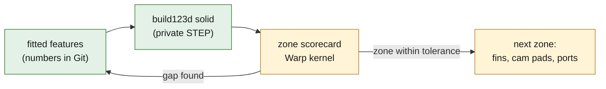

### v2 body: a loft through sections, closed into one solid ([summary](params/v2-loft-s025-summary.json), [scorecard](params/scorecard-v2-loft-s025.json), [error breakdown](params/error-breakdown-v2-loft-s025.json))

Run f stops at 69.9% within 0.2 mm because of what the scan shows the head to
be. Its fins are shallow rounded ribs and its pockets are curved, so most
walls slope, and the cast faces are not planes within tolerance (their plane
fits leave 0.25 to 0.6 mm RMS). A prism leaves a stair on every sloped wall.
[loft_stack.py](source/loft_stack.py) therefore keeps as exact features only
what the scan supports and lofts the rest:

- **Datum faces.** The 54 levels of the 0.02 mm detector (deck, groove floor,
  cam-side pads) are planes across which the section jumps. The body is a
  prism for 0.25 mm on either side of each, because the occupancy grid cannot
  place a wall closer than one voxel to a face.
- **Ruled bands.** Between two faces, sections are taken at most `--step`
  apart; each is the occupancy contour at that exact height. A ring is ruled to
  the ring of the next section that it overlaps. An unpaired ring stays
  vertical and ends on a flat cap. A band in which a ring of 20 mm or more
  finds no partner is split at mid-height, down to 0.125 mm, so that a change
  of topology costs a thin prism instead of a thick one.
- **One solid.** Every polygon of every band is a closed, oriented triangle
  mesh. Manifold unites them. The result is checked again with trimesh and
  scored by the independent checker.

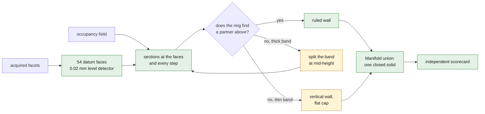

*Diagram: how one band of the v2 body is built. Only a ring with no partner in
a band already 0.125 mm thin becomes a stair step.*

| Sections at most | Bands (split) | Ring length ruled | p50 | p95 | Within 0.1 mm | Within 0.2 mm | Within 0.5 mm | Triangles |
|---|---|---|---|---|---|---|---|---|
| 1.0 mm apart | 157 (36) | 94.9% | 0.052 mm | 0.291 mm | 76.4% | 91.4% | 98.3% | 1.68 M |
| 0.5 mm apart | 241 (48) | 95.7% | 0.048 mm | 0.190 mm | 81.2% | 95.5% | 99.5% | 1.85 M |
| **0.25 mm apart** | 410 (0) | 96.8% | 0.045 mm | **0.157 mm** | 84.6% | **97.4%** | 99.6% | 2.26 M |
| v1 run f, for comparison | 69 | none | 0.099 mm | 0.846 mm | 50.2% | 69.9% | 88.3% | |
| T1, for comparison | | | 0.043 mm | 0.117 mm | 89.7% | 99.5% | 99.8% | 7.05 M |

All three bodies are watertight, consistently wound single solids, and the
checker's oracle agrees within 5e-5 mm on each. **The 0.25 mm body is the
reference CAD body**: 1,095,426 mm³ against 1,094,498 mm³ in the occupancy
field (+0.08%), genus 112, and p95 0.134 / 0.162 / 0.158 mm in the deck, fin
and cam zones.

Where the reference body still misses, in points of the whole scan area:

| Surface class (facet normal) | Scan area | Within 0.2 mm | Points outside 0.2 mm | Points outside 0.5 mm |
|---|---|---|---|---|
| up-facing horizontal | 21.1% | 94.9% | 1.08 | 0.11 |
| sloped | 39.2% | 98.5% | 0.61 | 0.12 |
| vertical walls | 24.6% | 97.3% | 0.66 | 0.18 |
| down-facing horizontal | 15.1% | 98.2% | 0.28 | 0.01 |

The sloped class, 15.3 points outside 0.2 mm in run f, is down to 0.61. The
largest remaining class is the up-facing cast surfaces, which sit between two
sections.

Found on the way, each measured:

- **A defect in `slice_region`.** It united the even rings and subtracted the
  odd ones in one step, which removed every island standing inside a hole. At
  z = 2.3 mm that is the 1,229 mm² land between the chamber and the sealing
  groove; higher up it is the valve-guide bosses in the spring pockets. The
  first loft showed the land missing as a ring 0.9 mm off. Rings are now
  applied from the largest to the smallest, with a test. Every body built
  before the fix lacks those islands (T2 slab, v1 runs a to h).
- **The pairing rule.** A fixed overlap of one half let the two halves of a
  splitting body pair with the whole, and ruling across that folded the wall:
  one band lost 44% of its volume. A whole-ring distance was too strict the
  other way: one small island joining the 900 mm outline disqualified it, and
  only 24% of ring length was ruled. The adopted threshold is the overlap left
  when the ring moves sideways along its whole length by four band
  thicknesses, or by 0.6 mm if that is more.
- **Small unpaired holes.** A hole with no partner, under a wall that leans
  over it, made the polygon invalid and the whole polygon fell back to a
  prism: 27% of ring length. The polygon is now ruled without such holes and
  each is subtracted as a prism (143 holes in the reference body).
- **Needle triangles and the checker.** Long straight walls and the caps of the
  union gave triangles tens of millimetres long and a fraction of a millimetre
  wide. The checker's single-precision kernel lost up to 0.02 mm on them and
  its oracle failed. Section edges are now at most 1 mm and body edges at most
  2 mm; the surface does not move and the scores are unchanged.
- **Rejected: flipping edges to remove flat triangles.** On the body of
  2026-11-10 it changed the genus from 108 to 107, so it is not used. 35
  triangles without area remain in the reference body.

Limits of the v2 body:

- **Its surface area is 14% above the reference surface** (192,794 against
  168,408 mm² for T1s), and 81.9% of it is supported by the scan against
  87.5%. Stair steps remain where rings are unpaired, mostly in unobserved
  regions where the occupancy contour changes from one section to the next.
  Anything that integrates over the raw surface inherits that excess.
- **83 detached pieces (66 mm³ in total) are dropped** and 76 enclosed voids
  (370 mm³) are kept. 0.13% of the scan area is farther than 1 mm from the
  body, against 0.06% for T1.
- **It keeps stud stubs and touches itself at four points.** See the visual
  check under the package section: stubs up to 5.5 mm tall beside three
  removed studs, and 5 non-manifold edges for any tool that welds vertices.
- **It is a triangle solid, not a B-rep.** It regenerates from the code and
  the parameters in about three minutes. As a B-rep it would need one face
  per wall triangle, about 3 million for the reference body, so no STEP is
  written. The B-rep parts of the twin are the v1 deck plate and the two
  port lofts.
- **The analytic chamber sphere and the port lofts are not cut into it.** The
  sphere leaves 0.24 mm RMS on the chamber wall, so the sections describe the
  chamber better; the port lofts stay separate features.

### Tiers rebuilt from the CAD body ([thermal](params/thermal-screen-cad.json), [USD](params/usd-cad-summary.json), [3MF](params/print-cad-summary.json))

The same chain that ran on the scan-derived surface runs on the v2 body.
[loft_occupancy.py](source/loft_occupancy.py) first writes the body's occupancy
on the lattice of the scan occupancy; its volume matches the solid within
0.04%.

| Thermal screen, 1.0 mm surface | From the scan occupancy (T3) | From the v2 CAD body |
|---|---|---|
| Surface triangles / genus / volume | 399,142 / 10 / 1,096,788 mm³ | 396,244 / 8 / 1,095,610 mm³ |
| Tetrahedra / nodes | 4,928,248 / 889,267 | 4,542,800 / 827,179 |
| Elements with minSICN < 0.1 (none inverted) | 0.41% | 0.56% |
| Temperature min / mean / p95 / max (°C) | 154.3 / 189.3 / 214.6 / 220.0 | 155.7 / 188.8 / 214.7 / 220.0 |
| Heat entering at the chamber | 1,641.7 W | 1,635.8 W |
| Convective loss recomputed independently | 1,646.3 W (0.28%) | 1,640.4 W (0.28%) |
| Cooled area | 142,664 mm² | 142,166 mm² |

The CAD body reproduces the scan-derived screen: the mean differs by
0.53 °C, the 95th percentile by 0.12 °C, the minimum by 1.4 °C, the heat by
0.36% and the cooled area by 0.35%. Same declared
hypothesis case, uncorrelated with any engine. Passing through the 1.0 mm
surface also removes the stair steps, which is why the 14% area excess of the
raw body does not appear here.

A binary occupancy averages to multiples of 1/64, so the iso-level 0.5 fell
exactly on grid values, marching cubes emitted folded facets and Gmsh HXT
refused the surface. The level is now 31.5/64 for such a grid.

| Tier | From T1s | From the v2 CAD body |
|---|---|---|
| OpenUSD stage, 30 OpenUSD validators | 0 findings | 0 findings |
| OpenUSD stage, NVIDIA validator (42 rules) | 0 failures, 0 errors, 1 warning | 0 failures, 0 errors, 2 warnings |
| Stage mesh | 600,000 triangles, 12.7% of area inferred | 2,262,390 triangles, 18.0% inferred |
| 3MF study | 7,050,948 triangles, watertight, exact round trip | 2,262,390 triangles, watertight, exact round trip (1,095,426.1 mm³) |

The two warnings on the CAD stage are faces without area and points that
coincide, both in single precision
([report](params/simready-validate-cad-stage.json)). They are left as
measured: removing the faces would open the surface, and the repairs that
keep it closed do not clear them
([#707](#profiles-rtx-and-the-two-warnings-on-a-rented-gpu-707)). The 3MF is written
from the double-precision body; written from its single-precision STL, the
read-back was not watertight.

### The CAD body as a simulation-ready package ([asset](params/simready-asset.json), [NVIDIA: usda](params/simready-validate-asset-usda.json), [usdz](params/simready-validate-asset-usdz.json), [visual check](params/v2-body-visual-check.json))

The CAD-body stage is geometry with evidence colours. A physics or rendering
application also expects a collider, a bound material and one file to load.
[export_simready.py](source/export_simready.py) adds them in a text root layer
and leaves the geometry layer byte for byte as it was:

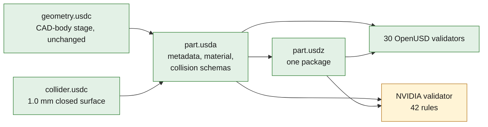

*Diagram: the package is three layers. The NVIDIA box is amber for the two
warnings the geometry layer already carried; the package adds none.*

| Item | In the package |
|---|---|
| Stage | default prim `/Head935`, kind component, Z-up, 0.001 m per unit, 1 kg per unit |
| Render mesh | `BareHead`, 2,262,390 triangles, one normal per face, evidence colours |
| Material | `Looks/EvidenceDisplay`, a `UsdPreviewSurface` that reads the evidence colour; bound to the body and the 10 studs |
| Collider | `Collision/BareHead`, guide purpose, 396,244 triangles (the 1.0 mm surface of the thermal screen), `UsdPhysics` collision with convex decomposition; volume 1.00017 of the render body |
| OpenUSD validators (30) | no finding on `part.usda` or on `part.usdz` |
| NVIDIA validator (42 rules) | 0 failures, 0 errors, 2 warnings on each: faces without area and co-located points in single precision, both on `BareHead`, both inherited and [explained](#profiles-rtx-and-the-two-warnings-on-a-rented-gpu-707) |
| Read back from the `.usdz` | identical to the layers |

Not authored, on purpose: **no mass, density or rigid body**, because the
alloy is unknown, and **no physical material**. The bound material displays
the observed and inferred classes; it is not a material of the part. No
physics was run on the package, and the NVIDIA skill named for this step
(`omniverse-cad-to-sim-ready`) is not installed on the host, so its rules
were not consulted.

**Visual check.** The six-view render shows a recognisable head: fins, both
ports, spring pockets with guide bosses, the chamber with two throats and
two plug bores, four stud bosses. The first render, on 2026-11-11, also
showed what the scores did not: five slivers standing up to 26 mm above the
cam face. They led to [the stud repair](#the-stud-repair-of-2026-11-11-occupancy); the
figures below are from the body rebuilt after it.

- **Stud residue is down to stubs.** Nothing stands more than 5.5 mm above
  the cam face beside the studs, against 26 mm before. The stubs sit below
  the height from which the studs were fitted, where the repair does not
  reach, beside three of the four long studs.
- **The renderer's strict gate still refuses the body.** Its loader welds
  vertices and drops degenerate triangles before testing. As built the body
  is watertight (2,262,390 triangles); after trimesh's default processing 4
  vertices merge and 5 edges are shared by more than two faces, against 10
  and 23 before the repair. The solid touches itself at those points. A
  slicer or mesher that welds will see the same thing; the 3MF and the
  thermal surface were built without welding.

### Profiles, RTX and the two warnings on a rented GPU (#707)

[Record](params/simready-conformance-gpu.json). On 2026-11-22 the admitted
SimReady image (`3dprinting993-simready-local-ai@sha256:5a69a680…`, the
digest `deploy/openbao/openbao-ghcr` admits) ran on a rented RTX 3090,
driver 595.91.07, instance 61955410. The invoice is $0.131 (GPU $0.102 for
0.35 h, storage $0.028, download $0.001), and the instance was destroyed, then
confirmed gone. All 113 receipts came back and rehashed; they stay private.
The controller in
`deploy/vast/simready` was not used: it needs the OpenBao wrapper, which is
on the Mac only, and an RTX PRO 6000 floor sized for the image's local AI. Its
gates were kept: image by digest, GPU probe, inputs frozen by hash, cost cap,
guard on the instance and checked teardown. The package checked is the one
of the previous section, byte for byte.

| Check | Tool | Result |
|---|---|---|
| The two inherited warnings | [stage_warnings.py](source/stage_warnings.py) on this host | explained; no repair that keeps the surface closed clears them, so the stage is unchanged |
| NVIDIA stage validator, newest release | `usd-validation-nvidia` 1.23.0 alone in its venv | the same two warnings on `part.usda` and `part.usdz`; the report is byte for byte the 1.21 one |
| SimReady profiles, the image's release | `simready-validate` 2026.6.5, Foundation 2026.06.0 | Package 1.0.0 and Package-NoBOM 1.0.0 pass; Package-Candidate fails on the missing thumbnail only; the four prop profiles fail |
| SimReady profiles, newest release | `simready-validate` 2026.10.0 with `simready-foundation-tier-core` 2026.10.0, from PyPI | Robotics-Prop 5.0.0 and Package-Candidate 1.3.0 fail; Package and Package-NoBOM cannot run on a USD stage in this release |
| RTX capture of the frozen review scene | OVRTX 0.3.0, [capture_rtx.py](source/capture_rtx.py) unchanged | three stills and a 120-frame turntable in 304 s; read by the agent |

**The warnings.** The stage holds exactly the float32 cast of the
double-precision loft body; a rebuild with `export_usd.py` on this host
reproduced it byte for byte. ZeroAreaFaceChecker sees 996 faces whose float32
cross product is zero. [usd-cad-summary.json](params/usd-cad-summary.json)
counts 35 because it measures in double. All 996 are caps: three distinct
corners nearly on one line. WeldChecker sees 1,058 groups of identical float32
points. 1,056 of them are distinct in double, at most 7.3e-6 mm apart where
the float32 spacing is 7.6e-6 mm; 2 coincide in double, where the solid
touches itself. Three repairs keep the surface closed and consistently wound
under a tolerance of 1e-4 mm fixed beforehand:

| Repair | Faces flat in float32 | Co-located groups |
|---|---|---|
| none (the stage) | 996 | 1,058 |
| collapse edges under 1e-4 mm, flip caps lower than 1e-4 mm | 834 | 2 |
| collapse float32-equal or short edges, flip only float32-flat faces | 103 | 751 |
| manifold3d `simplify(1e-4)`, 26% fewer triangles | 125 | 62 |

None clears both. The flat faces come in chains across shared edges, where a
flip would fold the neighbour. Points two or more edges apart cannot be welded
without pinching the surface, and nudging them apart would only hide the
warning. The warnings stand on this mesh-derived stage. A stage tessellated
from the whole-body B-rep (#695) will be checked afresh.

**The profiles.** Each validator release reads a `.usd` or `.usda` root, so
the package was checked as its root layer with its two binary layers beside it,
extracted from `part.usdz` with the recorded hashes. Every failing requirement
has a cause:

| Requirement | Why it fails here | Waits for |
|---|---|---|
| RB.001, RB.MB.001 | no rigid body: a body without mass lets the engine invent a density | the alloy (#705) |
| SR.004 | SimReady metadata missing; mass is one of its fields | the alloy (#705) for mass; authoring for the rest |
| UN.007 | the stage is in millimetres, the twin's convention; the profile wants metres | an authoring decision |
| NP.005 | in 2026.06.0, the folder names (gone in a copy named by the convention); in 2026.10.0, also one USD file per folder | authoring |
| NP.006, SR.002, AF.001, SL.001 | no SimReady metadata, thumbnail, asset frame or semantic labels | authoring |
| GSP.001 | no grasp vector: a robotics handling point no source gives | not applicable |

The materials feature passes in the image's release. A profile pass would say
the package is well formed for a use; no pass or fail here says anything about
the part.

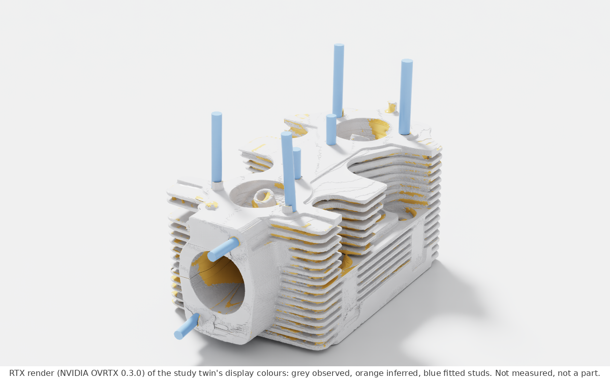

**The RTX capture.** The three stills and orbit frames 0, 30, 60 and 90 were
read. The whole body stays in frame through the orbit. No hole, stray shell or
dark inverted patch is visible. Fins, both ports, the spring pockets, the
chamber with two throats and two plug bores, the stud holes and the sealing
groove are where the six-view render has them. Seen in the pictures:

- the scene's lights saturate the display colours: the observed grey comes out
  almost white and the inferred orange yellow-orange;
- a dark seam crosses the exhaust-port boss in three views, where loft bands
  meet; a render cannot tell a step from a crease;
- fine lines follow the loft sections on flat faces, and the stud stub beside a
  long stud is visible;
- the chamber camera looks into the 12° key light, drawn as a white disc behind
  the body, which is a property of the scene;
- orbit frames from 30 on carry faint ghosts of the studs from the previous
  camera position: 16 accumulation steps do not clear a camera move. The
  stills, 64 steps from a fixed camera, have none.

**Not done.** The Material and Physics agents were not run: they propose a
material, density and mass, and nothing unsourced may be bound before the
alloy is selected (#705). Mass, inertia, density and a physics material stay
null (#705), the STEP conversion waits for the whole-body B-rep (#695), and no
thermal or stress field is bound (#702, #703). The twin stays not measured, not
functional, not released.

### Print body: a study object derived from the twin ([case](params/print-body-case.json), [record](params/print-body.json), [orientations](params/print-body-supports.json))

The v2 CAD body is the twin and is not changed. A body sent to a slicer needs
three more things, and [print_body.py](source/print_body.py) adds them on the
occupancy lattice, each amount a declared hypothesis:

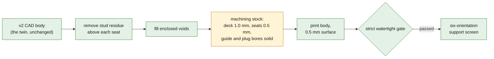

*Diagram: the print body is derived, never edited back into the twin. The
stock step is amber because no drawing of this head exists.*

| Step | Volume |
|---|---|
| Stud residue removed above the ten seats | 429 mm³ |
| Enclosed voids filled (before and after the stock) | 32 mm³ |
| Stock under the deck and the register floor, 1.0 mm | 9,782 mm³ |
| Stock on the two valve seats, 0.5 mm | 992 mm³ |
| Guide bores printed solid | 885 mm³ |
| Plug thread bores printed solid | 2,812 mm³ |
| **Print body** | **1,109,068 mm³** against 1,094,993 mm³ for the twin |

The 0.5 mm surface has 1,684,604 triangles in a box of
117.6 × 224.1 × 95.6 mm. Once welded it is watertight, with no edge shared by
more than two faces and no triangle without area. **It passes the strict
gate that refused the twin body.** No stud stub is left, and no air is
enclosed.

**Orientations**, from the same column screen as the AM screen, run on the
print body:

| Build direction | Height | Overhang below 45° | Support envelope (÷ part volume) | Lands on the part |
|---|---|---|---|---|
| deck down (+Z) | 95.5 mm | 39,176 mm² | 448,910 mm³ (0.40) | 38% |
| deck up (−Z) | 95.5 mm | 41,467 mm² | 516,070 mm³ (0.47) | 33% |
| flange y− down (+Y) | 224.0 mm | 14,676 mm² | 389,082 mm³ (0.35) | 56% |
| flange y+ down (−Y) | 224.0 mm | 14,104 mm² | 476,689 mm³ (0.43) | 47% |
| side x− down (+X) | 117.5 mm | 23,225 mm² | 418,822 mm³ (0.38) | 60% |
| side x+ down (−X) | 117.5 mm | 22,847 mm² | 417,815 mm³ (0.38) | 61% |

- **The fins decide.** They are plates normal to the bore axis. Built deck
  down or deck up, every fin underside is an overhang (39,000 to 41,000 mm²)
  and the supports sit between fins, where they cannot be removed. Built on a
  side or on a flange the fins stand vertical and the overhang falls to
  14,000 to 23,000 mm².
- **Two orientations are kept for the build study:** flange y− down, with the
  smallest envelope and nearly the least overhang but 224 mm of height, and
  side x+ down, at about half that height. Neither is chosen.
- In both, more than half of the support envelope lands on the part itself.
  An envelope is not a support design: no support is generated, and none of
  the installed tools designs one.

**Layer screen**, with the repository's assigned tool on the Eplus3D EP-M300
card ([record](params/print-body-layer-screen.json)). It now runs on both
surfaces of the print body, the 0.5 mm one (1,684,604 triangles) and
the 1.0 mm one (398,652):

| Quantity | 0.5 mm surface | 1.0 mm surface |
|---|---|---|
| Orientation the tool selects | build along Y, flange y+ on the plate | the same |
| Downward-facing area along Y / X / Z | 11,540 / 18,660 / 34,242 mm² | 11,168 / 19,131 / 32,249 mm² |
| Layers of 0.05 mm | 4,482 over 224.1 mm, none empty | 4,481 over 224.0 mm, none empty |
| Fit in the 300 × 300 × 450 mm envelope | yes, bare part: margins 182, 204 and 226 mm | yes: 183, 205 and 226 mm |
| Layers with unsupported area | 3,181; the largest in one layer is 767 mm² | 2,844; 643 mm² |
| New islands | 563 in 245 layers | 216 in 159 layers |
| Support proxy (vertical columns) | 433,945 mm³ | 456,345 mm³ |
| Trapped powder at 1.0 mm | none detected | none detected |
| Thickness probe, 2,000 points | median 2.64 mm, 5th percentile 0.57 mm; 25.4% below 1.5 mm | median 4.71 mm, 5th percentile 1.38 mm; 6.8% below 1.5 mm |

- **Both surfaces give the same build:** along Y, on a flange, with the least
  downward-facing area, the same envelope margins and no trapped powder. The
  largest unsupported area sits 34 mm up, where the section jumps from 1,300
  to 4,000 mm².
- **The island count depends on the surface:** 216 on the smoother one,
  563 on the finer one, which also carries its own steps. Each
  island starts in mid-air and needs a support. The support proxy is a
  conservative column volume, not a design.
- **The thickness probe does not measure walls on the 0.5 mm surface.** It
  grows a sphere from the surface and is stopped by that surface's roughness:
  25% of its probes read below 1.5 mm there, against
  7% on the 1.0 mm surface. A second measurement on the 0.25 mm
  occupancy grid ([wall_check.py](source/wall_check.py),
  [record](params/print-body-wall-check.json)) puts 8.7% of the
  surface in walls below 1.5 mm or at sharp edges, and 5.2% below
  1.0 mm: the fin tips. That is 0.35% of the volume.
- **Why the 0.5 mm run kept being killed, corrected.** It was first recorded
  as the slicer keeping every layer in memory. Measured stage by stage, the
  slicing ends at 4 GiB; it is the thickness probe that passed 6, 12 and
  20 GiB, because trimesh grows all 2,000 spheres at once and looks up every
  triangle near each. [layer_screen.py](source/layer_screen.py) runs the same
  tool and kernel, unmodified, with the sections taken 64 layers at a time
  and the probes 25 at a time: 3.4 GiB at the peak, 12 minutes. On the 1.0 mm
  surface its four output files have the hashes of the run made without it.
- Every qualification gate of the report is false: no engineering review of
  the orientation, no recoater check, no supplier supports, no machine file,
  no coupon, no process physics.

Left open on purpose: stud passages, ports, plug wells and spring pockets.
Not done: supports, a machining drawing, tolerances, shrinkage or distortion
compensation. The print body is a study object, not a build file.

### Build simulation: the deposition witness in Adamantine ([witness](params/am-build-witness.json))

Every Adamantine case of this repository had run with material deposition
switched off. A layer-by-layer build adds material over time, so that path
needed its own witness before any run on the head.
[am_build.py](source/am_build.py) runs the smallest case with a closed-form
answer: a block of 20 × 8 mm in plan, a 4 mm substrate at 300 K, two lumped
layers of 4 mm added at 500 K from a deposition file, every wall adiabatic.

| Check, from the VTU files alone | Solver's own mesh | Imported hexahedral mesh |
|---|---|---|
| Active volume before, between and after the layers (640, 1,280, 1,920 mm³) | error 0.0001 mm³ | error 0.0001 mm³ |
| Mean temperature against the nodal mixing value (300, 375, 406.25 K) | error 0.0 K | error 0.0 K |
| Field uniform at the end of each interval | yes | yes |

**The witness passes on both meshes**, and it found three things on the way:

- **A layer carries less heat than its volume.** New nodes take the
  deposition temperature and interface nodes keep theirs. A layer of n cell
  rows carries (n − 0.5) / n of its nominal heat: 75% here. The nominal
  mixing temperatures would have been 400 and 433.33 K; the solver gives 375
  and 406.25 K, exactly.
- **A box that ends on a cell boundary also activates the cells beyond it.**
  The boxes are inset by 0.1 mm.
- **This build's input validation refuses a deposition file** unless a
  second, literal key names it.

The witness shows that the solver adds material when and where the file says
and conserves energy while doing so. It has no laser, no powder and no
mechanics.

**A build of the head did not run in Adamantine.** Three things stood in
the way, and each is answered in CalculiX in the
[build screen](#build-screen-the-print-body-grown-lump-by-lump-in-calculix-case-witnesses-record)
below:

- **The heat input.** Activating a lumped layer at the solidus puts in only
  that layer's own heat content. A laser delivers several times more, most of
  which leaves by conduction during the exposure.
- **The time scale.** A 4 mm lump stands for 80 layers of 0.05 mm, each with
  its own recoating and exposure time. Adamantine integrates explicitly, with
  steps of 0.02 s on 4 mm cells, so a build of 40 hours is out of its reach.
- **The mechanics.** Distortion and residual stress need plasticity, which no
  Adamantine case here had exercised.

### Build screen: the print body grown lump by lump in CalculiX ([case](params/build-sim-case.json), [witnesses](params/build-sim-witness.json), [record](params/build-sim.json))

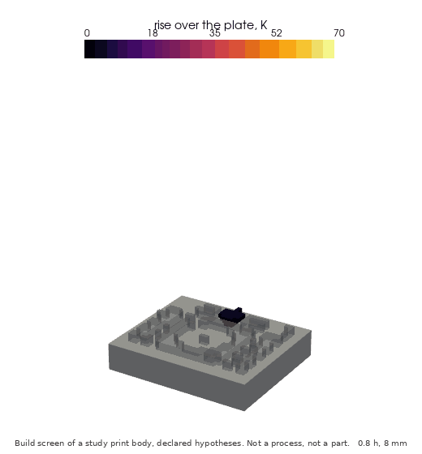

*Voxel cells of 4 mm, as solved. A screen under declared hypotheses: no
process value comes from the machine's maker and nothing was printed.*

**The head's build now runs, as a screen.** Under the declared process values the
print body takes 43.4 hours on one 350 W laser. Its hottest region runs
60 to 64 K above the plate as a time average, at the ten levels solved.
After release the model is out of shape by 0.23 to 0.33 mm at the
median and 1.62 to 2.87 mm at its worst corner across ten runs that differ
only in cell size and lump height. The median agrees between the four cell
sizes; the value at the worst corner does not: with the lumps held at 12 mm it
rises from 1.74 to 1.93 mm as the cells go from 3 to 1.5 mm, and with 8 mm lumps
from 1.93 to 2.38 mm as they go from 4 to 2 mm. The distortion is an order of
magnitude, not a converged value. The stress sits on the declared yield curve, as this
kind of model must give: what carries information is where the shape moves,
not the stress level.

**How the three blockers were answered.**

- **Heat input:** the absorbed laser energy of each lump, spread over its
  melted volume and its real time. Energy density 30.7 J/mm³
  (350 W, 1,200 mm/s, hatch 0.19 mm, layer 0.05 mm: a published AlSi10Mg
  set, read in its source, not the EP-M300's) times a declared absorptivity
  of 0.4. The temperature rise scales linearly with that number.
- **Time scale:** real time. Each lump lasts as long as its layers take:
  exposure by one laser plus 12.25 s of recoating per layer.
  Adamantine integrates explicitly, with a stable step near 0.02 s on these
  cells, so the 43.4 hours run in CalculiX, which integrates implicitly.
- **Mechanics:** a lump is born strain free at the solidus
  (563 °C) and cools to the temperature the thermal run gives it;
  yield falls with temperature, with almost no hardening (1% of the
  modulus, for the solver). Three closed-form witnesses hold the deck first.

**Witnesses** ([build_sim.py](source/build_sim.py), sub-command `witness`):

| Witness | Closed form | CalculiX |
|---|---|---|
| Two lumps at 500 K added to a substrate at 300 K, adiabatic | 375 K, then 406.25 K | 375 K, 406.25 K |
| A body flux in the last lump for 5 s | mean 1,793.4 K | 1,793.4 K |
| Bar held at both ends, upper half born strain free, cooled; elastic | 322, 322, 483, 805 MPa by cell row | 322, 322, 483, 805 MPa |
| The same bar with a yield of 200 MPa | von Mises 200 MPa everywhere | 200 MPa in every cell |

The bar found a trap in the solver. **A node whose elements are not yet
active does not keep its initial temperature:** it holds the value last
prescribed. Without a temperature card for the new nodes in the birth step,
the upper half was born at 400 K instead of 800 K and ended at 161 MPa
instead of 805. The head deck prescribes every new node; the wrong bar
is kept in the witness record.

**Model.** Voxel hexahedra of the print-body occupancy, flange y+ on the
plate (the build the layer screen sliced). A cell is solid when half of its
0.25 mm voxels are. A cell with no solid cell among the nine below it stands
on a column of support cells that carry 20% of the alloy's conductivity,
stiffness and yield. All heat leaves through the plate, held at
100 °C underneath; powder and gas are adiabatic, so the temperatures are
an upper bound for this heat input.

| Level | Cells | Lump | Lumps | Lasers | Part cells | Support cells | Nodes | Part volume against the occupancy | Runs |
|---|---|---|---|---|---|---|---|---|---|
| c4-l8 | 4 mm | 8 mm, 160 layers | 28 | 1 | 17,336 | 3,550 | 35,299 | +0.04% | thermal, mechanics (3 variants) |
| c4-l4 | 4 mm | 4 mm, 80 layers | 56 | 1 | 17,336 | 3,550 | 35,299 | +0.04% | thermal, mechanics |
| c4-l12 | 4 mm | 12 mm, 240 layers | 19 | 1 | 17,336 | 3,550 | 35,299 | +0.04% | thermal, mechanics |
| c3-l9 | 3 mm | 9 mm, 180 layers | 25 | 1 | 40,978 | 8,744 | 81,438 | -0.24% | thermal, mechanics |
| c3-l12 | 3 mm | 12 mm, 240 layers | 19 | 1 | 40,978 | 8,744 | 81,438 | -0.24% | thermal, mechanics |
| c3-l3 | 3 mm | 3 mm, 60 layers | 75 | 1 | 40,978 | 8,744 | 81,438 | -0.24% | thermal, mechanics |
| c2-l8 | 2 mm | 8 mm, 160 layers | 28 | 1 | 139,548 | 29,142 | 262,998 | +0.66% | thermal, mechanics in DOLFINx |
| c2-l12 | 2 mm | 12 mm, 240 layers | 19 | 1 | 139,548 | 29,142 | 262,998 | +0.66% | thermal, mechanics in DOLFINx |
| c2-l4 | 2 mm | 4 mm, 80 layers | 56 | 1 | 139,548 | 29,142 | 262,998 | +0.66% | thermal, mechanics in DOLFINx |
| c1.5-l12 | 1.5 mm | 12 mm, 240 layers | 19 | 1 | 329,963 | 64,170 | 601,400 | +0.41% | thermal, mechanics in DOLFINx |
| c4-l8-2-lasers | 4 mm | 8 mm, 160 layers | 28 | 2 | 17,336 | 3,550 | 35,299 | +0.04% | thermal, mechanics |
| c4-l8-4-lasers | 4 mm | 8 mm, 160 layers | 28 | 4 | 17,336 | 3,550 | 35,299 | +0.04% | thermal, mechanics |
| c4-l8-laid-supports | 4 mm | 8 mm, 160 layers | 28 | 1 | 17,336 | 7,741 | 38,435 | +0.04% | thermal, mechanics |

The level `c4-l8-laid-supports` stands on the envelope of the support layout
instead of the columns, at the melted share of its block supports.

The half-full rule does not keep the volume exactly: the models hold -0.24% to
+0.66% of the occupancy's volume, and the absorbed energy follows the cells.

**Temperature during the build.**

| Level | Build time | Absorbed energy | Largest rise over the plate | Where (height above the plate) | Largest energy imbalance | Solver time |
|---|---|---|---|---|---|---|
| c4-l8 | 43.4 h (28.1 h exposure, 15.2 h recoating) | 14.2 MJ | 62.0 K | 180 mm | 0.20% | 6 min |
| c4-l4 | 43.4 h (28.1 h exposure, 15.2 h recoating) | 14.2 MJ | 63.5 K | 180 mm | 0.40% | 16 min |
| c4-l12 | 43.4 h (28.1 h exposure, 15.2 h recoating) | 14.2 MJ | 60.5 K | 192 mm | 0.13% | 7 min |
| c3-l9 | 43.4 h (28.1 h exposure, 15.3 h recoating) | 14.2 MJ | 60.2 K | 189 mm | 0.13% | 79 min |
| c3-l12 | 43.4 h (28.1 h exposure, 15.3 h recoating) | 14.2 MJ | 60.2 K | 189 mm | 0.10% | 19 min |
| c3-l3 | 43.4 h (28.1 h exposure, 15.3 h recoating) | 14.2 MJ | 62.7 K | 177 mm | 0.41% | 73 min |
| c2-l8 | 43.6 h (28.3 h exposure, 15.2 h recoating) | 14.3 MJ | 60.6 K | 184 mm | 0.10% | 222 min |
| c2-l12 | 43.6 h (28.3 h exposure, 15.2 h recoating) | 14.3 MJ | 60.1 K | 192 mm | 0.07% | 95 min |
| c2-l4 | 43.6 h (28.3 h exposure, 15.2 h recoating) | 14.3 MJ | 61.4 K | 178 mm | 0.20% | 264 min |
| c1.5-l12 | 43.4 h (28.2 h exposure, 15.2 h recoating) | 14.2 MJ | 62.0 K | 192 mm | 0.05% | 390 min |
| c4-l8-2-lasers | 29.3 h (14.1 h exposure, 15.2 h recoating) | 14.2 MJ | 98.1 K | 180 mm | 0.30% | 9 min |
| c4-l8-4-lasers | 22.3 h (7.0 h exposure, 15.2 h recoating) | 14.2 MJ | 138.2 K | 180 mm | 0.41% | 9 min |
| c4-l8-laid-supports | 46.6 h (31.4 h exposure, 15.2 h recoating) | 15.8 MJ | 40.3 K | 180 mm | 0.11% | 9 min |

- **The part stays near the plate temperature:** its largest rise is 60 to 64 K, about
  160 to 164 °C at the hottest region with the plate at 100 °C; the rest
  is cooler. The mean absorbed power is
  91 W (14.2 MJ over the build), and the aluminium section carries it
  to the plate.
- **Lump height and cell size move it by 2 K:** 60.2 to 63.5 K over lumps of 3 to
  12 mm and cells of 2 to 4 mm. At the same lump height, halving the cells from
  4 to 2 mm changes it by -1.4 K: the temperature is settled at the scale of
  this screen.
- **The hottest region is the top of the build,** 177 to 192 mm above the plate,
  where the heat has the longest way down.
- **The absorptivity decides the level.** 0.4 is declared; published values
  run from 0.13 to 0.58, and the rise scales with it: 20 to 90 K
  on this model.
- **More lasers shorten the build and heat the part.** With two lasers at 350 W
  each the build takes 29.3 hours and the hottest region runs 98 K above the
  plate; with four, 22.3 hours and 138 K, about 238 °C. Only the
  exposure shrinks: the 15.2 hours of recoating stay, so four lasers save
  49% of the time, not three quarters. The machine's lasers are 500 W, not the
  declared 350 W: these rows are a sensitivity to the mean power.
- **On the laid-out supports the part runs cooler:** 40 K above the plate instead of 62.
  The [support layout](#support-layout-block-supports-laid-out-by-rule-case-witnesses-record) puts 7,741 support cells
  under the body where the 45° rule on cells put 3,550, and its walls melt 36% of a cell
  instead of the declared 20%: more metal between the part and the plate. The build takes
  46.6 hours instead of 43.4, and absorbs 15.8 MJ instead of 14.2.

**Stress and distortion.** Three states are read: the end of the build, room
temperature on the plate, and after plate and supports are removed with the
part held at three nodes. Distortion is the displacement left once rigid
motion and the best uniform shrinkage are taken out.

| Run | Stress-free at | Yield at room temperature | von Mises on the plate, median / 95th percentile | Cells within 5% of yield | Distortion after release, median / 95th / largest | Uniform shrinkage |
|---|---|---|---|---|---|---|
| c4-l8, as built | 563 °C | 322 MPa | 220 / 310 MPa | 11% | 0.30 / 0.87 / 1.93 mm | 0.52% |
| c4-l8, stress-relieved yield curve | 563 °C | 155.3 MPa | 142 / 161 MPa | 43% | 0.24 / 0.70 / 1.67 mm | 0.49% |
| c4-l8, stress-free at 400 °C | 400 °C | 322 MPa | 170 / 305 MPa | 4% | 0.21 / 0.61 / 1.30 mm | 0.45% |
| c4-l4, as built | 563 °C | 322 MPa | 216 / 310 MPa | 10% | 0.24 / 0.75 / 1.62 mm | 0.47% |
| c4-l12, as built | 563 °C | 322 MPa | 219 / 310 MPa | 12% | 0.33 / 0.87 / 1.71 mm | 0.56% |
| c3-l9, as built | 563 °C | 322 MPa | 230 / 311 MPa | 16% | 0.31 / 0.90 / 2.16 mm | 0.57% |
| c3-l12, as built | 563 °C | 322 MPa | 225 / 311 MPa | 15% | 0.33 / 0.86 / 1.74 mm | 0.60% |
| c3-l3, as built | 563 °C | 322 MPa | 220 / 311 MPa | 13% | 0.23 / 0.76 / 2.14 mm | 0.49% |
| c2-l8, as built, solved in DOLFINx | 563 °C | 322 MPa | 238 / 312 MPa | 20% | 0.30 / 0.90 / 2.38 mm | 0.59% |
| c2-l12, as built, solved in DOLFINx | 563 °C | 322 MPa | 228 / 311 MPa | 18% | 0.32 / 0.84 / 1.85 mm | 0.62% |
| c2-l4, as built, solved in DOLFINx | 563 °C | 322 MPa | 231 / 314 MPa | 18% | 0.25 / 0.83 / 2.87 mm | 0.53% |
| c1.5-l12, as built, solved in DOLFINx | 563 °C | 322 MPa | 228 / 312 MPa | 18% | 0.32 / 0.84 / 1.93 mm | 0.62% |
| c4-l8-2-lasers, as built, 2 lasers | 563 °C | 322 MPa | 208 / 308 MPa | 7% | 0.28 / 0.82 / 1.81 mm | 0.56% |
| c4-l8-4-lasers, as built, 4 lasers | 563 °C | 322 MPa | 194 / 305 MPa | 4% | 0.27 / 0.76 / 1.68 mm | 0.60% |
| c4-l8-laid-supports, as built, laid-out supports | 563 °C | 322 MPa | 229 / 314 MPa | 16% | 0.30 / 0.76 / 1.71 mm | 0.50% |

- **The stress level is the yield curve, not a prediction.** As built, the
  median is 220 MPa and the 95th percentile 310 MPa against a yield
  of 322 MPa. With the stress-relieved curve (155.3 MPa) they fall to
  142 and 161 MPa, and 43% of the cells are within 5% of yield.
  Every lump is given about 1% of thermal strain, more than twice the
  yield strain, so the material yields wherever it is restrained.
- **The distortion depends less on the yield curve than on the stress-free
  temperature.** Largest value 1.93 mm as built, 1.67 mm with the
  yield halved (-14%), 1.30 mm with the stress-free
  temperature lowered from 563 to 400 °C (-33%).
- **Removing plate and supports changes the shape by 0.93 mm at most**
  as built, against 1.93 mm of distortion in all.
- **The uniform shrinkage (0.45% to 0.52%) follows from the declared
  stress-free temperature.** It is taken out of the distortion and is not a
  scale factor for a build file.

**Cell size against lump height** (as built, one laser, support columns): distortion after release, median / largest.

| Lump height | 4 mm cells | 3 mm cells | 2 mm cells (DOLFINx) | 1.5 mm cells (DOLFINx) |
|---|---|---|---|---|
| 12 mm | 0.33 / 1.71 mm | 0.33 / 1.74 mm | 0.32 / 1.85 mm | 0.32 / 1.93 mm |
| 8 mm on 4 and 2 mm cells, 9 mm on 3 mm cells | 0.30 / 1.93 mm | 0.31 / 2.16 mm | 0.30 / 2.38 mm | not run |
| 4 mm on 4 and 2 mm cells, 3 mm on 3 mm cells | 0.24 / 1.62 mm | 0.23 / 2.14 mm | 0.25 / 2.87 mm | not run |

- **On 4 mm cells the median falls as the lumps thin:** 0.33, 0.30 and 0.24 mm for
  lumps of 12, 8 and 4 mm. The largest value does not follow: 1.71, 1.93 and
  1.62 mm. It is one corner of the outline, and with 4 mm lumps another corner takes over.
  A real layer is 0.05 mm; nothing here says where the trend ends.
- **With 12 mm lumps, 4 and 3 mm cells agree; finer cells do not.** The largest value
  is 1.71, 1.74, 1.85 and 1.93 mm on 4, 3, 2 and 1.5 mm cells (+1.3%, +6.5%, +4.1%).
  The median stays at 0.33 to 0.32 mm and the 95th percentile at 0.87 to 0.84 mm.
  The worst point is 60 mm above the plate in all four; 3 mm cells put it on the
  opposite corner of the outline, the three others on the corner at lowest x and y,
  half a millimetre apart on 2 and 1.5 mm cells.
- **In the two other rows the worst corner is higher on 3 mm cells:** 2.16 against
  1.93 mm (+12%) with lumps of 9 and 8 mm, and 2.14 against 1.62 mm (+32%) with lumps of
  3 and 4 mm. In the last pair it is the same corner, 45 and 44 mm above the plate.
  Cell size and lump height both change in these rows, so they do not say
  which of the two does it. An earlier version of this section put the 12%
  down to the lump height alone; the run with 3 mm lumps does not support
  that, and the value at the worst corner is not settled in cell size.
- **The median and the 95th percentile agree in every row,** within 6% and 3%.
  On 3 mm cells the median falls as the lumps thin, as on 4 mm cells: 0.33, 0.31
  and 0.23 mm for lumps of 12, 9 and 3 mm. The 95th percentile is lowest with
  the thinnest lumps on both: 0.76 and 0.75 mm.
- **With the lumps held at 8 mm, halving the cells settles the median, not the worst corner.**
  On 2 mm cells against 4 mm cells: median 0.30 against 0.30 mm (+0.8%), 95th
  percentile 0.90 against 0.87 mm (+3.9%), largest 2.38 against 1.93 mm (+23%). The
  worst point stays near the same corner of the outline, the one at lowest x and y,
  48 mm above the plate instead of 56. This is the comparison the 3 mm runs lacked:
  only the cell size changes, and at this lump height the value at the worst corner
  keeps rising as the cells shrink.
- **With the lumps held at 4 mm, halving the cells moves the worst corner across the part.**
  On 2 mm cells against 4 mm cells: median 0.25 against 0.24 mm, 95th percentile
  0.83 against 0.75 mm, largest 2.87 against 1.62 mm (+77%). The worst point is on
  the corner at lowest x, 40 mm above the plate, where 4 mm cells put it on the
  opposite corner, 114 mm away.
- **Across the ten runs the largest distortion is 1.62 to 2.87 mm** and the median
  0.23 to 0.33 mm. The finest lump is 60 real layers.
- **The stress on the plate rises a little as the cells shrink:** median 220, 225 to
  230 and 228 to 238 MPa on 4, 3 and 2 mm cells, 228 MPa on 1.5 mm cells; the 95th
  percentile stays at 310 to 314 MPa, under the declared yield of 322 MPa.
- **A hotter build distorts a little less on this model.** With two and four lasers the
  largest value is 1.81 and 1.68 mm against 1.93 mm (-6%, -13%), at the
  same corner, and the median 0.28 and 0.27 mm against 0.30 mm. The median stress
  falls from 220 to 208 and 194 MPa. The part stays warmer while it is
  built, as it would on a hotter plate, and the declared yield curve is
  lower there. Whether the alloy keeps its strength after hours at 200 °C
  and more is outside this model.
- **On the laid-out supports the largest distortion is 1.71 mm** instead of 1.93 mm (-12%),
  and it moves from a lower corner to the top of the build, 176 mm above the plate. The 95th
  percentile falls from 0.87 to 0.76 mm; the median stays at 0.30 mm. Changing the
  supports moves the worst corner as much as changing the lumps does.

**Does the worst corner settle with the cell size? No, in each row** ([rule written before the 2 and 1.5 mm runs](params/build-sim-convergence-rule.json), verdicts in the [record](params/build-sim-dolfinx.json)).
The rule was committed before those levels were prepared: a row settles when it has at
least three cell sizes, its last two changes of the largest value are both within 5%, and
the worst points of its two finest levels are within 12 mm of each other. It was not
changed after the results. The distance is taken in the twin's coordinates, because each
level's build coordinates start at its own footprint corner.

| Lumps | Cell sizes | Largest distortion | Changes | Worst points of the two finest | Verdict |
|---|---|---|---|---|---|
| 12 mm | 4, 3, 2, 1.5 mm | 1.71, 1.74, 1.85, 1.93 mm | +1.3%, +6.5%, +4.1% | 0.5 mm apart | not settled |
| 8 mm | 4, 2 mm | 1.93, 2.38 mm | +23% | 9.2 mm apart | not settled |
| 4 mm | 4, 2 mm | 1.62, 2.87 mm | +77% | 114.1 mm apart | not settled |

- **The 12 mm row fails on the change from 3 to 2 mm cells.** The last change, +4.1%, is
  within 5%, and the worst point no longer moves, but the value has risen at every step
  below 3 mm.
- **The median and the 95th percentile do settle in that row:** 0.33, 0.33, 0.32 and
  0.32 mm, and 0.87, 0.86, 0.84 and 0.84 mm. What the cell size does not fix is the
  value at one corner of the outline.
- **The geometry changes with the cell size.** A cell is solid when half its voxels are,
  so each size makes a different solid: part volume +0.04%, -0.24%, +0.66% and +0.41%
  against the occupancy on 4, 3, 2 and 1.5 mm cells, and the corner where the worst
  point sits is cut differently each time. This sweep therefore mixes a change of
  discretisation with a change of the corner itself, as the carrier's gyroid cell did
  with its solid fraction. Separating the two needs a series on one fixed solid, for
  example cells subdivided from one coarse cut; no such run exists.

**A second solver for the 2 mm cells** ([build_sim_dolfinx.py](source/build_sim_dolfinx.py), [limits written before the first run](params/build-sim-dolfinx-acceptance.json), [record](params/build-sim-dolfinx.json)).
CalculiX solves this mechanics on one thread with a direct solver, and the 2 mm
level, 788,994 unknowns, is out of its reach on this host. The script states the
same model in DOLFINx 0.11 (PETSc, MPI): the same cells, lumps, temperatures at the
end of each lump, declared material, plate condition and three held nodes;
8-node hexahedra with 2 x 2 x 2 integration points, strain-free birth, von Mises
plasticity with radial return. Nothing in it is a new hypothesis: only the solver
changes.

- **The bar witnesses pass with each of its three linear solvers** (LU, a block
  low-rank Cholesky factorisation kept as the preconditioner of conjugate gradients,
  and multigrid), on four processes, against the closed-form values set for CalculiX.
- **On the 4 mm cells it gives CalculiX's numbers** with each linear solver. The limits,
  written before the first run, were 2% on the median and 95th percentile, 3% on the
  largest value, the same worst node, and 2% on the shrinkage and the stress. Every
  printed digit agrees (table below). Node by node, the displacements differ by
  3.4e-5 mm at most and the cell-mean stress by 0.08 MPa, in every saved state.
- **The 2 mm level then ran in 4.0 hours** on four processes with the block
  low-rank solver, in a container capped at 18 GiB: 59 increments, 356 Newton
  iterations, 4 line searches. No CalculiX run of this level exists; the agreement
  is on the 4 mm cells.
- **The levels c2-l12, c2-l4 and c1.5-l12 ran on a rented machine** with the same
  image and script, after the bar witnesses passed there again: 44 cores of a Xeon
  E5-2699 v4, the three side by side on 8, 12 and 16 processes. Wall time 2.7, 5.3 and
  6.5 h; largest resident memory 17, 20 and 54 GiB. The 1.5 mm level has 1,804,200
  unknowns and needed 66 line searches against 0 to 4 on 2 mm cells. Each level's
  record names the machine and the script hash at launch.
- **Multigrid needs the least memory but is slow here:** 221,513 conjugate-gradient
  iterations on the 4 mm cells against 4,753 with the block low-rank solver, because
  the plastic tangent is far softer along the flow direction than across it.

| c4-l8, as built | Processes | Wall time | Distortion after release, median / 95th / largest | Worst point (x, y, height above the plate) | Uniform shrinkage | von Mises on the plate, median / 95th |
|---|---|---|---|---|---|---|
| CalculiX 2.21, direct solver | 1 thread | 118 min | 0.2974 / 0.8691 / 1.9343 mm | 8, 8, 56 mm | 0.5244% | 220.1 / 310.0 MPa |
| DOLFINx, LU (MUMPS) | 8 | 21 min | 0.2974 / 0.8691 / 1.9343 mm | 8, 8, 56 mm | 0.5244% | 220.1 / 310.0 MPa |
| DOLFINx, block low-rank Cholesky and conjugate gradients | 4 | 8 min | 0.2974 / 0.8691 / 1.9343 mm | 8, 8, 56 mm | 0.5244% | 220.1 / 310.0 MPa |
| DOLFINx, multigrid and conjugate gradients | 8 | 64 min | 0.2974 / 0.8691 / 1.9343 mm | 8, 8, 56 mm | 0.5244% | 220.1 / 310.0 MPa |

Two programs that agree on one model say the equations are solved, not that the
model is the print.

**Input audit, stated in the record.** The cells are cut from the
[print body](#print-body-a-study-object-derived-from-the-twin-case-record-orientations),
which passes the strict watertight gate with no enclosed void. It derives from the
v2 body, of which 82% of the area lies on acquired scan
([scorecard](params/scorecard-v2-loft-s025.json)) and 18% is closure where the scanner
saw nothing; its stock and fills are declared. The input is admissible as a closed
study body, not as the specimen. The two-solver comparison does not depend on this:
both programs solve identical cells. The cell-size rows and the place of the worst
corner describe this study body's voxel model; whether the worst corner lies on
acquired surface is not established.

**What this screen does not say.**

- No melt pool, scan path or peak temperature: the heat of a lump is spread
  over its volume and its real time.
- No heat loss to powder or gas.
- No support prepared in a build processor: the supports are homogenised
  cells, columns under a 45° rule or, on one level, the envelope of the
  [layout by rule](#support-layout-block-supports-laid-out-by-rule-case-witnesses-record).
- No creep, stress relief during the build or phase change, and no
  calibration against a printed coupon.
- Every gate of the record is false: no process parameters from the maker,
  no calibrated heat input, no support prepared in a build processor, no
  comparison with a printed part. The distortion is not a compensation field.

### Support layout: block supports laid out by rule ([case](params/support-design-case.json), [witnesses](params/support-design-witness.json), [record](params/support-design.json))

*The support envelope on 1 mm blocks: the air columns that hold a block
support, not the thin walls. A layout by rule on a study body, not a build
file.*

**The print body now has a support layout, by rule.** With the flange down and a
45° rule, 12,376 mm² of down-facing surface gets a block support. The
supports fill 470,700 mm³ of envelope, 42% of the part's volume, and melt
169,400 mm³, 15% of the part. About half of the envelope stands on the part
itself, and a quarter of the supported surface has no straight way out to
the side. No person has judged whether these supports can be removed.

**Rules** ([support_design.py](source/support_design.py)). Each value is declared, with the publication it leans on.
The sources were read by an automated research pass on 2026-11-13: *read*
means the document was opened and the passage read in it, *read by an
automated reader* that a summarising tool extracted the passage. No person
has re-read them.

| Rule | Value | Leans on | How it was read |
|---|---|---|---|
| Surface that needs a support | 45 degrees from the plate | Materialise aluminium guideline; Renishaw guide 2017; Protolabs guide 2019 | read by an automated reader; read; read |
| Attached overhang left bare | an attached overhang up to 1.0 mm wide is left bare | Renishaw guide 2017 | read |
| Distance between support walls | 1.0 mm between walls, both ways | Piscopo et al. 2024; Yue et al. 2022 | read by an automated reader; abstract only |
| Wall thickness | 0.2 mm: one scan track | Klanjšček and Kalin 2025; Van Cauwenbergh et al. 2021; Charan et al. 2023 (preprint) | read; read by an automated reader; read; a preprint, not peer reviewed |
| Teeth: share of the wall line that touches the part | 0.5: half of each wall's top line touches the part | Poyraz et al. 2015 (IN625); Li et al. 2026 (IN625) | read; read |
| Slenderness of a support | none: the height over inscribed width of each support body is reported, not judged | nothing published was found | — |

- **Walls of 0.2 mm every 1 mm melt 36% of the envelope** (2t/s − (t/s)²). The
  build screen had declared 20% for its support columns.
- **An island always gets a support.** A narrow overhang is left bare only
  when it hangs from material already built; where a region of a layer
  starts with nothing under it, the support stays whatever its width.
- **Two values have no aluminium source.** The teeth come from two nickel
  alloy studies, and no published limit for the slenderness of a block
  support was found, so slenderness is reported and not judged.
- **Not opened:** Calignano, Materials and Design 64 (2014) 203, the usual reference for aluminium supports; ISO/ASTM 52911-1; any design guide
  of EOS or Eplus3D; the default values of a build processor.

**Witnesses** (sub-command `witness`, 0.25 mm grid):

| Shape | Quantity | By hand | Measured |
|---|---|---|---|
| A cap 40 × 40 mm on a stem 20 × 20 × 30 mm | envelope, all on the plate | 36,000 mm³ | 35,992 mm³ |
|  | height over inscribed width of the ring | 2.56 | 2.50 |
| A closed cavity 20 × 20 × 10 mm with a 4 mm chimney | envelope standing on the part | 3,840 mm³ | 3,838 mm³ |
|  | of which hidden from the side | 3,840 mm³ | 3,838 mm³ |
| A wall with a ledge of 1 mm and one of 3 mm | supported area: the wide ledge only | 120 mm² | 119 mm² |
| A blade 1.5 mm thick hanging under a slab | narrow patches kept because an island starts there | 1 | 1 |

All 21 checks pass within 5%; the largest error is 2.4%. Before any
exemption the layout finds the overhang area and the air-column volume of
the [orientation screen](params/print-body-supports.json) to 0.0003%: 476,689 mm³.

**Layout of the print body.**

| Quantity | Value |
|---|---|
| Down-facing surface below 45°, projected | 12,538 mm² |
| Left bare: narrow attached overhangs | 226 patches, 163 mm² (1.3%) |
| Narrow patches kept because an island starts there | 3 |
| Supported surface, projected | 12,376 mm² |
| Support envelope | 470,685 mm³, 42% of the part |
| … standing on the plate | 246,716 mm³ (52%) |
| … standing on the part | 223,970 mm³ (48%), on 5,911 mm² of the part |
| Melted in the walls | 169,447 mm³, 15% of the part |
| Exposure added, at the part's energy density | 4.1 h on 27.0 h |
| Wall line against the part | 36.6 m: 24.8 m under the supported surface, 11.8 m at the foot of the supports that stand on the part |
| … of which teeth touch | 18.3 m |
| Support bodies | 149, 142 of 1 mm³ or more |
| Tallest support | 176 mm |
| Height over inscribed width | median 16, largest 152 |
| No straight lateral access | 21,248 mm³ of envelope (4.5%); 3,174 mm² of supported surface (26%) |

- **The body stands on its supports.** It touches the plate on 46 mm² only,
  and the flange face lies 34 mm above its lowest point: the blue bed under the
  body is 52% of the envelope.
- **The other half stands on the part.** Those supports fill pockets and
  openings of the body and leave a second mark where they land, on
  5,911 mm².
- **26% of the supported surface has no straight way out to the side,** in
  only 4.5% of the envelope: short supports under internal surfaces. The test is
  crude: two horizontal axes, no oblique line, no tool.
- **Some supports are tall and thin:** up to 176 mm, and up to 152 times
  taller than the largest disc that fits in their footprint. Whether such a
  support survives the recoater is not judged here.
- **The supports cost 15% more melted volume** and 4.1 hours of exposure.
- **In the build screen** the level `c4-l8-laid-supports` takes this envelope
  in place of the columns; its numbers are in the section above.

**The same rules in the six orientations of the [orientation screen](params/print-body-supports.json)** ([record](params/support-design-orientations.json)).

| Orientation | Build height | On the plate | Envelope | Standing on the part | Wall line against the part | Supported surface with no lateral access | Tallest support |
|---|---|---|---|---|---|---|---|
| deck down | 95.5 mm | 5 mm² | 448,300 mm³, 40% of the part | 38% | 106.1 m | 9,721 mm² (27%) | 84 mm |
| deck up | 95.5 mm | 19 mm² | 514,400 mm³, 46% of the part | 33% | 116.4 m | 6,697 mm² (17%) | 90 mm |
| flange y− down | 224.0 mm | 313 mm² | 386,200 mm³, 35% of the part | 56% | 39.0 m | 2,681 mm² (21%) | 217 mm |
| flange y+ down (the build screen) | 224.0 mm | 46 mm² | 470,700 mm³, 42% of the part | 48% | 36.6 m | 3,174 mm² (26%) | 176 mm |
| side x− down | 117.5 mm | 35 mm² | 417,100 mm³, 38% of the part | 60% | 59.4 m | 10,323 mm² (49%) | 114 mm |
| side x+ down | 117.5 mm | 50 mm² | 414,700 mm³, 37% of the part | 61% | 57.3 m | 8,816 mm² (43%) | 114 mm |

- **The two flange-down builds touch the part least:** 37 to 39 m of wall line
  against 57 to 116 m for the four others, and 2,700 to 3,200 mm² of
  supported surface without lateral access against 6,700 to 10,300 mm².
- **The other flange down needs the least support of the six:** 386,200 mm³,
  18% less than the orientation the build screen ran, and it sits on
  313 mm² of plate instead of 46. Its supports are taller
  (217 mm) and more of the envelope stands on the part (56%).
- **Deck up or down is less than half as tall** (95.5 mm against 224 mm), and recoating
  follows the height. It pays with about three times the wall line against
  the part (106 to 116 m).
- **No orientation is chosen here.** The build screen solved one of them;
  build time, distortion and the finish of the machined faces were not
  compared across orientations.

**What this layout does not say.**

- It is not a build file and was not prepared in a build processor.
- No person has judged whether a support can be removed; the access test is
  two straight lines.
- Round holes get a support on their top arc like any other surface,
  although guides let holes under 8 to 10 mm print bare.
- One block pattern everywhere: no solid support under a large overhang,
  no powder escape from the support cells.
- Every gate of the record is false.

### Supports from an open build-preparation library: PySLM against the rule layout ([plan](params/support-build-processor-plan.json), [witness](params/support-build-processor-witness.json), [record](params/support-build-processor.json))

*Both layouts on 1 mm blocks of the 0.25 mm grid. Red marks overhang within
45 degrees of straight down that the layout leaves without a support.
Geometry only, not a build file.*

**PySLM, with its own defaults, supports 2.7% of the overhang the rule
layout starts from; the rule layout supports 98.7%.** The print body went to PySLM 0.6.1
(LGPL-2.1), the open library the carrier already pins, at the same
revision, flange y+ on the plate, at a critical angle of 45 degrees. It
prepared 19 block supports holding 343 mm² of the
12,538 mm² of down-facing surface; the rule layout holds
12,376 mm². What would be compared was committed before the run
([plan](params/support-build-processor-plan.json)); both layouts are measured
on the same grid by the same code
([support_build_processor.py](source/support_build_processor.py)), which first
gives back the rule layout's committed area, envelope and landing exactly.

| Quantity, projected areas | Rule layout | PySLM, 0.5 mm surface | PySLM, 1.0 mm surface (not in the plan) |
|---|---|---|---|
| Overhang supported, of 12,538 mm² | 12,376 mm² (98.7%) | 343 mm² (2.7%) | 3,606 mm² (28.8%) |
| Support envelope | 470,685 mm³ | 11,580 mm³ | 118,311 mm³ |
| … standing on the plate / on the part | 246,716 / 223,970 mm³ | 6,059 / 5,496 mm³ | 87,268 / 30,297 mm³ |
| Contact with the part, under the surface + at the foot | 12,376 + 5,911 mm² | 441 + 256 mm² | 3,716 + 1,039 mm² |
| Overhang left bare | 162 mm² in 226 patches | 12,196 mm² in 394 patches | 8,932 mm² in 415 patches |
| Widest bare patch | 1.0 mm (11 mm²) | 19.7 mm (2,705 mm², 33 mm above the plate) | 14.6 mm (432 mm², 154 mm above the plate) |
| Tallest support column | 175 mm | 72 mm | 114 mm |

- **The two layouts barely overlap.** Of the overhang, 343 mm² is supported
  by both, 12,033 mm² by the rule only and none by PySLM only; 162 mm² is
  bare in both, the narrow ledges the rule leaves. PySLM's blocks also touch
  99 mm² of the part outside the 45-degree surface.
- **The face 33 mm above the plate is left bare.** It lies where the flange
  face does, the face the rule layout stands on its blue bed; in PySLM's
  layout the body hangs on a few thin columns (picture, bottom row).
- **Where the overhang is lost, read from the library's own steps**
  ([diagnosis](params/support-build-processor.json)): PySLM takes the
  overhang from raw face normals, and on the 0.5 mm surface it falls apart
  into 5,144 regions, 4,369 of them under 0.5 mm². 5,063 regions
  (4,404 mm²) are under its 5 mm² minimum once inset by 0.5 mm. 26 regions
  (4,344 mm², among them the largest, 2,600 mm²) are split by that inset
  and every piece is then refused: the library loads each piece as a path
  that trimesh 5.1.1, the version the repository pins, does not report as
  closed. The 49 regions left (2,828 mm²) end as 19 blocks holding
  343 mm² of the surface; that last loss, through the height maps and their
  contours, was not traced step by step.
- **The result depends on the surface it reads.** On the 1.0 mm surface of
  the same body the regions are fewer (1,120), most of the flange face gets
  a bed (seen in a private render of that run), and 28.8% of the overhang is
  supported. An answer that moves tenfold with the tessellation does not
  prepare this part.
- **The grid truss runs on the blocks it has:** 17 of 19 blocks, 5,607 mm²
  of truss surface; the two thinnest, about half a millimetre tall, stop with
  the library's own "please share a bug report".

**What it took to run.** Each departure is recorded in the record.

- Upstream PySLM stopped on its extrusion error, the one the carrier met:
  the declared fallback applied the carrier's historical patch to that
  extrusion only.
- On the 0.5 mm surface its spline simplification raised "MultiPolygon
  error": the declared fallback switched it off, as the carrier does.
- Under Xvfb and llvmpipe the 52nd height-map window of a process fails
  its framebuffer check; a wrapper lets Qt delete each window after PySLM
  has read it. The library's code and its height maps are unchanged.
- The witness found one more limit: trimesh 5 fills boundary loops of three
  or four edges when it splits the overhang, so the cap of the square T of
  the rule layout's witness is never supported.

**Does this count as "prepared by a build processor" for #706? No.**
PySLM is an open research library, not the machine maker's build processor,
and on this body it supports a small and unstable share of the overhang.
What stays open is the tool the issue asks for: the machine maker's build
processor for the selected machine, or a commercial preparation suite with
a build processor for it (Materialise Magics, for example). None is
installed or licensed here. It would add support templates and exposure
parameters qualified for the alloy and the machine, a machine build file
with scan order, support types beyond blocks, and checks this library does
not make: recoater collision, powder removal, heat through the supports.
The build screen keeps its levels; none was changed or added.

### Melt-pool check of the declared heat input ([record](params/melt-pool-check.json))

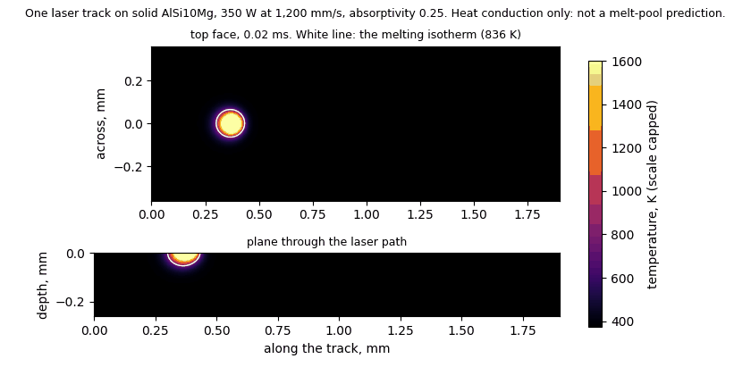

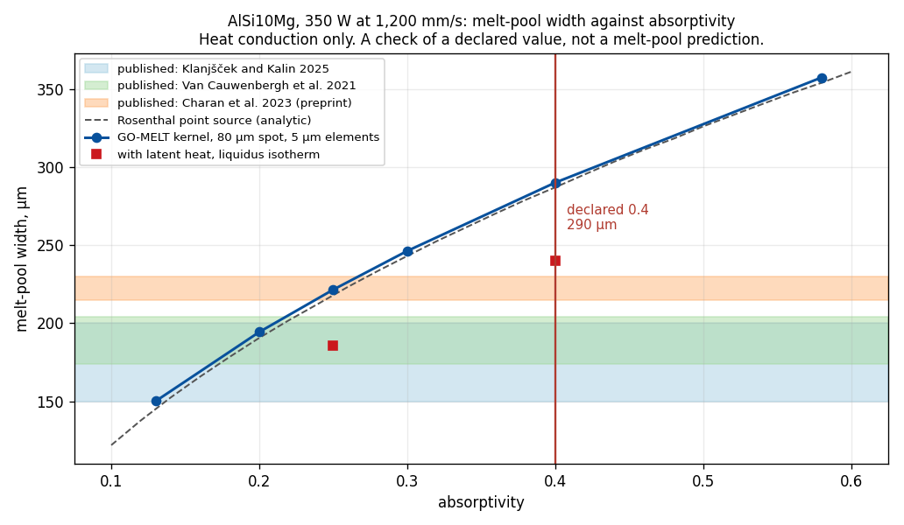

*One track on solid AlSi10Mg by heat conduction only ([video](media/melt-pool.mp4)). A check of a declared number,
not a melt-pool prediction: no melt flow, no evaporation, no keyhole, no powder.*

**The declared absorptivity of 0.4 is on the high side.** The build screen's temperature scales with
that one number. A single track at the declared laser values gives a melt pool 290 µm wide,
or 240 µm when the latent heat is included. The published tracks nearest to this setting are
215 to 230 µm wide, which on this model is an absorptivity of 0.24 to 0.27,
or 0.33 to 0.37 with latent heat. The declared case is not changed here.

**Method** ([melt_pool_track.py](source/melt_pool_track.py), [melt_pool_summary.py](source/melt_pool_summary.py)). An explicit,
matrix-free heat conduction run built from three functions of the repository's
reviewed [GO-MELT](https://github.com/JLnorthwestern/GO-MELT) revision, on a rented GPU: the first run of that kernel on CUDA
here. Half a track is modelled, on a block with adiabatic faces, with the
build screen's own values: 350 W, 1,200 mm/s, conductivity 105 W/(m·K),
plate at 100 °C, melting at the solidus (563 °C). The laser spot is a declared 80 µm.

**Checks.**

| Check | Result | Limit |
|---|---|---|
| Witness: width within 2% of Rosenthal's point source | 0.16% | 2.0% |
| Witness: depth within 2% of Rosenthal's point source | 0.19% | 2.0% |
| Mesh: width changes by less than 1% between the two finest meshes | 0.01% | 1.0% |
| Energy: source within 0.1% of the absorbed power times the time, every case | 0.03% | 0.1% |
| Energy: heat stored within 0.1% of the source, constant properties | 0.00% | 0.1% |
| Energy: heat stored within 2% of the source, cases with latent heat | 1.19% | 2.0% (set after the first reading) |

- **A near-point source reproduces Rosenthal's solution:** 218.7 µm wide and 109.4 µm deep
  against 218.3 and 109.2 µm, at absorptivity 0.25.
- **The mesh is fine enough:** 221.5, 221.6, 221.6 µm on elements of 10, 5, 4 µm.
- **Energy closes** to rounding with constant properties. With latent heat
  the explicit step is not exactly conservative; the first limit of 0.1% failed
  there at 1.2%, and that defect is reported instead.

**Width against absorptivity** (80 µm spot, 5 µm elements, constant properties).

| Absorptivity | Width | Depth | Rosenthal width |
|---|---|---|---|
| 0.13 | 150 µm | 69 µm | 145 µm |
| 0.2 | 194 µm | 93 µm | 191 µm |
| 0.25 | 222 µm | 107 µm | 218 µm |
| 0.3 | 246 µm | 121 µm | 243 µm |
| 0.4 (declared) | 290 µm | 143 µm | 287 µm |
| 0.58 | 357 µm | 182 µm | 354 µm |

**Published widths, and the absorptivity each corresponds to on this model.**

| Source | Width | How it was read | Absorptivity, constant properties | With latent heat |
|---|---|---|---|---|
| Klanjšček and Kalin 2025: EOS M290, bulk top surfaces, several settings | 150 to 200 µm | read | 0.13 to 0.21 | 0.15 to 0.29 (beyond the two cases run) |
| Van Cauwenbergh et al. 2021: 189 ± 15 µm; power and speed not given | 174 to 204 µm | read by an automated reader | 0.17 to 0.22 | 0.22 to 0.30 (beyond the two cases run) |
| Charan et al. 2023 (preprint): 350 W at 1,300 and 1,100 mm/s, the setting nearest to the declared one | 215 to 230 µm | read off a graph; not peer reviewed | 0.24 to 0.27 | 0.33 to 0.37 |

- **For the build screen:** its largest rise of 62 K scales with the absorptivity. At 0.24 to 0.37,
  the range of the nearest published tracks with and without latent heat, it would be 37 to 58 K.
- **The spot hardly matters at this speed:** 60 and 100 µm spots change the width by -0.8% and +1.0%; the
  depth of the source, by +0.2% and -0.9%.
- **Latent heat matters:** it narrows the pool by 16%. Its value (400 kJ/kg, that of aluminium) and the
  solidus and liquidus used with it (830 and 869 K) come from Gusarov et al.,
  arXiv:2409.18226, Table 1, read in the source.
- **The peak temperatures are not physical:** up to 12,800 K, far above boiling, because nothing here
  evaporates or flows. The width is set by the far field, which is why it follows
  the analytic solution.
- **On the GPU** one 5 µm case (1.5 million nodes, 21,000 steps) takes 7.3 minutes on an
  RTX 3090, in double precision.

**What this check does not say.**

- It is not a melt-pool prediction: no melt flow (which widens and shallows a
  pool), no evaporation, no keyhole, no powder, constant properties.
- The published widths come from other machines and settings; only one source
  is at this power and near this speed, and it is a preprint read off a graph.
- The block is small: its far faces warm by up to
  349 K by the end of the track, with adiabatic walls.
- The tracks ran 0.1% to 4.9% past the length asked for, because the driver ran whole
  blocks of steps. The pool is read in the middle of the track, so the widths
  stand; the driver is corrected for later runs, and these cases were not rerun.
  Every case file is in [params/melt-pool-cases](params/melt-pool-cases), with its hash in the record.
- It calibrates nothing: the build screen's absorptivity stays a declared
  value, and its gate on a calibrated heat input stays closed.

### SimReady tools: STEP → OpenUSD and NVIDIA validation ([deck plate](params/simready-deck-plate.json), [ports](params/simready-ports.json))

The NVIDIA converter and validator run on this host from wheels, in two
separate virtual environments (`usd-convert-cad` 0.2.0, which embeds HOOPS
Exchange and its own OpenUSD; `usd-validation-nvidia` 1.21.0 with OpenUSD
26.8). The 10 GB image, a GPU and credentials are not needed for this step.
[simready_convert.py](source/simready_convert.py) converts and validates;
[simready_check.py](source/simready_check.py) then reloads each stage with
plain `usd-core` in the twin environment and compares it with the STEP as
OCCT reads it. Gates set beforehand: bounding box within 0.1 mm, volume
within 1%.

| B-rep input | Triangles | NVIDIA validator | Bounding box vs STEP | Volume vs STEP |
|---|---|---|---|---|
| v1 deck plate | 1,632 | pass, 0 issues | 0.000 mm | +0.17% |
| `port_y_minus` loft | 5,784 | pass, 0 issues | 0.022 mm | −0.18% |
| `port_y_plus` loft | 6,484 | pass, 0 issues | 0.020 mm | −0.06% |

Every stage is authored in millimetres, Z-up. What the independent check
found and the validator did not:

- With the default tessellation the deck plate has 50 edges used once, about
  140 mm of zero-width T-junctions. `--accurate-tessellation` removes them
  there but raises one validator warning on `port_y_minus` (3 non-manifold
  vertices, an indexing artefact: the mesh is closed once welded by
  position). Neither setting is clean on all three inputs; the default is
  kept and the other run is recorded
  ([deck](params/simready-deck-plate-accurate-tessellation.json),
  [ports](params/simready-ports-accurate-tessellation.json)).
- build123d's `.volume` is off by +0.17% and −0.21% on the two lofts against
  an adaptive OCCT integration. The loft volumes in
  [port-loft-check.json](params/port-loft-check.json) carry that error.

A validator pass shows a well-formed stage. It is not a SimReady profile
conformance. Profile validation and an RTX capture of the CAD-body package ran
on 2026-11-22 ([#707](#profiles-rtx-and-the-two-warnings-on-a-rented-gpu-707));
the Material and Physics agents were not attempted. The v2 body has no STEP,
so it enters this tier only as the USD stage above.

### AM screen: orientations and cooldown ([supports](params/am-supports.json), [cooldown](params/am-cooldown.json))

A geometric LPBF screen of the bare body under declared hypotheses, on the
scan-derived occupancy. It designs no support, chooses no orientation and
qualifies no material or process.

[am_supports.py](source/am_supports.py) counts, per build direction, the
surface within 45° of the plate and the air column under it, at the 0.25 mm
pitch. Its analytic witnesses (a T block, a cube with a through-hole and an
enclosed sphere, a vented sphere) are reproduced within 2.5%.

| Build direction | Height | Overhang below 45° | Support envelope (÷ part volume) | Lands on plate / on part |
|---|---|---|---|---|
| deck down (+Z) | 95.25 mm | 38,109 mm² | 444,124 mm³ (0.41) | 275,936 / 168,188 mm³ |
| deck up (−Z) | 95.25 mm | 40,779 mm² | 511,388 mm³ (0.47) | 347,079 / 164,309 mm³ |
| flange y− down (+Y) | 229.0 mm | 15,002 mm² | 423,397 mm³ (0.39) | 205,339 / 218,057 mm³ |
| flange y+ down (−Y) | 229.0 mm | 13,897 mm² | 473,952 mm³ (0.43) | 252,287 / 221,665 mm³ |
| side x− down (+X) | 121.25 mm | 23,492 mm² | 418,503 mm³ (0.38) | 169,079 / 249,424 mm³ |
| side x+ down (−X) | 121.25 mm | 23,034 mm² | 466,010 mm³ (0.43) | 213,110 / 252,900 mm³ |

- The overhang area agrees with a separate count on the T1s triangles within
  +0.2% to −8.8%.
- Enclosed volume is 10.0 mm³ in 184 voids, the largest 1.0 mm³: the ports
  and pockets are open to the outside. On a 0.5 mm grid the figure is
  54.8 mm³, so it depends on the pitch.
- Between 32% (deck up) and 60% (side x− down) of the support envelope
  lands on the part itself, not on the plate.
- The flange directions do not put the flange on the plate: the named faces
  sit 5.6 and 33.7 mm above the lowest point.
- Before the stud repair the deck-up envelope read 883,849 mm³ (0.81 of the
  part volume): the columns under the stud residue, 114.5 mm tall, made up
  the difference.

[am_cooldown.py](source/am_cooldown.py) runs 20 s of convective cooldown in
Adamantine on hexahedra of the occupancy, from a uniform 500 K into 300 K
air with h = 20 W/m²K, generic AlSi10Mg-class constants, clamped on the deck
side. An independent reader re-derives volume, area and energy from the VTU
files only.

| At 20 s | 4 mm hexahedra | 2 mm hexahedra |
|---|---|---|
| Hexahedra / nodes | 16,944 / 22,078 | 137,344 / 160,912 |
| Volume | 1,084,416 mm³ | 1,098,752 mm³ |
| Exterior area | 162,048 mm² | 187,832 mm² |
| Mean temperature | 495.09 K | 494.40 K |
| Largest displacement | 0.018 mm | 0.021 mm |
| Energy imbalance | 1.1e-4 | 1.5e-4 |

- The mean temperature follows the discrete area over volume, and the
  stair-step area does not converge: it is 3.8% below the T1s area at 4 mm
  and 11.5% above it at 2 mm. A lumped estimate on the T1s surface gives
  494.94 K, between the two. The difference between the levels is therefore
  not a discretisation error estimate.
- The solver's von Mises maximum rose 40% with refinement (25.8 to 36.2 MPa).
  It sits at re-entrant voxel corners and is not a stress.
- A 20 × 12 × 8 mm witness block gives 483.522 K against 483.518 K lumped.
- The image tagged 1.1 holds source version 1.1.9; this is not the native
  build of the 2026-10-29 study, and that study's body still had its studs,
  so the two are not comparable like for like.

### Machined features: fitted with the assigned tool, checked with CloudCompare ([windows](params/feature-rois.json), [fits](params/feature-fits.json), [check](params/feature-check.json))

Until 2026-11-10 the repository had no assigned tool for fitting a bore or a
valve seat to a scan, and the twin's own circle fits were the only numbers on
its machined features. [fit_features.py](source/fit_features.py) now runs the
assigned tool on 32 windows of the acquired scan: one tube per feature, drawn
by hand on radius-against-station plots and selecting points by position
only. The noise given to the tool is the RMS of the deck plane, 0.040 mm.
Half of the vertices of each window are fitted. The other half goes to
[check_features.py](source/check_features.py), where CloudCompare measures it
against the fitted primitive.

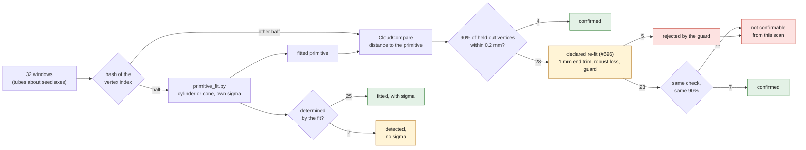

*Diagram: every window is split before fitting, so the check never measures a
vertex the fit saw. The acceptance was fixed before the first check run and is
the same for the re-fit.*

**The check, first.** A feature is confirmed when at least 90% of its
held-out vertices within 0.5 mm of the primitive lie within 0.2 mm, the
twin's tolerance. **4 of 32 pass** at this first check, 11 after the declared
re-fit below: the throat and the seat of `valve_y_plus`
and the two plug seat faces. The other 28 hold between 63% and 90% within
0.2 mm, with a median distance of 0.03 to 0.13 mm and a 95th percentile of
0.29 to 0.46 mm. The fit's own residual, 0.03 to 0.06 mm RMS, does not show
this: it only counts the vertices inside its 0.12 mm band. The numbers below
are therefore nominal sizes and axes of the scanned features. None is an
inspected surface, and the tool's standard deviations are lower bounds.

#### The declared re-fit of the 28 ([declaration](params/feature-refit-declaration.json), [re-fits](params/feature-refits.json), [check](params/feature-check-refit.json), [standing](params/feature-confirmation.json))

Issue #696 asked for each unconfirmed feature to be confirmed after a re-fit
declared before its check, or recorded as not confirmable from this scan with
the reason. The diagnosis read the fitted half only. It reproduces the first
check within 0.03 on every feature, so it shows why the held-out vertices
disagreed:

- the tool fits only the vertices inside its 0.12 mm band, so on a bore
  rougher than the deck it fits part of the surface: on many first fits the
  vertices within 0.5 mm sit 0.1 to 0.2 mm off-centre;
- the end sixths of several windows hold chamfers, edge breaks or a
  neighbouring surface;
- some surfaces stay outside 0.2 mm even when an offset, a taper and two- and
  three-lobe terms are allowed.

One rule was declared for all 28 and pushed (commit `44784510`, draft #732)
before any held-out vertex was measured. Revolved windows are shortened by
1 mm at each end. The primitive is refitted, in its own family, by robust
least squares (SciPy, soft-L1 loss, 0.1 mm scale) over the fitted-half
vertices within the check band of the first fit. A guard rejects a re-fit
whose axis or half-angle moves more than 3° or whose diameter moves more than
0.5 mm: it would be fitting another surface. The 1 mm was chosen after trying
0.5, 1 and 2 mm on the fitted half; 2 mm empties the short windows. The
acceptance, the split and the first fits are unchanged, and a shortened
window keeps every vertex in its first half, so every checked vertex was held
out of both fits.

**11 of 32 features are confirmed**: the four of the first check and seven
after the re-fit.

| Confirmed after the re-fit | First check | Re-fit check | Re-fitted on the scan |
|---|---|---|---|
| `valve_y_minus_throat` | 85.7% | 94.8% | Ø45.86 mm at mid-band, cone 1.64°, 11.0 mm long, rms 0.098 mm |
| `plug_x_plus_thread_bore` | 85.5% | 94.3% | Ø11.40 mm at mid-band, cone 0.14°, 14.2 mm long, rms 0.103 mm |
| `plug_x_plus_chamber_relief` | 78.9% | 91.4% | Ø14.35 mm, cylinder, 6.1 mm long, rms 0.122 mm |
| `plug_x_minus_chamber_relief` | 89.8% | 91.0% | Ø14.56 mm, cylinder, 5.9 mm long, rms 0.118 mm |
| `plug_x_minus_well` | 86.5% | 90.5% | Ø25.59 mm at mid-band, cone 0.88°, 17.9 mm long, rms 0.128 mm |
| `plug_x_plus_well` | 82.6% | 90.3% | Ø25.05 mm at mid-band, cone 0.78°, 17.9 mm long, rms 0.129 mm |
| `valve_y_minus_guide_bore_port_end` | 82.8% | 90.1% | Ø8.76 mm at mid-band, cone 1.83°, 11.7 mm long, rms 0.115 mm |

The margins are thin: five of the seven pass by less than 1.5 points.
`plug_x_minus_thread_bore` held 90.7% on the fitted half and 89.7% on the
held-out half, so it stays unconfirmed. The fitted half predicted every
held-out share within 0.035.

**21 features are not confirmable from this scan.** Each needs a contributed
measurement of the specimen. The reason is the class the declaration fixed
before the check:

- **Rejected by the guard (5).** `valve_y_minus_seat`: the re-fit turned its
  half-angle by 14° onto another surface. `valve_y_plus_guide_bore_cam_end`,
  `valve_y_plus_guide_boss_port` and `stud_x_minus_y_plus_counterbore`: axes
  moved 4° to 11°. `deck_register_recess`: a ring 5.5 mm long keeps too few
  vertices once shortened.
- **Not resolved by this scan (10).** Even a revolved surface with offset,
  taper and two- and three-lobe terms leaves more than 10% of the fitted half
  outside 0.2 mm: `valve_y_minus_guide_bore` (83.6% on the held-out half),
  `valve_y_minus_guide_bore_cam_end` (79.5%), `valve_y_minus_guide_od_port`
  (80.0%), `valve_y_plus_guide_od_cam` (77.4%), `valve_y_plus_spring_pocket`
  (82.1%), `valve_y_plus_spring_seat` (71.4%), `stud_x_minus_y_plus_passage`
  (78.7%), `stud_x_plus_y_minus_counterbore` (76.1%),
  `stud_x_plus_y_plus_passage` (78.0%) and `stud_x_plus_y_plus_counterbore`
  (75.8%): the inside of the guides, stud passages and counterbores, and the
  spring features of `valve_y_plus`.
- **No assigned primitive has the shape (6).** A richer surface would hold
  90% of the fitted half, but no cylinder, cone or plane does: out of round,
  or a curved face. `valve_y_minus_guide_od_cam` (76.2%),
  `valve_y_minus_spring_seat` (86.5%, a curved face),
  `plug_x_minus_thread_bore` (89.7%), `stud_x_minus_y_minus_passage` (87.7%),
  `stud_x_minus_y_minus_counterbore` (88.1%) and
  `stud_x_plus_y_minus_passage` (88.8%).

The fitted and held-out halves interleave on one surface, so a rule chosen on
the fitted half predicts the check closely. The check guards against
over-fitting and tool error; it cannot show that a window holds the right
surface. That is why one trim applies to every window and the guard limits
how far a re-fit may move. The confirmed numbers stay nominal: the scale is
an owner instruction (#693), H05 keeps `not_modelled_in_v0`, and no feature
is cut into the v2 body.

#### Reference sheet of the confirmed features ([record](params/reference-sheet.json), #708)

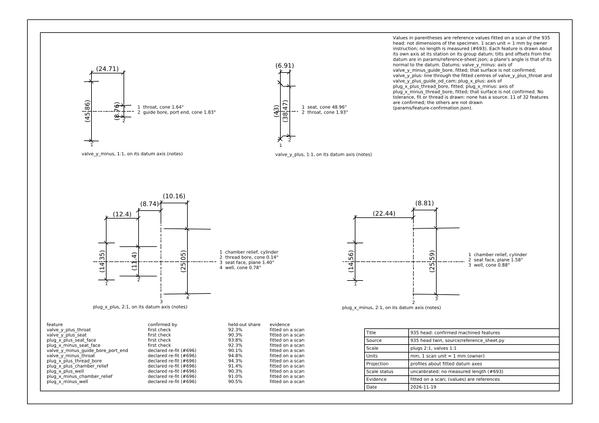

[reference_sheet.py](source/reference_sheet.py) draws the 11 confirmed
features, and only those, with the drawing tool now assigned in
[TOOLCHAIN.md](../../docs/TOOLCHAIN.md). There are four views, one per valve
or plug: the valves at 1:1 and the plugs at 2:1. Each feature is drawn about
its own axis, at its station on the datum axis of its group as
`feature-fits.json` records it. The tilts from the datum, 0.46° to 2.75°, and
the offsets, 0.01 to 0.80 mm, are in the record, not drawn.

Every value is in parentheses: a reference value fitted on a scan, not a
dimension of the specimen. The title block states the scale as uncalibrated
(#693). No tolerance, fit or thread is drawn, because none has a source.

The sheet is read back like the witness:
- each of the 16 dimensions shows the fitted number it stands for, from
  points on the drawn profile;
- no text on the sheet carries a tolerance, a fit or a thread;
- the title block reads back field by field;
- every confirmed feature is named, and no unconfirmed one except as the
  source of a datum. Two datums come from surfaces that are not confirmed:
  the `valve_y_minus` guide bore and the `plug_x_minus` thread bore.

A copy of the sheet whose dimension style forgets the 2:1 scale is caught. It
is a sheet to read the fits by, not a drawing to make or inspect the part
from.

**Valve train**, in the twin frame. The valves are named by flange side;
which one is the intake is not established.

| | `valve_y_minus` | `valve_y_plus` |
|---|---|---|
| Axis datum | guide bore, acquired at both ends, one cylinder over 48.8 mm | line through the throat centre and the cam-end guide centre, 65.9 mm apart |
| Axis to the bore axis | 25.89° | 29.89° |
| Guide bore | Ø8.51 mm (σ 0.008 mm) | Ø8.55 mm about the datum, cam end only |
| Guide outside diameter, cam end | Ø12.89 mm | Ø13.02 mm about the datum |
| Throat | Ø45.81 mm, detected only: a barrel profile that five rival cones share | Ø38.45 mm, 1.9° cone, **confirmed** |
| Seat | cone of 45.5° ± 0.14° about its own axis, 46.6° about the guide axis, Ø49.0 mm at mid-band | 49.0°, Ø43.1 mm, detected only, **confirmed** |
| Seat centre off the valve axis | 0.46 mm | 0.36 mm |
| Spring seat normal to the valve axis | 0.30° | 1.61° |

The two valve axes make 55.76° with each other.

- **Only one guide bore is seen at both ends.** On `valve_y_plus` the port
  end of the guide is not acquired, and its cam-end features, 8 to 11 mm
  long, point 3.2° to 4.3° away from the line through the two centres while
  reporting 0.4° to 1.3°. The same two-centre construction on `valve_y_minus`
  lies 0.42° from its guide bore axis, so the `valve_y_plus` axis is good to
  about half a degree, not to the 0.02° of the other valve.
- **This scan does not give seat run-out.** The seat centres sit 0.36 and
  0.46 mm from their valve axes, the plug wells 0.67 and 0.77 mm from their
  thread bores. A band 3.8 mm long cannot tell an offset from a tilt, and the
  scan locates one small feature against another to a few tenths of a
  millimetre at best. A valve job needs the specimen on a bench.

**Plugs, studs and register.**

| Feature | Fitted on the scan |
|---|---|
| Plug thread bores | Ø11.49 mm (0.34° cone) and Ø11.28 mm, 29.19° and 28.61° from the bore axis, 57.76° from each other |
| Plug chamber-side reliefs, wells | Ø14.26 and Ø14.39 mm; Ø24.7 mm (90 fitted vertices) and Ø25.4 mm (detected only) |
| Plug seat faces | planes 1.41° and 1.58° off their thread-bore axes, both **confirmed** |
| Stud passages | Ø10.50 (detected), Ø10.96 (0.74° cone), Ø10.51 (detected) and Ø10.51 mm (0.40° cone) |
| Stud counterbores | Ø24.44, Ø25.22 (135° of arc), Ø24.27 and Ø24.26 mm (detected) |
| Register recess | Ø113.36 mm on 212° of arc. The circle fit of P1 gave 113.88 mm with 0.29 mm RMS on every facet of the band |

Found on the way:

- **Seven features come back detected, not determined.** Their surface does
  not hold one cylinder or cone inside the 0.12 mm band, so the tool reports
  two rival models that share nearly every vertex and refuses both refits.
  Two stud passages seen over 354° and 37 mm are in that state. The record
  keeps the first estimate without any uncertainty.
- **The deck's noise understates the noise in a bore.** That is the reading
  of the check above. The tool's fits were not rerun with another value; the
  [declared re-fit](#the-declared-re-fit-of-the-28-declaration-re-fits-check-standing)
  replaced its 0.12 mm band by a robust loss over the check band instead.
- **The windows were drawn twice.** The first pass had 39 windows about axes
  read from plots. The second pass redrew the valve windows about the fitted
  axes, narrowed the two seat windows to the 45° band and dropped seven
  windows: four stud seat faces and the port end of the `valve_y_plus` guide,
  which hold too few vertices, the chamber shoulder, whose window caught the
  dome, and one duplicate. The check ran on the final table only, so its
  acceptance could not steer the windows.

**The v2 body, measured by a second tool** ([record](params/cloudcompare-v2-body.json)).
CloudCompare on 200,000 scan facets drawn by area gives a median of
0.0456 mm, a 95th percentile of 0.1571 mm and 97.36% within 0.2 mm. The Warp
scorecard reads 0.0454 mm, 0.1572 mm and 97.37%. The scorecard's arithmetic
is reproduced; the scan itself is not checked by this.

What these fits do not change: no feature is cut into the v2 body, H02, H05
and H06 keep their status in [hypotheses.json](hypotheses.json), and the
port-flow audit below still fails its third gate.

Not run on this head, each for a stated reason:

- **Fatigue post-processing (pyLife).** There is no stress history, because
  the only solve is a steady temperature field under a declared case, and no
  S-N data is admitted for the alloy, which is itself unknown.
- **Valve-train dynamics.** No tool is installed (Chrono is a candidate
  only), and there is no valve, spring or cam.
- **A dimensioned drawing.** The tool is assigned and witnessed, and a
  [reference sheet](#reference-sheet-of-the-confirmed-features-record-708) of
  the 11 confirmed features exists (#708). A drawing to make or inspect the
  part from still needs a measured scale (#693), the 21 features this scan
  cannot confirm, and a source for every tolerance, fit and thread.

### Alloy and machine for a simulated LPBF print ([candidates](params/alloy-candidates.json), [bare-head ranking](params/alloy-thermal.json), [assembly case](params/assembly-case.json), [assembly ranking](params/assembly-thermal.json), [strength](params/alloy-strength.json), [trade-off](params/alloy-tradeoff.json), [literature](params/thermal-literature-bounds.json), [machines](params/lpbf-machine-survey.json), [993 comparison](params/published-993-comparison.json))

The owner's brief of 2026-11-11: a full-size study print, the alloy chosen by
simulated heat dissipation as a middle ground with strength, the machine from
a maker in mainland China that publishes its data, and hypotheses wherever
data is missing. This section records what public sources give and what the
thermal screens say. No alloy and no machine is selected here.

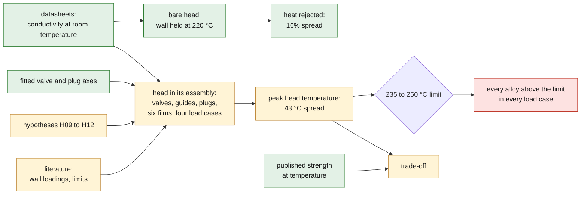

*Diagram: two screens on the same conductivities, then strength beside
temperature. The assembly screen is amber because every body and boundary it
adds is a hypothesis.*

**Published conductivities.** 20 entries on 14 distinct values, each with
its source, its method and whether the value was re-read in the downloaded
file. Rows marked * rest on the research pass alone. All are
room-temperature values; none is published at 150 to 250 °C. The two CP1
rows marked † are computed here from its published electrical conductivity
by the Wiedemann-Franz law: a hypothesis, not a datasheet value. A20X
publishes no conductivity and cannot be placed on a thermal screen.

**Two screens.** The bare-head screen holds the chamber wall at 220 °C and
asks how much heat leaves. The assembly screen adds two closed valves, two
guides and two plugs as hypothesis solids about the fitted axes, puts films
on the chamber, the two ports, the register recess, the spring pockets and
everything else, and asks how hot the head alloy gets. Its mesh has
4,755,061 tetrahedra in one watertight united body.

**Four load cases of the assembly**, each a set of declared films:

| Case | Gas side | Peak head alloy at 95 / 150 / 191 W/(m·K) | Heat in at 150 | Exhaust valve at 150 |
|---|---|---|---|---|
| Declared | gas 900 °C at 400 W/(m²·K) in the chamber, 700 °C in the exhaust port; no oil film | 311 / 280 / 267 °C | 3,290 W | 502 °C |
| Declared, with oil | the same, with an oil film at 90 °C and 500 W/(m²·K) on the spring pockets | 309 / 277 / 264 °C | 3,306 W | 501 °C |
| **Published loading, with oil** | chamber gas 621 °C, exhaust port 700 °C; both coefficients scaled to the published wall loadings; oil film; air at 150 W/(m²·K) | 428 / 399 / 386 °C | 5,327 W | 579 °C |
| Published loading, more air | the same, with the air film at the published upper bound of 233 W/(m²·K) | 373 / 340 / 324 °C | 5,364 W | 551 °C |

In the two published-loading cases the chamber gas is at the effective
621 °C that NACA Report 612 measured on air-cooled aircraft cylinders, and the
chamber and exhaust-port coefficients are scaled, at 150 W/(m·K), towards the
465 and 145 kW/m² that Mackerle gives. After 5 scaling steps the walls
carry 460 and 144 kW/m².

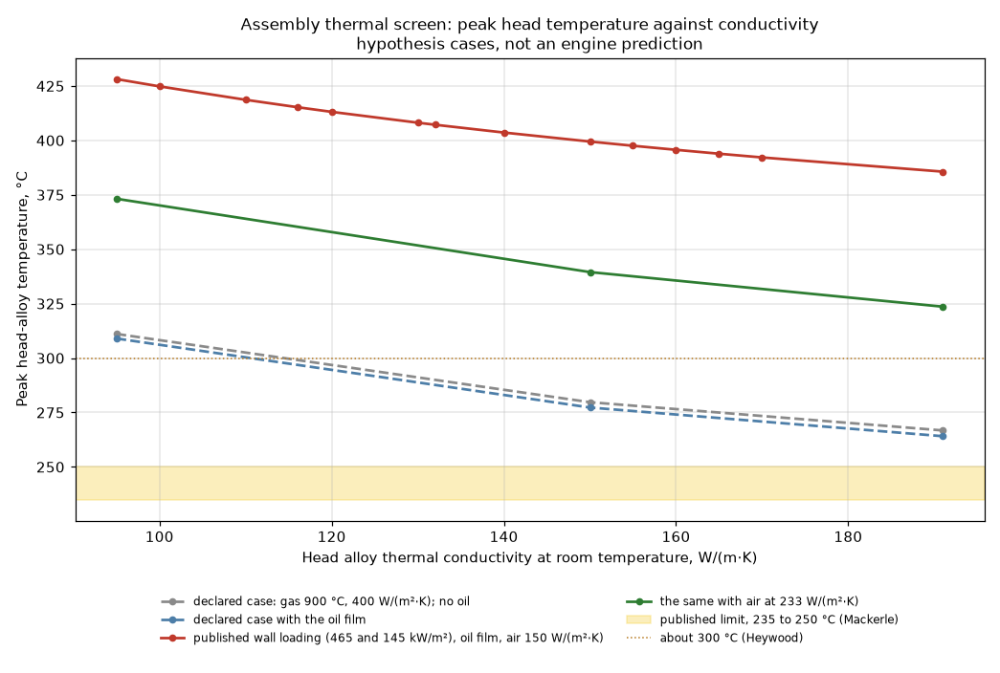

**Every alloy, at the published wall loading with the oil film:**

| W/(m·K) | Alloy and condition | Bare head: heat | Fin efficiency | Assembly: peak alloy | Valve bridge |
|---|---|---|---|---|---|
| 191 | Aheadd CP1 heat treated (computed)† | 1,707 W | 83.4% | **386 °C** | 371 °C |
| 170 | AlSi10Mg stress relieved, high (3D Systems); AlSi7Mg, high (Eplus3D) | 1,674 W | 81.8% | **392 °C** | 376 °C |
| 165 | AlSi10Mg T6, vertical (EOS) | 1,665 W | 81.3% | **394 °C** | 378 °C |
| 160 | AlSi10Mg stress relieved (EOS)*; AlSi10Mg stress relieved, low (3D Systems); Aheadd CP1 (blog figure)* | 1,656 W | 80.9% | **396 °C** | 380 °C |
| 155 | AlSi10Mg T6, horizontal (EOS)* | 1,646 W | 80.4% | **398 °C** | 381 °C |
| 150 | AlSi7Mg T6 (EOS)*; AlSi7Mg, low (Eplus3D); generic value of the earlier screens | 1,636 W | 79.9% | **399 °C** | 383 °C |
| 140 | AlSi7Mg as built (EOS) | 1,614 W | 78.8% | **404 °C** | 387 °C |
| 132 | Al5X1 heat treated (EOS) | 1,594 W | 77.9% | **407 °C** | 390 °C |
| 130 | AlSi10Mg as printed, high (3D Systems) | 1,589 W | 77.6% | **408 °C** | 391 °C |
| 120 | AlSi10Mg as printed, low (3D Systems) | 1,562 W | 76.3% | **413 °C** | 396 °C |
| 116 | Aheadd CP1 as built (computed)† | 1,550 W | 75.7% | **415 °C** | 398 °C |
| 110 | AlSi10Mg as built, horizontal (EOS) | 1,530 W | 74.8% | **419 °C** | 401 °C |
| 100 | AlSi10Mg as built, vertical (EOS); Al-Mg-Sc, high (3D Systems) | 1,495 W | 73.0% | **425 °C** | 407 °C |
| 95 | Al-Mg-Sc, low (3D Systems) | 1,475 W | 72.1% | **428 °C** | 410 °C |

- **Every alloy is above the published limit in every case.** The coolest
  result of all is 264 °C: the declared case with the oil film, at the
  highest conductivity. At the published loading the range is 386 to
  428 °C, and with the air film at its upper bound 324 to 373 °C.
  Mackerle's limit is 235 °C, with hot spots at 250 °C.
- **The oil film on the spring pockets is worth 2 to 3 °C.** The pockets
  are too far from the chamber to matter.
- **Conductivity is worth 43 °C** between 95 and 191 W/(m·K) at
  the published loading. On the bare head the same range moves the rejected
  heat by 16%, because the air side limits it: an isothermal body
  would reject 2,047 W.
- **Heat treatment matters more than the alloy.** AlSi10Mg goes from 100 to
  110 W/(m·K) as built to 155 to 165 after stress relief or T6: 31 °C
  on the peak.
- **The hottest alloy moves with the load.** In the declared cases it is at
  the exhaust seat. At the published loading it is in the alloy round a
  plug bore.
- **The model still lacks cooling a real head has.** There is no barrel, no
  oil beyond the pockets and no cam housing ([added since](#heat-paths-in-the-assembly-barrel-oil-and-joints-case-record-chart):
  they lower the peak by 20 to 31 °C, and every alloy stays above 300 °C). With the heat load the
  literature gives, that is why nothing stays under the limit. The computed
  exhaust valve (579 °C) is still below the textbook 700 °C.
- **Reproducibility.** The assembly mesh is regenerated at each run and the
  mesher is not deterministic: the declared case reproduced the first sweep's
  peaks within 0.5 °C. The 150 W/(m·K) solve of the bare head reproduces the
  CAD-body screen exactly (1,635.8 W).

**Strength beside temperature.** For the alloys that publish a strength:

| Alloy and condition | W/(m·K) | Peak at the published loading | Above the coolest candidate | Yield at room temperature | Yield at 250 °C | Strength published up to |
|---|---|---|---|---|---|---|
| AlSi10Mg, stress relieved 350 °C 2 h, 0° orientation | 160 to 170 | 392 to 396 °C | 7 to 10 °C | 166 MPa | 133 MPa | 250 °C |
| AlSi10Mg, EOS T6 (530 °C 30 min, quench, 165 °C 6 h) | 155 to 165 | 394 to 398 °C | 8 to 12 °C | 250 MPa | not published | 20 °C |
| AlSi7Mg (EOS AlF357), T6-like (540 °C 30 min, quench, 165 °C 6 h) | 150 | 399 °C | 14 °C | 265 MPa | not published | 20 °C |
| Al-Mg-Sc (Scalmalloy class), direct aged 325 °C 4 h | 95 to 100 | 425 to 428 °C | 39 to 43 °C | 465 MPa | 146 MPa (interpolated) | 300 °C |
| Aheadd CP1 (Al-Fe-Zr), heat treated 4 h at 400 °C | 160 to 191 | 386 to 396 °C | 0 to 10 °C | 300 MPa | not published | 20 °C |
| EOS Al5X1, heat treated | 132 | 407 °C | 22 °C | 380 MPa | not published | 20 °C |
| A20X / A205 (Al-Cu-TiB2), T7 | not published | not placed | not placed | not in the sheet read | 215 MPa | 250 °C |

- **No computed peak lies inside any published strength range.** At the
  published loading every peak is above 380 °C, and no source gives strength
  beyond 300 °C. The table therefore compares the alloys at 250 °C, the
  hot-spot limit.
- **The strongest alloy at room temperature is not the strongest here.**
  Al-Mg-Sc starts at 465 MPa, but it is the worst conductor: it runs about
  40 °C hotter than the best candidate, its yield at 250 °C (146 MPa,
  interpolated) is close to stress-relieved AlSi10Mg's (133 MPa), and it
  falls to 60 MPa at 300 °C.
- **The documented middle ground is heat-treated AlSi10Mg.** Its
  conductivity is measured (155 to 165 W/(m·K)), its strength is published up
  to 250 °C, and Eplus3D, Farsoon and BLT list it by name. Its conductivity and
  strength sources are not for the same heat-treatment condition.
- **CP1 is the candidate to verify.** Heat treated, its computed conductivity
  is the highest of all and its room-temperature yield is 300 MPa, and one
  maker's sheet claims stability up to 300 °C. No datasheet read gives it a
  thermal conductivity or a strength above room temperature. Eplus3D lists it
  for the EP-M300, the larger machine the owner accepted.
- **A205 has the best published hot strength** (215 MPa at 250 °C) and no
  published conductivity, so it cannot be placed.

Nothing is selected. The two rows worth a data request are heat-treated
AlSi10Mg, for its strength at the condition of its conductivity, and CP1, for
a measured conductivity and its strength at 200 to 300 °C.

**The declared load against the literature.** No factory or peer-reviewed
head temperature, heat balance or fan power of the 911 engine could be
opened, and the DDK forum dataset holds none either. What is citable is
generic. It bounds the cases without calibrating them:

| Quantity | Declared case, at 150 W/(m·K) | Published-loading case, at 150 W/(m·K) | Published |
|---|---|---|---|
| Heat into the assembly | 3,290 W | 5,327 W | cooling heat 0.6 to 0.8 × brake power, shared by head, barrel and oil (Mackerle); the 993 makes 33 kW per cylinder |
| Heat out to air / charge / oil / cylinder | 2,691 / 479 / none / 119 W | 3,890 / 736 / 294 / 406 W | no split published for the 911 |
| Chamber wall loading | 242 kW/m² | 460 kW/m² | about 465 kW/m² (Mackerle) |
| Exhaust port loading | 127 kW/m² | 144 kW/m² | about 145 kW/m² (Mackerle) |
| Gas temperature at the chamber | 900 °C | 621 °C | effective 621 °C on aircraft cylinders (NACA 612) |
| Air-side coefficient | 150 W/(m²·K) | 150 W/(m²·K) | at most 116 to 233 W/(m²·K) (Mackerle) |
| Exhaust valve | 502 °C | 579 °C | about 700 °C (Heywood) |
| Peak head alloy | 280 °C | 399 °C | limit 235 °C, hot spots 250 °C (Mackerle); under about 300 °C (Heywood) |

**Machine.** No maker read publishes everything a build simulation needs.

| Maker, machine | Envelope (mm) | Lasers | Spot | Layer | Oxygen | Parameters |
|---|---|---|---|---|---|---|
| Eplus3D EP-M260 | 260 × 260 × 390 | 500 or 700 W, single or dual | 70–100 µm | 20–120 µm | ≤ 100 ppm | open stated on the EP-M300 sheet only |
| Eplus3D EP-M300 | 300 × 300 × 450 | 1, 2 or 4 × 500 W | 70–120 µm | not published | not published | open: power, speed, scan direction, up and down facing surfaces |
| Kings M280 | 250 × 250 × 320 | IPG 2 × 500 W, 1064 nm | not published | 20–100 µm | not published | packages supplied |
| Farsoon FS273M | 275 × 275 × 355 | 1 or 2 × 500 W | not published | 20–100 µm | not published | "open machine key parameters" |
| Laseradd DiMetal-280 | 250 × 250 × 300 | 500 W × 1 or 2 | not published | 20–100 µm | not published | not published |
| BLT A300 / A320 | 250 × 250 × 300 | 500 W or 2 × 500 W | not published | not published | not published | not published |
| HBD 400 | 350 × 400 × 400 | 4 or 6 × 500 / 1000 W | not published | not published | not published | not published |

Eplus3D publishes the most: the only spot size and oxygen level in a
datasheet, and the only aluminium conductivity from a Chinese maker (150 to
170 W/(m·K) for AlSi7Mg, condition not stated). The Eplus3D, Kings and
Farsoon datasheets were re-read here; the other three rows rest on the
research pass. Not published by anyone: absorptivity, hatch spacing and scan
strategy, the power and speed used per alloy, beam profile, powder-bed
properties and temperature-dependent material data. A build simulation will
need each of them as a declared hypothesis.

**The 993 manual as a cross-check of the scale.** The manual describes
another head, so nothing in it calibrates this one. The two fitted seat
diameters (49.0 and 43.1 mm at mid-band) fall on the manual's two valve heads
(49 and 42.5 mm) within about 1.5%, and one seat angle matches (45.5° against
45°). That does not contradict the scale of 1 unit = 1 mm, and it suggests
`valve_y_minus` is the inlet (H09). Two things differ: the scan's guide bore
reads 8.51 mm against 8.00 to 8.015 mm, and the plug bores (11.3 to 11.5 mm)
are too small for the manual's M14 thread.

**The DDK forum dataset as a second cross-check.** The PorscheFanatics
repository holds 5,916 measurement records read from the DDK forum. It has
no cylinder head temperature and no fan air delivery: its 45 temperature
records are oil, heater-duct and thermostat temperatures, and its flow
records are fuel flows. It does hold head dimensions that members reported
for 3.2 Carrera and RSR-type engines, and they sit closer to the scan than
the 993 manual does:

| Quantity | Forum figure (basis) | Scan |
|---|---|---|
| Inlet port diameter, 3.2 head | 41.5 mm (quoted) | 40.8 to 44.2 mm equivalent, `port_y_minus` |
| Exhaust port diameter, 3.2 head | 40 mm (measured) | 38.1 to 40.5 mm equivalent, `port_y_plus` |
| Inlet valve, 3.2 and RSR-type | 49 to 50 mm (quoted, reported) | seat mid-band 49.0 mm |
| Exhaust valve, RSR-type | 41.4 to 42.5 mm (reported) | seat mid-band 43.1 mm |
| Valve guide, first oversize | 13.2 to 13.26 mm (quoted, measured) | 12.9 and 13.0 mm |
| Valve stem, early 911 | 9 mm (wear limit 8.928 mm, reported) | guide bore 8.51 mm |

Forum figures are leads, weaker than the manual, and none describes this
head. They do not contradict the scale, they support the inlet role of
`valve_y_minus`, and they leave the guide bore undecided between an 8 mm and
a 9 mm stem. The oil temperatures (80 to 100 °C in normal running) are kept
as a lead for an oil-cooling hypothesis.

### Heat paths in the assembly: barrel, oil and joints ([case](params/assembly-heat-paths-case.json), [record](params/assembly-heat-paths.json), [chart](media/heat-paths.png))

The assembly screen above put every alloy above the published limit, but it
had no barrel, oil on the spring pockets only, and perfect contact at every
joint. Issue #701 asked whether the over-temperature came from those missing
sinks. This screen keeps every value of the first one and adds three heat
paths, each value either fitted, published with its source, or declared as a
hypothesis with a range (H13 to H15):

- **A barrel.** It is a tube on the bore axis:
  - its bore sits on the fitted chamber shoulder (92.80 mm), and its collar
    fills the fitted register recess;
  - its heights (114.5 mm overall, 77.27 mm to the shoulder) and its 107 mm
    lower register come from the MAHLE replacement cylinder of the 993 Turbo,
    which is another engine;
  - its bore takes gas at the 316 °C that NACA Report 612 gives for barrels,
    scaled to Mackerle's 145 kW/m² on cylinder walls in the published-loading
    cases;
  - its fins are one effective film, 3 (1.5 to 6) times the air film, and its
    lower register stands in a crankcase at the oil temperature.
- **Oil where it reaches.** The spring pockets, now walls and mouth included,
  and the cam-housing face (fitted level 85.87 mm), as one lumped contact to
  the oil, which is at 90 °C (80 to 100 °C published for other 911 engines).
- **A conductance at each joint.** This covers the valve seats, the stems in
  their guides, the guides, the plug threads and seats, and the barrel collar.
  No published number was found for any of them, so each takes
  10,000 W/(m²·K), swept from 1,000 to 100,000.

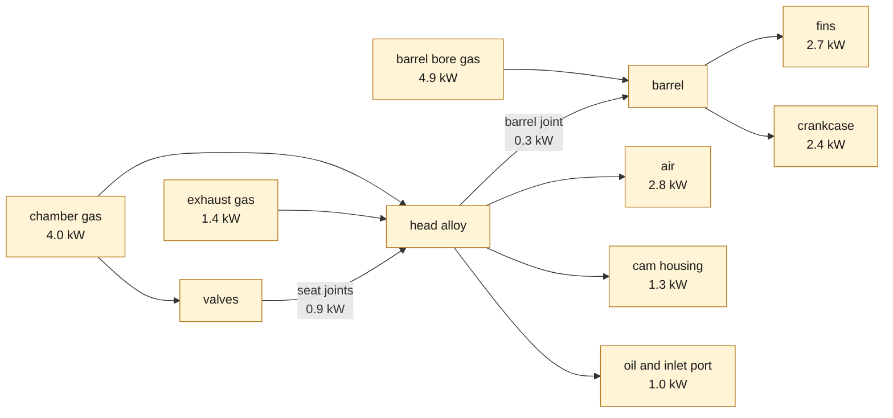

*Diagram: heat flows at the published loading and 150 W/(m·K), rounded. Every
box is amber: each flow rests on declared films, joints or a hypothesis
part.*

**The four load cases, before and after:**

| Case | First screen, peak at 95 / 150 / 191 W/(m·K) | With the heat paths | Heat in at 150 | Exhaust valve at 150 |
|---|---|---|---|---|
| Declared | 311 / 280 / 267 °C | 317 / 284 / 269 °C | 4,990 W | 535 °C |
| Declared, with oil | 309 / 277 / 264 °C | 306 / 269 / 252 °C | 5,449 W | 526 °C |
| **Published loading, with oil** | 428 / 399 / 386 °C | **408 / 372 / 355 °C** | 10,251 W | 586 °C |
| Published loading, more air | 373 / 340 / 324 °C | 367 / 329 / 311 °C | 10,259 W | 569 °C |

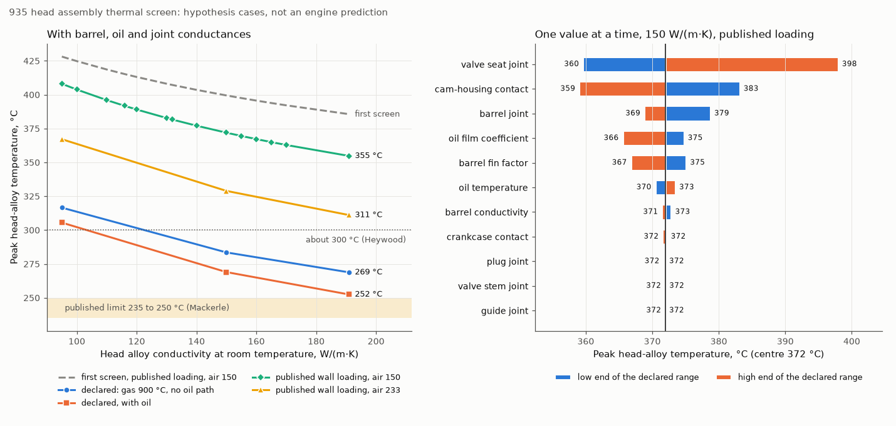

**Sensitivity**, one value at a time to each end of its declared range, at
the published loading and 150 W/(m·K), with the calibrated gas side held fixed:

| Value | Declared, range | Peak at the low and high ends | Span |
|---|---|---|---|
| valve seat joint | 10,000; 1,000 to 100,000 W/(m²·K) | 360 / 398 °C | 38 °C |
| cam-housing contact | 1,000; 300 to 3,000 W/(m²·K) | 383 / 359 °C | 24 °C |
| barrel joint | 10,000; 1,000 to 100,000 W/(m²·K) | 379 / 369 °C | 10 °C |
| oil film coefficient | 500; 100 to 2,000 W/(m²·K) | 375 / 366 °C | 9 °C |
| barrel fin factor | 3; 1.5 to 6 | 375 / 367 °C | 8 °C |
| oil temperature | 90; 80 to 100 °C | 370 / 373 °C | 3 °C |
| barrel conductivity | 150; 95 to 191 W/(m·K) | 373 / 371 °C | 1 °C |
| crankcase contact | 1,000; 300 to 3,000 W/(m²·K) | 372 / 372 °C | 0.7 °C |
| plug, stem and guide joints | 10,000; 1,000 to 100,000 W/(m²·K) | 372 °C | 0.2 °C at most |

- **No computed peak lies inside a published strength range.** At the
  published loading the heat paths lower the peak by 20 to 31 °C, to 355 to
  408 °C, and every candidate stays above 300 °C. The closest is
  stress-relieved AlSi10Mg, at 363 to 367 °C, whose strength is published up to
  250 °C ([trade-off](params/alloy-tradeoff.json)). Nothing is selected.
- **The joints matter more than the barrel.** With every joint perfect, the
  same configuration peaks at 414 °C; at the declared 10,000 W/(m²·K) it
  peaks at 372 °C. The seat joint alone spans 38 °C: a poor seat keeps the
  heat in the exhaust valve (616 °C) and out of the head. The stem, guide and
  plug joints change the peak by 0.2 °C or less.
- **The barrel is mostly a system of its own.** At Mackerle's 145 kW/m² its
  bore takes 4.9 kW. The fins and the crankcase reject it, and only 0.3 kW
  passes from the head into the barrel. Its collar runs at 314 °C, against the
  180 °C contact of the first screen, so it is a weaker sink than that
  contact was.
- **The cam housing is the largest new sink:** 1.3 kW at the declared
  coefficient, and a 24 °C span on the peak.
- **In the declared case without oil the peak rises by 2 to 6 °C.** The
  barrel brings its gas heat to the deck, and no oil path takes heat out.
- **The hottest head alloy is behind the exhaust seat** in every
  published-loading case, as in the first screen's declared cases.

**How the result was checked.**

- **The joint method passes three checks:**
  - a witness with a known answer, where node-to-surface contact pairs carried
    the declared conductance within 0.5 % across a jagged plane and cylinder
    (surface-to-surface carried 4 % less);
  - a perfect-contact witness, where every joint at 10⁷ W/(m²·K) reproduces
    the same mesh with shared nodes within 0.1 °C;
  - a balance per part, closing to 0.4 % of the heat put in.
- **The calibration converged.** It stopped with every calibrated wall within
  1 % of its target, after 6 and 5 steps. A first run used the first case's
  rule, five plain scaling steps, and was stopped: after four steps the barrel
  bore carried 125.7 of its 145 kW/m², because its loading saturates as the
  bore wall nears the gas temperature.
- **The mesh comparison.** The base mesh has 6.04 million tetrahedra.
  - A second mesh of the same surface moves no zone by more than 2.4 °C.
  - A surface extracted at 0.75 mm instead of 1.0 mm (12.9 million
    tetrahedra) agrees within 0.9 °C behind the exhaust seat and within 0.1 °C
    at the valve bridge and the plug bosses.
  - Its own peak, 409 °C, sits on the thin edge of head alloy where the inlet
    valve rim meets the chamber wall. That edge is a sharp corner of the
    hypothesis valve geometry, and it gets hotter as the mesh resolves it
    thinner, so its temperature does not converge. It is reported, not
    quoted as the peak.

It remains a hypothesis screen: no barrel, joint or oil path of this engine is
measured, and nothing here predicts an engine temperature.

### Port CFD: upstream audit, no solver run ([audit](params/port-cfd-audit.json))

A port-flow number needs a closed duct from the flange to the chamber, walls
traceable to acquired data, and the valve, seat and guide in place.
[audit_port_domain.py](source/audit_port_domain.py) checks those three gates
on what the twin holds:

| Port | Centreline | Closed sections | Lofted | Wall observed on the loft | Valve, seat, guide |
|---|---|---|---|---|---|
| `port_y_minus` | 90 mm | 21 of 31 | 51 mm (57%) | 77% | modelled from published values (H05, H16) |
| `port_y_plus` | 54 mm | 10 of 19 | 24 mm (44%) | 92% | modelled from published values (H05, H16) |

**Verdict: no admissible fluid domain.** Each port fails gates 1 and 2.
Beyond the lofted part the sections open into the valve pocket, and 8% to
23% of the lofted wall is winding-number closure. Gate 3 has passed since
2026-11-22, when the valve, seat and guide bodies were built (next section).
A flow number on this domain would record the open sections and the
unobserved walls, not the port, so no solver was run. The row reopens with
registered sections of the bend and pocket (H04).

### Valves, seats, guides and a declared port domain, 2026-11-22 ([case](params/valve-seat-guide-case.json), [bodies](params/valve-seat-guide.json), [port domain](params/port-domain.json), [stop record](params/port-cfd.json), [inferred share](params/inferred-share.json))

On 2026-11-22 the owner asked for #698, #697 and #700 to be worked from
published data under declared assumptions. The [search log](../../docs/research/935-valves-ports-20261122.md)
found the maker's catalogue ranges, production 930 Turbo and 911 parts and a
workshop's seat and guide practice, each value read twice in a saved copy;
nothing published describes this head's hidden geometry or its flow.

**Bodies.** [valve_seat_guide.py](source/valve_seat_guide.py) builds the
valve, the seat insert and the guide of each valve as separate solids of
revolution on the fitted axes (private STEP files, hashes in the record).
Every value names its source or its hypothesis:

| | `valve_y_minus`, inlet (H09) | `valve_y_plus`, exhaust (H09) | From |
|---|---|---|---|
| valve head | 49 mm | 41.5 mm | the only sizes common to the maker's two candidate families, 45–53 and 38–42.5 mm; the production 930 Turbo (H16) |
| stem, overall length | 8 mm, 109 mm | 8 mm, 108 mm | the maker's 8 mm stems; published 8 mm-stem 911 valves (H16) |
| seat | 45° through the fitted mid-band circle (48.97 mm), 30° and 75° cuts, contact 1.2 mm | same on 43.10 mm, contact 1.4 mm | 911 seat practice (H16) |
| insert bore, outside, height | 45.81 (fitted throat), 53.5 (derived), 7 mm (assumed) | 38.47 (fitted throat), 46.0 (930 Turbo ring), 7 mm (assumed) | H16 |
| guide | 8.05 × 12.87 mm, fitted stations −19.2 to 29.6 | 8.05 × 13.02 mm, 22.1 to 72.3 | fitted outside and stations; assumed 0.05 mm stem clearance (H16) |

The bodies do not overlap, closed or at the published largest lifts (9.7 and
8.9 mm, the production 930 Turbo), and the two heads stay 0.59 mm apart with
both at full lift. Beside the scan: the inlet contact band lies inside the
fitted seat window; the exhaust band reaches 0.09 mm (radius) inside the
window's inner edge, so a 41.5 mm exhaust valve sits at the edge of what the
scanner saw, where a 42.5 mm one, also in the catalogue, would not. A
section render through both axes was read: bodies in place, no stray piece.
Nothing here is a dimension of the specimen.

**Roles (H09).** `valve_y_minus` is the inlet: its larger seat and throat,
its angle (25.89° against the published inlet 25.5° and exhaust 30.25°; the
other way round misses by 4.4°) and its larger flange opening (41.8 against
40.5 mm, beside a 935 head set listed with 41 and 40 mm ports) all point the
same way. None of these describes this head, so H09 is declared, not retired.

**Hypotheses.** H05 is now *modelled from published values and declared
assumptions*, kept until the head's specification arrives; H09 is declared
and kept; H10 is kept, because both thermal screens ran on its solids and
were not rerun. New: H16 (the published values and explicit assumptions of
the bodies) and H17 (the port continuation below). H01, H04, H07 and H08 were
searched for and nothing describes this head (a 1988 Porsche patent routes
oil through an air-cooled head to the exhaust seat; that is not evidence of a
gallery here): their closures stay and their requests stay open.

**Inferred area, restated.** [inferred_share.py](source/inferred_share.py)
repeats the scorecard's split with Open3D and finds the same inferred area
(34,849 mm², 18.1% of the v2 body). By region: the port voids (H04) 2.2%,
other enclosed voids 2.1%, stud passages 0.2%, and the rest, fin roots,
fin-gap floors and the outer closure (H01), 13.6%. No evidence was admitted,
so the 18.1% stands.

**Port domain under a declared rule, gates unchanged.**
[port_domain.py](source/port_domain.py) replaces, in a fluid domain only, the
closure beyond the last scan section by rule H17: the convex hull of that
section (guide boss taken out) and the fitted throat circle, then the fitted
throat and seat, minus the fitted guide. The rule adds no port
dimension of its own; its one setting is a 1 mm margin that finds the rays
ending on the guide boss.

| Port | Stations: scan / bowl (H17) / throat | Observed on each | All | Gate 1 | Gate 2, 95% | Gate 3 |
|---|---|---|---|---|---|---|
| `port_y_minus` | 18 / 7 / 6 | 77% / 14% / 83% | 64% | passes by construction | fails | passes |
| `port_y_plus` | 9 / 4 / 5 | 92% / 20% / 72% | 71% | passes by construction | fails | passes |

**The port CFD stops at gate 2.** The stations beyond the scan sections would
need 119.6% (`port_y_minus`) and 97.9% (`port_y_plus`) of their points on
acquired facets. No declared rule can supply that: what fails is the
scanner's coverage of the bend and the bowl. No Poiseuille rerun, mesh or
solver followed, and nothing was rented. The row reopens with registered
sections of the bend and bowl (H04, H17), or with an owner decision to change
gate 2, which this work does not take.

### Interface contract: written, nothing measured ([contract](params/interface-contract.json), [check](params/interface-contract-check.json), #694)

AGENTS.md asks for an interface contract before any functional part. The
[contract](params/interface-contract.json) lists 11 interfaces and 170 quantities:
the deck face and register, the four stud passages, the ten studs and their
tapped holes, both port flanges, both plug bores, the cam-housing face, a
valve-cover face, and the guides and seats of both valves. Each quantity names
its datum in the [twin frame](params/frame.json).

**Nothing is measured.** Every value, uncertainty and source is null. Each
quantity names what would fill it: a contribution under
[decision 0019](../../docs/decisions/0019-accept-contributed-measurements.md)
or a drawing, once the specimen is identified (#692). A length can be compared
with the twin only after the scale is measured (#693). Where a hypothesis
applies, it is named: H02 for the passages, H03 for the tapped holes, H05 and
H09 for the valves, H06 for the plug threads. The twin's own number sits beside
89 quantities, under `twin_nominal_not_evidence`. It is never the value.

[check_interface_contract.py](source/check_interface_contract.py) reads the
contract and the params files. It imports the standard library only and shares
no code with the scripts that built the twin. It reports pass, fail or not
checkable for each quantity. Today all 170 are not checkable. A pass will also
need a threshold committed before the values arrive, as for the
[carrier scan](../../docs/decisions/0024-engine-carrier-interfaces-from-a-scan.md).
The clocking datum about the bore axis has no physical feature yet.

### Prepared work: what the four parts that never ran need ([register](params/prepared-work.json))

Four parts of this twin never ran: port flow, fatigue, valve-train dynamics
and a drawing. None can run on what the twin holds today. The register says,
for each, which tool would do it and whether that tool has passed a witness,
what is held, what is missing, and what a contribution would have to hold
for the part to reopen. **Nothing in this section is a result.**

A search of published documents on 2026-11-16 ([note](../../docs/research/935-head-published-data-20261116/README.md),
[record](../../docs/research/935-head-published-data-20261116/findings.json)) added what the *Held* lines below call published:
values of other heads and of test coupons, each with its source and how it
was read. It moved no part out of its blocked state.

| Part | State | Tool | Witness of the tool |
|---|---|---|---|
| Port flow | blocked on geometry: gate 2 (acquired port walls) fails on both ports, also on the declared domain of 2026-11-22 | OpenFOAM with foamlib ([TOOLCHAIN.md](../../docs/TOOLCHAIN.md)); Gmsh for meshing ([AGENT_TOOL_GUIDE.md](../../docs/AGENT_TOOL_GUIDE.md)) | [openfoam-poiseuille-f25](../../outils/benchmarks/openfoam-poiseuille-f25): exists with its test ([test_openfoam_poiseuille_f25.py](../../tests/test_openfoam_poiseuille_f25.py)); to be rerun on the image used before any port case |
| Fatigue | blocked on a stress history and on material data | pyLife 2.3 ([TOOLCHAIN.md](../../docs/TOOLCHAIN.md)): rainflow counting, Wöhler curves, Miner damage | [witness_rainflow_miner.py](../../benchmarks/fatigue-postprocessor/witness_rainflow_miner.py): passed on 2026-11-10 ([results-20261110.json](../../benchmarks/fatigue-postprocessor/results-20261110.json)): rainflow against the ASTM E1049 table, Basquin and Miner against a closed form |
| Valve-train dynamics | blocked on kinematics and on a dynamics tool | none. Chrono is a candidate, not installed: no image, lock or witness ([AGENT_TOOL_GUIDE.md](../../docs/AGENT_TOOL_GUIDE.md)) | [test_m64_valvetrain_v1.py](../../tests/test_m64_valvetrain_v1.py): analytic checks of that model (derivatives, spring rate, harmonic limit, energy); a sensitivity study, no cam data and no bench correlation |
| Drawing | reference sheet of the 11 confirmed features drawn (#708); a dimensioned drawing waits for a scale, more features and sourced tolerances | build123d projection to DXF, with ezdxf dimensions and a title block ([TOOLCHAIN.md](../../docs/TOOLCHAIN.md), 2026-11-19, #708) | [drawing_witness.py](source/drawing_witness.py): passed on 2026-11-19 ([drawing-witness.json](params/drawing-witness.json)): three views of a known solid read back from DXF; one third-angle sheet whose seven dimensions show their own measurement at 3.5 mm from definition points on drawn edges, and whose title block reads back field by field; five planted faults caught; sections not checked |

**Port flow:** the flow through each port at stated valve lifts and pressure difference.

- Held: port centrelines and section lofts ([port-fit.json](params/port-fit.json): lofted over 57% and 44% of the centreline; 8% to 23% of the lofted wall is closure, not scan); the admissibility audit and its three gates ([port-cfd-audit.json](params/port-cfd-audit.json): both ports fail gates 1 and 2; gate 3 passes since the valve, seat and guide bodies exist (2026-11-22)); valve, seat insert and guide of each valve as separate bodies on the fitted axes ([valve-seat-guide.json](params/valve-seat-guide.json): published values of other heads, the maker's catalogue ranges and explicit assumptions (H16), roles declared (H09); no dimension of the specimen); a port domain closed by a declared rule, audited with the same gates, and the stop record ([port-cfd.json](params/port-cfd.json): gate 2 fails on both ports (64% and 71% of wall points observed against 95%); no solver, no witness rerun, no rental); two valve axes, seats and throats fitted on the scan ([feature-fits.json](params/feature-fits.json): nominal; one throat and one seat confirmed on held-out vertices ([feature-check.json](params/feature-check.json))); the load-case contract ([load-cases-f1.json](../../twins/engine-simulation-contracts/load-cases-f1.json): LC-935-PORT-COLD-FLOW, 9 of 9 inputs empty); published port openings of the production 964 Turbo 3.3 head, the definition of the flow coefficient, and two validated port computations on other heads ([findings.json](../../docs/research/935-head-published-data-20261116/findings.json): another head and other ports; the two computations sit 6% and 8% from their bench, which is the size of agreement a comparison could expect).
- Missing: registered sections of the port bend and of the valve pocket (retires H04); valve, seat and guide geometry of this head (the bodies held rest on other heads' values, H16) (retires H05); confirmation of which port is inlet and which is exhaust (declared from three published relations, H09) (retires H09); valve lifts, pressure difference, air state and wall roughness for the cases; a measured flow number to compare with.
- A contribution must hold: the specimen: head type, part number or casting marks; the instrument, its resolution and a stated uncertainty; reference marks that tie the sections to the flange face and the valve axis; at least three dimensions that the twin already holds, for a scale check (the flange, the seat, the guide bore); an explicit licence to use and redistribute the files.
- First steps once the inputs exist: rebuild the port lofts through the new sections and rerun source/audit_port_domain.py: the three gates must pass; rerun the Poiseuille witness on the image used; mesh one port with the valve at one lift, checkMesh first, three mesh levels; report the discharge coefficient with its mesh sensitivity, beside the measured number if one exists.
- Runnable today: nothing beyond the audit: a solver run on either domain would measure the unobserved walls of the bend and the bowl (H04, H17), not the port.

**Fatigue:** damage of the head under a stated duty, for a stated alloy and process.

- Held: temperature fields of the head in an assembly, four load cases ([assembly-thermal.json](params/assembly-thermal.json): a hypothesis screen: declared films and conductivities, no engine correlation); temperature fields of the head with a barrel, oil on the cam side and a conductance at each joint, four load cases and a sweep of every new value ([assembly-heat-paths.json](params/assembly-heat-paths.json): a hypothesis screen: declared joints, barrel and oil (H13 to H15), no engine correlation); residual stress after the build, on voxel cells ([build-sim.json](params/build-sim.json): a screen: the stress sits on the declared yield curve and is not a prediction); published static strengths of the candidate alloys ([alloy-strength.json](params/alloy-strength.json): published values, most not re-read, none a design allowable); one fatigue number for AlSi10Mg ([eos-m290-alsi10mg-30um.json](../../catalog/manufacturing/processes/eos-m290-alsi10mg-30um.json): one point, fully reversed, test temperature not stated, turned coupons, another machine: not a curve and not a part allowable); published fatigue sets of printed AlSi10Mg: 20 points as built and after two low-temperature treatments, one fully reversed strength with its fit, two sets after ageing at 177 °C, and three single strengths at 200 and 350 °C from abstracts ([findings.json](../../docs/research/935-head-published-data-20261116/findings.json): published and read, not admitted as material data; the three sets with points or a fit do not state their test temperature, the sets disagree (60 against 110 MPa fully reversed), and none has points at the head's temperature).
- Missing: a mechanical load case of the head: stud preload, gas pressure on the chamber, seat and guide press fits (retires H03 for the studs); a converged stress field under that load case, cold and hot; an S-N curve for the alloy as printed, in the build direction, at the head's temperature; the duty: how many cycles at which load.
- A contribution must hold: alloy, powder lot, machine, layer thickness, build orientation and heat treatment of the coupons; surface state (as built or machined), stress ratio, test temperature and run-out definition; the raw points, not only a fitted curve; an explicit licence to use and redistribute the data.
- First steps once the inputs exist: write the load case beside the assembly thermal case, every value with its source; solve cold assembly and hot firing on the same mesh; mesh sensitivity at the three highest locations; rerun the pyLife witness, then count damage with the stated curve; report the sensitivity to the curve before any life; keep the result a screen: no life is stated for a part without process-specific data (docs/SAFETY.md).
- Runnable today: the tool witness only.

**Valve-train dynamics:** valve motion, spring margin and seating at stated engine speeds.

- Held: two valve axes, 55.8 degrees apart, a guide bore, seats and spring seats fitted on the scan ([feature-fits.json](params/feature-fits.json): nominal; 11 of 32 features confirmed, the valve of each flange side not identified as inlet or exhaust); the load-case contract for a valve cycle ([load-cases-f1.json](../../twins/engine-simulation-contracts/load-cases-f1.json): LC-993-VALVE-DYNAMIC-CYCLE, written for the 993: 8 of 8 inputs empty); catalogue ranges for 935 valves and aftermarket cam timing cards ([README.md](../../docs/research/935-faithful-replica-20261028/README.md): not measurements of this specimen; aftermarket declarations); valve sizes, lifts, timing at 0.10 mm clearance and cam lobe dimensions of the production 930 Turbo; valve angles, stems and lengths of the 964 Turbo 3.3 ([findings.json](../../docs/research/935-head-published-data-20261116/findings.json): two homologation forms, each value read twice; other heads. The angle between the two fitted valve axes is 55.76 degrees against 55.75 published; the fitted guide bore is 0.49 mm under the production stem, so the production valve does not fit this head).
- Missing: cam lift curve, rocker geometry and ratio (retires H05 in part); spring rate, installed height, coil-bind height; masses of valve, retainer, rocker (retires H05 in part); valve head diameters, stem diameter, seat angle and width of this head (retires H05); a dynamics tool with a witness, if more than one mass is needed.
- A contribution must hold: the specimen and the parts measured, with part numbers; instrument and uncertainty for each length, mass and spring force; the cam card with its reference lift and lash; an explicit licence to use and redistribute the data.
- First steps once the inputs exist: write a parameter set for this head in the model's own format, every entry with its status and source; rerun the model's analytic checks, then spring margin and float speed over the stated speed range; check the valve-to-valve and valve-to-plug clearances on the fitted axes at full lift; state the result as a sensitivity study until a bench trace exists.
- Runnable today: the model's own tests; no run for this head, whose cam, spring and masses are unknown. The form's lift and timing would allow a reference case of the production 930 Turbo with a declared cam law and declared springs: a study of another engine.

**Drawing:** a dimensioned drawing of the head's machined features.

- Held: 11 features confirmed on held-out vertices: valve_y_plus_throat, valve_y_plus_seat, plug_x_plus_seat_face, plug_x_minus_seat_face at the first check; valve_y_minus_guide_bore_port_end, valve_y_minus_throat, plug_x_plus_thread_bore, plug_x_plus_chamber_relief, plug_x_plus_well, plug_x_minus_chamber_relief, plug_x_minus_well after the declared re-fit (#696) ([feature-confirmation.json](params/feature-confirmation.json): confirmed against the scan within 0.2 mm, at 1 scan unit = 1 mm by owner instruction; not dimensions of the specimen); a reference sheet of the 11 confirmed features on their fitted datums, every value a reference fitted on a scan ([reference-sheet.json](params/reference-sheet.json): drawn and read back on 2026-11-19; scale uncalibrated (#693); no tolerance, fit or thread); 21 features fitted and not confirmable from this scan ([feature-confirmation.json](params/feature-confirmation.json): 71% to 89.7% of held-out vertices within 0.2 mm after the declared re-fit, or a re-fit its guard rejected, against the 90% fixed beforehand; each needs a contributed measurement); analytic B-rep of the deck plate and of two port lofts ([deck-features.json](params/deck-features.json): the v1 parts; the v2 body is a triangle solid with no B-rep to project).
- Missing: a physical scale: one calibrated length on the specimen (retires the owner's instruction that 1 unit is 1 mm); confirmation of the other features; tolerances, fits and threads (retires H03 for the studs, H05 for seats and guides); a B-rep of the body, if outline views are wanted.
- A contribution must hold: the specimen and the feature measured, with the datum it was measured from; instrument, resolution and uncertainty; an explicit licence to use and redistribute the values.
- First steps once the inputs exist: a reference sheet of the confirmed features on the fitted datums, each value marked as fitted on a scan; annotation and title-block checks added to the tool witness before any dimension is drawn; a tool assignment recorded in docs/TOOLCHAIN.md.
- Runnable today: the reference sheet, regenerated from the records; nothing more until a measured length (#693), another confirmed feature or a sourced tolerance arrives.

The project measures nothing itself and pays nobody to measure
([decision 0019](../../docs/decisions/0019-accept-contributed-measurements.md)). A contribution needs its capture protocol,
an explicit licence, an identified specimen and a review independent of the
contributor. No contributor is named here, and none has been asked.

## Phase ledger

| Phase | Inputs | Output | Check | State |
|---|---|---|---|---|
| P0 freeze | owner decision | notices in the old twin README and `docs/ARCHIVE.md` | — | done |
| P1 datums | scan | [params/frame.json](params/frame.json) | plane/circle residuals recorded | done |
| P1b occupancy | scan, frame | private winding-number grid; [summary](params/occupancy-summary.json) | ambiguous volume reported | done |
| T1 surface | occupancy | private closed surface; [summary](params/t1-surface-summary.json) | watertight, winding, genus | done |
| Scorecard T1 | scan, frame, T1 | [scorecard-t1.json](params/scorecard-t1.json) | Warp vs trimesh oracle | done: 99.5% within 0.2 mm |
| T1s snap | T1, scan | private snapped surface; [summary](params/t1s-snap-summary.json) | connectivity unchanged, watertight, 0 self-intersections | done: p95 0.015 mm ([scorecard](params/scorecard-t1s.json)) |
| T2 B-rep v0 | occupancy | none | BRepCheck | measured negative result (see above) |
| Simulation surface | occupancy at 0.75 mm | private; [summary](params/sim-surface-mc075-summary.json) | watertight, genus 21 | done |
| T3 thermal | 1.0 mm surface | private deck and fields; [result](params/thermal-screen.json) | mesh quality, solver return, energy balance 0.28% | done at two levels; mean, p95 and minimum agree (minimum within 0.3 °C) |
| Screenshots | T1, scan, thermal | private renders (observed/inferred, scan deviation, thermal field); public [scorecard chart](media/scorecard-t1-cdf.png) | visual review | done |
| T4 USD | T1s, frame, hypotheses | private `.usdc`; [summary](params/usd-summary.json) | 30 OpenUSD validators, NVIDIA validator | done: 0 OpenUSD findings; NVIDIA 0 failures, 1 warning (one non-manifold vertex) |
| T5 print | T1s | private 3MF; [summary](params/print-summary.json) | streaming round trip | done, exact volume |
| v1 features | frame, scan | deck plate: [features](params/deck-features.json) | zone scorecard | iteration 4: p95 2.72 mm (chamber, four passages, two-level outline); kept as the analytic B-rep part |
| v1 body stack | occupancy, scan, fin faces, port sections, deck features | private compound of band solids and its outer shell; [run f summary](params/v1-body-stack-f-summary.json) | whole-scan scorecard on the shell, per run | closed at run f: p95 0.85 mm, 69.9% within 0.2 mm; superseded as the body by v2 |
| v2 body | occupancy, datum faces | private closed solid; [summary](params/v2-loft-s025-summary.json) | manifold status, watertight, volume; whole-scan [scorecard](params/scorecard-v2-loft-s025.json) with oracle; three section steps | done: p95 0.157 mm, 97.4% within 0.2 mm; area 14% above T1s; no B-rep |
| Thermal from CAD | v2 body occupancy at 1.0 mm | private deck and fields; [result](params/thermal-screen-cad.json) | energy balance 0.28%; comparison with T3 at the same pitch | done: mean −0.53 °C, heat −0.36% against T3 |
| USD and 3MF from CAD | v2 body | private `.usdc` and 3MF; [USD](params/usd-cad-summary.json), [3MF](params/print-cad-summary.json) | 30 OpenUSD validators, NVIDIA validator; streaming round trip | done: 0 OpenUSD findings; NVIDIA 0 failures, 2 warnings (35 flat triangles, co-located points); 3MF exact |
| Port CFD | port fit, hypotheses | [audit](params/port-cfd-audit.json) | three admissibility gates | closed by audit: no admissible domain, no solver run; gate 3 passes since 2026-11-22; reopens with H04 evidence; [prepared](#prepared-work-what-the-four-parts-that-never-ran-need-register) |
| Valves, seats, guides; declared port domain | fits, [published values and assumptions](params/valve-seat-guide-case.json), H16, H17 | [bodies](params/valve-seat-guide.json), [port domain](params/port-domain.json), [stop record](params/port-cfd.json), [inferred share](params/inferred-share.json); private STEP and meshes | overlaps closed and at lift; contact band against the fitted seat window; the unchanged three gates; scorecard's inferred area reproduced with Open3D | done 2026-11-22: bodies consistent, exhaust band 0.09 mm past the window; gate 2 fails on both ports (64% and 71% observed), CFD stopped there, nothing rented |
| SimReady tools | v1 deck plate STEP, two port loft STEPs, both stages | private stages; [deck](params/simready-deck-plate.json), [ports](params/simready-ports.json) | NVIDIA validator; independent bounding box and volume against the STEP | done for the three B-rep inputs (pass) and both stages; profile validation and RTX done on the CAD-body package (#707), agents not attempted; no STEP of the v2 body |
| AM screen | occupancy | [supports](params/am-supports.json), [cooldown](params/am-cooldown.json) | analytic witnesses within 2.5%; independent VTU reader, energy imbalance 1.5e-4 | done as a screen: six orientations, two cooldown levels; no orientation chosen, no support designed |
| Feature fit | bare scan, frame, [32 windows](params/feature-rois.json) | [feature-fits.json](params/feature-fits.json); private vertex split | the tool's own `determined` flag and standard deviations; two-centre construction against a guide bore axis (0.42°) | done: 25 determined, 7 detected only; two valve axes, guide bore, seats, plug bores, stud passages |
| Feature check | fits, held-out half of each window | [feature-check.json](params/feature-check.json); private clouds and receipts | CloudCompare distances; acceptance fixed beforehand (90% within 0.2 mm) | done: **4 of 32 confirmed** at the first check; the fits are nominal, not inspected |
| Feature re-fit (#696) | the 28 unconfirmed fits, fitted half only, a rule declared before the check | [declaration](params/feature-refit-declaration.json), [re-fits](params/feature-refits.json), [check](params/feature-check-refit.json), [standing](params/feature-confirmation.json) | same CloudCompare check and 90% on the held-out half; standing reproduced by a test | done: **11 of 32 confirmed**; 21 not confirmable from this scan, each with its declared reason |
| Body check by a second tool | v2 body, 200,000 scan facets | [cloudcompare-v2-body.json](params/cloudcompare-v2-body.json) | CloudCompare against the Warp scorecard | done: 97.36% against 97.37% within 0.2 mm, p95 0.1571 against 0.1572 mm |
| Asset package | CAD-body stage, 1.0 mm surface | private `part.usda`, `part.usdz` and two binary layers; [summary](params/simready-asset.json) | 30 OpenUSD validators and the NVIDIA validator on both forms; read-back of the package | done: 0 OpenUSD findings; NVIDIA 0 failures, the 2 inherited warnings, explained and not cleared (#707); no mass, no physics run |
| SimReady profiles and RTX (#707) | the asset package | private receipts; [record](params/simready-conformance-gpu.json), [still](media/rtx-camside.png) | two validator releases on a rented RTX 3090; receipts rehashed; pictures read by the agent | done: Package and Package-NoBOM pass, every prop profile fails on the rigid body (#705) and on units; RTX stills and turntable captured |
| Visual check of the v2 body | double-precision 3MF | private six-view render; [record](params/v2-body-visual-check.json) | read by the agent; the renderer's strict watertight gate | done twice: the first reading found stud slivers up to 26 mm tall and led to the stud repair; after it, stubs of 5.5 mm and 5 non-manifold edges once vertices are welded |
| Alloy candidates and machine survey | public datasheets and pages read on 2026-11-11 | [candidates](params/alloy-candidates.json), [machines](params/lpbf-machine-survey.json), [literature](params/thermal-literature-bounds.json) | each value marked re-read or reported only; source URL and file hash | done as a survey: no alloy or machine selected; no maker publishes a complete data set |
| Alloy ranking, bare head | CAD-body thermal deck, candidate conductivities | [alloy-thermal.json](params/alloy-thermal.json) | same mesh and case; 150 W/(m·K) reproduces the CAD screen; energy balance 0.3% | done: 1,475 W to 1,707 W, a 16% spread |
| Alloy ranking, assembly | CAD body, fitted axes, [declared case](params/assembly-case.json), H09 to H12 | private occupancy, surface and decks; [assembly-thermal.json](params/assembly-thermal.json) | watertight union; film areas and heat by group; four load cases, two scaled to published wall loadings | done as a hypothesis screen: peak head alloy 386 to 428 °C at the published loading, above the 235 to 250 °C limit for every candidate in every case |
| Heat paths in the assembly | the assembly case, [heat-path case](params/assembly-heat-paths-case.json), H13 to H15 | private occupancy, surfaces and decks; [assembly-heat-paths.json](params/assembly-heat-paths.json), [chart](media/heat-paths.png) | joint witness against a closed form; perfect-contact witness; balance per part; calibration within 1 %; a finer surface and a second mesh | done as a hypothesis screen: peak head alloy 355 to 408 °C at the published loading; the seat joint and the cam housing decide most of the spread; [section](#heat-paths-in-the-assembly-barrel-oil-and-joints-case-record-chart) |
| Strength beside temperature | [published strengths](params/alloy-strength.json), both assembly rankings | [alloy-tradeoff.json](params/alloy-tradeoff.json), [chart](media/alloy-ranking.png) | solved conductivities only; no extrapolation beyond a published range | done: no computed peak lies inside a published strength range, with or without the heat paths; nothing selected |
| 993 manual cross-check | fitted features, workshop-manual catalogue | [published-993-comparison.json](params/published-993-comparison.json) | same-dimension flag on each row | done: scale not contradicted; not a calibration |
| Print body | v2 occupancy, fits, [declared stock](params/print-body-case.json) | private occupancy and 0.5 mm surface; [record](params/print-body.json) | welded watertight, no non-manifold edge, no enclosed void; the renderer's strict gate | done as a study object: passes the gate the twin body failed; stock amounts are hypotheses |
| Print-body orientations | print-body occupancy | [print-body-supports.json](params/print-body-supports.json) | the AM screen's analytic witnesses | done as a screen: flange y− down and side x+ down kept for the build study; no support designed |
| Print-body layer screen | 0.5 mm and 1.0 mm surfaces of the print body, EP-M300 card | [print-body-layer-screen.json](params/print-body-layer-screen.json); private per-layer tables and charts | hashes of master and surface; the tool's gates; the bounded-memory driver gives the same four files as the plain run on the 1.0 mm surface | done on both surfaces: build along Y, 4,482 layers, fits the envelope, no trapped powder at 1.0 mm; 563 islands on the fine surface, 216 on the smoother one; thin walls measured on the grid ([wall check](params/print-body-wall-check.json)) |
| Build simulation witness | a block, two lumped layers from a deposition file | [am-build-witness.json](params/am-build-witness.json) | active volume and mean temperature against a closed form, on the solver's mesh and on an imported one | passed on both; the head's build runs in CalculiX instead (next row) |
| Build screen | print-body occupancy, [declared case](params/build-sim-case.json) | [build-sim.json](params/build-sim.json), [build-sim-dolfinx.json](params/build-sim-dolfinx.json); private decks, fields and two [pictures](media/build-sim-result.png) | three closed-form [witnesses](params/build-sim-witness.json); energy balance within 0.4%; 10 levels for temperature and 2 laser cases, 11 mechanical runs in CalculiX; a second solver, DOLFINx, within [limits set before its first run](params/build-sim-dolfinx-acceptance.json) on the 4 mm cells, then four levels on 2 and 1.5 mm cells; a [cell-size rule](params/build-sim-convergence-rule.json) written before those runs | done as a screen: 43.4 h, largest rise 60 to 64 K above the plate (98 and 138 K with two and four lasers); distortion after release 0.23 to 0.33 mm median, 1.62 to 2.87 mm largest on 1.5 to 4 mm cells: the median agrees between the cell sizes, the worst corner does not settle in any row of the rule; on the laid-out supports 40 K and 1.71 mm; stress at the declared yield curve; every gate false |
| Support layout | print-body occupancy, [declared rules](params/support-design-case.json) | [support-design.json](params/support-design.json); private envelope and a [picture](media/support-layout.png) | four shapes with hand-computed answers ([witnesses](params/support-design-witness.json)); the totals before exemption equal the orientation screen's | done as a layout by rule: 470,700 mm³ of envelope, 15% of the part melted in walls, 48% standing on the part, 26% of the supported surface without straight lateral access; no build processor, removal not judged |
| Melt-pool check | the build screen's declared laser and material values | [melt-pool-check.json](params/melt-pool-check.json); private fields; [chart](media/melt-pool-width.png) and [animation](media/melt-pool.gif) | Rosenthal's point source within 0.2%; three meshes; energy balance | done as a check: 290 µm at the declared absorptivity (240 µm with latent heat) against 215 to 230 µm published nearest to this setting; conduction only, nothing calibrated |
| Fatigue, valve-train dynamics, drawing | none | [prepared-work.json](params/prepared-work.json); [drawing-tool witness](params/drawing-witness.json) | every path of the register exists; the drawing tool reads back three views of a known solid | not run: no stress history or S-N data, no cam, spring or masses, 11 of 32 features confirmed. [Prepared](#prepared-work-what-the-four-parts-that-never-ran-need-register): tool, witness, held and missing inputs for each |

## Limits

- Distances are to the acquired surface. They say nothing about unobserved
  geometry, the specimen's true dimensions, its material or its function.
- The studs are hardware fitted as cylinders; their threads and tapped holes
  are hypotheses (H03).
- The thermal case is a declared hypothesis set, uncorrelated with an engine.
- The v2 body is a triangle solid lofted through sections of the occupancy
  field. Where the scanner saw nothing it reproduces the winding-number
  closure, not the part; 18% of its area is such closure.
- The valves, seat inserts and guides are separate bodies from published
  values of other heads and explicit assumptions (H16), not from the
  specimen. The v2 body keeps the scanned guides and seats as one solid with
  the head, without bores beyond what was acquired.
- The fitted features are numbers on scan vertices. CloudCompare confirms 11
  of 32 within 0.2 mm; none is a dimension of the specimen, a tolerance, a
  fit or a thread, and the valve named by a flange side is not identified as
  intake or exhaust.
- The AM numbers are geometric and thermal screens on generic constants.
  They establish no printability, orientation, support scheme or material.
- The build screen spreads a declared heat input over lumps of 80 to 180
  layers, on voxel cells of 2 to 4 mm (3 and 4 mm for the mechanics) with
  homogenised support columns. Its temperatures are time averages, its
  stresses sit on a declared yield curve, and its distortion moves with the
  lump height and is not a compensation field. One level stands on the
  laid-out supports; the others on columns. No process value comes from the
  machine's maker and nothing was printed.
- The support layout follows declared rules on the 0.25 mm grid. Its teeth
  and its slenderness have no aluminium source, its access test is two
  straight lines, and no build processor or person has prepared or judged it.
- The melt-pool check is heat conduction on one track. It shows which
  absorptivity the published widths correspond to on that model; it calibrates
  nothing, and the build screen's declared value is unchanged.
- The prepared work is a register of what is missing. It holds no result, and
  it names no contributor.
- No port-flow result exists. The audit found no admissible fluid domain,
  also with the port closed by the declared rule H17: too little of the bend
  and bowl was acquired.
- The alloy rankings are screens on room-temperature conductivities and
  declared boundaries. The assembly screen's valves, guides and plugs are
  hypothesis solids in perfect contact, with an oil film on the spring
  pockets only and no barrel. The heat-path screen adds a barrel from another
  engine's published heights, oil on the cam side and declared joint
  conductances, every one a hypothesis with a range; its peak does not
  converge on the thin alloy edge at the inlet valve rim. Neither selects an
  alloy or predicts an engine temperature. The strengths beside it are published values, most of them
  not re-read and none a design allowable.
- The machine survey reads makers' own pages on one day. A datasheet is not
  a qualified process.
- A validator pass, OpenUSD or NVIDIA, shows a well-formed stage only.
- Engine use, metal manufacture and any interface claim remain prohibited
  without the evidence named in the repository rules.
