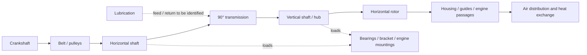

# 935 horizontal system twin — executable base

This step builds the system register, its OpenUSD graph, six calculation
groups and the chain for comparison with measurements. The two scans have
their own PicoGK preparation. The functional geometric assembly and the
calibrated twin wait for independent dimensions and evidence.

The [register](system-definition.json) contains 14 candidate physical
functions and three boundaries/locations to be identified. The
[17 interfaces](interface-contract.json) connect them. The register admits no
dimensioned part into the active catalogue. A function does not establish the
exact number of parts: the bearing group, for example, remains to be detailed.



The coupling and the alternator remain in the register, with location and
mounting to be established. The diagram shows functions; it does not position
the parts or infer the internals from the external scan.

## What the programs run

[build_system_twin.py](source/build_system_twin.py) uses only the Python
standard library. It reads a case, checks units, finite values, uncertainties
and evidence references, then produces a report, an HTML review and
`system-logical.usda`. The outputs are private and are not overwritten.

The `hypothesis_screen` mode now allows exploratory scenarios with
`assumption` inputs and a documented rejection test. The first
[campaign of 27 kinematic hypotheses](../../docs/research/935-horizontal-cooling/HYPOTHESES.md)
and the [community questions](../../docs/research/935-horizontal-cooling/COMMUNITY_RESEARCH.md)
precede qualification of the specimen; no measured status is granted to the
hypotheses.

| Model | Calculation run when the inputs are available | Limit |
|---|---|---|
| Speeds | `n_entree = n_moteur × r_courroie × (1 − glissement)`; `n_rotor = n_entree × r_engrenage` | The ratios are output/input speed ratios, not a choice of gear teeth. |
| Rotor | `U = πDn/60`; blade passing frequency `Z n/60` | Tip speed and frequency; no relative Mach, CFD field or predicted noise. |
| Inertia / imbalance | `E = Jω²/2`, `T_acc = Jα`, `F_balourd = U_balourd ω²`, `J_ramenee = J r_engrenage²` | Rotor inertia only; the other inertias and elastic responses remain to be integrated. |
| Air network | Intersection of the fan map / common quadratic losses and parallel branches | Candidate topology to be confirmed; map at the same speed and the same density, no extrapolation. |
| Steady-state transmission | Rotor power `QΔp/η`, input power, losses, torque and belt tension difference | The acceleration torque is separate. The tension difference gives neither the pretension nor the resulting radial load. Alternator excluded from this balance. |
| Thermal | Lumped solid capacities, single-pass air exchange, exponential response at fixed flow and load | No conduction between zones, radiation, oil/water network or qualified real cylinder head temperature. |

The network imposes a **total-to-total pressure** convention and stations
common to the fan and network maps. Resistances are in `Pa·s²/m⁶`; flows are
actual volumetric flows at the declared density. A static map cannot be used
without documented conversion. Each branch is a cooled passage or an
explicitly identified leak. Constant coefficients do not describe stall,
recirculation or an arbitrary topology. The
[DOE/AMCA system approach](https://www.energy.gov/sites/prod/files/2014/05/f16/fan_sourcebook.pdf)
serves as a general methodological reference, not as a source of 935
characteristics.

The thermal model uses `H = ṁ cp (1 − exp(−UA/(ṁ cp)))`, then
`C dT/dt = P_source − H(T − T_air_entree)`. The `solid_heat_load` field is the
power injected into the solid; the heat flow actually transferred to the air
is calculated separately during the transient. The inlet temperature is that
of the passage considered, not automatically the ambient temperature.
Use of this model and its UA/C parameters must be compared with measurements
of the real variant. The imbalance provides an excitation force; its
[response depends on the shafts and supports](https://evolution.skf.com/damping-in-a-rolling-bearing-arrangement/).

## Inputs and status of the numbers

[operating-case.template.json](operating-case.template.json) keeps the
19 unknown parameters at `null` and the unknown branches in an empty list.
Physical data require specimen identity, SI value, standard uncertainty, and
identifier and SHA-256 digest of the measurement or qualified result.
For a map, the uncertainties correspond to the three columns of each row.
The program checks this metadata; it does not verify the content or the
metrological authenticity of the evidence. The predictions remain
conditional. Uncertainty propagation is not yet implemented.

[synthetic-case.json](synthetic-case.json) describes a two-branch arithmetic
witness. Its expected flow is `√5 − 1 m³/s`, from the independent equation
`50Q² + 100Q − 200 = 0`. Its values are neither measurements nor a 935 design
proposal. Synthetic evidence is refused for a physical case. The 17 tests
cover in particular this solution, conservation, the ratio convention, the
thermal limits and the rejection of invalid data.

The current physical case builds the logical system, but its six calculation
groups remain without values. The synthetic witness allows all six to run.
The results never change the manufacturing authorisation or the validation
status of the twin.

## OpenUSD and geometry

The USD file contains `Scope` prims and relationships between components. No
Mesh, Xform, location, mass, material or rigid body schema is added. This
avoids assigning a common pose to the two unregistered scans.
`metersPerUnit = 1` defines the future convention of the register; it does
not scale the OBJ files. An [OpenUSD Scope](https://openusd.org/release/api/class_usd_geom_scope.html)
organises objects without a transform of its own.

The two stages produced were opened with OpenUSD 25.11: 37 prims,
17 relationships resolved, native compliance passed. This format check
qualifies no geometry or mechanical interface. CAD conversion, property
assignment and SimReady preparation will have to use the measured sources
and interfaces. They are not run here.

## Acquisition, solvers and comparison with tests

The [measurement contract](measurement-contract.json) describes 15 channel
families: speeds of the three shafts, torques, total pressures, actual flow
and distribution, temperatures, vibration and lubrication. For each sensor,
complete the frame, position, calibration, sampling rate, synchronisation and
uncertainty. The speed bounds and test criteria remain to be defined by the
technical lead. This document neither launches nor authorises a physical
test.

The [solver dossier](solver-handoff.json) organises the inputs needed for
geometry/manufacturing, CFD, structure, rotor dynamics, bearings/gear teeth
and lubrication. The six domains remain blocked on their inputs. No strength,
service life or fatigue calculation is replaced by the reduced model. Mass and
inertia tensor derived from a volume require closed geometry and qualified
scale, material and density; the open scan does not provide them.

[compare_holdout.py](source/compare_holdout.py) compares the calculated values
with an independent CSV and requires the same cases/units, frozen evidence and
pre-established tolerances. It rejects calibration data as validation, a
measurement already used as an input and a missing prediction. An empty CSV
remains `blocked_no_holdout`. The standard uncertainties entered are recorded
without a statistical test or automatic qualification. A successful numerical
comparison still waits for review of the evidence, uncertainties, model
relevance and criteria before a physical correlation can be established.

## Reproducible execution

```sh
python3 twins/935-horizontal-cooling-system-f0/source/build_system_twin.py \
  --case twins/935-horizontal-cooling-system-f0/operating-case.template.json \
  --output work/NEW/reference
python3 twins/935-horizontal-cooling-system-f0/source/build_system_twin.py \
  --case twins/935-horizontal-cooling-system-f0/synthetic-case.json \
  --output work/NEW/synthetic
python3 twins/935-horizontal-cooling-system-f0/source/compare_holdout.py \
  --predictions work/NEW/reference/readiness-and-predictions.json \
  --observations twins/935-horizontal-cooling-system-f0/holdout-observations.template.csv \
  --output work/NEW/holdout
python3 -m unittest discover -s tests -p test_935_system_twin.py -v
```

For the specimen data, keep the filled case and the measurements private.
Supplier answers will have to be attributed to their dimensions/interfaces,
with contradictions and uncertainties kept. See the
[structured questions](SUPPLIER_QUESTIONS.md). The 993 programme remains
separate; its old geometries and calculations are not imported into this 935
twin.
