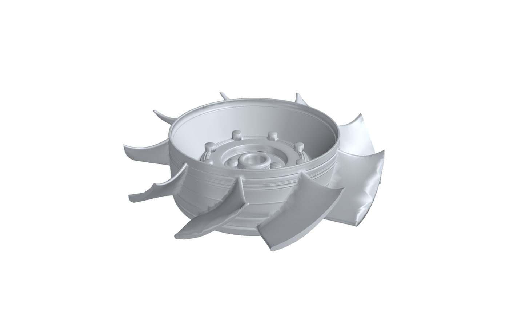
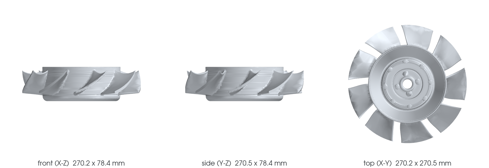

# 935 horizontal fan — top-down CAD twin

Started 2026-11-06 after the owner's decisions:

- **Goal:** two flat (horizontal) fans: the original 935 fan rebuilt
  faithfully from the scan, and a new horizontal fan for the 993 in the
  spirit of Gunther Werks' flat-fan cars (our own design, not a copy).
- **Scale:** one scan unit is one millimetre, declared by the owner
  ([`H-SCALE`](hypotheses.json)). Owner declaration, not an instrument
  calibration.
- **Method:** feature-based CAD fitted to the scan, top-down, as for the
  935 head twin (in progress on branch `claude/935-cad-twin-20261106`). The bottom-up triangle
  repair and mesh-trial line is frozen; see
  [the freeze record](../../docs/research/935-horizontal-cooling/REFRAME_20261106.md).

Git holds the code, the fitted numbers and the deviation statistics. The
scan, meshes and STEP files stay private (`work/`, private releases).
The original scans come from the private release `reconstruction-20261005`
(`935-original-scans-20261005.tar.gz`, SHA-256
`69f0a58a6cce33cbdba18fcf4ded8322f27d198e511a685c95e7b8f4c85f31a6`).

## What the scan shows, in millimetres

A thin-walled revolved hub with nine blades:

| feature | fitted value | quality |
|---|---|---|
| datum A, front flange face (bolt circle) | plane, z = 0 | 0.104 mm RMS |
| hub bore | Ø 22.62 mm | 0.164 mm RMS |
| outer drum, upper band | Ø 178.58 mm | 0.137 mm RMS |
| outer drum, lower band | Ø 176.89 mm (slight draft or back misregistration) | 0.135 mm RMS |
| rolled lip top | z = 32.56 mm, about 2.7 mm across | — |
| blades | 9, root at the drum (r ≈ 89), tip circle R 135.25 (Ø 270.5 mm) | see below |
| overall hub height | z −45.2 to +33.2 mm | — |
| back pass misregistration | 0.27–0.69° tilt, 0.44 mm drum-centre shift | [`H-BACK-REGISTRATION`](hypotheses.json) |

The revolved hub profile ([`params/hub-profile.json`](params/hub-profile.json),
367 vertices, section 2,405 mm²) follows the observed surface with a mode
RMS of 0.076 mm. Spikes and one self-intersection at the rolled lip, left
by the refinement on bosses, are removed so the profile is a simple polygon:
a revolve of a self-intersecting loop passes its own validity check but
breaks every later boolean.





### Local features ([`params/features.json`](params/features.json))

| feature | fitted |
|---|---|
| front heads (rivet or bolt heads) | 8 at r 51.6 mm, 45° apart, about Ø 11 × 7 mm |
| back tails | 8 at r 51.6 mm, Ø 9–12 × 3.1–4.3 mm (the height swing is the back-pass tilt) |
| step bosses | 4 at r 22–24 mm on the inner step, Ø 11–13 × 4–5 mm |
| drive dogs | 2 crescent pads 16.7–17.3 mm proud of the flange back face, 1,014 and 1,073 mm², 176° apart; dog 1 shows two partial holes |

### Blade ([`params/blade.json`](params/blade.json))

One blade fitted on all nine scanned blades pooled, after removing each
blade's angular placement error (−0.84° to +0.54°):

| r (mm) | chord (mm) | stagger from tangential | max thickness (mm) | pooled RMS (mm) |
|---|---|---|---|---|
| 95.5 | 72.9 | 46.6° | 7.9 | 0.46 |
| 113.0 | 76.7 | 36.6° | 7.3 | 0.48 |
| 128.0 | 84.1 | 33.8° | 6.7 | 0.64 |
| 134.4 | 89.2 | 33.3° | 6.4 | 0.76 |

Tip circle R 135.25 mm (Ø 270.5), 0.26 mm off the bore axis; single tips
scatter by about ±0.5 mm. The sections are thick cambered airfoils, not
plates. The leading edge is taken at the low-z end
([`H-FLOW-DIRECTION`](hypotheses.json)).

### CAD and scorecard

[`build_cad.py`](source/build_cad.py) builds two variants: **nominal**
(40° blade pitch, the design intent) and **specimen** (the measured blade
offsets, for scoring). The independent
[`score_twin.py`](source/score_twin.py) measures every scan facet against
the CAD; it imports nothing from the fitting code.

Specimen variant, scan → CAD, area-weighted:

| zone | scan area (mm²) | within 0.5 mm | within 1 mm | median (mm) | unexplained (> 3 mm) |
|---|---|---|---|---|---|
| whole rotor | 187,919 | 71 % | 90 % | 0.27 | 1.9 % |
| hub (r < 88) | 82,333 | 74 % | 87 % | 0.18 | 3.9 % |
| drum and blade roots (r 88–93) | 38,944 | 72 % | 94 % | 0.32 | 0.2 % |
| blades (r 93–134) | 60,738 | 65 % | 93 % | 0.34 | 0.5 % |
| tips (r > 134) | 5,904 | 63 % | 89 % | 0.33 | 1.5 % |

CAD → scan: 68 % of the CAD surface lies within 0.5 mm of a scan facet; the rest is
inferred (mostly where the scan has holes). The nominal variant, with a
perfect 40° pitch, scores 63 % within 0.5 mm overall and only
43 % on the blades: the real blades sit up to ±0.8° (about ±1.9 mm at the tip)
off nominal, which is why the specimen variant is the one that measures fidelity.

The rest is blade-to-blade scatter (one mean blade for nine slightly
different ones), the back-pass misregistration, and the debris streak
across the front face (a fixture or stick through the bore during
scanning), which accounts for most of the unexplained area.

## Pipeline

| step | program | output | state |
|---|---|---|---|
| 1 frame | [`fit_frame.py`](source/fit_frame.py) | [`params/frame.json`](params/frame.json) | done |
| 2 revolved hub profile | [`fit_hub_profile.py`](source/fit_hub_profile.py) | [`params/hub-profile.json`](params/hub-profile.json) | done |
| 3 local features | [`fit_features.py`](source/fit_features.py) | [`params/features.json`](params/features.json) | done; dog 2 holes unresolved |
| 4 blade, nine blades pooled | [`fit_blades.py`](source/fit_blades.py) | [`params/blade.json`](params/blade.json) | done |
| 5 build123d model | [`build_cad.py`](source/build_cad.py) | private STEP/STL | done |
| 6 independent scorecard | [`score_twin.py`](source/score_twin.py) | [`params/scorecard-nominal.json`](params/scorecard-nominal.json), [`params/scorecard-specimen.json`](params/scorecard-specimen.json) | done |
| 7 new 993 flat fan from this baseline | [part 993-ENG-FLAT-FAN-ROTOR-WE43-F0-0001](../../parts/993-eng-flat-fan-rotor-we43-f0-0001/README.md) | catalogue record | done (concept) |

Known artefact: the fitted surface offsets are smoothed across radius but
not along the chord, so a few blade surfaces show slight ripples near the
tips in the renders.

Progress is measured as the share of scan area within tolerance of the CAD,
not by the number of studies. Next for the twin: chordwise smoothing of the
blade surfaces, the blade-to-drum fillet,
a separate rigid fit of the back pass, and the drive scan (the mating part
of the dogs).

## Reproduce

```sh
VENV=work/flat-fan/venv   # numpy 2.5.4, scipy 1.18.1, scikit-image, matplotlib
SRC=twins/935-horizontal-fan-cad-twin/source
OBJ=work/flat-fan/private/input/rotor-original.obj   # from the private release above
$VENV/bin/python $SRC/fit_frame.py $OBJ work/flat-fan/private/cache twins/935-horizontal-fan-cad-twin/params/frame.json
$VENV/bin/python $SRC/fit_hub_profile.py $OBJ work/flat-fan/private/cache twins/935-horizontal-fan-cad-twin/params/hub-profile.json
$VENV/bin/python $SRC/fit_features.py $OBJ work/flat-fan/private/cache twins/935-horizontal-fan-cad-twin/params/features.json
$VENV/bin/python $SRC/fit_blades.py $OBJ work/flat-fan/private/cache twins/935-horizontal-fan-cad-twin/params/blade.json
$VENV/bin/python $SRC/build_cad.py nominal work/flat-fan/private/cad     # also: specimen
$VENV/bin/python $SRC/score_twin.py $OBJ twins/935-horizontal-fan-cad-twin/params/frame.json \
    work/flat-fan/private/cad/rotor-nominal.stl twins/935-horizontal-fan-cad-twin/params/scorecard-nominal.json nominal
```

`score_twin.py` needs `warp-lang`; `build_cad.py` needs `build123d` and,
for the hollow 993 hub, `shapely`. The images are rendered by
[`render_views.py`](source/render_views.py) in the cadsim container.

Both programs refuse a scan whose SHA-256 differs from the pinned one.

Nothing here establishes a historical dimension of a particular 935 beyond
this scan, a fit to an engine, or permission to manufacture.
