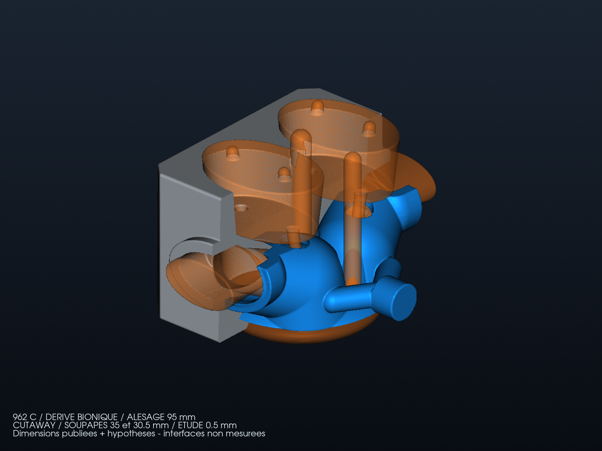

# Culasse bionique 962 C : dimensions retrouvées et hypothèses de travail

**Instruction du 16 octobre 2026 : rechercher les dimensions originales,
puis poursuivre le modèle avec des hypothèses explicites.** La forme bionique
peut modifier largement la référence. Le manque de certaines cotes ne bloque
donc plus l'étude géométrique ; il interdit de revendiquer le montage ou la
qualification de la pièce. Le [dossier dimensionnel](DIMENSIONAL_BASIS.md)
conserve les valeurs retrouvées et leur portée exacte.

## Entrées effectivement utilisées

| Entrée | Valeur | Base du modèle |
| --- | ---: | --- |
| Alésage de référence | 95 mm | Pièces 962 C eau/eau et fiches d'exemplaires publiées |
| Course 3,0 L | 70,4 mm | Fiche d'exemplaire Groupe C ; pas mesure du donneur |
| Course 3,2 L | 74,4 mm | Reconstruction documentée d'un 3,2 L |
| Disque d'admission | 35 mm | Référence de pièce 956/962 et reconstruction 3,2 L ; transfert d'application supposé |
| Disque d'échappement | 30,5 mm | Même niveau de preuve et même réserve |
| Centres projetés des quatre réservations | X = ±19, Y = ±19 mm | Implantation de conception supposée |
| Profondeur de chambre | 13 mm | Hypothèse indépendante de la cylindrée |
| Diamètres de gorge admission/échappement | 30 / 26 mm | Hypothèses, pas des cotes de siège ou de port Porsche |
| Guides | Ø7 mm, axe de Y = ±22 à ±36 mm sur 75 mm | Réservations supposées, sans guide fonctionnel |
| Deux puits d'allumage | Ø12 et Ø10 mm, X = 0 et 38 mm | Choix moderne conservé ; aucun filetage ou montage de bougie qualifié |
| Corps de base | 120 × 140 × 90 mm | Enveloppe d'étude antérieure, pas dimensions OEM |
| Eau | terminaux Ø22 mm ; séparation sèche nominale 4,5 mm ; peau nominale 5 mm | Hypothèses héritées, à vérifier géométriquement puis hydrauliquement |

Le [registre de recherche](dimensional-research.json) distingue constructeur,
fournisseur de pièces, fiche d'exemplaire et compte rendu de restauration.
Les angles, goujons, entraxes, registres, sièges, surfaces d'étanchéité et
huile inconnus ne sont pas présentés comme des mesures originales.
Les Ø35/30,5 servent à dimensionner les réservations ; le modèle ne livre
pas une soupape, un siège, un ressort ou une distribution fonctionnels.

## Paramétrage local, sans agrandissement global

Le [générateur](source/family/HeadFamilyStudy.cs) reprend l'étude précédente
en conservant ses sources et preuves. Il construit une seule fois les trois
domaines : métal, eau et réservations sèches. L'alésage règle localement le
rayon de chambre (`alésage/2 − 2 mm`) et le rayon externe du plateau
(`alésage/2 + 8 mm`). Les marges de 2 et 8 mm sont des choix d'étude,
sans preuve d'étanchéité ou de résistance.

Les réservations de soupapes utilisent les diamètres retrouvés. Leur
implantation et leurs transitions vers les ports restent supposées. Les
galeries suivent les volumes chauds et respectent une réservation autour
des zones sèches. Les 36 cellules BCC externes sont conservées ; elles ne
proviennent pas d'une optimisation de contraintes ou de transfert thermique.

La course reste dans le [registre moteur](bionic-family.json), hors des
entrées géométriques de culasse. Deux cylindrées au même alésage peuvent
ainsi référencer le même candidat géométrique ; cela ne valide ni leur
piston, ni leur compression, ni l'interchangeabilité des ensembles.

| Scénario | Alésage | Course | Géométrie de culasse |
| --- | ---: | ---: | --- |
| 3,0 L | 95 mm | 70,4 mm publiée | candidat Ø95 |
| 3,2 L | 95 mm | 74,4 mm rapportée | même candidat Ø95, montage non vérifié |
| 3,4 L | 98 mm supposés | calculée pour 3 400 cm³ | candidat Ø98 |
| 3,6 L | 100 mm supposés | calculée pour 3 600 cm³ | candidat Ø100 |
| 3,8 L | 102 mm supposés | calculée pour 3 800 cm³ | candidat Ø102 |
| 4,0 L | 102 mm supposés | calculée pour 4 000 cm³ | même candidat Ø102, montage non vérifié |

Les courses calculées ne sélectionnent pas des vilebrequins disponibles.
Les cylindrées réelles des deux couples historiques arrondis sont conservées
dans le JSON. Les alésages proposés ne prouvent pas leur passage dans un
carter ou un entraxe d'origine. Aucun rapport volumétrique n'est imposé aux
nouveaux modèles à partir d'un piston de catalogue ou d'une autre restauration.

## Exécution et contrôle

```sh
python3 twins/962-cylinder-head-f0/source/family/run_study.py \
  /chemin/vers/PicoGK \
  twins/962-cylinder-head-f0/source/family/configs/bore-95.json \
  work/962-family/nouvel-essai-95
```

Le pilote vérifie les empreintes des bibliothèques retenues, compile le C#,
prend le verrou PicoGK partagé, puis exporte les STL et cinq champs VDB.
L'inspecteur utilise NumPy, trimesh et VTK. Il contrôle fermeture, orientation,
connexité, ouvertures sèches, sections des terminaux et séparation eau/sec.
Le seuil échantillonné de 4 mm reste celui de l'étude précédente ; il ne
constitue pas une épaisseur minimale certifiée. Les sondes de partition
eau/métal restent un diagnostic, sans maillage conforme ni calcul CHT.

Chaque répertoire de sortie doit être neuf. Les essais rejetés et leurs
mesures sont conservés. Les champs VDB sont des domaines géométriques,
une distance et un gradient ; ils ne contiennent aucun résultat thermique,
de pression ou de vitesse. Le budget SP95 antérieur n'est pas transféré à
toutes les cylindrées.

## Résultats natifs effectivement obtenus

Les quatre géométries ont été exécutées sous le verrou partagé, avec le même
binaire et le runtime natif retenu. Le [bordereau](derived/family/delivery-report.json)
lie configurations, sources, rapports, binaires et sorties par empreintes.
Chaque modèle fournit trois STL inspectés en mm, un VDB de cinq champs et
quatre rendus. Les fichiers complets restent sous `work/962-family/`.

| Alésage | Volume de métal géométrique | Séparation eau/sec minimale échantillonnée | Valeurs scalaires et vectorielles vérifiées par sens |
| --- | ---: | ---: | ---: |
| 95 mm | 915,458 cm³ | 4,439 mm | 1 223 560 par champ |
| 98 mm | 911,704 cm³ | 4,439 mm | 1 235 784 par champ |
| 100 mm | 908,921 cm³ | 4,439 mm | 1 244 713 par champ |
| 102 mm | 905,982 cm³ | 4,439 mm | 1 253 379 par champ |

Les douze surfaces inspectées sont fermées, orientées de façon cohérente,
finies et chacune d'un seul tenant. Les triangles de surface d'aire nulle
sont retirés par l'outil existant ; les nombres et les empreintes des exports
bruts et nettoyés sont conservés. Le contrôle ne certifie pas l'épaisseur
minimale globale ni le maintien des sièges et des guides.

Les sondes de partition restent imparfaites : à 0,25 mm, les cas Ø98 et
Ø100 présentent respectivement 2 et 1 points non assignés ; les Ø95 et
Ø102 présentent 5 et 4 points classés encore dans l'eau. À 1,5 mm, des
recouvrements et des points non assignés subsistent. Ces résultats sont
conservés dans chaque rapport ; aucune conformité CHT n'est acquise.

**Candidat Ø95, utilisé pour les scénarios 3,0 et 3,2 L :**



**Candidat Ø102, utilisé pour les scénarios 3,8 et 4,0 L :**


Les 58 tests ciblés 962 passent avec VTK. Sept configurations invalides
sont rejetées par le programme C# avant toute génération native ; le
[reçu](derived/family/invalid-inputs.json) en conserve les empreintes et
l'absence de répertoire de sortie. Aucun résultat de performance moteur
ne découle de ces contrôles logiciels et géométriques.

Le `make check` global exécuté sur cette famille compte 4 043 tests en
239,018 s, avec deux échecs d'égalité exacte de flottants déjà présents dans
les modules de ventilateur 993 non modifiés et 230 tests ignorés. Le résultat
global reste non vert ; aucun de ces échecs ne concerne la famille 962.
Les autres cibles de `make check` passent séparément avec `make -o test check`.

La revue a ajouté un refus explicite si l'identifiant ou la géométrie du
JSON fourni ne correspond pas au reçu natif. Les quatre inspections ont
ensuite été répétées vers des répertoires neufs `inspected-bound-002`, sans
régénérer les géométries. Leurs métriques de maillage et de partition sont
identiques aux premières inspections, conservées localement. Les deux
régressions ajoutées après l'exécution globale sont incluses dans les
58 tests ciblés finaux. Le bordereau lie aussi les sources C# communes
compilées, le nettoyage délégué et les références des bibliothèques.

## Consultation sur GitHub

La [PR brouillon 261](https://github.com/cluster2600/porscheparts/pull/261)
regroupe les sources éditables, les recherches, les rendus et les rapports.
La [livraison d'étude en brouillon](https://github.com/cluster2600/porscheparts/releases/tag/untagged-3dc4679a17c16edf0fb4)
contient quatre archives, soit douze STL inspectés, quatre VDB et seize rendus,
avec configurations, rapports et empreintes. L'accès à cette livraison demande
une connexion GitHub avec les droits sur les brouillons du dépôt.

Les archives correspondent au calcul et aux inspections du commit
`79180221fa79f2f669cbf3c0b9104cbb662c39d6` ; les modifications ultérieures
de cette page décrivent leur publication. `SHA256SUMS.txt` et `archives.json`
permettent de vérifier les téléchargements. Les licences du dépôt et des
dépendances restent applicables. La CI distante se consulte sur la PR ;
aucune fusion, qualification physique ou publication fonctionnelle n'est
revendiquée.

## Limites fonctionnelles

Les surfaces de fixation, registres et étanchéités restent à définir ; le
cylindre, le porte-arbres, les goujons et le réseau d'huile ne sont pas
livrés par cette étude de culasse. La fabrication, la tenue en pression,
la fatigue, la combustion, les performances et le montage restent non validés.
L'étape suivante est de contraindre progressivement ces zones avec des cotes
supplémentaires et de comparer les variantes par calcul, sans redessiner
automatiquement les interfaces pour rendre le modèle visuellement cohérent.
