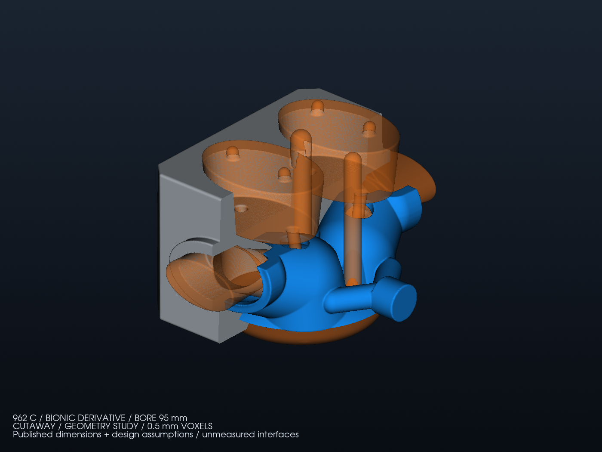
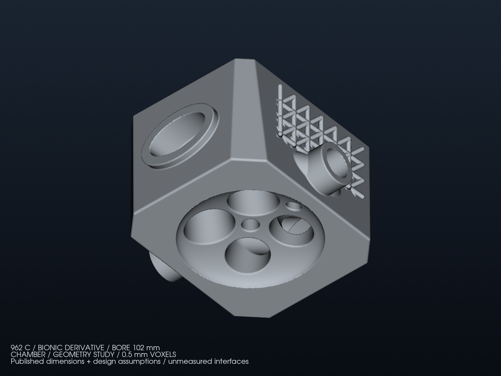

<a id="culasse-bionique-962-c--dimensions-retrouvées-et-hypothèses-de-travail"></a>

# Bionic 962 C head: recovered dimensions and working assumptions

**Instruction of October 16, 2026: research original dimensions, then continue
the model with explicit assumptions.** The bionic shape may substantially
change the reference. Missing dimensions therefore no longer block the
geometry study; they prevent claims of installation or part qualification.
The [dimensional dossier](DIMENSIONAL_BASIS.md) preserves the recovered values
and their exact scope.

<a id="entrées-effectivement-utilisées"></a>

## Inputs actually used

| Input | Value | Model basis |
| --- | ---: | --- |
| Reference bore | 95 mm | Water/water 962 C parts and published individual-car records |
| 3.0 L stroke | 70.4 mm | Group C individual-car record; not a donor measurement |
| 3.2 L stroke | 74.4 mm | Documented 3.2 L rebuild |
| Intake disc | 35 mm | 956/962 part reference and 3.2 L rebuild; assumed application transfer |
| Exhaust disc | 30.5 mm | Same evidence level and limitation |
| Projected centers of the four reservations | X = ±19, Y = ±19 mm | Assumed design layout |
| Chamber depth | 13 mm | Assumption independent of displacement |
| Intake/exhaust throat diameters | 30 / 26 mm | Assumptions, not Porsche seat or port dimensions |
| Guides | Ø7 mm, axis from Y = ±22 to ±36 mm over 75 mm | Assumed reservations, without functional guides |
| Two ignition wells | Ø12 and Ø10 mm, X = 0 and 38 mm | Retained modern choice; no qualified spark-plug thread or installation |
| Base body | 120 × 140 × 90 mm | Previous study envelope, not OEM dimensions |
| Water | Ø22 mm terminals; nominal dry separation 4.5 mm; nominal skin 5 mm | Inherited assumptions, to check geometrically then hydraulically |

The [research register](dimensional-research.json) distinguishes manufacturer,
parts supplier, individual-car record and restoration account.
Unknown angles, studs, center distances, registers, seats, sealing surfaces
and oil are not presented as original measurements.
The Ø35/30.5 values size the reservations; the model does not deliver a
functional valve, seat, spring or valvetrain.

<a id="paramétrage-local-sans-agrandissement-global"></a>

## Local parameterization without global scaling

The [generator](source/family/HeadFamilyStudy.cs) continues the previous study
while preserving its sources and evidence. It constructs the three domains
once: metal, water and dry reservations. Bore sets the local chamber radius
(`bore/2 − 2 mm`) and outer deck radius (`bore/2 + 8 mm`).
The 2 and 8 mm margins are study choices, without sealing or strength evidence.

The valve reservations use the recovered diameters. Their layout and
transitions into the ports remain assumed. Galleries follow the hot volumes
and maintain a reservation around dry areas. The 36 external BCC cells are
retained; they do not result from stress or heat-transfer optimization.

Stroke remains in the [engine register](bionic-family.json), outside the
head-geometry inputs. Two displacements at the same bore can therefore
reference the same geometric candidate; this validates neither their pistons,
compression nor assembly interchangeability.

| Scenario | Bore | Stroke | Head geometry |
| --- | ---: | ---: | --- |
| 3.0 L | 95 mm | 70.4 mm published | Ø95 candidate |
| 3.2 L | 95 mm | 74.4 mm reported | Same Ø95 candidate, installation unverified |
| 3.4 L | 98 mm assumed | Calculated for 3,400 cm³ | Ø98 candidate |
| 3.6 L | 100 mm assumed | Calculated for 3,600 cm³ | Ø100 candidate |
| 3.8 L | 102 mm assumed | Calculated for 3,800 cm³ | Ø102 candidate |
| 4.0 L | 102 mm assumed | Calculated for 4,000 cm³ | Same Ø102 candidate, installation unverified |

Calculated strokes do not select available crankshafts. Actual displacements
of the two rounded historical pairs are retained in the JSON.
Proposed bores do not prove clearance within an original case or cylinder pitch.
No compression ratio is imposed on the new models from a catalog piston or
another restoration.

<a id="exécution-et-contrôle"></a>

## Execution and inspection

```sh
python3 twins/962-cylinder-head-f0/source/family/run_study.py \
  /path/to/PicoGK \
  twins/962-cylinder-head-f0/source/family/configs/bore-95.json \
  work/962-family/new-run-95
```

The driver verifies the retained library digests, compiles the C#, acquires
the shared PicoGK lock, then exports the STL files and five VDB fields.
The inspector uses NumPy, trimesh and VTK. It checks closure, orientation,
connectivity, dry openings, terminal sections and water/dry separation.
The 4 mm sampled threshold remains that of the previous study; it is not a
certified minimum thickness. Water/metal partition probes remain a diagnostic,
without a conformal mesh or CHT calculation.

Every output directory must be new. Rejected attempts and their measurements
are preserved. VDB fields contain geometric domains, a distance and a gradient;
they contain no thermal, pressure or velocity results.
The previous SP95 budget is not transferred to every displacement.

<a id="résultats-natifs-effectivement-obtenus"></a>

## Native results actually obtained

The four geometries were executed under the shared lock, using the same
binary and retained native runtime. The [delivery record](derived/family/delivery-report.json)
links configurations, sources, reports, binaries and outputs by digest.
Each model provides three inspected STL files in mm, a five-field VDB and
four renders. Complete files remain under `work/962-family/`.

| Bore | Geometric metal volume | Minimum sampled water/dry separation | Scalar and vector values checked in each direction |
| --- | ---: | ---: | ---: |
| 95 mm | 915.458 cm³ | 4.439 mm | 1,223,560 per field |
| 98 mm | 911.704 cm³ | 4.439 mm | 1,235,784 per field |
| 100 mm | 908.921 cm³ | 4.439 mm | 1,244,713 per field |
| 102 mm | 905.982 cm³ | 4.439 mm | 1,253,379 per field |

The twelve inspected surfaces are closed, consistently oriented, finite and
each connected. Zero-area surface triangles are removed by the existing tool;
counts and digests of raw and cleaned exports are retained.
This check certifies neither global minimum thickness nor seat/guide retention.

Partition probes remain imperfect: at 0.25 mm, Ø98 and Ø100 have respectively
2 and 1 unassigned points; Ø95 and Ø102 have 5 and 4 points still classified
in the water. At 1.5 mm, overlaps and unassigned points remain.
These results are retained in every report; no CHT conformity is established.

**Ø95 candidate, used for the 3.0 and 3.2 L scenarios:**



**Ø102 candidate, used for the 3.8 and 4.0 L scenarios:**



The 58 targeted 962 tests pass with VTK. Seven invalid configurations are
rejected by the C# program before native generation; the
[receipt](derived/family/invalid-inputs.json) retains their digests and the
absence of an output directory. These software and geometry checks establish
no engine-performance result.

The global `make check` run on this family counts 4,043 tests in 239.018 s,
with two exact floating-point equality failures already present in the
unmodified 993 fan modules and 230 skipped tests. The global result remains
non-green; neither failure concerns the 962 family. The other `make check`
targets pass separately with `make -o test check`.

Review added explicit rejection if the supplied JSON identity or geometry
does not match the native receipt. The four inspections were then repeated
into new `inspected-bound-002` directories without regenerating geometry.
Their mesh and partition metrics match the first inspections, retained locally.
The two regressions added after the global run are included in the final
58 targeted tests. The delivery record also links compiled shared C# sources,
delegated cleanup and library references.

<a id="consultation-sur-github"></a>

## Viewing on GitHub

[Draft PR 261](https://github.com/cluster2600/porscheparts/pull/261) collects
editable sources, research, renders and reports.
The [repository releases page](https://github.com/cluster2600/porscheparts/releases)
lists the draft 962 C study delivery. Its four original archives contain twelve
inspected STL files, four VDB files and sixteen renders, with configurations,
reports and digests. The `review-en.zip` companions add English documentation
and views while retaining the original exports and evidence. Access requires
a GitHub login with permission to view the repository's drafts.

The archives correspond to the calculation and inspections at commit
`79180221fa79f2f669cbf3c0b9104cbb662c39d6`; later changes to this page describe
their publication. `SHA256SUMS.txt` and `archives.json` check the original
archives; `ENGLISH_SHA256SUMS.txt` and `ENGLISH_ARCHIVES.json` check the English
review packages. Draft release permalinks can change when GitHub edits the
draft, so this page uses the stable repository releases entry point.
Repository and dependency licenses remain applicable. Remote CI is available
on the PR; no merge, physical qualification or functional release is claimed.

<a id="limites-fonctionnelles"></a>

## Functional limits

Mounting surfaces, registers and seals remain to be defined; the cylinder,
camshaft carrier, studs and oil network are not delivered by this head study.
Manufacturing, pressure strength, fatigue, combustion, performance and
installation remain unvalidated. The next step is to constrain these areas
progressively with additional dimensions and compare variants by calculation,
without automatically redesigning interfaces to make the model look coherent.
