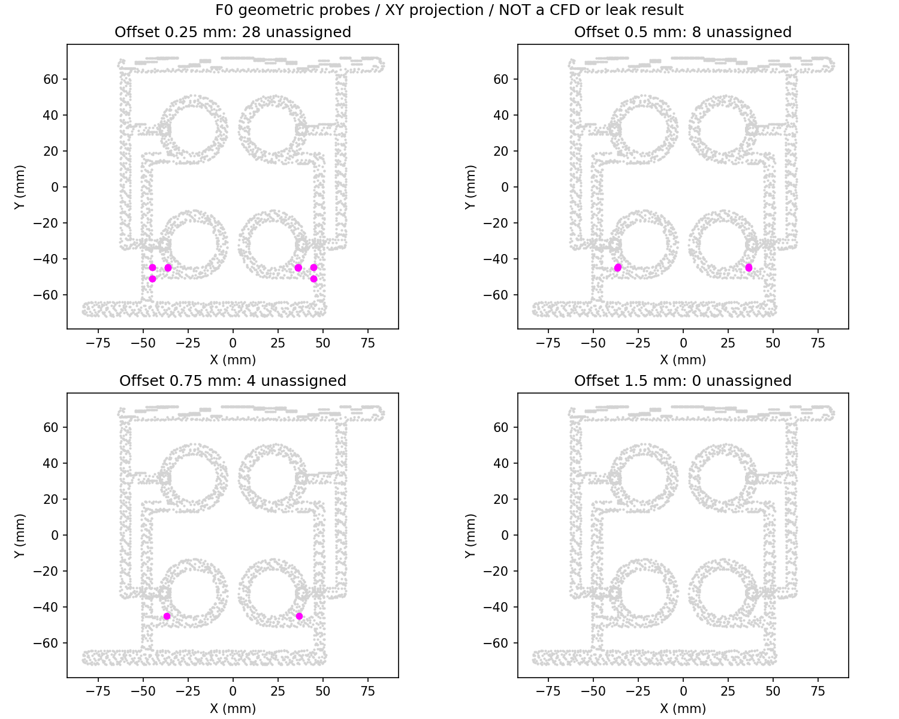

# F0 : sections d'eau et diagnostic des interfaces

**Le contrôle utilise les STL PicoGK effectivement générés, avec leurs
empreintes conservées. Il ne modifie pas la culasse.** Le circuit reste une
étude non mesurée, sans performance hydraulique ou fabrication qualifiée.

Le [script](source/audit_coolant_boundaries.py) extrait les deux sections aux
plans X = −80 et +80 mm de l'enveloppe F0. Ces plans sont ceux du modèle
hypothétique ; ce ne sont pas des raccords du donneur. Les coupes sont
triangulées après contrôle d'une seule boucle fermée, sans sommet de degré
différent de deux. Le [rapport](derived/boundary-audit.json) lie sources,
maillages, sorties et runtime. Les surfaces de coupe `inlet.vtp` et
`outlet.vtp` restent locales et peuvent être ouvertes dans ParaView.

## Résultats sur le F0 conservé

| Section géométrique | Aire | Périmètre | Diamètre hydraulique `4A/P` |
|---|---:|---:|---:|
| Entrée, X = −80 mm | 52,5045 mm² | 26,2833 mm | 7,9906 mm |
| Sortie, X = +80 mm | 52,4872 mm² | 26,2195 mm | 8,0074 mm |

Ces valeurs décrivent les sections des maillages, pas des dimensions usinées
ou une tolérance. Le diamètre hydraulique n'est pas un diamètre de foret.
La petite différence entrée/sortie n'établit pas une perte de charge.
Le volume d'eau ne dépasse pas l'enveloppe F0 par Y ou Z ; il se prolonge
par les deux terminaisons X. Cette vérification d'enveloppe n'est pas un
contrôle exhaustif d'étanchéité de la paroi.

## Sondage eau/métal : anomalie conservée

À partir des centres des triangles d'eau, déplacer une sonde suivant la
normale extérieure de la face. Classer indépendamment sa distance signée
aux deux surfaces, eau et métal. Quatre décalages sont examinés ; le signe
zéro est classé extérieur. Les sondes peuvent retomber dans une autre branche
du même circuit : ces cas ne deviennent pas des validations de matière.

| Décalage | Métal seul | Eau seule | Dans les deux | Dans aucun des deux |
|---|---:|---:|---:|---:|
| 0,25 mm | 130 048 | 0 | 0 | 28 |
| 0,50 mm | 130 062 | 6 | 0 | 8 |
| 0,75 mm | 130 062 | 10 | 0 | 4 |
| 1,50 mm | 130 040 | 36 | 0 | 0 |

Chaque ligne porte sur **130 076 sondes**. Les **1 480 centres de faces**
dans la garde de 1,5 mm près des terminaisons X sont exclus : la paroi autour
des raccords n'est donc pas inspectée par ce sondage. Les centres, normales
et positions de sonde sont ceux du maillage, sans recalage photographique.



Les points magenta sont les sondes présentes dans aucun des deux volumes
triangulés, en projection XY. Leur nombre baisse avec le décalage, mais ce
n'est pas une convergence : le maillage et son voxel de 0,75 mm sont inchangés.
Changer la distance de la sonde ne raffine pas la géométrie.

**La conformité eau/métal reste non validée.** Aux petits décalages, des
écarts sont observés près de jonctions. À 1,5 mm, les 36 sondes hors métal
sont dans l'eau. Ces classifications ne prouvent ni fuite physique ni paroi
fermée et ne donnent pas une épaisseur minimale. Les surfaces séparées ne
sont pas acceptées comme une interface commune de maillage CHT.

## Étape hydraulique suivante

Localiser les cellules/interfaces concernées puis comparer un raffinement
de voxel sur la même géométrie, avec une nouvelle preuve liée à chaque sortie.
Construire ensuite une partition fluide/solide à interface commune, avec
entrée, sortie et parois identifiées. Ne pas déplacer artificiellement les
surfaces pour faire passer le contrôle, ni masquer les points non attribués.

La CFD exige encore débit ou courbe de pompe, composition du liquide,
température/pression d'entrée, rugosité et comportement aux jonctions.
La CHT ajoute flux thermique/chambre, lois matériau et conditions externes.
Les pressions, débit et charge thermique restent inconnus dans le
[contrat F0](interface-contract.json). Aucune perte de charge, ébullition,
évacuation de poudre, tenue de paroi ou amélioration thermique n'est calculée.

## Reproduction et témoins négatifs

Avec le runtime NumPy/trimesh/VTK/Matplotlib déjà utilisé pour F0 :

```sh
python twins/962-cylinder-head-f0/source/audit_coolant_boundaries.py \
  work/962-head/delivery work/962-head/boundary-audit-new
python -m unittest discover -s tests -p 'test_962*.py' -v
```

Le répertoire de sortie doit être neuf et les STL doivent correspondre aux
empreintes originales. Une source F0 modifiée est aussi refusée. Des témoins
indépendants contrôlent une coupe de cube (aire et périmètre analytiques),
une section ouverte ou déconnectée, une paroi analytique amputée, le retour
d'une sonde dans l'eau, un chevauchement et des entrées non finies. Le
diagnostic reste non qualifié même si les tests de son outil passent.

La méthode de coupe s'appuie sur la
[documentation VTK 9.7 de ContourTriangulator](https://vtk.org/doc/nightly/release/9.7/html/classvtkContourTriangulator.html).
Ses triangles de coupe ne constituent pas un maillage CFD de qualité.
