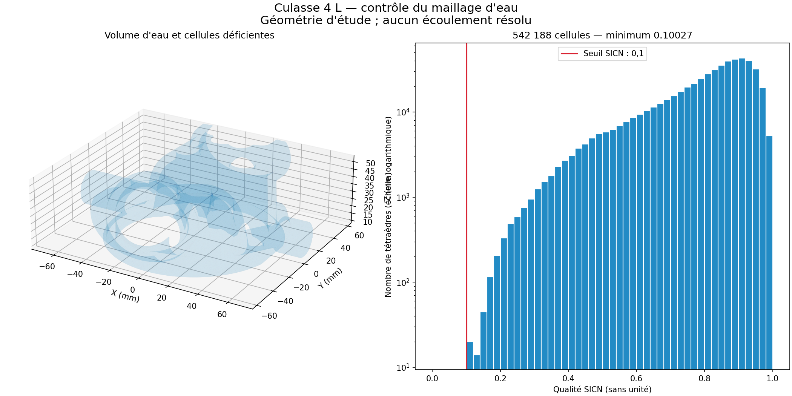

# Culasse 4 L : nouveau maillage d'eau et contrôle volumique

Cette étape reprend le volume d'eau conservé de la famille Ø102 mm, utilisé
pour le scénario 4 L, sans modifier le maître PicoGK ni le métal. Le double
allumage et les quatre réservations de soupapes restent les choix du projet.
Les interfaces du donneur et les qualifications physiques restent ouvertes.

## Résultat effectivement relu

Le [contrôle complet du fichier final](derived/coolant-flow/mesh-010-readback.json)
confirme **542 188 tétraèdres**, tous de volume positif, et **zéro cellule
sous SICN 0,1**. Le minimum est **0,1002721581**. Le seuil n'a pas été abaissé.
Le fichier conserve les 150 754 triangles de frontière orientés, avec un
écart maximal de coordonnées de 2,05 × 10⁻¹⁴ mm après écriture et relecture.
Chaque face intérieure appartient à deux cellules d'orientations opposées ;
aucun nœud n'est inutilisé.

Il s'agit du contrôle volumique Gmsh/SICN et de sa relecture indépendante,
**pas d'une acceptation OpenFOAM ni d'une solution d'écoulement**. La marge
du pire élément au seuil est faible. Les critères du solveur, la résolution
près des parois et la convergence en maillage restent à vérifier.

## Surface de calcul et corrections locales

La surface de référence porte l'empreinte
`feeaddaf029a8635a7e580f1a6916c5c85b44ada9db947e6602203f8d3c6156f`.
Elle correspond à l'export inspecté Ø102 du 16 octobre, sans dimension
d'interface mesurée. Le [contrôle de la dérivée finale](derived/coolant-flow/surface-004.json)
conserve fermeture, orientation, une composante et caractéristique d'Euler.
Le volume passe de 137 942,605 à **137 937,088 mm³**, soit −0,0040 %.

L'écart maximal mesuré aux sommets et centres de triangles, dans les deux
sens, est de **0,051150 mm**, sous la limite conservée de 0,0625 mm. Cet
échantillonnage n'est pas une borne de Hausdorff continue et ne prouve pas
l'épaisseur, l'étanchéité ou la conformité CHT métal/eau.

La préparation native MeshLib réduit d'abord 595 434 triangles à 150 756.
Deux défauts restants sont traités par un changement de diagonale puis
l'élimination d'une arête de 0,058865 mm. La surface finale a 150 754 faces.
La condition nécessaire q ≥ 2/29 est satisfaite ; elle ne suffit pas, à elle
seule, à garantir SICN ≥ 0,1 dans le volume.

## Essais conservés

| Essai | Tétraèdres | SICN minimum | Cellules sous 0,1 |
|---|---:|---:|---:|
| Delaunay + Netgen, première surface | 386 534 | 0,004536 | 30 |
| Delaunay + Netgen, surface corrigée | 386 275 | 0,039502 | 17 |
| Optimiseur standard après Delaunay | 387 817 | 0,043002 | 18 |
| Frontal + Netgen | 490 622 | 0,088543 | 6 |
| Optimiseur standard après Frontal | 491 561 | 0,086453 | 8 |
| HXT + Netgen | 542 188 | 0,089529 | 3 |
| Optimiseur standard après HXT | 543 664 | 0,089529 | 5 |
| Optimisation individuelle des points intérieurs | 542 188 | 0,092200 | 1 |
| Optimisation conjointe locale | **542 188** | **0,100272** | **0** |

Les premiers essais de reparamétrage sont également conservés : l'entrée
brute a été arrêtée après une récursion pathologique, et la surface simplifiée
a ensuite été refusée pour topologie de paramétrage invalide. Le maillage
discret fixe contourne cette étape ; aucun échec n'est transformé en succès.

Les trois derniers tétraèdres HXT avaient chacun un sommet intérieur. Une
maximisation du pire SICN dans chaque étoile en corrige deux. Pour le dernier,
l'optimum individuel reste à 0,098901 et est donc refusé. L'optimisation
conjointe de trois points intérieurs, portant sur 37 cellules, franchit le
seuil. Les positions de frontière et toute la connectivité volumique restent
inchangées. Un témoin fermé et un témoin à deux points libres vérifient
l'algorithme avant son utilisation sur la culasse.

## Reproduction et fichiers

Les programmes sont dans [source/coolant_flow](source/coolant_flow/README.md).
Ils refusent les entrées dont les empreintes ont changé et les répertoires
de sortie existants. La préparation utilise MeshLib 3.1.4.297 ; le maillage
utilise Gmsh 4.15.2 natif ARM64 avec Netgen. La qualité sauvegardée est aussi
recalculée par NumPy à partir de tous les sommets des tétraèdres.

Les STL restent en **mm** ; les MSH destinés au calcul sont en **m**.
Le [reçu de livraison](derived/coolant-flow/delivery.json) lie l'archive locale,
les sources, les rapports, l'image et les fichiers complets par leurs empreintes.
Les grands maillages et les rejets complets restent sous
`work/962-coolant-flow/`, sans écrasement.

## Limite d'exécution hydraulique

Le démarrage ordinaire de Docker Desktop répond qu'il fonctionne déjà,
mais son API indique « unable to start ». La vérification SSH du calculateur
local précédemment documenté expire. Aucun redémarrage forcé, réinitialisation,
suppression de données ou calcul payant n'a été lancé.

Il reste donc à importer ce maillage dans OpenFOAM Foundation 13 et à réussir
`checkMesh -allGeometry -allTopology` avant une résolution. Le besoin exploratoire
de 48,62 L/min par culasse du [bilan SP95](MEZGER_4L_SP95.md) n'est pas un débit
mesuré. Perte de charge, distribution entre zones chaudes, CHT, tenue mécanique,
choix de matériau, procédé LPBF et puissance moteur restent non validés.
