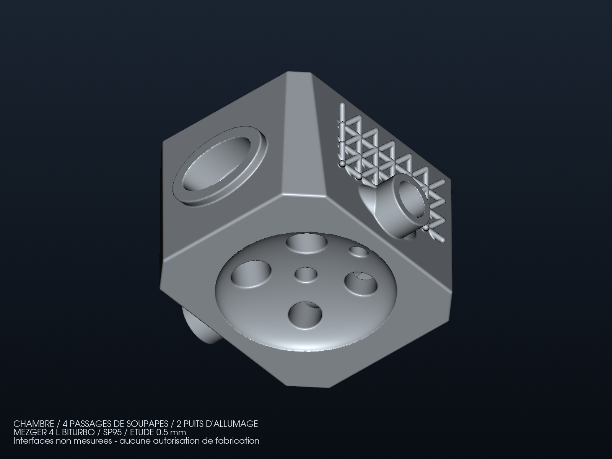
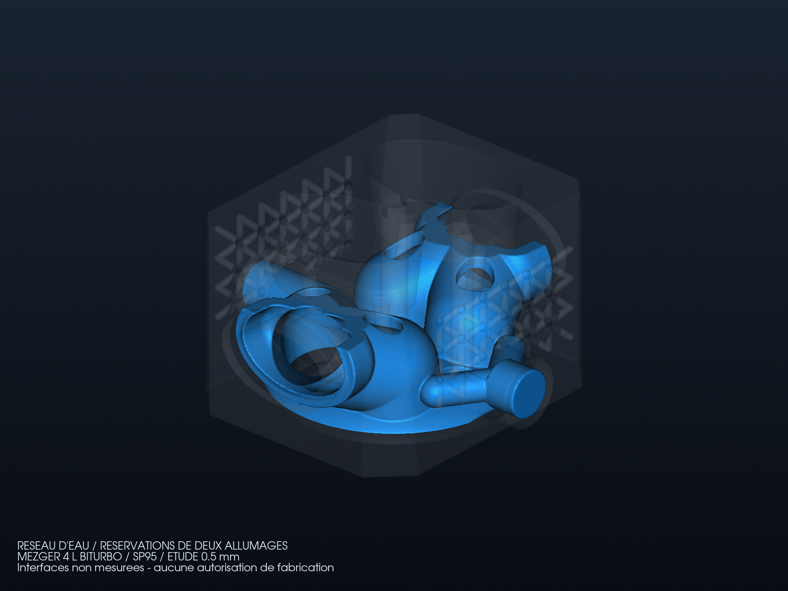

# Culasse 4 L SP95 : géométrie dimensionnée pour le débit d'eau

Cette variante fait passer le [bilan Mezger 4 L/SP95](MEZGER_4L_SP95.md) dans
une nouvelle géométrie native PicoGK. Elle conserve quatre passages de
soupapes, deux réservations d'allumage, les lofts ShapeKernel et les nervures
BCC externes LatticeLibrary. Les anciens modèles et leurs reçus restent intacts.



## Changements effectivement générés

- Enveloppe de chambre de demi-axes 49 × 49 × 13 mm, avec embase de rayon
  59 mm, pour l'hypothèse d'alésage de 102 mm. Le volume mort et le rapport
  volumétrique du moteur ne sont pas établis par cette cavité.
- Deux ports d'eau de diamètre nominal **22 mm**, contre 10 mm dans la
  variante précédente. Ce sont des terminaisons de calcul sans raccord monté.
- Un puits d'allumage central de 12 mm et un second de 10 mm à X=38 mm.
  Ces enveloppes proposées ne sont ni des filetages ni un choix de bougies.
- Une alimentation bifurquée autour de la réservation du second allumage.
  Le premier essai laissait un tronçon aveugle près de son volume protégé.
- Lissage des volumes secs et de l'eau **avant** la soustraction finale au
  métal. La paroi métallique au contact de l'eau n'est pas lissée ensuite.
- 36 cellules BCC externes, de 12 × 14 × 14 mm et diamètre de barre 3,5 mm.
  Leur forme n'est pas issue d'une optimisation mécanique sous combustion.

Les axes sont locaux à l'étude. Aucun entraxe de cylindres, axe de banc,
plan d'assemblage ou coordonnées de goujons du donneur n'est déduit de ces
dimensions. L'enveloppe hors tout d'environ 152 × 150 × 90 mm doit notamment
être confrontée à l'implantation réelle des culasses voisines.

Le [contrat de conception](source/flow4l/design.json) liste les interfaces et
le chemin de charge requis. La variante précise du moteur, les fixations,
les portées, la distribution, les sièges/guides, les bougies et l'huile
restent inconnus. La géométrie ne constitue pas une culasse montable.

## Contrôles sur les fichiers réellement produits

Le [rapport indépendant](derived/flow4l/study-report.json) lie les sources,
binaires, STL, VDB et images par empreintes. La
[provenance complémentaire](derived/flow4l/provenance.json) conserve le SDK
et les sources communes. Les trois domaines sont fermés, orientés et ont
chacun une seule composante de surface après retrait tracé des faces dégénérées.

| Grandeur géométrique | Résultat |
|---|---:|
| Volume métallique | 952,07 cm³ |
| Volume d'eau | 148,93 cm³ |
| Volumes secs, prolongements inclus | 487,11 cm³ |
| Séparation eau/sec minimale échantillonnée | 4,439 mm |
| Section d'entrée / sortie | 375,44 / 375,23 mm² |
| Diamètre hydraulique d'entrée / sortie | 21,48 / 21,56 mm |
| Vitesse moyenne à 48,62 L/min | 2,159 / 2,160 m/s |

Le débit de 48,62 L/min par culasse reste celui du scénario supposant
49,03 kW par culasse et 15 K d'échauffement de l'eau. Il n'est pas mesuré sur
un moteur. La section a été multipliée par environ cinq ; cela ne donne pas
la perte de charge interne ni la distribution du débit entre zones chaudes.



Les sondes à 0,25 mm donnent zéro point non assigné, mais encore **deux
chevauchements** sur 607 232 sondes. Les autres distances de sondage sont
conservées dans le rapport. Il ne s'agit toujours pas d'une interface
conforme certifiée pour CHT ; fermeture et échantillonnage ne suffisent pas
à valider une paroi ou une étanchéité.

Le premier essai rejeté est conservé dans
[le diagnostic de composantes](derived/flow4l/rejected/native-001-components.json).
Les sources et sorties complètes de chaque essai restent dans les répertoires
locaux `work/962-flow4l/run-*`, sans écrasement.

## Échange VDB et préparation hydraulique

PicoGK a enregistré et relu à l'identique les trois domaines, le champ de
distance et son gradient, avec comparaison native et vérification de toutes
les valeurs actives dans les deux sens. Ces deux derniers champs sont
**géométriques**, sans température, pression ou vitesse calculée.

Une dérivée cartésienne de l'eau est également exportée par classification
native `Voxels.bIsInside` au centre des cellules. À 2 mm, deux cellules
isolées font rejeter cette dérivée. À 1 mm, les 149 980 cellules sont reliées,
mais le maillage volumique échoue ensuite à `checkMesh` sur 708 déterminants
de cellule. La tentative de tétraédrisation directe Gmsh de la surface est
également rejetée par les contrôles complets. Aucun seuil n'est abaissé.

La surface dérivée pour maillage reste fermée : 61 504 triangles, écart
maximal mesuré aux sommets de 0,238 mm et écart de volume de −0,150 %.
Ce contrôle échantillonné n'est pas une borne de Hausdorff globale.
L'accrochage à la surface par `snappyHexMesh` dans OpenFOAM **Foundation 13**
produit 138 400 cellules et une seule région, mais le contrôle complet rejette
720 cellules concaves et une face trop déformée. Une nouvelle représentation
conforme aux faces utilise ensuite les centres et bases de faces natifs
d'OpenFOAM : 1 612 960 tétraèdres de volume positif, avec un écart de volume
de 0,0207 % par rapport au parent. Elle est également rejetée : cinq contrôles
échouent, notamment sur 9 055 déterminants et sept faces trop déformées.

Le [rapport de maillage](derived/flow4l/meshing-report.json) conserve les
empreintes des cas et les journaux principaux. Le contrôle bloquant a empêché
le lancement du solveur sur ces maillages. Aucun seuil n'a été abaissé et
aucune itération d'écoulement n'est créditée. La perte de charge, la répartition
du débit, l'efficacité thermique et la puissance moteur restent à établir.

## Reproduction

Le [générateur C#](source/flow4l/HeadFlow4LStudy.cs), le
[programme d'export](source/flow4l/HeadFlowRunner.cs) et le
[pilote](source/flow4l/run_study.py) utilisent l'installation PicoGK documentée.
Le runtime vérifié utilise le SDK 9.0.319, .NET 9.0.21 et un voxel de 0,5 mm.
ShapeKernel et LatticeLibrary sont comparés à leurs références existantes.
Le pilote prend le verrou natif partagé du catalogue.

```sh
python3 twins/962-cylinder-head-f0/source/flow4l/run_study.py \
  /chemin/vers/PicoGK work/962-flow4l/nouvel-essai
python3 -m unittest discover -s tests -p 'test_962_flow4l.py' -v
```

Les grandes sorties STL/VDB restent des fichiers dérivés locaux ; leurs
empreintes et les rendus sont versionnés. Aucun scan ou manuel tiers, poids
de modèle ou binaire fournisseur n'est ajouté au dépôt.

Une archive locale de consultation rassemble les trois STL inspectés, le
VDB géométrique, les sources de cette variante, les rapports et les rendus :
`work/962-flow4l/delivery-001/mezger-4l-sp95-head-study.zip`.
Le [reçu de livraison](derived/flow4l/delivery-report.json) enregistre ses
95 532 176 octets et les empreintes des 37 fichiers, tous relus après
compression. Cette archive accompagne le dépôt complet pour la reproduction :
les helpers partagés et les dépendances PicoGK restent ceux du dépôt et de
l'installation vérifiée. Elle ne contient aucun résultat de pression,
vitesse ou température de solveur, ni dossier de fabrication.

## Suite de la chaîne d'outils

Le [workflow du dépôt](../../docs/TOOLCHAIN.md) reste applicable. L'étape
hydraulique doit produire un maillage accepté, une solution convergente et
un bilan de débit avant de créditer un résultat numérique. Le calcul CHT
nécessite ensuite une partition solide/eau conforme, les flux et les
propriétés thermiques du matériau en fonction de la température.

CalculiX ne peut établir une tenue moteur avec des goujons, contacts et
précharges inventés. Les interfaces mesurées et le cycle de pression
conditionnent cette analyse. La sélection d'alliage LPBF, la simulation de
fabrication, les coupons, l'inspection, les essais de pression et le banc
restent ouverts ; tous les drapeaux de qualification restent faux.
