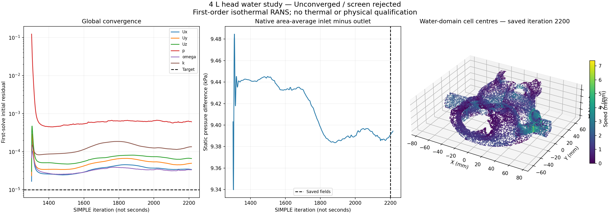
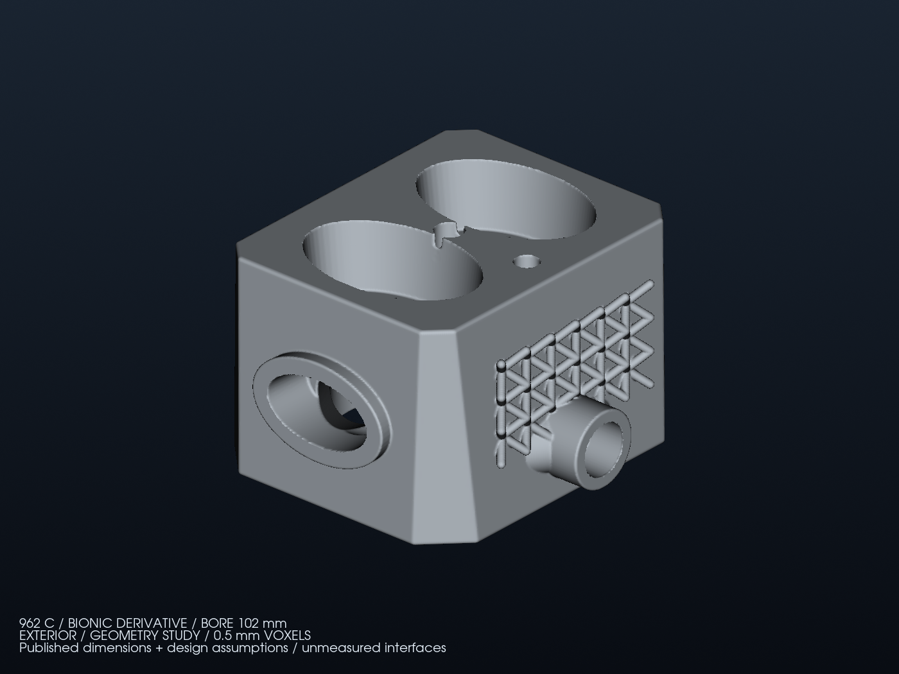
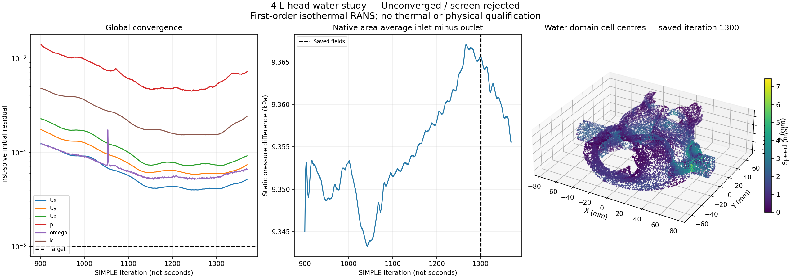

# 4 L water-domain flow restarts — 27 October 2026

The [admitted MMG mesh](MMG_REPAIR_FOLLOWUP.md) is retained unchanged:
635,132 tetrahedra. New native Foundation 13 calculations run on kali1,
from the hash-verified iteration-900 fields of case-015. The model remains a
single-cylinder **study water domain**, with assumed interfaces and fluid
properties. These calculations do not establish a usable 962/Mezger kit.

**Outcome: seven bounded steady RANS attempts retain the admitted mesh but
none satisfies the full numerical flow screen.** The longest continuation
reaches global iteration 2,215 from checkpoint 1,300; its last written state
is iteration 2,200.
No heat-transfer result or physical CFD field import into PicoGK/VDB is promoted.
The [execution ledger](derived/coolant-restart-20261027/execution-report.json)
records every attempt. The [delivery receipt](derived/coolant-restart-20261027/delivery.json)
and [replica check](derived/coolant-restart-20261027/replicas.json) identify the
separate, verified review archive; its large native payloads remain outside Git.

This is the existing metal study envelope, with its
[section view](derived/family/english-views/bore-102/cutaway.png).
The [existing image provenance](derived/family/english-views/bore-102/render-report.json)
binds the solid and original coolant meshes to the same study inputs.
The current work changes the CFD representation and solver recipe; it does
not redesign or qualify this envelope.

## Controlled comparison

Both new cases use four MPI ranks, at most four CPU cores and 6 GiB without
swap, with a 1,800-second solver deadline. Full native mesh admission and
input digest verification precede decomposition and solver execution.
Neither the mesh quality thresholds nor the **10⁻⁵ global residual target**
are relaxed. SIMPLE iteration labels are numerical iterations, not seconds.

- Case-017 adds two non-orthogonal pressure correctors to the original recipe.
  The normal-gradient and Laplacian schemes remain fully corrected.
- Case-018 uses the **same iteration-900 seed**, solver controls, mesh and
  fluid assumptions. Only the non-orthogonal correction changes to
  `limited corrected 0.5` in `snGradSchemes` and `laplacianSchemes`.
- Case-019 adds only `grad(U) cellLimited Gauss linear 1` to case-018's
  recipe. It uses the same original iteration-900 seed. Velocity-gradient
  limiting is another documented stability option; its effect remains a
  comparison rather than evidence of physical accuracy.
- Case-020 instead changes only pressure-field relaxation from 0.3 to 1
  in case-018's existing `consistent yes` formulation. This tests the
  pressure-update coupling; velocity discretization is unchanged.
- Case-023 resumes the audited **iteration-1,300 fields of case-019**.
  Pressure relaxation, mesh, physical inputs and gradient schemes remain
  unchanged; U, k and omega equation relaxation changes from 0.5 to 0.3.
  The checkpoint retains its original iteration label and all six field hashes.
- Case-024 is a 300-second pressure-accuracy pilot on the same checkpoint and
  damping as case-023. GAMG pressure uses absolute tolerance 10⁻¹⁰ and zero
  relative tolerance; the **global** 10⁻⁵ criterion remains unchanged.
- Case-025 repeats that short pilot with classical SIMPLE (`consistent no`),
  and saves every ten iterations. Its physical inputs and spatial schemes are
  unchanged.

The [Foundation 13 numerical-scheme guide](https://doc.cfd.direct/openfoam/user-guide-v13/fvschemes)
explains this limited correction and its accuracy/stability tradeoff for
strongly non-orthogonal meshes. Our native maximum is 82.06699°. The comparison
is a numerical diagnostic; a lower residual does not establish mesh independence
or correct heat transfer. The first-order upwind velocity scheme also requires
an accuracy study before accepting hydraulic performance.

Preparation sources: [prepare_restart.py](source/coolant_flow/prepare_restart.py),
[limited companion](source/coolant_flow/prepare_limited_restart.py), and
[bounded native runner](source/coolant_flow/run_restart.sh).
The [bounded-gradient companion](source/coolant_flow/prepare_bounded_gradient_restart.py)
prepares case-019 without editing either previous recipe.
The [pressure-update companion](source/coolant_flow/prepare_consistent_pressure_restart.py)
prepares case-020. The [audited checkpoint preparation](source/coolant_flow/prepare_damped_checkpoint.py)
prepares case-023 without relabelling its saved state as the original seed.
The [absolute-pressure pilot](source/coolant_flow/prepare_precise_pressure_pilot.py)
and [classical-SIMPLE pilot](source/coolant_flow/prepare_simple_pressure_pilot.py)
retain those separate recipes and shorter deadlines.
All previous source files, receipts, geometry masters and archives remain frozen.

## Case-017: stopped diagnostic, not convergence

The solver completes iteration **1,369**, with pressure residual
**7.2276 × 10⁻⁴**, then is stopped explicitly to run the limited-correction
comparison. No native convergence or `End` marker exists in its solver log.
The solver's own return status was not captured when the resource unit was
stopped; the audit records it as **null**, not a fabricated success code.

Native reconstruction recovers the latest saved fields at **iteration 1,300**.
They are distinct from the final completed iteration. The
[independent audit](derived/coolant-restart-20261027/case-017-flow.json)
verifies all prepared inputs, the admitted native mesh receipt, the five saved
volume-field counts and units, finite internal values, turbulence positivity,
and terminal phi counts, units and fluxes against the native function histories.

| Saved-field diagnostic, iteration 1,300 | Value |
|---|---:|
| Prescribed flow per single-cylinder head | 48.6236 L/min |
| Inlet/outlet relative flow imbalance | 1.1918 × 10⁻⁷ |
| Area-average static pressure difference | 9,365.59 Pa |
| Product of prescribed flow and static pressure difference | 7.5898 W |
| Maximum saved cell speed | 7.4590 m/s |
| Static pressure range over the preceding 100 iterations / mean | 0.09424% |

These are **unconverged diagnostics**. A small terminal flow imbalance and a
stable pressure integral do not override the failed global residual target.
The static pressure difference is not total-pressure loss or pump sizing;
external headers, pipes, radiators, valves and pump efficiency are absent.
The full-engine budget assumes six such heads; 48.62 L/min is not the total
engine or bank flow. Density 965 kg/m³ and dynamic viscosity 0.000315 Pa·s
remain assumptions, with no solved water temperature or confirmed mixture.

The right panel is a deterministic subset of actual reconstructed cell centres
and velocities. It depicts **water**, not the metal envelope. Coordinates are
converted from native metres to millimetres; velocity remains in m/s.
The [render receipt](derived/coolant-restart-20261027/case-017-render.json)
binds the figure to its audit, native centre field, saved velocity and histories.

Native `foamPostProcess -solver incompressibleFluid -func yPlus -latestTime`
reports wall y+ minimum 8.0351 × 10⁻⁷, maximum 275.7414 and mean 44.4322.
This broad distribution needs a near-wall resolution assessment; its mean
alone cannot validate the wall treatment. The complete normalized
[y+ log](derived/coolant-restart-20261027/case-017-yPlus.txt) is retained.
Native `writeCellCentres` supplies the frame used by the render.

The [transfer receipt](derived/coolant-restart-20261027/case-017-delivery.json)
records the 169,970,544-byte native case capsule, verified on kali1 and the Mac.
Every one of its 57 payload hashes is verified after transfer. Large geometry,
fields and complete logs remain outside Git; the public record includes
reports, normalized native logs, an excerpt and the actual-data figure.

## Other retained steady-state comparisons

The following values describe **saved, unconverged snapshots**. They are not
accepted pressure losses or a mesh-convergence comparison. Each case retains
its complete native solver history, fields, mesh and input receipts outside Git.

| Case | Last completed iteration | Saved snapshot | Last global p residual | Static pressure difference at saved snapshot |
|---|---:|---:|---:|---:|
| [017](derived/coolant-restart-20261027/case-017-flow.json) | 1,369 | 1,300 | 7.2276 × 10⁻⁴ | 9,365.59 Pa |
| [018](derived/coolant-restart-20261027/case-018-flow.json) | 1,435 | 1,400 | 8.7359 × 10⁻⁴ | 9,390.89 Pa |
| [019](derived/coolant-restart-20261027/case-019-flow.json) | 1,377 | 1,300 | 6.6939 × 10⁻⁴ | 9,403.11 Pa |
| [020](derived/coolant-restart-20261027/case-020-flow.json) | 1,349 | 1,300 | 1.6917 × 10⁻³ | 9,387.89 Pa |
| [023](derived/coolant-restart-20261027/case-023-flow.json) | 2,215 | 2,200 | 6.0916 × 10⁻⁴ | 9,390.90 Pa |
| [024](derived/coolant-restart-20261027/case-024-flow.json) | 1,327 | 1,300, original seed | 9.4559 × 10⁻⁴ | 9,403.11 Pa, original seed |
| [025](derived/coolant-restart-20261027/case-025-flow.json) | 1,327 | 1,320 | 8.4725 × 10⁻⁴ | 9,434.84 Pa |

Case-019 reaches its 1,800-second solver deadline, exit 124; its final started
iteration 1,378 is incomplete. Cases-018 and -020 are explicitly stopped to
retain the comparisons and allocate compute to the next recipe. No solver
success status is invented for these operator stops. In particular, full
pressure updates did not demonstrate improved global convergence in this trial.
Case-023 also reaches its 1,800-second limit; both short pilots reach 300 s.
All three record exit 124. The **case-024 saved fields are only the original
checkpoint**, not a newly written flow state. The native function history has
an initial sample at 1,300, so it can be cross-checked, but it is never presented
as the state reached at iteration 1,327.

The [case-024](derived/coolant-restart-20261027/case-024-linear-diagnostic.json)
and [case-025](derived/coolant-restart-20261027/case-025-linear-diagnostic.json)
diagnostics verify all three pressure linear solves in their last complete
iteration reach 10⁻¹⁰. Native local continuity indicators fall to approximately
7.58 × 10⁻⁹ and 6.72 × 10⁻⁹ respectively. The global residuals still fail 10⁻⁵.
Linear-solver accuracy, terminal balance and global nonlinear convergence
remain separate evidence. SIMPLE iteration oscillations have no physical
frequency and do **not** demonstrate physical unsteadiness.

The [case-018](derived/coolant-restart-20261027/case-018-delivery.json),
[case-019](derived/coolant-restart-20261027/case-019-delivery.json), and
[case-020](derived/coolant-restart-20261027/case-020-delivery.json) transfer
receipts bind their separate capsules and all verified payloads. One case-018
packaging attempt started before postprocessing finished; it remains marked
incomplete. The accepted transfer was rebuilt after native postprocessing ended
and every payload digest was checked.

## Polyhedral conversion: rejected before any flow solve

Native `polyDualMesh -concaveMultiCells -noFunctionObjects 60` produces a
150,188-cell candidate in case-021. It inherits the old 635,132-cell `coolant`
zone without remapping, so native `checkMesh` aborts on invalid zone indices.

[repair_dual_zone.py](source/coolant_flow/repair_dual_zone.py) creates a separate
case-022. It verifies the admitted parent zone contains every original water
cell, derives the new contiguous cell labels from owner/neighbour connectivity,
and replaces **only zone membership**. Every other dual-mesh file is identical
by hash. It changes no point, face, owner or neighbour to hide a quality defect.

The corrected metadata permits the full native quality check, which rejects
the candidate on **ten checks**: one non-positive cell, 13,885 concave cells,
maximum non-orthogonality 116.655°, 59 highly skew faces, and deficient face
pyramids, decomposition tets, determinant, interpolation and volume ratios.
The native minimum signed volume is −9.66275 × 10⁻¹⁸ m³.
No flow solve is launched on either dual candidate; the admitted tetrahedral
mesh remains the selected representation. The surface export is retained, but
the expensive surface-distance screen is not performed after this native reject.
The [dual-candidate rejection record](derived/coolant-restart-20261027/dual-rejection.json)
binds both candidates, their native logs and the verified transfer capsule.

## Independent native analytical replay

The same Foundation 13 runtime directly executes `foamRun -solver incompressibleFluid`
on the existing repository's synthetic planar Poiseuille inputs: 8, 16 and 32
cells, twice. All six native mesh checks and solver executions finish. At 32
cells, flow error is **0.1953125%**, velocity L2 error **0.1337213%**, and
observed L2/L∞ orders are approximately **2.0**. Canonical numerical metrics are
identical across both repetitions.

The [native analytical record](derived/coolant-restart-20261027/native-analytic-replay.json)
retains the complete original numerical thresholds and failures. The original
F25 repeat checker reports its expected `simpleFoam` delegation message absent:
this replay calls `foamRun` directly and does not run the pinned F25 container.
No F25 container-conformance or aggregate pass is claimed. All its numerical
criteria are satisfied; the actual execution difference remains explicit.
This tests a synthetic laminar problem, not turbulent cooling or the head.

## Software checks and retained evidence

All **256 executed head tests pass**, with five VTK-dependent tests skipped;
eleven new test methods cover checkpoint tampering, recipe isolation, global
versus internal pressure residuals, field units, and cell-zone connectivity.
The 17 analytical-benchmark software tests pass as well.

The final complete local `make check` before the checkpoint extension runs
4,247 tests: two pre-existing fan floating-point equality failures, no errors,
233 skips. The checkpoint and pilot extensions then pass the final full head
suite. The [software record](derived/coolant-restart-20261027/software-checks.json)
preserves earlier local passes too. Two passes also detected generated bytecode
left in the frozen benchmark source tree; those owned artifacts were removed.
The current analysis CLI is separately checked not to create that bytecode,
and the final global check disables bytecode generation. No unrelated fan
record or frozen source is altered to manufacture a green local result.

Large native meshes, field states and complete logs remain in verified capsules
on the Mac and kali1. Small reports, source code, tests, normalized logs and
actual-data figures are versioned. The VDB physics importer retains its original
numerical-screen requirement; it is not bypassed for these unconverged fields.

## Acceptance and remaining work

[analyze_restart.py](source/coolant_flow/analyze_restart.py) keeps the **first**
pressure solve's initial residual for each global iteration. Later, smaller
non-orthogonal correction residuals cannot replace it. A numerical screen
requires a zero solver exit, native convergence and `End`, every global
residual below 10⁻⁵, a saved snapshot matching the final completed iteration,
positive turbulence fields, terminal flow balance, and a static pressure
range below 0.1% over 100 samples. A controlled stop or missing evidence fails.

The next physical stages remain a spatial/accuracy study, consistent metal/water
interfaces for CHT, temperature-dependent material properties and heat-load
assumptions. The measured donor datums, mounting and load paths, combustion and
SP95 knock limits, strength/fatigue, LPBF process qualification, pressure testing
and dyno demonstration remain open. Manufacturing is not authorized.
