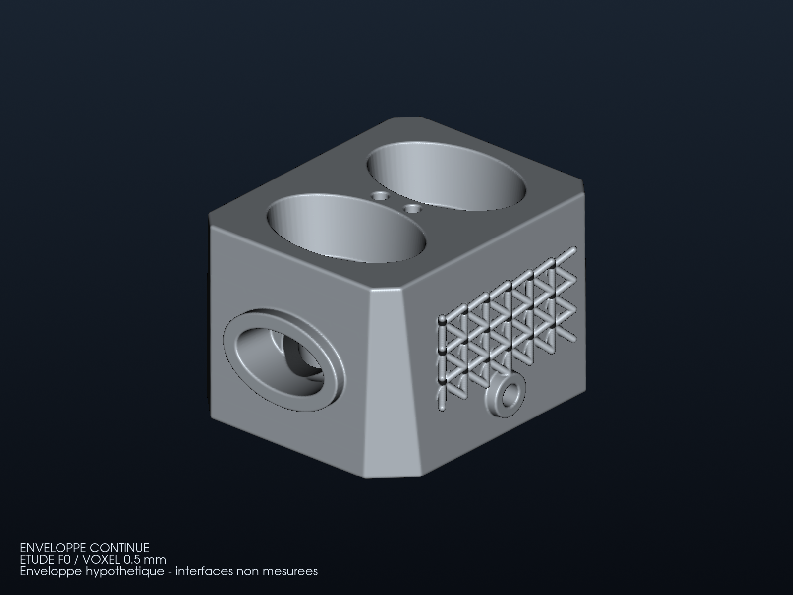
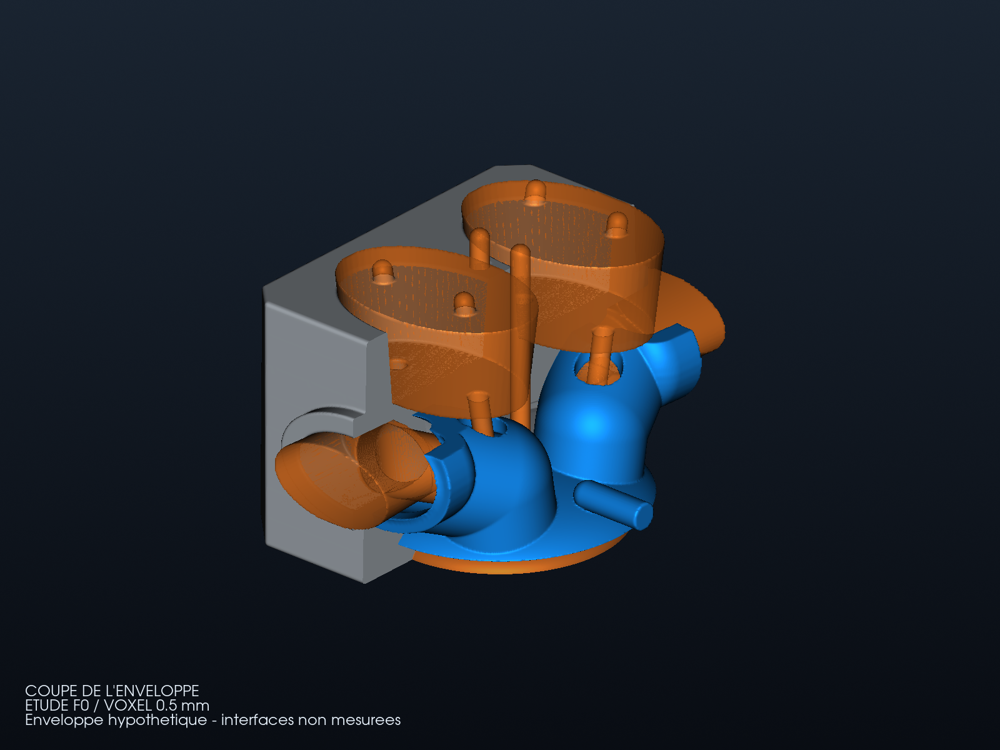
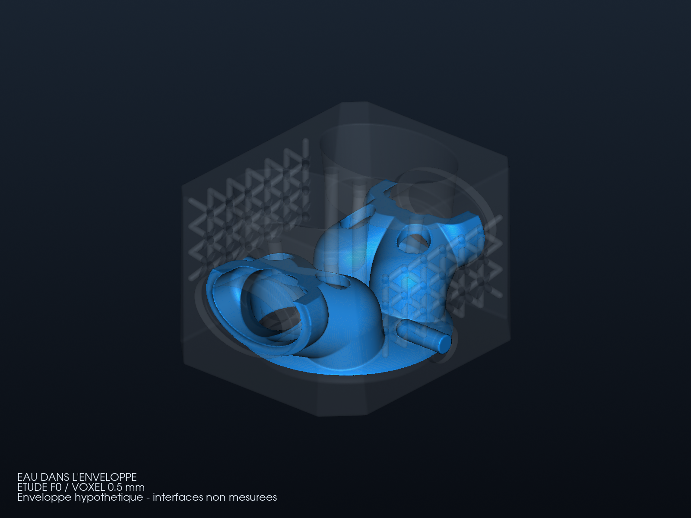

# Culasse : architecture observée et enveloppe calculée

La première charpente puis le bloc arrondi ne reproduisaient pas l'architecture
visible d'une culasse de 962 C. Cette variante utilise les
[photographies examinées](ORIGINAL_ARCHITECTURE.md), ShapeKernel et PicoGK :
corps chanfreiné, deux poches ouvertes de ressorts, conduits réunis par paire,
bossages ovales et enveloppe d'eau conforme. La variante ajoute des nervures BCC extérieures avec LatticeLibrary et
[échange les champs géométriques en VDB](BIONIC_FIELDS.md). Les images montrent les vrais
maillages calculés ; toutes les dimensions restent des hypothèses.

## Extérieur



## Coupe de l'enveloppe



La coupe virtuelle à X = 0,25 mm conserve la moitié opposée à la caméra et
ferme ses faces de coupe. Les volumes orange sont des réservations, pas des
soupapes ou des bougies assemblées. Le bleu représente l'eau, sans résultat
de température ou de pression.

## Eau à l'intérieur du corps transparent



## Sources et limites

Le [générateur de base](source/architecture/Head962ArchitectureStudy.cs) construit
les formes dans des repères locaux, module leurs sections et soustrait les
réservations. Quatre guides inclinés et deux puits de bougie sont représentés.
Le [runner à nervures](source/bionic/HeadBionicRunner.cs) ajoute des cellules
complètes reliées aux flancs, sans optimisation sous charges.
Les deux puits constituent notre adaptation moderne ; la photo de chambre
examinée montre une seule ouverture centrale. Les sièges, ressorts et bougies
assemblés ne sont pas représentés par les volumes orange.

La chemise suit les réservations de chambre et de gaz par offsets et booléens.
La séparation nominale eau/volume sec est de 4,5 mm et la peau extérieure
nominale de 5 mm, avant discrétisation et intersection : **ce ne sont pas
des épaisseurs qualifiées**. Il faut encore examiner purge, dépowdering,
supports, écoulement, fatigue et maintien des guides/sièges. Le
[contrat d'interfaces](interface-contract.json) reste inconnu.

Le [rapport de la variante à nervures](derived/bionic-report.json) conserve les
empreintes des sources, bibliothèques, maillages, sondes et images. La
fermeture d'un maillage ne prouve ni résistance ni étanchéité physique.
La circulation de l'eau et l'amélioration thermique ne sont pas validées.

Les [vues sans nervures](derived/architecture-views/exterior.png) et leur
[rapport](derived/architecture-report.json), le
[bloc générique intermédiaire](STOCK_ENVELOPE.md) et le
[raffinement du routage initial](REFINEMENT.md) restent disponibles avec leurs
preuves originales. Aucun de ces modèles n'est une pièce montable sur 964/993.

## Sources et reproduction

La compilation et la relecture VDB de la variante suivent
[BIONIC_FIELDS.md](BIONIC_FIELDS.md). Les commandes ci-dessous reproduisent
l'architecture de base sans nervures.

Le [projet de compilation](source/architecture/Engine.csproj) utilise le
runtime PicoGK vérifié et les sources ShapeKernel identifiées dans les
[références](source/architecture/references.json). Il compile séparément des
générateurs précédents. Voir le [dossier](ORIGINAL_ARCHITECTURE.md) pour
l'assistance Qwen, les bibliothèques utilisées et les entrées manquantes.

```sh
dotnet build twins/962-cylinder-head-f0/source/architecture/Engine.csproj \
  -p:PicoGKBinaryRoot=/chemin/vers/le/runtime-F0-verifie \
  -p:ShapeKernelRoot=/chemin/vers/LEAP71_ShapeKernel \
  -o work/962-head/architecture-bin
```

Exécuter ce runner avec les trois spécifications
[solid](source/architecture/solid.json), [coolant](source/architecture/coolant.json)
et [dry-passages](source/architecture/dry-passages.json)
**sous le verrou commun** de
[run_part.py](../../parts/picogk-catalog/tools/run_part.py), avec les dylib
du runtime vérifié à côté du binaire. Les sorties locales retenues sont
`work/962-head/architecture-native-004/`. L'inspection et les vues sont rejouables :

```sh
python twins/962-cylinder-head-f0/source/architecture/inspect_and_render.py \
  work/962-head/architecture-native-004 \
  work/962-head/architecture-bin /chemin/vers/LEAP71_ShapeKernel \
  work/962-head/architecture-inspected-new
```

Le [script d'inspection/rendu](source/architecture/inspect_and_render.py) contrôle
les trois volumes et réutilise la coupe virtuelle fermée. La coupe utilise
[VTK ClipClosedSurface](https://vtk.org/doc/nightly/html/classvtkClipClosedSurface.html).
Les fichiers STL et binaires restent locaux ; les sources et rendus sont
partageables. Aucune fabrication ni performance moteur n'est autorisée.
