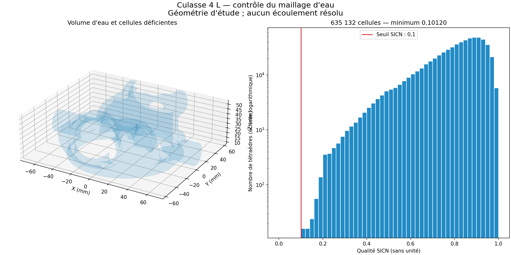

# Circuit d’eau 4 L : réparation MMG et admission OpenFOAM

Le maillage du **volume d’eau** passe maintenant
`checkMesh -allGeometry -allTopology` sur kali1 : **635 132 tétraèdres,
« Mesh OK. »** Les seuils n’ont pas été abaissés. Cette admission numérique
ne qualifie ni la culasse métallique ni un moteur de 1 000 ch.

Le [reçu de réparation](derived/coolant-mmg-20261025/repair-report.json)
lie les sources, les fichiers contrôlés et les journaux. Les
[rejets précédents](KALI_CFD_FOLLOWUP.md) restent conservés. Aucun maître
PicoGK, fichier métallique ou contrat antérieur n’a été modifié.
Le témoin géométrique est l’export PicoGK Ø102 inspecté de l’étude ; les
interfaces du donneur restent à mesurer.

*Rendu du fichier contrôlé à l’étape maillage, avant l’obtention d’une solution
d’écoulement. Il représente le circuit d’eau, pas l’enveloppe métallique.*

## Chaîne réellement utilisée

```mermaid
flowchart LR
  A[MSH conservé 542 188 cellules] --> B[MMG : optimisation, surface figée]
  B --> C[Gmsh et relecture indépendante]
  C --> D[SciPy : SICN, stencil et interpolation]
  D --> E[MMG local : entités imposées]
  E --> F[Trimesh : nouvelle paroi contre le maître]
  F --> G[SciPy : cinq points intérieurs]
  G --> H[Gmsh : relecture complète du MSH]
  H --> I[OpenFOAM : contrôle complet et garde-fou]
  I --> J[Résolution RANS séparée]
```

MMG 5.8.0 est construit dans le dossier utilisateur de kali1, depuis
[la révision officielle conservée](https://github.com/MmgTools/mmg/tree/4d8232c8aebfed877935d75d4d4a67e850962422).
Le commentaire PAX de l’archive source confirme cette révision. L’archive,
le binaire, le compilateur et les versions des outils sont liés dans le
[reçu runtime](derived/coolant-mmg-20261025/runtime.json). Il ne s’agit pas
d’une installation système ni d’une affirmation sur la dernière version.
La construction utilise CMake, `-DBUILD=MMG3D -DCMAKE_BUILD_TYPE=Release`, puis
`cmake --build build --parallel 2` ; le journal complet est dans la capsule.

La première passe `-optim -nosurf` produit 626 459 tétraèdres et conserve
exactement la triangulation de paroi. Les neuf cellules SICN déficientes
sont corrigées par l’optimiseur de points intérieurs déjà présent. Le
contrôle OpenFOAM relève cependant encore 259 déterminants insuffisants
et neuf poids d’interpolation insuffisants.

L’optimisation locale SLSQP est alors étendue aux **trois critères simultanés** :
SICN ≥ 0,1, déterminant de stencil ≥ 0,001 et poids d’interpolation ≥ 0,05.
La formule du déterminant reprend le calcul de Foundation 13 : tenseur des
vecteurs d’aire des faces internes, normalisé par leur aire moyenne. Pour les
tétraèdres, le poids d’interpolation est obtenu par le rapport des volumes
adjacents. Les essais analytiques vérifient échelle, rang et tétraèdre régulier.
Le contrôle natif confirme ensuite exactement les dix déterminants et trois
poids restant dans cette première dérivée.

Les essais de fusion ne sont pas sélectionnés. Le choix glouton de paires
convexes laisse une cellule, l’extension en triplet est refusée, et le choix
alternatif échoue encore au contrôle natif. `removeFaces` simplifie aussi
des faces de paroi ; une application conservant les triangles évite cette
modification mais ne résout pas les derniers défauts. Tous ces résultats
restent des rejets, distincts de la chaîne finalement admise.

## Réparation locale de la triangulation de paroi

Le second traitement MMG cible **1 080 cellules** autour des derniers défauts.
Le fichier d’entrée déclare **625 379 tétraèdres, 150 438 triangles et
144 463 sommets comme imposés** au moyen de `RequiredTetrahedra`,
`RequiredTriangles` et `RequiredVertices`. La sélection couvre deux couronnes
de voisinage par sommets ; elle est testée sur des régions disjointes.

Cette passe autorise une nouvelle triangulation locale de la paroi, avec
`-optim -hausd 0.000005`, en mètres. Le paramètre de cinq micromètres ne
constitue pas une preuve de distance : la nouvelle surface est contrôlée
séparément contre le volume d’eau natif d’origine. La passe termine en
**6,231 s** sous sa limite de 300 s, avec 635 132 tétraèdres et 152 944 triangles.

Le [contrôle indépendant de surface](derived/coolant-mmg-20261025/surface-screen.json)
confirme fermeture, orientation, une composante et Euler conservé. L’écart
maximal échantillonné sur les sommets et centres de triangles, dans les deux
sens, vaut **0,0491497 mm**, sous le budget inchangé de **0,0625 mm**.
Ce n’est pas une borne de Hausdorff continue. Le volume vaut
137 937,311 mm³, soit −0,003838 % par rapport à l’export natif.

Cette nouvelle paroi est liée à un nouveau reçu, sans réécrire celui de la
paroi précédente. La première vérification OpenFOAM de cette dérivée relève
quatre déterminants et un poids insuffisants. Une dernière optimisation de
**cinq points intérieurs**, par le même programme SLSQP, les corrige.

## Fichier final et contrôle natif

La [relecture complète](derived/coolant-mmg-20261025/final-readback.json)
recouvre tous les tétraèdres sauvegardés : volumes positifs, SICN recalculé
indépendamment, incidence et orientation des faces internes, identité des
triangles de frontière avec la nouvelle surface contrôlée et aucun nœud
inutilisé. Les STL sont en mm ; les MSH et les cas OpenFOAM sont en m.

| Mesure finale | Valeur |
|---|---:|
| Tétraèdres | 635 132 |
| SICN minimum | 0,1012038134 |
| Cellules sous SICN 0,1 | 0 |
| Différence maximale de coordonnées entre frontière sauvegardée et surface liée | 0 mm |
| Déterminant minimal OpenFOAM | 0,0010004422 |
| Poids minimal d’interpolation OpenFOAM | 0,0505 |
| Skewness maximal OpenFOAM | 1,71623 |
| Non-orthogonalité maximale | 82,06699° |

Le [journal natif final](derived/coolant-mmg-20261025/case-015-checkMesh.txt)
et le [reçu du garde-fou](derived/coolant-mmg-20261025/openfoam-mesh.json)
confirment l’admission. Les 617 faces au-dessus de 70° restent un avertissement
numérique du contrôle natif ; la marge du plus petit déterminant reste faible.
L’admission ne remplace donc pas une étude de convergence et de sensibilité.

SHA-256 du MSH final :
`5cf9923844e8cacfffc6b7c0e427b60e8f0745602330a99aacb48082ba81e0c8`.

## Reproduction

Utiliser un environnement avec Gmsh 4.15.2, NumPy 2.2.6, SciPy 1.17.1,
trimesh 5.1.1 et Rtree 1.4.1 ; le rendu utilise Matplotlib 3.10.8. Chaque
sortie doit être un dossier neuf. Les noms suivants décrivent les fichiers
conservés ; une nouvelle exécution peut produire d’autres identités binaires.

1. Depuis `mesh-010/coolant.msh`, écrire un fichier MEDIT avec `gmsh.open`,
   puis `gmsh.write("input.mesh")`, sans remaillage ni changement d’unité.
2. Exécuter MMG : `-in input.mesh -out repaired.mesh -optim -nosurf -m 3000 -v 5`.
3. Restaurer les références physiques avec
   [import_mmg.py](source/coolant_flow/import_mmg.py), puis exécuter
   [read_saved.py](source/coolant_flow/read_saved.py) contre `surface-004`.
4. Appliquer [relocate_nodes.py](source/coolant_flow/relocate_nodes.py), relire,
   puis [relocate_stencil.py](source/coolant_flow/relocate_stencil.py) et relire.
5. Préparer les entités imposées avec
   [prepare_mmg_local.py](source/coolant_flow/prepare_mmg_local.py), puis lancer
   MMG avec `-optim -hausd 0.000005 -m 3000 -v 5` sur ce nouvel input.
6. Exécuter [mmg_surface_exchange.py](source/coolant_flow/mmg_surface_exchange.py)
   avec l’empreinte transférée du MEDIT, le maître natif et son empreinte.
   Ce programme conserve l’import initial, produit une surface séparée,
   réutilise le contrôleur de surface, puis lie et relit le volume.
7. Réappliquer `relocate_stencil.py` au volume lié, puis `read_saved.py`
   contre cette nouvelle surface. Préparer le cas avec
   [prepare_kali_bound_case.py](source/coolant_flow/prepare_kali_bound_case.py).
8. Dans Foundation 13, exécuter le cas neuf avec `Allrun.sh` pour quatre
   processus ou [run_kali_serial.sh](source/coolant_flow/run_kali_serial.sh)
   pour un processus, sous les limites externes du travail. Les empreintes
   des entrées et le garde-fou de maillage précèdent obligatoirement le solveur.

Les passes MMG sont limitées à 300 s, un cœur, 4 Gio sans swap. Le cas de
résolution est limité à 1 800 s de solveur et 6 Gio sans swap. Le runtime
Foundation 13 utilise les chemins standards dans Bubblewrap, sans changer
les droits du système. Les empreintes et la liste des fichiers complets
figurent dans le [reçu de livraison](derived/coolant-mmg-20261025/delivery.json).
Les grandes géométries et les essais complets restent dans l’archive locale,
hors Git ; sources, rapports, journaux normalisés et rendu sont versionnés.

## Résolution et vérifications logicielles

La résolution RANS isotherme k–ω SST a démarré après l’admission du maillage,
au débit exploratoire de **48,6236 L/min par culasse**. Les paramètres restent
des hypothèses : 965 kg/m³ et 0,000315 Pa·s. Le
[cas préparé](derived/coolant-mmg-20261025/prepared-case.json) lie ses 18 entrées.
Le [premier essai borné](derived/coolant-mmg-20261025/flow-stop.json)
s’arrête à la limite de **1 800 s de solveur**, code 124, après 929 itérations
complètes et pendant l’itération 930. Le critère résiduel 10⁻⁵ n’est pas
satisfait. Le dernier instant sauvegardé est l’itération 900 et ne représente
pas l’état du dernier pas terminé. **Aucun résultat hydraulique convergé n’est
admis.** L’[extrait du journal](derived/coolant-mmg-20261025/flow-stop-excerpt.txt)
est lié au journal complet par son empreinte.

Les champs et journaux de cet essai sont conservés dans une
[capsule d’arrêt distincte](derived/coolant-mmg-20261025/flow-stop-delivery.json).
Ils ne sont pas ajoutés rétroactivement à la capsule de réparation du maillage.
Une reprise depuis l’itération 900, avec une nouvelle recette et ses propres
preuves de convergence, reste un travail distinct de l’admission obtenue ici.

L’échec de `mpirun --version` provenait de fichiers d’aide absents et ne
prouvait pas une panne du lanceur. Le lancement à deux processus, puis
la résolution native sur quatre processus, fonctionnent. Le calcul parallèle
en double est arrêté explicitement après 92 itérations ; le calcul séquentiel,
alors à 208 itérations, est conservé. Cet arrêt ne signifie pas convergence.

Les **250 tests culasse passent**, dont cinq ignorés faute de VTK ; les neuf
nouveaux tests passent. Le passage `make check` dans l’environnement local
d’outillage atteint 4 213 tests, avec deux écarts de flottants sur des modules
de ventilateur non modifiés, huit erreurs de dépendances/API et 172 ignorés.
Il précède l’activation des dépendances de rendu et n’est pas vert. Le
[passage avec les dépendances déclarées par la CI](derived/coolant-mmg-20261025/software-checks.json)
atteint ensuite **4 237 tests**, avec **deux échecs de flottants et aucune
erreur**, ainsi que 232 tests ignorés. Ces deux échecs concernent les mêmes
modules de ventilateur non modifiés ; aucun passage global local vert n’est
revendiqué. Les outils de géométrie et leurs contrôles effectifs restent
vérifiés séparément de cet environnement de tests.

Le métal, la CHT, la tenue mécanique, le cliquetis SP95, les interfaces du
donneur, le procédé LPBF et la puissance moteur restent hors de cette admission.
