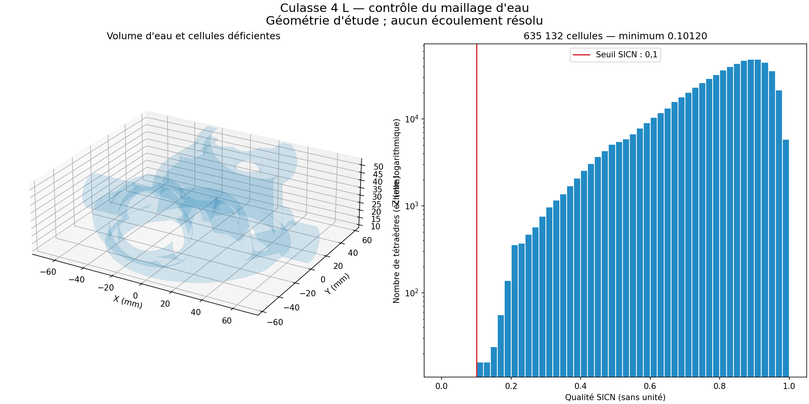

# 4 L water circuit: MMG repair and OpenFOAM admission

The mesh of the **water volume** now passes
`checkMesh -allGeometry -allTopology` on kali1: **635,132 tetrahedra,
« Mesh OK. »** The thresholds were not lowered. This numerical admission
qualifies neither the metal cylinder head nor a 1,000 hp engine.

The [repair receipt](derived/coolant-mmg-20261025/repair-report.json)
links the sources, the checked files and the logs. The
[earlier rejections](KALI_CFD_FOLLOWUP.md) remain kept. No PicoGK
master, metal file or earlier contract was modified.
The geometric witness is the inspected Ø102 PicoGK export of the study; the
donor interfaces remain to be measured.

*Render of the file checked at the meshing step, before any flow solution
was obtained. It shows the water circuit, not the metal envelope.*

## Chain actually used

MMG 5.8.0 is built in the user directory of kali1, from
[the kept official revision](https://github.com/MmgTools/mmg/tree/4d8232c8aebfed877935d75d4d4a67e850962422).
The PAX comment of the source archive confirms this revision. The archive,
the binary, the compiler and the tool versions are linked in the
[runtime receipt](derived/coolant-mmg-20261025/runtime.json). This is not
a system installation nor a claim about the latest version.
The build uses CMake, `-DBUILD=MMG3D -DCMAKE_BUILD_TYPE=Release`, then
`cmake --build build --parallel 2`; the complete log is in the capsule.

The first `-optim -nosurf` pass produces 626,459 tetrahedra and keeps
the wall triangulation exactly. The nine deficient SICN cells
are corrected by the interior-point optimiser already present. The
OpenFOAM check nevertheless still reports 259 insufficient determinants
and nine insufficient interpolation weights.

The local SLSQP optimisation is then extended to **three simultaneous criteria**:
SICN ≥ 0.1, stencil determinant ≥ 0.001 and interpolation weight ≥ 0.05.
The determinant formula follows the Foundation 13 computation: tensor of the
area vectors of the internal faces, normalised by their mean area. For
tetrahedra, the interpolation weight is obtained from the ratio of the adjacent
volumes. The analytical tests check scale, rank and the regular tetrahedron.
The native check then confirms exactly the ten determinants and three
weights remaining in this first derivative.

The merge trials are not selected. The greedy choice of convex
pairs leaves one cell, the triplet extension is refused, and the alternative
choice still fails the native check. `removeFaces` also simplifies
wall faces; an application that keeps the triangles avoids this
modification but does not resolve the last defects. All these results
remain rejections, distinct from the chain finally admitted.

## Local repair of the wall triangulation

The second MMG treatment targets **1,080 cells** around the last defects.
The input file declares **625,379 tetrahedra, 150,438 triangles and
144,463 vertices as required** by means of `RequiredTetrahedra`,
`RequiredTriangles` and `RequiredVertices`. The selection covers two vertex
neighbourhood rings; it is tested on disjoint regions.

This pass allows a new local triangulation of the wall, with
`-optim -hausd 0.000005`, in metres. The five-micrometre parameter does not
constitute proof of distance: the new surface is checked
separately against the original native water volume. The pass finishes in
**6.231 s** under its 300 s limit, with 635,132 tetrahedra and 152,944 triangles.

The [independent surface check](derived/coolant-mmg-20261025/surface-screen.json)
confirms closure, orientation, a single component and preserved Euler characteristic. The maximum
sampled deviation over the vertices and triangle centres, in both
directions, is **0.0491497 mm**, under the unchanged budget of **0.0625 mm**.
This is not a continuous Hausdorff bound. The volume is
137,937.311 mm³, i.e. −0.003838 % relative to the native export.

This new wall is linked to a new receipt, without rewriting that of the
previous wall. The first OpenFOAM verification of this derivative reports
four insufficient determinants and one insufficient weight. A final optimisation of
**five interior points**, by the same SLSQP program, corrects them.

## Final file and native check

The [complete read-back](derived/coolant-mmg-20261025/final-readback.json)
covers all saved tetrahedra: positive volumes, SICN recomputed
independently, incidence and orientation of the internal faces, identity of the
boundary triangles with the new checked surface and no unused
node. The STLs are in mm; the MSH and the OpenFOAM cases are in m.

| Final measure | Value |
|---|---:|
| Tetrahedra | 635,132 |
| Minimum SICN | 0.1012038134 |
| Cells below SICN 0.1 | 0 |
| Maximum coordinate difference between saved boundary and linked surface | 0 mm |
| Minimum OpenFOAM determinant | 0.0010004422 |
| Minimum OpenFOAM interpolation weight | 0.0505 |
| Maximum OpenFOAM skewness | 1.71623 |
| Maximum non-orthogonality | 82.06699° |

The [final native log](derived/coolant-mmg-20261025/case-015-checkMesh.txt)
and the [guard receipt](derived/coolant-mmg-20261025/openfoam-mesh.json)
confirm the admission. The 617 faces above 70° remain a numerical
warning of the native check; the margin of the smallest determinant remains small.
The admission therefore does not replace a convergence and sensitivity study.

SHA-256 of the final MSH:
`5cf9923844e8cacfffc6b7c0e427b60e8f0745602330a99aacb48082ba81e0c8`.

## Reproduction

Use an environment with Gmsh 4.15.2, NumPy 2.2.6, SciPy 1.17.1,
trimesh 5.1.1 and Rtree 1.4.1; the render uses Matplotlib 3.10.8. Each
output must be a new directory. The following names describe the kept
files; a new execution may produce other binary identities.

1. From `mesh-010/coolant.msh`, write a MEDIT file with `gmsh.open`,
   then `gmsh.write("input.mesh")`, without remeshing or change of unit.
2. Run MMG: `-in input.mesh -out repaired.mesh -optim -nosurf -m 3000 -v 5`.
3. Restore the physical references with
   [import_mmg.py](source/coolant_flow/import_mmg.py), then run
   [read_saved.py](source/coolant_flow/read_saved.py) against `surface-004`.
4. Apply [relocate_nodes.py](source/coolant_flow/relocate_nodes.py), read back,
   then [relocate_stencil.py](source/coolant_flow/relocate_stencil.py) and read back.
5. Prepare the required entities with
   [prepare_mmg_local.py](source/coolant_flow/prepare_mmg_local.py), then launch
   MMG with `-optim -hausd 0.000005 -m 3000 -v 5` on this new input.
6. Run [mmg_surface_exchange.py](source/coolant_flow/mmg_surface_exchange.py)
   with the transferred digest of the MEDIT, the native master and its digest.
   This program keeps the initial import, produces a separate surface,
   reuses the surface checker, then links and reads back the volume.
7. Reapply `relocate_stencil.py` to the linked volume, then `read_saved.py`
   against this new surface. Prepare the case with
   [prepare_kali_bound_case.py](source/coolant_flow/prepare_kali_bound_case.py).
8. In Foundation 13, run the new case with `Allrun.sh` for four
   processes or [run_kali_serial.sh](source/coolant_flow/run_kali_serial.sh)
   for one process, under the external limits of the job. The input digests
   and the mesh guard must precede the solver.

The MMG passes are limited to 300 s, one core, 4 GiB without swap. The solve
case is limited to 1,800 s of solver time and 6 GiB without swap. The
Foundation 13 runtime uses the standard paths in Bubblewrap, without changing
system permissions. The digests and the list of complete files
appear in the [delivery receipt](derived/coolant-mmg-20261025/delivery.json).
The large geometries and the complete trials remain in the local archive,
outside Git; sources, reports, normalised logs and render are versioned.

## Solve and software checks

The isothermal k–ω SST RANS solve started after the mesh admission,
at the exploratory flow rate of **48.6236 L/min per cylinder head**. The parameters remain
assumptions: 965 kg/m³ and 0.000315 Pa·s. The
[prepared case](derived/coolant-mmg-20261025/prepared-case.json) links its 18 inputs.
The [first bounded trial](derived/coolant-mmg-20261025/flow-stop.json)
stops at the limit of **1,800 s of solver time**, code 124, after 929 complete
iterations and during iteration 930. The 10⁻⁵ residual criterion is not
satisfied. The last saved time is iteration 900 and does not represent
the state of the last completed step. **No converged hydraulic result is
admitted.** The [log excerpt](derived/coolant-mmg-20261025/flow-stop-excerpt.txt)
is linked to the complete log by its digest.

The fields and logs of this trial are kept in a
[separate stop capsule](derived/coolant-mmg-20261025/flow-stop-delivery.json).
They are not added retroactively to the mesh repair capsule.
A restart from iteration 900, with a new recipe and its own
convergence evidence, remains work distinct from the admission obtained here.

The failure of `mpirun --version` came from missing help files and did not
prove a launcher fault. The two-process launch, then
the native solve on four processes, work. The duplicate parallel computation
is stopped explicitly after 92 iterations; the sequential computation,
then at 208 iterations, is kept. This stop does not mean convergence.

The **250 cylinder-head tests pass**, of which five are skipped for lack of VTK; the nine
new tests pass. The `make check` run in the local tooling
environment reaches 4,213 tests, with two floating-point discrepancies in unmodified
fan modules, eight dependency/API errors and 172 skipped.
It precedes the activation of the render dependencies and is not green. The
[run with the dependencies declared by the CI](derived/coolant-mmg-20261025/software-checks.json)
then reaches **4,237 tests**, with **two floating-point failures and no
error**, as well as 232 skipped tests. These two failures concern the same
unmodified fan modules; no green local global run is
claimed. The geometry tools and their effective checks remain
verified separately from this test environment.

The metal, the CHT, the mechanical strength, SP95 knock, the donor
interfaces, the LPBF process and the engine power remain outside this admission.
