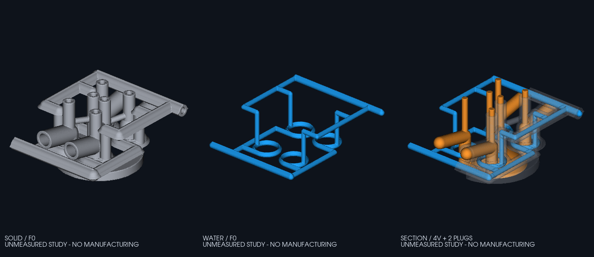
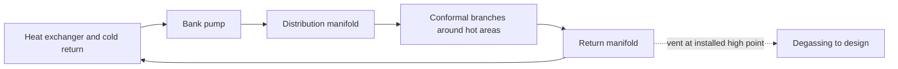

<a id="culasse-962-c--recherche-et-candidat-picogk-f0"></a>

# 962 C cylinder head: research and PicoGK F0 candidate

**Reference confirmed on October 16, 2026: the water-cooled 3.0 L 962 C head,
to develop the bionic family up to 4.0 L.** The
[recovered dimensions](DIMENSIONAL_BASIS.md) now anchor the study:
95 × 70.4 mm published for a 3.0 L, Ø35/30.5 mm family valves.
The [new configurable bionic model](BIONIC_FAMILY.md) continues geometry work
with explicit assumptions for unavailable dimensions.

The [engineering execution programme](ENGINEERING_PROGRAM.md) continues through
material/strength assessment, LPBF simulation, an Omniverse twin and PhysicsNeMo.
The [material-gap audit](derived/engineering/material-production-gap-audit/README.md)
adds a separate Nikon CP1 characterization lead and traces the matched hot-property,
fatigue and creep data still needed. Its coupon statistics do not select a head
material or qualify a production process.
The [latest head checkpoint](derived/engineering/apex1613790-head-application/README.md)
reduces the observed poor-cell count from **129 to 127** and supplies the exact
generated mesh as a lossless review download. All 44 replacement cells pass the
local SICN 0.1 gate; the whole head remains rejected, with unchanged minimum
SICN 0.039074265058645995. Head strength and manufacturing qualification remain open.
The [current 127-cell census](derived/engineering/current127-full-stars/README.md)
finds 101 interior seed nodes and their complete 3,137-cell incident union,
including 3,010 initially good cells and 99 cells shared by several seeds.
All 127 poor cells are covered; repair feasibility remains unproven.
The [next local study](derived/engineering/apex1613031-local-repair/README.md)
retains the complete nine-node shell extraction and its rejected first generation:
nine cells, one below SICN 0.1, minimum 0.05102133753836959. Its source, full
results and separate reviews are available; this checkpoint changes no head mesh.
The [saved Netgen successor](derived/engineering/netgen-apex1613031/README.md)
passes the local SICN 0.1 gate: fourteen cells, minimum 0.1008883740399272.
Its complete outputs and separate reviews are available; head replacement and
engineering qualification remain separate gates.
The [coarse thermoelastic follow-up](derived/engineering/cp1-oneway-thermoelastic-level1/README.md)
completes 80 steps and passes **15,734,237 scalar comparisons** under the same
absolute SI limits, using its own BEGIN40 birth reference. Complete fields and
saved-result reviews are retained. Mechanical convergence and physical qualification
remain open.
The [matched-time sensitivity diagnostic](derived/engineering/cp1-oneway-thermoelastic-time-sensitivity/README.md)
compares 81 saved coarse/fine END pairs and all 225 own-birth references.
It retains complete counts and maximum witnesses for 3,854,107 END scalar pairs;
the largest postbirth stress-component difference is about 1.65 kPa.
This is a fixed synthetic sensitivity result, with no convergence order or
cross-level acceptance threshold. Head and material/process qualification remain open.
The [corrected one-way thermoelastic coupon](derived/engineering/cp1-oneway-thermoelastic-transfer/README.md)
passes 31,241,797 scalar comparisons under the unchanged SI limits. Its complete
fields, source, earlier setup failure and separate saved-result reviews are retained.
Acceptance covers one synthetic software case with assumed material properties;
head strength, mechanical convergence and material/process qualification remain open.
The [grouped-scaling mechanics cube](derived/engineering/moose-local-grouped-scaling-cube/README.md)
passes the unchanged analytical field, energy and saved-algebra checks. The
[earlier runtime checkpoint](derived/engineering/moose-local-runtime/README.md)
retains the first strict rejection. Head physics and material qualification remain open.
The [completed partial head replacement](derived/engineering/head-star-replacement/README.md)
passes its local 39-cell and full save/reopen procedure. It reduces poor cells
from 210 to **208**, while the whole head still fails SICN 0.1. No head strength
result follows. The [fresh complete census](derived/engineering/head-star-remaining-full-stars/README.md)
finds 155 interior seed nodes and 5,327 incident cells, including 5,119 currently
good cells that the next repair must preserve. All 208 poor cells are covered;
the fresh boundary-node bins are [0, 0, 15, 193, 0]. Repair feasibility remains open.
The [current coordinate trial](derived/engineering/head-star-remaining-sicn-proposer-rejected/README.md)
returned solver success but failed the unchanged quality gate: 213 analytic poor
cells, minimum SICN 0.07200216465522885. Its full 155-coordinate/5,327-quality
diagnostic is retained; no proposal or new head mesh was produced. At that
checkpoint the saved head remained at 208 poor cells. The subsequent
[local cavity study](derived/engineering/apex1474426-local-cavity/README.md)
preserves the rejected 57-cell generation and a saved Netgen result with
101 cells, all above SICN 0.1 (minimum 0.13807503254019585). All 32 shell
coordinates and 60 boundary faces remain fixed. A separate read-only parent
query records 38 exterior and 22 connected interfaces. The subsequent
[exact local-domain check](derived/engineering/apex1474426-domain/README.md)
passes all 1,770 old and 5,050 replacement cell pairs, preserving the same
32 node coordinates bit for bit, 60 oriented shell faces and exact occupied local region.
Independent saved-data checks confirm the complete associations; they do not
repeat the pair geometry. The subsequent
[native head application](derived/engineering/apex1474426-head-application/README.md)
completes the partial edit and full save/reopen procedure, reducing the observed
poor-cell count from **208 to 204**. All 101 replacement cells pass SICN 0.1;
outside tagged arrays, original classifications and source boundary remain
preserved. The saved head contains 1,097,057 nodes and 3,620,861 tetrahedra,
with minimum SICN 0.039074265058645995. Its whole-head quality gate still fails;
no head strength, material or manufacturing qualification follows.
The [current census and shell selection](derived/engineering/current204-batch-shells/README.md)
bind the 204-cell head to 154 complete seed stars and 5,267 incident cells.
A separate saved-data pass selects 116 vertex-disjoint regions containing
4,164 original cells, including 172 poor and 3,992 currently good cells.
Two candidate shells fail a necessary face screen; all negative and conflict
records remain complete. This is a finite repair target; the mesh is unchanged.
The [completed local stages](derived/engineering/current204-local-stages/README.md)
retain 115 rejected generation cases and their separate Netgen attempts:
47 pass local quality/storage checks and 68 fail quality. The held first attempt
remains unretried. Complete arrays, tiny meshes, contracts, execution records and
the 116-region parent context are included. The subsequent
[47 exact local-domain checks](derived/engineering/current204-case-domains/README.md)
complete all 147,917 old/candidate cell pairs and 8,283,352 plane-triple
attempts. All local-domain queries pass; independent saved-association review
and root acceptance are retained with complete lossless reports. The regions
cover 75 original poor cells. The subsequent
[combined head application](derived/engineering/current204-combined-application/README.md)
completes the 47-region replacement and full save/reopen audits, reducing the
observed count **204 to 129**. All 2,972 replacement cells pass SICN 0.1; outside
tagged arrays, original classifications and source boundary remain preserved.
Independent review checks every replacement mapping and all 8,916 native metric
words without replaying global geometry. The saved head has 1,097,219 nodes and
3,621,755 tetrahedra. Its unchanged minimum SICN 0.039074265058645995 and 129
remaining poor cells still reject the whole head; the stronger 414 Mesh_2
failures remain open.
The [census and thermoelastic setup checkpoint](derived/engineering/current129-thermoelastic-setup/README.md)
retains all 129 poor cells in 102 complete seed stars: 3,165 incident cells,
including 3,036 initially good cells. Its controller used a different, already
pinned Python than declared; the deviation is preserved and acceptance covers
the observed query and saved associations only.
The same checkpoint preserves all 54,675 original temperature tokens transferred
to three mechanical input tables, including the BEGIN80 reference on all 225
born nodes and 25 shared nodes. The first mechanical attempt then failed during
setup because its temperature initial conditions overlapped. All 22 stopped
files are retained; no timestep, stress field or mechanical assessment completed.
The [assumed-material thermal coupon](derived/engineering/cp1-assumed-thermal-birth-failed/README.md)
failed its first time step: 33 internal cutbacks, zero converged steps and no
energy assessment. The full failure and initial fields are retained. Its
rho = 2700 kg/m³, cp = 900 J/(kg K) and k = 187 W/(m K) are research assumptions;
no accepted thermal, material or LPBF result follows.
The separate [LINEAR thermal coupon](derived/engineering/cp1-assumed-thermal-birth-linear/README.md)
completes 160 steps to 0.4 s. The unchanged independent assessor passes all
93,189 field, source, history and energy checks: maximum step energy defect
2.1964e-8 J against 1e-7 J, and continuous relative energy error 0.37577%
against 1%. All original fields and the failed Newton history remain retained.
The subsequent [fixed three-level energy-error check](derived/engineering/cp1-assumed-thermal-birth-linear-refinement/README.md)
adds separately assessed 40- and 80-step runs without changing that finest result.
Maximum absolute relative errors are 1.49219%, 0.751924% and 0.375766%; ratios
1.98449 and 2.00104 pass the unchanged 1.4 requirement, with the finest below 1%.
This verifies the synthetic coupon's energy-error refinement criterion. Full-field
and spatial convergence, the original Newton criterion, matched material, head
strength and calibrated LPBF qualification remain open.
The [latest bore95 USD checkpoint](USD_NORMALS_ENGINEERING.md) verifies face
normals and passes the minimum and CPU asset checks; its formal robotics profile
retains six failed feature rows. No head physics or manufacturing qualification
follows from these results.
The [native mesh-guard diagnosis](derived/engineering/remaining266-native-profiles/README.md)
now identifies the obstruction in the rejected endpoint003 snapshot: all 135
queried edges pass topology and custom placement, then fail the unchanged
adjacent-area ratio guard. Three native literal references and independent
arithmetic checks support this diagnosis; no geometry was changed.
The [later atomic cavity repair](ATOMIC_CAVITY_ENGINEERING.md) exports a separate
candidate with all 266 remaining poor facets removed. Complete independent
array readback, global topology/intersection and two-sided distance checks pass.
Its maximum deviation bound is 0.032864 mm against the unchanged 0.0625 mm
budget. The 228-patch and eight-opening-point screens pass; volume-mesh
admission and head physics remain open.
The [repaired-surface BIN/PLY review](derived/engineering/atomic-cavity-review-delivery/README.md)
is uploaded with its checksum and complete 143-member manifest; all 33 earlier
draft-release assets remain unchanged.
The [subsequent raw-volume trial](ATOMIC_VOLUME_ENGINEERING.md) saves an exact
boundary mesh, but independent readback confirms 283,853 tetrahedra below SICN
0.1. Its positive volumes do not grant volume-quality or head-physics acceptance.
The [exact rejected MSH and evidence ZIP](derived/engineering/atomic-cavity-volume-raw-review-delivery/README.md)
is uploaded with its member manifest and checksum. All 34 archive members pass
independent full-byte checks; all 36 preceding release assets remain intact.
The [later optimizer and diagnosis](derived/engineering/atomic-cavity-volume-followup/README.md)
record a 20-minute stop without export, followed by a completed read-only query:
245,420 poor cells contain four boundary nodes. Moving only interior nodes with
unchanged connectivity cannot repair those cells; volume quality remains rejected.
The [assumed z=0 finishing trial](derived/engineering/atomic-cavity-plane-clip/README.md)
passes four exact-construction clipping fixtures. Its separate head proposal
retains 3,112 poor surface faces; local repair and fresh geometry checks are
required before volume meshing.
The [complete clipped-head array readback](derived/engineering/atomic-cavity-plane-clip-readback/README.md)
verifies every retained coordinate byte and classifies all poor faces: 2,396
on the cap, 716 touching its rim and none away from the plane. This scopes the
next local repair; it does not admit the clipped surface or volume.
The [rejected clipped BIN/PLY download](derived/engineering/atomic-cavity-plane-clip-raw-review-delivery/README.md)
is uploaded with its manifest and checksum. All 129 members pass independent
complete byte checks; the three new GitHub assets preserve all 39 predecessors.
The [later connected-patch census](derived/engineering/atomic-cavity-plane-clip-patch-census/README.md)
finds one 9,872-face incident region with six abstract boundary cycles. Its
local manifold checks pass; it is not a disk or an approved repair region.
The [fresh whole-surface reference](derived/engineering/atomic-cavity-plane-clip-topology/README.md)
measures one component and Euler −208, with no manifold defects or global
self-intersections. The 3,112-face quality rejection remains unchanged.
The [read-only repair reference](derived/engineering/atomic-cavity-plane-clip-repair-reference/README.md)
checks equal fixed masks and maps the planar cap as an abstract annulus with
two boundary cycles. Exact shortest-edge groups and an exploratory mixed-face
subset are recorded; no keeper or repair constraint is selected.
The [separate cap-aware repair trial](derived/engineering/atomic-cavity-plane-clip-cap-aware-repair/README.md)
adds a cap inspection plot, exact rim screening and four verified native fixtures.
Its boundary-only head proposal is rejected: native in-memory quality reports
1,122 poor faces, down from 3,112, and exports no candidate. Later topology,
neighbor and envelope checks were not reached; head physics remains open.
The [later mixed-side and cap refinement](derived/engineering/atomic-cavity-plane-clip-cap-refinement/README.md)
passes the necessary q≥2/29 gate on all 8,976 saved cap triangles, with
3,092 new interior points and all 38 fixed cells retained. The stronger Mesh_2
shape criterion still fails on 414 active faces. That cap-only checkpoint
does not admit the full head.
The [later assembled-surface checkpoint](derived/engineering/atomic-cavity-plane-clip-cap-assembly/README.md)
has 871,731 vertices and 1,743,878 faces, all meeting q≥2/29,
zero global self-intersection pairs and preserved local exterior/boundary
continuity. The eight retained opening-point screens and 16,218 affected
neighbor checks pass within their stated scopes. The original-to-assembled
distance upper bound is 0.03197034 mm; the original reverse CUB attempt hits its
native allocation cap and returns no interval. That checkpoint preserves the
incomplete result; the 414 stronger shape failures stay separate and unchanged.
The [subsequent CGAL distance assessment](derived/engineering/atomic-cavity-plane-clip-cap-assembly-distance-cgal/README.md)
completes both reverse source partitions against the full original analysis
mesh. Combined with the retained forward result, the two-way interval is
**[0.03283858206618785, 0.03288858206618786] mm**, passing the unchanged
0.0625 mm representation budget. The reference is an analysis mesh, not an OEM
measurement; no floating-point roundoff certificate is claimed. Volume quality
and head physics remain open.
The [subsequent assembled-head volume trial](derived/engineering/atomic-cavity-plane-clip-cap-assembly-volume/README.md)
saves 2,989,608 tetrahedra with the exact surface boundary. Independent saved-file
reading confirms 78,301 referenced interior nodes, positive volumes and exact
tagged arrays, but **285,573 cells fail SICN 0.1**; the minimum is
3.784626658982107e-9. The volume remains rejected, with no head thermal or
strength result. No mesh generation or optimization occurs in that readback.
The [later complete poor-cell classification](derived/engineering/atomic-cavity-plane-clip-cap-assembly-volume-poorcell-diagnosis/README.md)
finds 247,088 poor tetrahedra with four retained boundary vertices and 38,485
with at least one interior vertex. With connectivity and boundary coordinates
fixed, interior-node movement cannot repair the first group. Connectivity
changes remain a separate option; no repair or boundary-change necessity is
established by this diagnosis.
The [separate rejected-HXT review archive](derived/engineering/atomic-cavity-plane-clip-cap-assembly-volume-review-delivery/README.md)
is complete locally, with all 84 members independently byte-verified. Release
asset upload remains pending; the archived volume is still rejected.
The [separate Delaunay trial and saved-file first pass](derived/engineering/atomic-cavity-plane-clip-cap-assembly-delaunay/README.md)
records 3,961,773 tetrahedra and 73,924 below SICN 0.1, including one
nonpositive SICN value. Full first-pass boundary checks are saved; both deadline
stops and the unfinished final reopen remain explicit. This volume is rejected.
The [completed default optimizer and independent diagnosis](derived/engineering/atomic-cavity-plane-clip-cap-assembly-delaunay-default-postexport/README.md)
record 3,802,217 tetrahedra, 3,438 positive cells below SICN 0.1 and no
nonpositive metrics. Independent saved-file arrays and metrics match the
optimizer's after-proof. Of the poor cells, 1,435 use only retained boundary
vertices and 2,003 involve an interior vertex. With connectivity and boundary
coordinates fixed, interior movement alone cannot repair the first group.
The unchanged quality gate still rejects this volume; no head field is accepted.
The [saved Netgen cube fixture](derived/engineering/atomic-cavity-plane-clip-cap-assembly-netgen-cube/README.md)
passes its separate SICN 0.1 gate: 191 to 40 tetrahedra, 42 to 15 nodes and
minimum SICN 0.4780600202533193 after exact saved-file readback. Both generated
cube meshes and complete arrays are included. This toy software result supplies
no head mesh acceptance or physical qualification.
The [direct-SICN tiny attempt](derived/engineering/direct-sicn-cube-import-failure/README.md)
stops during SciPy import before any optimizer call, Gmsh calibration or mesh
export. Source/math and mocked lifecycle guards pass separately; the preserved
import failure establishes no optimizer result or head-repair feasibility.
The [completed tiny direct-SICN witness](derived/engineering/direct-sicn-cube-software-witness/README.md)
uses a separately reviewed existing runtime and passes the unchanged SICN 0.1
rule on all 12 cube tetrahedra, improving the native minimum from 0.0148139 to
0.7589466. Exact boundary, complete incidence and saved identity checks pass.
This coupled software result establishes no full-head feasibility or strength.
The [completed head Netgen trial](derived/engineering/atomic-cavity-plane-clip-cap-assembly-delaunay-netgen-postexport/README.md)
reduces SICN < 0.1 cells from 3,438 to 210, with minimum 0.039074265058645995.
Exact boundary, full incidence and saved-file identity checks pass; all Jacobians
and volumes are positive. The unchanged SICN 0.1 gate rejects this 3,620,809-cell
volume. The [independent saved-file diagnosis](derived/engineering/atomic-cavity-plane-clip-cap-assembly-delaunay-netgen-optimized-diagnosis/README.md)
matches every complete tagged array and native metric. All 210 poor cells
involve interior nodes: 15 have two source-boundary nodes and 195 have three.
This leaves interior adjustment open as a separate hypothesis; it establishes
neither repairability nor head acceptance.
The [completed Relocate3D trial](derived/engineering/atomic-cavity-plane-clip-cap-assembly-relocate3d-postexport/README.md)
increases the poor-cell count to 226 and lowers minimum SICN to
0.038263551144442014. Exact boundary, tag/connectivity and saved-file identity
checks pass, but the unchanged quality gate rejects the mesh. The prior Netgen
result remains the better rejected baseline; no new poor-cell partition is inferred.
The [completed fixed-triple diagnosis](derived/engineering/atomic-cavity-plane-clip-cap-assembly-netgen-fixed-triples/README.md)
checks all 195 three-boundary-node poor cells: no isolated apex ceiling is at or
below SICN 0.1. The 144 distinct interior apices still require complete shared-star
constraints; no repair, exterior-face membership or head acceptance is established.
The [complete seed-star census](derived/engineering/atomic-cavity-plane-clip-cap-assembly-netgen-full-stars/README.md)
identifies 156 candidate interior nodes and 5,355 incident tetrahedra: 210 poor
and 5,145 initially good. It retains 468 possible coordinate variables and the
complete geometric census data. No joint feasibility, optimization or new
candidate mesh is established; the saved head remains rejected.
The [bounded coordinate trial](derived/engineering/direct-sicn-head-proposer-rejected/README.md)
records solver-reported success but fails the unchanged all-cell 0.1 gate:
reported analytic minimum 0.0720022, with 215 of 5,355 cells below 0.1.
No final coordinate proposal or head mesh was exported; final-coordinate replay
is unavailable. This establishes no global infeasibility or head acceptance.
The [sparse trust-constr cube witness](derived/engineering/direct-sicn-sparse-cube-software-witness/README.md)
passes all 12 analytic cell-quality checks with minimum 0.758855 while retaining
all eight boundary coordinate bit records. Its sparse solver and saved-row checks
are a software result; no Gmsh final-quality query, head application or head
feasibility is established by this small test.
The [expanded sparse solver attempt](derived/engineering/direct-sicn-sparse-head-proposer-memory-stop/README.md)
matched all 29,473 initial native cell qualities before a sampled 1 GiB memory
stop after 7.2 seconds. No returned point, final quality array or coordinate
proposal was produced. The preserved resource stop establishes no head
feasibility or new mesh; the strict 0.1 quality rule remains unchanged.
The [returned sparse-head diagnostic](derived/engineering/direct-sicn-sparse-head-proposer-returned-rejection/README.md)
retains 1,098 selected node positions and all 29,473 analytic qualities.
Its 315 cells below 0.1 and minimum 0.030665 fail the unchanged quality gate.
The full numeric diagnostic is retained losslessly alongside the failed report.
No accepted coordinate proposal or native head application was produced.
The [normalized initial-barrier trial](derived/engineering/direct-sicn-sparse-head-proposer-normalized-rejection/README.md)
retains a second complete returned diagnostic: minimum 0.067817, with 244 of
29,473 cells below the unchanged 0.1 gate. The epigraph inequalities also fail.
Every returned quality is independently reconstructed from the saved rows.
No coordinate proposal, native head application or feasibility result follows.
The [exact shared-apex ball screen](derived/engineering/atomic-cavity-plane-clip-cap-assembly-netgen-shared-fixed-triples-ball-screen/README.md)
checks all 55 pairs in 48 originally-poor shared-node groups using rational
necessary outer bounds. Zero disjoint pairs were certified; every result is
inconclusive. This establishes no shared-node feasibility or accepted mesh.
The [exact shared-node obstruction](derived/engineering/atomic-cavity-plane-clip-cap-assembly-netgen-shared-fixed-triples-exact-pair/README.md)
proves that two retained cells cannot both reach SICN 0.1 by moving their
shared node while their fixed coordinates and connectivity remain unchanged.
The result is for the exact geometric model; a local remesh is a separate
next study, with no accepted head mesh or physical qualification yet.
The [data-only cavity study](derived/engineering/direct-sicn-apex1435493-cavity-study/README.md)
retains the 28-cell star, its closed 16-node/28-face shell and exact local tag map.
All 28 faces pass the necessary fixed-face screen; no cavity remesh, stitch
or feasibility result follows from that screen.
The [fixed-shell cube generation witness](derived/engineering/fixed-shell-generation-cube/README.md)
produces 11 positive tetrahedra with minimum native SICN 0.37759006531653144.
All fixed boundary bits and saved arrays match, with independently checked
exact volume 343 mm³; this is synthetic software evidence only.
The [specific cavity generation](derived/engineering/fixed-shell-generation-apex1435493/README.md)
preserves all 16 shell coordinate bytes and 28 oriented faces. Ten of 34
positive tetrahedra fail SICN 0.1 (minimum 0.019921779104111692); the local
result is rejected and was never adopted into the head.
The [saved-cavity Netgen trial](derived/engineering/fixed-shell-netgen-apex1435493/README.md)
reduces ten poor cells to two among 39 positive tetrahedra, with minimum SICN
0.08909847620076504. Boundary and saved-reopen identity pass; the unchanged
0.1 quality gate still rejects this separate local result. Complete four-stage
arrays and independent exact checks are retained; no head adoption follows.
The [single two-apex construction](derived/engineering/fixed-shell-apex-optimum/README.md)
improves the two target cells but inverts three neighbours and leaves four
other cells below SICN 0.1. All 39 exact signed-quality rows are retained;
this analytic proposal is rejected and was never applied to a native mesh.
The [current fixed-triple screen](derived/engineering/fixed-shell-current-triples/README.md)
retains all 126 pair comparisons without a disjointness certificate; the result
is inconclusive. The [single coupled proposal](derived/engineering/fixed-shell-coupled-sicn/README.md)
then passes the exact positive-orientation and SICN 0.1 predicates for all 39
stored cells, with minimum approximately 0.1013770 and all 16 shell nodes fixed.
Independent saved-coordinate arithmetic confirms this local quality result.
The [exact local intersection check](derived/engineering/fixed-shell-coupled-embedding/README.md)
passes all 741 tetrahedron pairs. The [native application and saved readback](derived/engineering/fixed-shell-coupled-sicn-apply/README.md)
then preserve all candidate coordinates, connectivity and boundary data, with
all 39 native quality gates passing. The tiny MSH and complete independent
117-row check are included. Whole-head containment, replacement and strength
remain open.
The [expanded interior-node census](derived/engineering/atomic-cavity-plane-clip-cap-assembly-netgen-expanded-stars/README.md)
contains 1,098 movable nodes and 29,473 coupled cells, including all 210 poor
cells and 29,263 initially good cells. Its complete geometric JSON is retained
losslessly through gzip; all 10,969 other context nodes remain fixed.
This read-only expansion establishes no optimization or accepted head mesh.
The [current BIN/PLY and seven-map download](derived/engineering/atomic-cavity-plane-clip-cap-assembly-raw-review-delivery/README.md)
is uploaded to the existing draft release. All 151 archive members pass complete
independent byte checks; all 42 preceding assets remain unchanged (45 total).
The [sourced material comparison](ENGINEERING_MATERIALS.md) now separates seven
published recipes, discrete hot-strength points and conditional body masses.
These results do not select or qualify a material for the head.
The [mechanical material-state review](derived/engineering/material-mechanical-state/README.md)
finds no complete recipe-matched E, Poisson ratio, expansion and yield card among
the seven retained states. Missing properties and head load-path inputs remain
explicit; no generic constants or material selection are introduced.
The [producer-source refresh](derived/engineering/material-mechanical-source-refresh/README.md)
adds named CP1 process identities and expansion intervals, while retaining the
missing E, Poisson ratio and temperature-law inputs. Source/date limits remain
explicit; no retained material card or material selection is changed.
The [prepared vector elastic cube](derived/engineering/imported-elastic-cube-preparation/README.md)
includes an independently checked 15-node/40-tetrahedron ASCII adapter, with six
source guards and nine assessor guards. The later
[local MOOSE runtime checkpoint](derived/engineering/moose-local-runtime/README.md)
completes installation, three metadata commands and one native affine cube solve.
Its separate unchanged assessor rejects the saved relative residual:
4.4458188673751004e-10 exceeds the 1e-10 limit, while A=P passes. The failed
assessment and original outputs remain preserved; this is no accepted benchmark,
head strength result or qualified material.
The [later grouped-scaling cube](derived/engineering/moose-local-grouped-scaling-cube/README.md)
passes the unchanged assessor: all 45 displacement and 45 reaction values,
40 tensor records, energy/work and saved algebra checks. Its relative residual
is 6.9088221239268e-13 against the same 1e-10 limit. Card, source mesh, reference
and acceptance criteria remain unchanged. This verifies one fictitious software
cube; head strength, material and LPBF qualification remain open.
The [separate AlSi10Mg conductivity follow-up](MATERIAL_CONDUCTIVITY_FOLLOWUP.md)
adds measured directional points over 23–250 °C, with the treatment, missing
conditions and proposed interpolation kept explicit.
The [two native conductivity witnesses](MATERIAL_CONDUCTIVITY_WITNESS.md)
now pass 109 final-field checks each against an independent Kirchhoff reference.
They verify the separate scalar software laws on an assumed bar; head strength
and material/process qualification remain open.
The [imported-cube software witness](derived/engineering/head-imported-cube-witness/README.md)
passes a separate nine-node ASCII2.2 import, discrete P1 solve and complete
Exodus mesh/field readback. Its normalized field w has units mm²; the retained
25% continuum flux deficit prevents a convergence claim. It supplies software
evidence for the next head import, without head strength or LPBF qualification.
The [earlier analysis-surface evidence](ANALYSIS_QUALITY_ENGINEERING.md) passes
its quality, topology, intersection and 0.25 mm distance screens, while
exceeding the finest 0.0625 mm representation budget. Its checks remain
separate from the new atomic candidate and solved head fields.
The [earlier quality-candidate review download](derived/engineering/analysis-quality-review-delivery/README.md)
contains exact BIN and standard PLY files, with English unit/import guidance.
The [later raw volume-mesh review](derived/engineering/rejected-volume-seed-review-delivery/README.md)
includes its exact MSH and explicit quality rejection; it supplies no head
thermal, strength or LPBF result. The [separate sized-volume review](derived/engineering/rejected-sized-volume-review-delivery/README.md)
retains the next bulk-filled mesh and its independent quality rejection.

The [replica family](REPLICA_FAMILY.md) defines the reference, six displacement
targets, calculator and missing measurements. [962 C metrology](REPLICA_METROLOGY.md)
concerns the original; no dimensionally faithful CAD master is available yet.
This absence does not block the authorized bionic studies.

The modern studies below and the [conversion program](KIT_962_PROGRAMME.md)
for 911, 964 and 993 bases are preserved. Twin ignition, bionic shapes and the
1,000 metric-horsepower target belong to those derivatives; they do not define
the original. F0 remains a geometry witness; its interfaces and report do not
become those of an M64 or of the historical reference.

<a id="études-modernes-déjà-livrées"></a>

## Modern studies already delivered

The [4 L SP95 study head](FLOW4L_STUDY.md) has been generated:
22 mm water ports, bifurcated supply around the second ignition well,
three inspected domains and four views of the actual meshes.

The [Mezger 4 L twin-turbo SP95 sizing study](MEZGER_4L_SP95_EN.md) now defines
the 1,000 metric-horsepower crankshaft target, air, fuel and water requirements,
and exploratory sections for the next head variant.

**Previous target: a 962-inspired engine kit for 911, 964 and 993 bases,
with a 1,000 metric-horsepower development target.** The
[product program](KIT_962_PROGRAMME.md) defines scope, variants,
manufacturing and qualification criteria. F0 remains a geometry witness;
its interfaces and report do not become those of an M64.

This delivery starts the requested digital twin: water-cooled head,
four valves and two spark plugs per cylinder, branching architecture and
passages intended for an LPBF study. **F0 is a geometry study without measured
interfaces, thermal simulation or manufacturing authorization.** It is not
yet a calibrated twin of an identified 962 head.



<a id="ce-que-les-sources-établissent"></a>

## What the sources establish

The [Porsche “40 Years Group C” dossier](https://newsroom.porsche.com/dam/jcr:a6f33b52-c47d-47b4-98c1-7e963661f587/40%2520Years%2520Group%2520C.pdf),
pages 7 and 18–20, distinguishes air-cooled two-valve IMSA 962 engines from
four-valve 962 C engines. The fully water-cooled 3 L appears at the 1985
Le Mans practice sessions. The family includes 2,994 and 3,164 cm³ variants.
Heads and cylinders are aluminum; the alloy is not specified.
Some cylinder/head units are electron-beam welded. Two camshafts per bank
are gear-driven; tappets actuate the valves and shims set clearances.

Porsche describes **two independent water circuits with one pump per bank**,
and large pipes near the exhaust passages. The internal design, exact gallery
sequence, flows and pressures remain unknown.

| Information | Research result | Use in F0 |
|---|---|---|
| Published bore/stroke | 92.3 × 66 mm for the 956 Type 935/76 | Reference distinct from the 962 donor |
| Exact bore/stroke of the 962 C donor | Not established by a primary drawing | **95 mm selected** bore, assumed |
| Overall dimensions, center distances, mounting | Unknown | No installation claimed |
| Chambers, seats, angles, guides | Unknown | Reserved passages |
| Original alloy and treatment | Unknown | No material equivalence |
| Original twin ignition | Not established | Two spark plugs required for the candidate |

The [research.json](research.json) register retains sources, pages, consulted
PDF digests, rights and unknowns. No manufacturer PDF, scan or third-party
drawing is redistributed. Model values are not Porsche dimensions.
The 993 catalog remains the source of truth for 993 parts; this separate
962 study adds no functional part to it.

<a id="apport-de-la-fia"></a>

## FIA contribution

[FIA Appendix J 1986](https://historicdb.fia.com/sites/default/files/regulations/1439541317/appendix_j_1986.pdf),
article 257.2.1, printed page 195 (PDF page 41), defines the engine assembly
as block, cylinders and heads and permits modifications. The page was checked
visually as well as by OCR. This Group C1 regulation is not a head drawing
and does not qualify a contemporary modification.

Searching “962” in the [FIA car database](https://historicdb.fia.com/cars/list/?search=962)
returned no car during that consultation. This limited result does not prove
the absence of a private FIA/ASN dossier. Records for a 911, 959, 917 or
road-going Dauer must not become evidence of 962 C interfaces.
For historic competition, separately check the period specification, HTP and
event rules with the ASN; F0 establishes no eligibility.

<a id="matière--conductivité-et-tenue-à-chaud"></a>

## Material: conductivity and hot strength

| Candidate | Data actually consulted | Study position |
|---|---|---|
| Aheadd CP1, Al–Zr–Fe LPBF | **187 W/m·K**, conductivity-column temperature unspecified; Rp0.2 323 MPa, Rm 342 MPa tested at 25 °C after 400 °C/4 h, vertical specimens | First lightweight candidate to compare |
| CuCrZr LPBF | A [2025 experimental study](https://www.sciencedirect.com/science/article/pii/S1044580325001007) reports **340 W/m·K**; indexed abstract consulted, full text inaccessible | Priority conductivity candidate; value unusable as a calculation property |
| EOS M400-1 CuCrZr, 80 µm layers | May 2025 data sheet: 88% IACS after 550 °C/3 h; vertical Rp0.2 230 MPa; density ≥ 8.84 g/cm³ | Supplier recipe to qualify; IACS is **electrical**, not thermal conductivity |
| CuCP, commercially pure copper | [EOS](https://www.eos.info/metal-solutions/metal-materials/copper) offers it for conductivity | Thermal witness to measure; no automatic structural selection |

Sources: [Constellium CP1 data sheet, November 2021](https://assets.foleon.com/eu-central-1/de-uploads-7e3kk3/41170/product_sheet_aheadd_cp1_nov_2021docx.e81a7d073ebf.pdf)
and [EOS CuCrZr data sheet, May 2025](https://www.eos.info/05-datasheet-images/Assets_MDS_Metal/EOS_CopperAlloy_CuCrZr/Material_DataSheet_EOS%20_Copper_CuCrZr_en.pdf).
These measurements use different processes and specimens. Neither 187 nor
340 W/m·K is a k(T) curve or a cylinder-head allowable.

**Screening priorities: CP1 for the lightweight reference, CuCrZr for the
high-conductivity variant.** Neither is selected as a head-solver material card
in the [input contract](engineering/input-contract.json). Final selection depends on k(T), local temperature,
thermomechanical fatigue, creep, seat/guide retention and permitted mass.
Measure these properties on the exact selected process. The best cold
conductor may be a poor hot cylinder-head body.

A CP1 variant with CuCrZr inserts is a later option: its contact resistance,
assemblies, expansion and galvanic couples require separate qualification.
No multimaterial assembly is simulated here. Titanium and Inconel are not
selected on heat-transfer requirements alone; no unverified numerical ranking
is assigned to them.

<a id="géométrie-moderne-effectivement-générée"></a>

## Modern geometry actually generated

The [Head962Study.cs](../../parts/picogk-catalog/engine/Head962Study.cs) generator
reuses primitives and the existing PicoGK catalog runner. The C# source and
three JSON files are editable inputs; STL files are derived outputs, not a
STEP parametric history.

- One unit per cylinder, with four gas/guide passages and two separate
  spark-plug wells. Two passages are intended for intake, two for exhaust.
  These are reservations without functional seats, threads or valves;
  the vertical F0 axes do not reproduce OEM angles.
- Four conformal loops around the passages, a lower distribution and an upper
  collection on a separate level to avoid crossings.
- Horizontal teardrop sections: rounded lower portion and 45° roof in the
  Z build frame. The risers are vertical circular passages. This is a DfAM
  intention; bends, junctions, overhangs and powder removal require coupon tests.
- A skin around dry and wet volumes, a chamber deck and branching ribs
  connecting the reservations. This bionic morphology does not come from
  optimization under combustion loads.
- Three consistent exports: solid, water volume and dry volumes. No closed
  lattice or gyroid network is added to the channels.

The 160 × 160 × 90 mm envelope, spherical chamber, 16 mm passage diameter,
8 mm spark-plug wells, 6 mm base channels and 4 mm nominal skin are
**demonstration assumptions**. The model reproduces neither studs nor the
camshaft carrier; it cannot be installed on an engine.
The exported dry volume deliberately extends beyond the solid to open the ports.

Diagram **proposed for the modern variant**, to qualify, not an OEM survey:



Repeat this circuit independently for the other bank. Inter-cylinder branches,
radiators, degassing and pumps are not modeled. The F0 loops feed the four
passages symmetrically; a future exhaust-priority distribution must be chosen
from heat flux and pressure loss, not appearance. A smaller or rougher channel
can increase local heat exchange while degrading total flow.

<a id="vérification-et-reproduction"></a>

## Verification and reproduction

The [report](derived/study-report.json) retains source and local STL digests,
dimensions, volumes, closure, orientation and connectivity.
Independent inspection probes the distance between water and dry volumes.
This sampled check certifies neither minimum thickness, global intersections,
pressure strength nor freedom from air pockets. Nominal skin is not a
manufacturing tolerance.

Build the existing project with the PicoGK checkout referenced by
[sources.lock](../../containers/m64-leap71/sources.lock), its compatible native
runtime and a new directory under `work/`:

```sh
dotnet build parts/picogk-catalog/engine/Engine.csproj \
  -p:UpstreamRoot=/path/to/upstream -p:GeneratePackageOnBuild=false \
  -o work/962-head/bin
# Place the compatible PicoGK runtime dylib/so files next to Engine.dll.
dotnet work/962-head/bin/Engine.dll twins/962-cylinder-head-f0/source/solid.json work/962-head/native
dotnet work/962-head/bin/Engine.dll twins/962-cylinder-head-f0/source/coolant.json work/962-head/native
dotnet work/962-head/bin/Engine.dll twins/962-cylinder-head-f0/source/dry-passages.json work/962-head/native
python twins/962-cylinder-head-f0/source/inspect_study.py work/962-head/native work/962-head/inspected
python3 -m unittest discover -s tests -p test_962_head_study.py -v
```

Run PicoGK serially under the lock provided by
[run_part.py](../../parts/picogk-catalog/tools/run_part.py) if other PicoGK jobs
use the same machine. The inspector uses NumPy, trimesh and VTK; delivery used
a temporary environment under `work/`, with no new application dependency.
Complete STL files remain local in `work/962-head/inspected/`.
Only the report and preview are versioned.

<a id="feuille-de-route-vers-un-jumeau-exploitable"></a>

## Roadmap toward a usable twin

1. **Identify the donor.** Set engine type, year, part number and welded/detachable
   architecture. Measure combustion deck, studs, axes, seats, guides, chamber,
   connections, camshaft carrier and drive. Scan the exterior and industrial-CT
   the galleries; retain uncertainties and rights.
2. **Reconstruct the reference.** Create protected interfaces and a measured
   model, with scan/CAD deviations. Calibrate both circuits from flow, pressure
   and temperature tests. Unknown [contract](interface-contract.json) fields
   must remain `null` until then.
3. **Compare reference and candidate.** Water/metal/gas CHT, hydraulic network,
   branch distribution, hot spots, boiling and cavitation; thermomechanical
   analysis with cylinder pressure, preload, seats and guides.
   Compare at identical pump power and inlet conditions.
4. **Qualify process and coupons.** CP1/CuCrZr on the exact machine, k(T),
   hot tensile strength, fatigue, creep, corrosion; channel/junction coupons,
   cleaning and CT. Define orientation, removable supports, heat treatment or
   possible HIP, machining operations and inspections.
5. **Engineering review then prototype.** Approved plan, hydrostatic and leak
   testing, thermal cycles, seat/guide retention, combustion bench and endurance.
   Manufacturing and engine use remain blocked until this evidence is linked
   to the dossier.

[validation.md](validation.md) distinguishes local checks, the `make check`
result and physical validations still absent.
