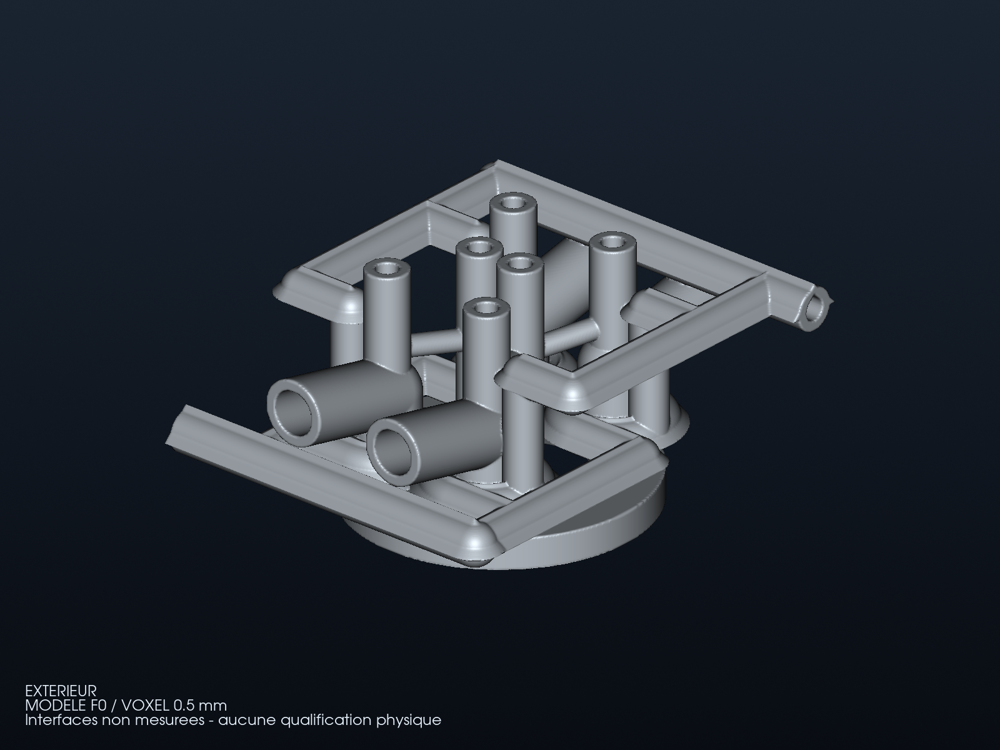
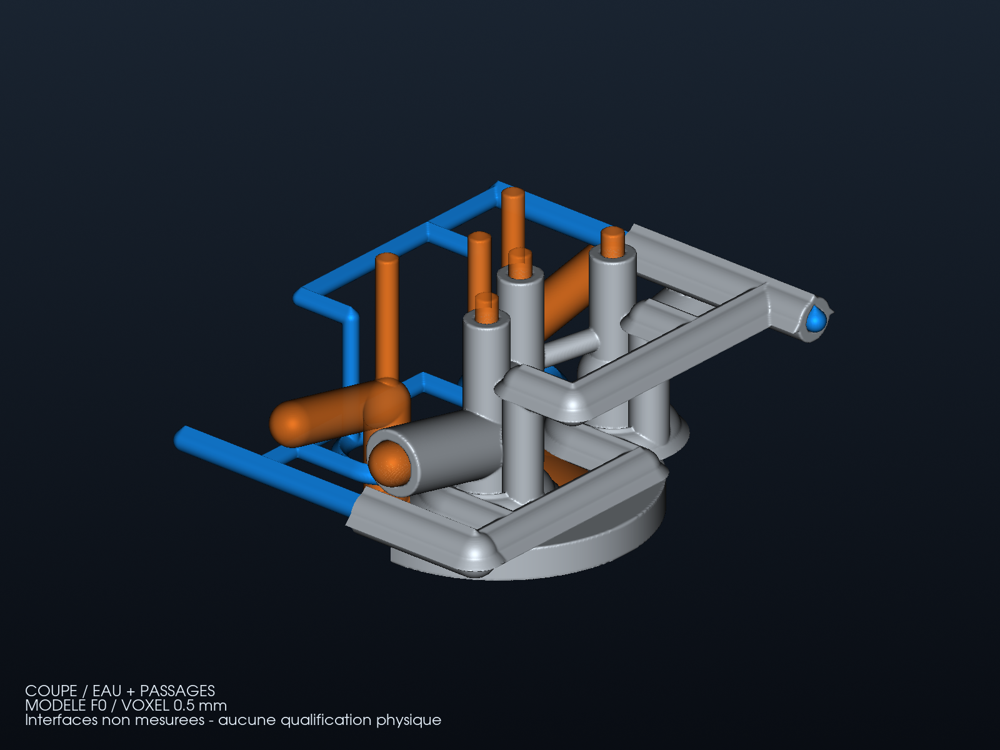
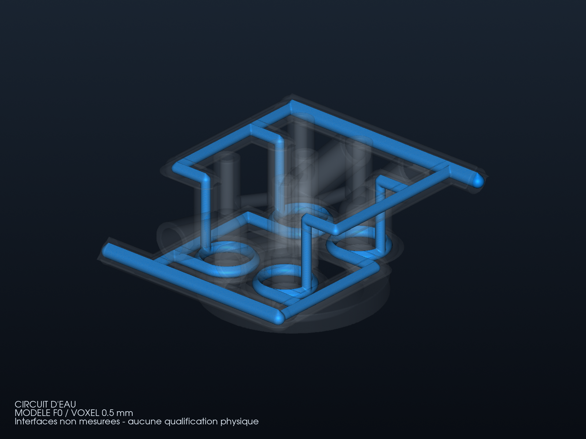

# Routage F0 sans enveloppe : raffinement PicoGK à 0,5 mm

Cette étape historique conserve la charpente et les volumes réservés, sans
enveloppe continue. La [galerie corrigée](GALLERY.md) montre le corps ajouté.
Ces rendus proviennent des **maillages effectivement calculés et inspectés**.
La géométrie de référence reste celle du F0 non mesuré : quatre réservations
de soupapes/guides et deux puits de bougie, sans distribution ni fixations
fonctionnelles. Le gris est une teinte de présentation ; le bleu représente
le volume d'eau, l'orange les volumes réservés aux passages et aux bougies.
Les couleurs ne représentent pas une température calculée.

## Charpente autour des conduits, avant ajout de l'enveloppe



## Coupe et passages internes



## Circuit d'eau et corps transparent



## Ce qui a réellement changé

Le [pipeline](source/refine_and_render.py) conserve les paramètres, le
générateur et les binaires PicoGK précédents. Seul le voxel passe de
0,75 à **0,5 mm** dans trois copies d'entrées vérifiées. Les exécutions
natives sont séquentielles sous le verrou commun. Les nouveaux STL et
entrées restent dans `work/962-head/refinement-0p5/` ; leur inspection et les
images publiées sont conservées dans `work/962-head/refinement-0p5-final/`.
Le [rapport](derived/refinement-report.json) distingue les références
géométriques originales des véritables entrées exécutées à 0,5 mm.

| Résultat géométrique | F0 à 0,75 mm | Raffinement à 0,5 mm |
|---|---:|---:|
| Triangles du solide après suppression des faces d'aire nulle | 761 902 | 1 729 312 |
| Volume de métal du maillage | 353,185 cm³ | 352,985 cm³ |
| Volume d'eau du maillage | 46,180 cm³ | 46,741 cm³ |
| Distance minimale eau–volumes secs, échantillonnée | 3,598 mm | 3,575 mm |
| Nombre de sondes pour cette distance | 197 322 | 447 288 |

Les trois maillages raffinés sont fermés, orientés de façon cohérente et
comptent chacun une composante de surface. Les six sondes d'ouverture sont
recontrôlées. Cela ne démontre ni montage, étanchéité ni épaisseur de paroi.
Les valeurs de volume ne sont pas des mesures de pièce et ne donnent pas
une masse matière qualifiée.

## Comparaison eau/métal : défauts encore ouverts

Le [diagnostic précédent](COOLANT_BOUNDARIES.md) est réutilisé sur les nouvelles
surfaces. Les sections d'entrée/sortie atteignent environ 53,178 mm², avec
un diamètre hydraulique de 7,974 mm. Ces valeurs restent des sections F0,
sans débit ni perte de charge moteur.

| Décalage des sondes normales | Non attribuées, 0,75 mm | Non attribuées, 0,5 mm |
|---|---:|---:|
| 0,25 mm | 28 / 130 076 | 60 / 294 924 |
| 0,50 mm | 8 / 130 076 | 8 / 294 924 |
| 0,75 mm | 4 / 130 076 | 0 / 294 924 |
| 1,50 mm | 0 / 130 076 | 0 / 294 924 |

Les sondes changent avec les triangles : les nombres bruts ne comparent pas
les mêmes points spatiaux. À 0,25 mm, les fractions non attribuées restent
proches (environ 0,022 % et 0,020 %). Les écarts au voisinage de l'interface
ne sont donc pas résolus par ce raffinement. À 1,5 mm, 160 sondes raffinées
retombent dans l'eau, contre 36 précédemment : aucune de ces sondes ne
devient une validation de matière.

Deux résolutions ne suffisent pas à qualifier la convergence, la géométrie
OEM ou une interface commune pour CHT. Le rapport conserve toutes les
qualifications physiques à `false`. La prochaine étape numérique est une
partition fluide/solide conforme et une comparaison sur des positions fixes,
avant la CFD/CHT ; les interfaces du donneur restent à mesurer.

## Reproduction

```sh
python twins/962-cylinder-head-f0/source/refine_and_render.py \
  work/962-head/bin/Engine.dll work/962-head/refinement-new
python -m unittest discover -s tests -p 'test_962*.py' -v
```

Le binaire et les bibliothèques doivent avoir les empreintes de la
[provenance conservée](derived/runtime-provenance.json). Le répertoire de
sortie doit être neuf. Les inspections et rendus peuvent être rejoués sur
les exports natifs conservés sans relancer le calcul PicoGK. La version
`dotnet --version` mesurée ici est 9.0.317 ; le dossier initial mentionne
9.0.318. Le nouveau rapport distingue cette mesure de la provenance de
référence, dont le commit amont reste non vérifié indépendamment.
