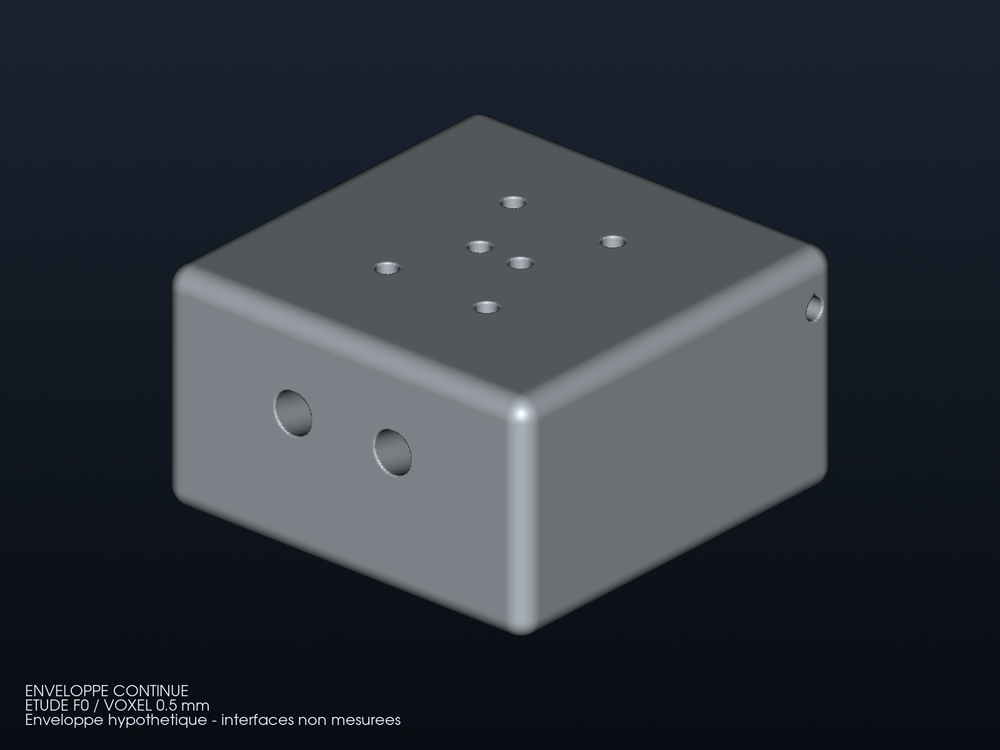
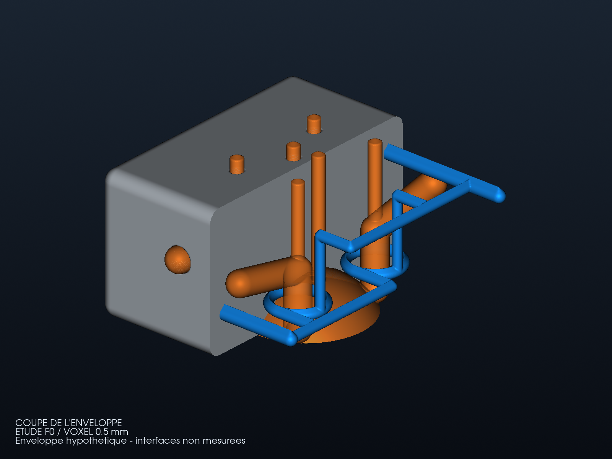
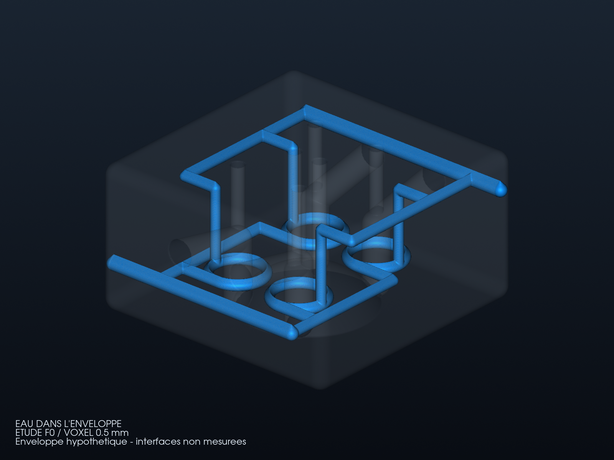

# Étape intermédiaire : enveloppe massive générique

Le premier rendu montrait une charpente autour des conduits. **L'enveloppe
extérieure était absente.** La nouvelle variante ajoute un vrai volume
continu, puis soustrait les volumes d'eau et de gaz au moyen de PicoGK.
Les vues ci-dessous utilisent le nouveau solide calculé et inspecté.

## Extérieur



## Coupe de l'enveloppe



La coupe virtuelle à X = 0,25 mm conserve la moitié opposée à la caméra et
ferme ses faces de coupe. Les volumes orange sont des réservations, pas des
soupapes ou des bougies assemblées. Le bleu représente l'eau, sans résultat
de température ou de pression.

## Eau à l'intérieur du corps transparent



## Corps ajouté, encore à développer

Le [nouveau générateur](../../parts/picogk-catalog/engine/Head962EnclosedStudy.cs)
réutilise les passages du F0 et ajoute un corps arrondi **160 × 160 × 90 mm**,
rayon de coins **8 mm**, au voxel de 0,5 mm. Ce sont des hypothèses de
démonstration, pas des mesures de Porsche. Les quatre réservations de guides
et les deux puits de bougie restent ouverts. Les sept sondes supplémentaires
confirment de la matière aux flancs, au toit et dans les régions où la
charpente seule laissait du vide.

Le volume de métal est d'environ **2 086,73 cm³**, contre 352,98 cm³ pour
la charpente raffinée. C'est un **corps de départ massif**, à alléger à partir
des charges et de la thermique ; il ne constitue pas une optimisation
bionique validée. Distribution, sièges, goujons, assemblages et lubrification
ne sont pas complétés par cette enveloppe. Le
[contrat d'interfaces](interface-contract.json) reste inconnu et non qualifié.

Le [rapport](derived/enclosed-report.json) conserve sources, binaires,
maillage, sondes et empreintes des images. Le maillage est fermé, orienté
de façon cohérente et constitué d'une composante de surface. Cela ne
qualifie ni l'épaisseur, ni la résistance, ni l'étanchéité physique.
Les classifications eau/métal proches des surfaces restent non résolues.

Le [raffinement antérieur du routage](REFINEMENT.md) est conservé séparément,
avec ses images et sa provenance. Il n'est plus présenté comme une culasse
munie d'une enveloppe.

## Sources et reproduction

Le [projet de compilation](source/enclosed/Engine.csproj) utilise les
bibliothèques binaires vérifiées du F0 ; l'ancien chemin local du checkout
PicoGK n'est plus disponible. Aucun changement du noyau n'est nécessaire.

```sh
dotnet build twins/962-cylinder-head-f0/source/enclosed/Engine.csproj \
  -p:PicoGKBinaryRoot=/chemin/vers/le/runtime-F0-verifie \
  -o work/962-head/enclosed-bin
```

Exécuter ce runner avec [enclosed-solid.json](source/enclosed-solid.json)
**sous le verrou commun** de
[run_part.py](../../parts/picogk-catalog/tools/run_part.py), avec les dylib
du runtime vérifié à côté du binaire. Les sorties locales retenues sont
`work/962-head/enclosed-native/`. L'inspection et les vues sont rejouables :

```sh
python twins/962-cylinder-head-f0/source/enclosed/render_enclosed.py \
  work/962-head/enclosed-native \
  work/962-head/refinement-0p5-final/inspected \
  work/962-head/enclosed-bin work/962-head/enclosed-inspected-new
```

Le [script d'inspection/rendu](source/enclosed/render_enclosed.py) contrôle
la fermeture du solide et de la coupe virtuelle. La coupe utilise
[VTK ClipClosedSurface](https://vtk.org/doc/nightly/html/classvtkClipClosedSurface.html).
Les fichiers STL et binaires restent locaux ; les sources et rendus sont
partageables. Aucune fabrication ni performance moteur n'est autorisée.
