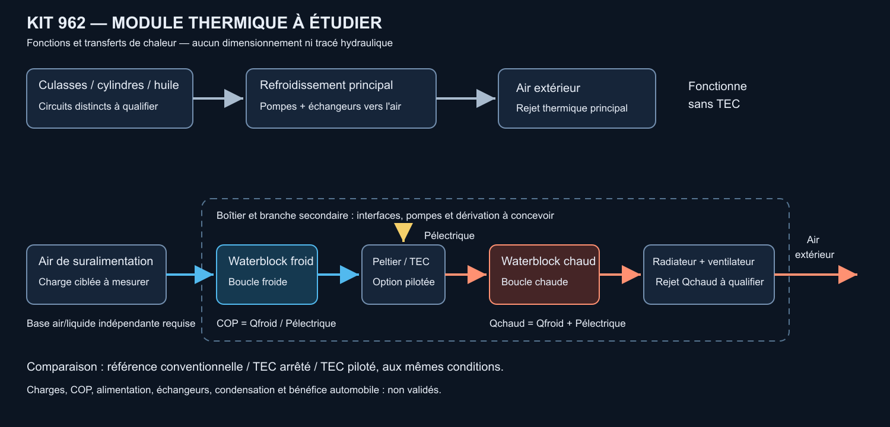

# Module thermique : waterblocks, ventilateurs et Peltier

Le propriétaire propose un boîtier inspiré du principe de GemaTEG pour améliorer
le refroidissement du kit 962. Cette option est ajoutée au programme comme
**une étude de régulation thermique ciblée**. Ni sa puissance frigorifique,
ni son encombrement, ni ses performances automobiles ne sont établis.

## Principe retenu et limite énergétique

[GemaTEG](https://www.gemateg.com/solution) décrit des cold plates actives et
une supervision des températures CPU/GPU. Nous retenons l'idée de pilotage
local, de boucle liquide et de contrôle instrumenté. Les gains publiés dans
ce contexte ne sont pas transférés au moteur. Aucun dessin, firmware ou document
interne GemaTEG n'est repris ; il ne s'agit pas d'un produit automobile GemaTEG.

Un Peltier pompe la chaleur vers sa face chaude, qui reçoit aussi sa
consommation électrique. Les relations de
[Ferrotec](https://thermal.ferrotec.com/technology/thermoelectric-reference-guide/thermalref11/)
sont `COP = Qfroid / Pélectrique` et `Qchaud = Qfroid + Pélectrique`.
Le COP doit provenir du module au point réel de fonctionnement ; sa valeur
maximale ou une puissance commerciale à ΔT nul ne suffit pas au dimensionnement.

**Exemples uniquement**, COP supposé égal à 1, conversion DC supposée à 90 %,
bus supposé de 14 V, pompes/ventilateurs exclus faute de mesures :

| Froid demandé | Électricité aux TEC | Chaleur face chaude | Consommation au bus | Courant au bus |
|---|---:|---:|---:|---:|
| 500 W | 500 W | 1 000 W | 556 W | 39,7 A |
| 1 kW | 1 kW | 2 kW | 1,111 kW | 79,4 A |
| 10 kW | 10 kW | 20 kW | 11,111 kW | 793,7 A |

La charge moteur n'est pas mesurée et n'est représentée par aucune de ces
lignes. Le courant n'est pas celui de modules montés directement sur 14 V :
c'est le courant d'alimentation amont d'une conversion supposée. La perte du
convertisseur et la chaleur des auxiliaires s'ajoutent au bilan global, avec
leur lieu de rejet à préciser. La charge mécanique de l'alternateur demande
en plus sa propre carte de rendement ; elle n'est pas calculée ici.

L'[outil de cadrage](source/thermal_budget.py) expose toutes ses hypothèses et
refuse les valeurs non finies ou incohérentes. Il ne prédit ni température,
COP réel, débit d'air, nombre de modules ou capacité du radiateur.

```sh
python3 twins/962-cylinder-head-f0/source/thermal_budget.py \
  --cold-load-w 1000 --assumed-cop 1 --assumed-bus-v 14 \
  --assumed-dc-efficiency 0.9 --auxiliaries-w 0
```

## Architecture proposée



Le [schéma SVG éditable](source/thermal-module.svg) représente des transferts
de chaleur et des fonctions, pas un tracé hydraulique ou une CAO de boîtier.

| Fonction | Architecture à comparer |
|---|---|
| Culasses/cylindres et huile | Refroidissement principal par liquide et échangeurs vers l'air extérieur, capable de fonctionner sans TEC |
| Air de suralimentation | Échangeur air/liquide et boucle basse température comme référence ; branche TEC optionnelle pour régulation ciblée ou transitoires |
| Branche TEC froide | Waterblock froid, liquide séparé, pompe, capteurs et dérivation conçue pour ne pas bloquer la circulation principale |
| Branche TEC chaude | Waterblock chaud, pompe et échangeur ventilé dimensionné pour Qchaud, avec trajet d'air extérieur |
| Commande | Courant TEC piloté ; mesure des deux faces, débits, tensions/courants, pression et humidité pertinente |
| Réservoir tampon éventuel | Réserve énergétique transitoire à quantifier ; ne remplace pas l'évacuation de chaleur en régime continu |

Cette séparation est une **proposition d'ingénierie**, pas une décision
de compatibilité. Les deux circuits des bancs moteur restent des interfaces
distinctes à mesurer. Ne pas relier eau moteur, huile et circuit TEC au même
fluide par simple commodité. Le côté chaud ne doit pas réchauffer l'air aspiré
par le refroidisseur de suralimentation ou recycler l'air chaud dans le moteur.

La réduction de température ne justifie la branche active que si le gain
mesuré vaut sa consommation, masse, complexité et maintenance. Comparer au
moins un échangeur conventionnel amélioré, la branche TEC et, si du froid
sous l'ambiante est nécessaire, une option à compression ; aucun COP de
compresseur n'est supposé ni équipement choisi.

## Contraintes à fermer avant une CAO fonctionnelle

- Mesurer séparément charges thermiques moteur, huile, air de charge et
  transitoires. Pour une boucle liquide : débit massique, composition, Cp(T)
  et températures d'entrée/sortie ; pour l'air : débit, pression et températures.
- Obtenir les courbes Qfroid/Pélectrique/COP aux températures des deux faces,
  avec vieillissement et limites du module, puis qualifier les contacts et
  le serrage. Le boîtier ne doit pas transmettre les efforts de fixation à
  des modules fragiles sans support mécanique validé.
- Établir budgets électriques **et mécaniques**, capacité alternateur/DC,
  fusibles/câblage, consommation pompes/ventilateurs et bilan de chaleur global.
- Vérifier radiateur, débit d'air et recirculation en température extérieure
  défavorable, au ralenti et en charge. Un ventilateur redistribue l'air ;
  il ne supprime pas les watts à rejeter.
- Définir le contrôle de condensation selon le point de rosée **local**,
  l'humidité et la pression à l'emplacement considéré. Les surfaces extérieures
  et l'air comprimé d'admission n'ont pas nécessairement le même point de rosée.
  Le [NWS](https://www.weather.gov/asos/AmbientDewPointTemperature.html) décrit
  la mesure de ce seuil par condensation sur une surface refroidie par Peltier.
- Valider modes dégradés : TEC arrêté, débit perdu, ventilateur/pompe en défaut,
  surtempérature côté chaud, capteur défaillant et fuite. La référence de
  refroidissement doit rester disponible ; le motoriste fixe les limites
  de charge et l'arrêt protecteur.
- Qualifier pression, vibrations, chocs thermiques, corrosion, isolation,
  étanchéité et accessibilité du boîtier dans le véhicule. Aucun matériau,
  raccord, emplacement ou dimension n'est encore choisi.

La première expérience proposée est un banc thermique électrique avec une
charge résistive et des échanges mesurés, avant toute installation moteur.
Comparer TEC arrêté/allumé à charge et conditions extérieures identiques ;
fermer `Qchaud ≈ Qfroid + Pélectrique` avec les pertes et incertitudes.
La commande active n'est retenue qu'après constat d'un bénéfice utile, dans
les budgets et sans dégrader le fonctionnement de référence.

Les besoins inconnus sont conservés dans
[thermal-module.json](thermal-module.json). Aucun achat, prototype pressurisé,
contact fournisseur, copie de géométrie ou de firmware GemaTEG n'est
effectué par cette étude. Le [programme kit](KIT_962_PROGRAMME.md) reste la
cible commerciale ; sa qualification ne découle pas de ce calcul.
