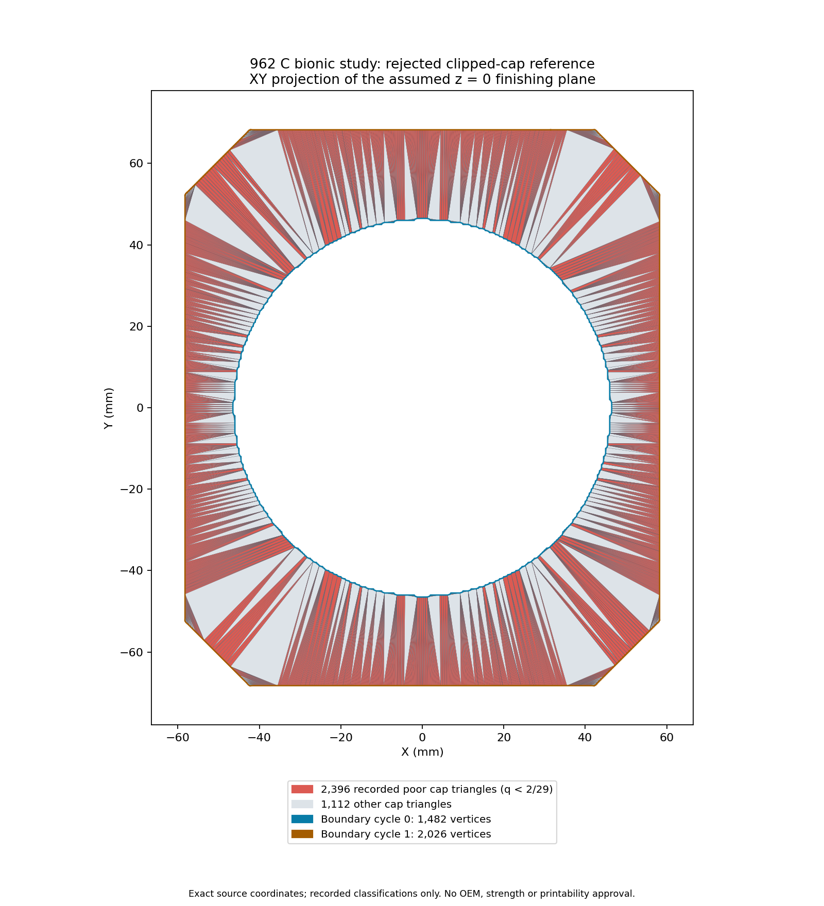

# Cap-aware repair: preserved native rejection

The single boundary-only source003 head trial returned **3** at `combined_full_quality_and_topology`: **“Combined global quality objective failed.”** It exported no candidate or provenance arrays. The proposal is rejected; no head surface, solver or manufacturing admission is established.

The native source reports 3,112 → 1,122 poor faces and minimum quality 3.582992623129178e−05 → 4.1765036666304356e−05. These are source-bound in-memory observations, independently reviewed through the stopped receipt and source association without rerunning quality, CDT or geometry. They do not satisfy the unchanged zero-poor-face objective at q = 2/29. The full original report is preserved losslessly in [head/report.json.gz](head/report.json.gz), with its original/compressed identities in [head/report-format.json](head/report-format.json).

Five early native guards report success: exact poor/target association, deterministic keeper mapping, mapped two-loop annulus, and cap plane/domain/winding/frozen-face/no-new-point checks. The report contains 510 choices and 286 coupled side-face IDs. **Later final global and patch topology, fixed/exterior, neighbor and envelope guards were not reached.** Their initialized zero counters are not completed checks. Global/patch Euler-after fields are null. Independent global intersection, feature/physical-domain and full original two-sided-distance gates are also uncompleted. [head/result-scope.json](head/result-scope.json) makes these observation limits explicit.

Root and [independent stopped-result review](reviews/head-result-peer.json) verified all 150 input pins, eight-file output closure, seven artifact hashes, lifecycle, exact 3,112/9,872/38 source-ID associations, every group choice/mapped cycle and the 286 coupled side-star IDs. They did not independently recompute native quality, CDT or in-memory geometry. The trial ran once in 2.816 seconds under the frozen image with 2 CPU, 4 GiB memory, no swap/network/tmpfs, read-only root and a 300-second wall limit. It was reaped, its stopped owned container removed, and OOMKilled was false.

## Original cap inspection and exact rim screen

This is the original retained cap of rejected bionic input d2af68ee at the assumed z = 0 mm finishing plane, not a view of an accepted repair. It displays 3,508 cap triangles, including 2,396 recorded below q = 2/29, with two abstract boundary cycles of 1,482 and 2,026 vertices. It is not Porsche metrology, a physical hole classification or a dimensional/strength/printability certificate. Plot002 fixes the original001 layout; loader, classifications and direct XY projection remain unchanged. PNG, SVG, exact source, receipt, visual review and [independent plot review](plot/peer-review.json) are retained.

The stdlib rim screen compares all 3,506 nonendpoint existing cap coordinates against each of 2,026 rim1 edges: 7,103,156 comparisons. For exact planar triangles, q² = 12 det²/S², where S is the sum of squared edge lengths. Thus q ≥ 2/29 is equivalent to 2523 det² ≥ S² for S > 0. A common dyadic integer scale preserves this comparison exactly.

For 1,474 rim edges, the completed search reports a maximum below threshold. This is a necessary obstruction for planar triangulations restricted to those original coordinates while preserving every unsimplified rim1 edge. The remaining 552 edges have necessary witnesses only. Visibility, domain/nonoverlap, orientation, fixed-face, envelope and neighbor constraints were relaxed. No feasible triangulation, keeper policy or general head failure follows. The peer checked the proof, every saved witness and original coordinate-row association without repeating the 7.1 million comparisons. The comparison stage reports 18.484 seconds; its 45-second alarm excludes setup and final verification/write.

The full screen report is losslessly compressed in [rim-screen/result.json.gz](rim-screen/result.json.gz). Source, three-input contract and [peer review](rim-screen/peer-review.json) are exact copies. The format receipt binds every decompressed byte and gzip CRC to the original JSON.

## Source and proposal history

Historical source002 ac5a70ab compiled and passed the four synthetic cases below. Its original 2,700-edge/476-group head proposal was **refused before launch** after exact saved-report inspection found 48 groups occupying separated runs on one cap loop. Any single keeper maps those runs to repeated IDs, so the existing mapped-cycle uniqueness guard must reject. The held proposal, original targets, checker source, full compressed cyclic-run proof and review remain under `refused-before-launch/`. This was not a native head failure or a general repair impossibility.

The successor retains every edge in the exact intersection of the frozen 2,700 minimum-edge graph and all 3,508 actual cap-boundary edges: 2,212 retained edges, 488 removed nonboundary edges, 510 groups and 2,722 member vertices. Every group occupies one run on one loop and belongs to a prior no-fixed-conflict group. All 1,474 failing rim edges remain included. This removes the demonstrated separated-run obstruction only. No keeper or coordinate was chosen during graph preparation. Full targets/source/contract/report/self-check and peer binding are retained under `boundary-targets/` and `reviews/`.

Selected [source003](source/cap_aware_003.cpp), SHA 1eb5bd30, changes only the two frozen head-count literals: 2,700 → 2,212 targets and 476 → 510 groups. Reversing those replacements reproduces every source002 byte. The exact policy prefix, quality codec, generated 3,112-ID header, predicates and guards are unchanged. Both selected source bodies and the literal diff are included. Initial unselected 8fae source, refused 3e1 generator/old-test bodies and plot001 imagery remain private, bound by original hashes. Their initial generator class-key refusal is preserved without upgrading it to a test pass.

The adapter chooses each eligible existing member by the complete surviving non-cap side-star maximin score, with lower source ID breaking exact ties. The simultaneous quotient and exact two-loop constrained Delaunay reconstruction must preserve all frozen exterior cap triangles exactly. Independent per-group scores do not guarantee simultaneous feasibility. There is no diameter-only refusal or exhaustive keeper backtracking. Mapped outer-minus-inner annulus coverage is distinct from original-domain equality, which is not evaluated, and from the separate original two-sided-distance bound. New cap triangles use the explicit no-old-face sentinel; exact frozen cap faces retain their old IDs, and vertex origins refer to input coordinate IDs.

## Completed compile and synthetic fixtures

| Source stage | Compile | Four native fixture codes | Complete saved-array assessment |
| --- | --- | --- | --- |
| source002 | 0 / 98.022 s / 47 pins | 0 / 0 / 3 / 3; 83 pins | Root and independent peer pass |
| source003 | 0 / 70.843 s / 64 pins | 0 / 0 / 3 / 3; 111 pins | Root and independent peer pass |

Both stages use the exact frozen arm64 Linux image. Compiles used C++17/O2, 2 CPU, 4 GiB, no swap/network, 1 GiB tmpfs and 300-second wall limits. Each tiny native fixture used 2 CPU, 512 MiB, no swap/network/tmpfs and 60 seconds. All stopped processes were reaped and their owned containers removed, with OOMKilled false. Executables are identified by hash/size and are not distributed.

In both stages, the pair and triple cases produce 17 vertices and 34 faces, selecting keepers 17 and 18 respectively. Each has exact volume 12 mm³, cap area 12 mm² and five preserved fixed cap faces. Fixed-vertex and cross-loop cases give the declared refusal with no exports. Complete tiny input BIN/targets, successful output arrays, reports and assessments are included. The independent oracle checks coordinate bytes, face preimages, poor/reference IDs, cap cycles and nonoverlapping annular coverage. Source-bound ordinary/envelope flags are distinguished from independent saved-array arithmetic checks. Three header-generator tests and seven fabricated-literal oracle tests passed; unchanged pure tests were not rerun for source003. These examples do not establish general CDT correctness or head success.

## Contents, closure and limits

[source-bindings.json](source-bindings.json) records exact reused source and compile mappings. Historical held records retain their original authority-false and unrun fields; separately authorized children record later execution. [original-records.json](original-records.json) preserves complete source002/source003 and fixture preparation maps, all five native contract/before/after maps, full artifact inventories, original receipt identities and exact public-copy associations. Later reviews are separate records, never retroactively inserted into earlier input maps.

[native-projections.json](native-projections.json) retains actual scalar outcomes, full resource controls and every mount destination/RW rule. Invocation commands, job entrypoints/arguments, host paths, container/ownership IDs, numeric PIDs, metadata timestamps and raw control stdout/stderr are omitted explicitly. Complete original native-byte closure is not claimed publicly. The large head BIN, compiled executables and upstream header bodies are excluded. No measured peak RSS, actual CPU usage or independent OS PID-absence proof is claimed.

The receipt seals the selected companion bytes. Run `python3 verify.py` to verify sizes, SHA-256 values and complete file closure using the reused stdlib verifier. It does not replay geometry or physics. Full compressed reports use level6 gzip with empty filename and mtime0; each format receipt records exact original/decompressed equality and CRC verification.

No original 962 dimensions, accepted surface/volume mesh, channel/void identity, conformal metal/fluid interface, independent distance certificate, solver result, material qualification, strength, thermal performance, LPBF process qualification or manufacturing authorization is established. This capsule preserves one rejected deterministic proposal and the evidence supporting that bounded conclusion.
