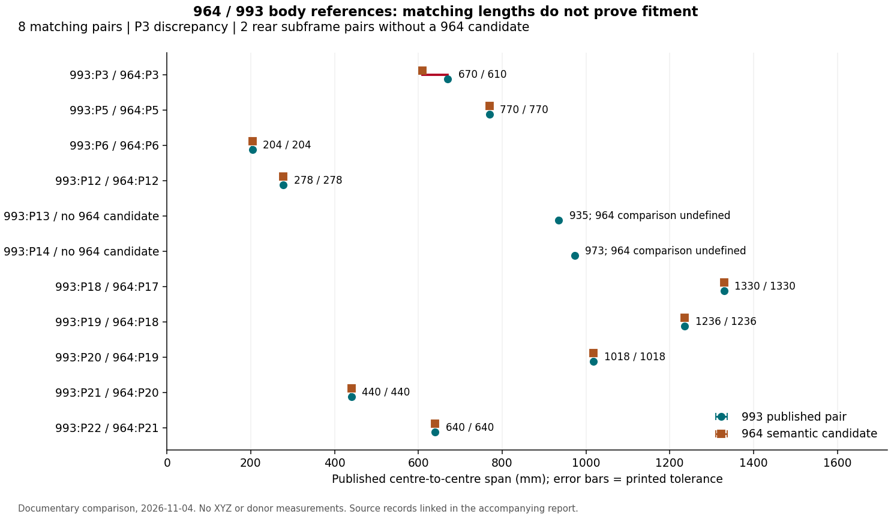

# 993 body-control dimensions and 964 comparison — 4 November 2026

**A public preview supplies 19 floor-control rows: 11 transverse spans and
eight diagonals, with six additional horizontal projections.** These 25 scalar
observations advance the separate 993 documentary baseline. They add **zero
measured XYZ points** to the unavailable 964 donor and do not define its tunnel.

The practical result is also a compatibility correction: point numbers are
local to each generation. A bare `P14` cannot identify an attachment in a
964/993 assembly.

## Source and scope

[Porsche 993 Body Dimensions Small](https://www.scribd.com/document/739228021/Porsche-993-Body-Dimensions-Small)
is a six-page public reader preview of Porsche workshop material. Its visible
headers identify the 911 Carrera (993). Viewer page 2 is printed page **5-9**,
with the mark **IV, 1994**. That is a document printing mark, not evidence of
the donor's year, gearbox or drive configuration.

All six preview pages were viewed. The floor diagram and table occupy pages
1–2; the body drawing and point legend occupy pages 3–4. Pages 5–6 concern the
Cabriolet roof and are excluded from the coupe study. Additional dimensions
in the pages 3–4 drawing remain untranscribed pending arrow-by-arrow review.

No original PDF was downloaded and no manufacturer revision was authenticated.
The similarly named Rennlist attachment remains a separate, unverified byte
source. This is **evidence level C**, reflecting the third-party reproduction.
Screenshots are retained privately; only their hashes and factual observations
are committed. No licence to reproduce the manual, use its illustrations as
CAD surfaces, or train a model on them is asserted.

## What the numbers mean

The table uses hole or bolt-hole centres. Its note distinguishes direct
distances from bracketed horizontal projections. The latter are separate
observations, not alternate tolerances. A span tolerance cannot be divided
between two points and relabelled as measured coordinate uncertainty.

| Row | 993 reference pair | Direct distance, mm | Horizontal projection, mm |
|---|---|---:|---:|
| A | P21 / P21 | 440 ± 2 | — |
| B | P3 / P3 | 670 ± 0.5 | — |
| C | P5 / P5 | 770 ± 2 | — |
| D | P6 / P6 | 204 ± 2 | — |
| E | P18 / P18 | 1330 ± 1 | — |
| F | P19 / P19 | 1236 ± 1 | — |
| G | P12 / P12 | 278 ± 1 | — |
| H | P20 / P20 | 1018 ± 1 | — |
| I | P13 / P13 | 935 ± 1.5 | — |
| K | P14 / P14 | 973 ± 1.5 | — |
| L | P22 / P22 | 640 ± 1 | — |
| M | P21 / P18 | 1500 ± 3 | — |
| N | P3 / P18 | 1199 ± 3 | 1195 ± 3 |
| O | P18 / P19 | 1788 ± 3 | — |
| P | P19 / P22 | 1689 ± 3 | 1654 ± 3 |
| R | P12 / P22 | 1447 ± 3 | 1414 ± 3 |
| S | P13 / P14 | 1143 ± 3 | 1122 ± 3 |
| T | P13 / P22 | 1372 ± 3 | 1344 ± 3 |
| U | P23 / P22 | 1043 ± 3 | 1039 ± 3 |

Repeated numbers in the first 11 rows denote opposite members of a pair;
the last eight rows are opposite-side diagonals in the diagram. Vehicle
LH/RH signs and absolute coordinates are deliberately unassigned. P23 is
drawn and used by row U, but its feature is absent from the reviewed legend.
Its identity stays null. In particular, it must not be silently renamed P20.

The [catalogue record](../../../catalog/measurements/MEAS-MANUAL-993-FLOOR-CONTROL-20261104.json)
stores direct and projected values separately, with page, row, convention,
source and screenshot hashes. Its `pdf_page` field refers to the six-page
preview, not to pagination in the old full-manual OCR record. The existing
993 aggregate and 964 records have not been edited.

## Compatibility findings

The [20-entry identity contract](contract.json) defines 19 documentary features
and leaves P23 undefined. The [crosswalk](crosswalk.csv) compares names and
available scalar spans with the
[964 span record](../../../catalog/measurements/MEAS-MANUAL-964-INTERFACE-SPANS-20261030.json).
Every key includes the generation. These are **semantic candidates**, not
accepted interchangeable interfaces.

| 993 feature | Candidate 964 feature | Finding |
|---|---|---|
| P3, front axle side-member attachment | P3 | 670 ± 0.5 versus 610 ± 1 mm; discrepancy must be resolved at the exact holes |
| P13 / P14, rear subframe attachments | None admitted | The 964 rear-axle references cannot supply this geometry |
| P15, rear strut reference | P14 | Number changes; both 964 model-year families remain unresolved |
| P17, rear bumper absorber attachment | P16 | 993 P17 is not the 964 front jack reference |
| P21, front lower closure reference | P20 | 993 P21 is not the 964 inner engine reference |
| P22, inner engine reference | P21 | Number changes despite a matching 640 ± 1 mm span |

Eight named pairs have matching nominal values **and** printed tolerances:
993→964 P5→P5, P6→P6, P12→P12, P18→P17, P19→P18,
P20→P19, P21→P20 and P22→P21. Numerical agreement is useful for a later
registration check. It supplies neither hole axes nor mating faces, thread
engagement, local laminate/joint details or verified part interchangeability.

This original plot shows scalar lengths, not the positions or shape of a car.
The 964 assembly drawing also contains an unassigned 670 ± 0.5 mm dimension,
as recorded by the [existing audit](../interface-exploitation-20261030/README.md).
The explicit 993 P3 row is not sufficient to reassign that 964 arrow or replace
its tabulated 610 ± 1 mm value.

The 993 projection note does not resolve the disputed 964 diagonal convention.
No 993 value or convention has been copied into the existing 964 coordinate
solver or used to restore its withdrawn rear-coordinate claim.

## Consequence for the monocoque

This increment addresses **M1 documentary inputs and M2 interface definition**
in the [programme](../../../docs/MONOCOQUE_964_993_PROGRAMME.md), under
[ADR 0004](../../../docs/decisions/0004-federated-digital-twin.md).
It supports source checking and future scan registration. It does not advance
the scan beyond its current envelope status or authorize a functional shell.

Next work has concrete acceptance criteria:

1. Review the remaining 993 drawing arrows and datum definition before solving
   any coordinate network. Retain unknown signs, heights and P23 identity until
   a source resolves them.
2. Obtain a traceable replacement scan or measurement report through the
   [alternative acquisition routes](../alternative-measurement-sources-20261104/README.md).
   It must identify the vehicle variant and cover the tunnel interior,
   door-foot structure, wheelhouses and exact attachment surfaces. A vendor
   showcase is not the dataset.
3. Register independent 964 and 993 interface contracts to the relevant source
   geometry. Resolve the front P3 difference and rear-subframe architecture
   before claiming compatibility or designing adapters.
4. Admit the central-cell geometry only after that check, then define laminate,
   joints and load cases, run structural/manufacturing verification and assemble
   the resulting evidence in OpenUSD for the final Omniverse review.

The original donor remains unavailable. TetraVision's acquisition request is
still unsent; this increment neither purchases data nor contacts a third party.
No torsion, strength, manufacturing or Omniverse qualification is claimed.

## Verification and retained evidence

[review.json](review.json) records page coverage, private screenshot hashes,
input/record hashes and the counts above. Transcription was checked visually
against the table and footnote; this is not independent physical metrology.
Repository checks validate the source/measurement schemas, references and
document links. Full `make check` is required before merging this increment.
The PR retains the exact CI receipt. No solver run is needed to validate a
documentary transcription, and no new geometry was generated.
