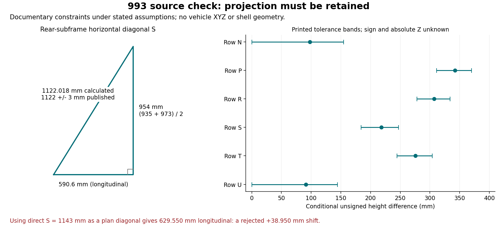

# 993 body drawing and projection checks — 4 November 2026

**The remaining body views add 15 scalar observations: seven transverse spans
and eight longitudinal distances.** Together with the
[floor-table review](../993-body-dimensions-20261104/README.md), the 993 dossier
now has 40 scalar observations and pair spans for 18 of its 19 defined point
identities. It still adds **zero validated vehicle XYZ points**.

One independent drawing/table equation now closes: the rear-subframe dimensions
predict a horizontal diagonal of **1122.018 mm**, versus **1122 ± 3 mm** in the
table. Substituting its unprojected 1143 mm value would move the calculated
longitudinal separation by **38.950 mm**. This verifies the usefulness of
preserving the source's projection convention before reconstruction.

## Source review and admission

The source is the same [public six-page preview](https://www.scribd.com/document/739228021/Porsche-993-Body-Dimensions-Small)
of Porsche 993 workshop material. This increment visually reviews the arrows
in viewer pages 3–4. These pages split one body drawing across two images.
They do not supply a complete 3D surface or an authenticated factory CAD model.

The [new catalogue record](../../../catalog/measurements/MEAS-MANUAL-993-BODY-DRAWING-20261104.json)
preserves the page, endpoints, printed tolerance and private capture hash for
each observation. No dimensions were estimated from pixel lengths. The source
and earlier records retain their existing hashes. Evidence remains level C:
no original PDF bytes, authenticated revision, independent survey or exact
donor applicability has been obtained.

The upstream verdict is **admissible for documentary constraint checks only**.
It is not admissible as functional shell geometry or structural mesh input.
P7's enlarged digits remain ambiguous and its value stays null. P23 remains
undefined. The 215 mm dimension has no printed tolerance; it stays unknown.

## Additional observations

| 993 reference | Quantity | Published value, mm |
|---|---|---:|
| P1 | Front absorber attachment pair span | 788 ± 1 |
| P2 | Front upper closure reference pair span | 600 ± 1 |
| P4 | Front strut reference-hole pair span | 869 ± 2 |
| P11 | Instrument-panel reference pair span | 1236 ± 1 |
| P15 | Rear strut reference-hole pair span | 893.4 ± 1.5 |
| P16 | Engine support reference pair span | 748 ± 1 |
| P17 | Rear absorber attachment pair span | 1006 ± 1 |
| P1 → drawing zero | Longitudinal distance | 722 ± 2 |
| P3 → drawing zero | Longitudinal distance | 215; tolerance absent |
| Drawing zero → P5 | Longitudinal distance | 143 ± 2 |
| P1 → P17 | Longitudinal distance across both drawing halves | 3748 ± 4 |
| P18 → P19 | Longitudinal distance | 1245 ± 2 |
| P18 → P20 | Longitudinal distance | 1328 ± 2 |
| P13 → P17 | Longitudinal distance | 1073 ± 2 |
| P13 → P14 | Longitudinal distance | 590.6 ± 1 |

P4 and P15 describe selected reference holes in mounting patterns, not measured
damper-axis spacing. The zero line is drawn through the front-strut region;
this review does not identify it with a particular mounting hole or axis.
In particular, no `P4 = 0` coordinate is generated.

## A useful independent consistency equation

Assume the drawn left/right pairs share a symmetry midplane and that each
pair's two members have equal height. For the opposite-side P13–P14 diagonal,
the transverse separation is then `(935 + 973) / 2 = 954 mm`. With the
separately drawn longitudinal separation of 590.6 mm:

```text
horizontal S = sqrt(590.6² + 954²) = 1122.018 mm
source horizontal S              = 1122 ± 3 mm
```

The calculated worst-case interval is **1120.216–1123.820 mm**, using the
printed limits of the three input dimensions. It overlaps the published
**1119–1125 mm** interval. No probability distribution or confidence level is
assigned to these repair tolerances.

Treating direct `S = 1143 mm` as a horizontal diagonal instead gives
`sqrt(1143² - 954²) = 629.550 mm`, **38.950 mm** larger than the independently
printed longitudinal dimension. The rejected alternative is retained as a
diagnostic, not as candidate geometry.



This agreement supports the 993 source interpretation. It is internal
documentary consistency under stated symmetry assumptions, not a physical
measurement or validation of the unavailable donor. It does not resolve the
different wording of the 964 manual or authorize copying the 993 convention
into the old 964 solver.

## What can and cannot be positioned

Six documentary longitudinal stations follow from the visible arrows, with
positive direction toward the rear from the printed zero line:

| 993 reference | Drawing station, mm | Worst-case half interval, mm |
|---|---:|---:|
| P1 | −722 | 2 |
| P3 | −215 | Unknown |
| P5 | 143 | 2 |
| P17 | 3026 | 6 |
| P13 | 1953 | 8 |
| P14 | 2543.6 | 9 |

These are scalar drawing stations, **not vehicle X coordinates**. Derived
stations share source dimensions: their interval bounds must not be treated
as independent measurements. Every vehicle XYZ, axis and mating face stays
null. No transform to the 964 underside scan is supplied by this drawing.

The six direct/projected pairs also constrain unsigned height differences by
`abs(dz) = sqrt(direct² - projected²)`, provided they refer to the same two
centres. The [analysis](analysis.json) records nominal values and feasible
worst-case intervals. Intersecting distance bands can admit zero height.
Neither a height sign nor an absolute Z follows; none is selected from visual
proximity to a skin or from a plausible-looking reconstruction.

The combined pair inventory has **13 matching nominal-and-tolerance pairs**
against the named 964 candidates. The new matches are P1, P2, P4, P11 and
993 P16 → 964 P15. The 993 rear strut reference **893.4 ± 1.5 mm** differs
from both 964 P14 year families, and 993 P17 **1006 ± 1 mm** differs from
964 P16 **994 ± 1 mm**. Equal names or lengths still establish no interchangeability.

## Reproduction, checks and next dependency

```sh
python3 twins/964-chassis/993-body-network-20261104/build.py --check
python3 -m unittest discover -s tests -p test_993_body_dimension_network.py -v
make check
```

[build.py](build.py) consumes the two 993 measurement records, the earlier
generation-qualified identity contract and the 964 comparison record.
[analysis.json](analysis.json) pins those inputs and the builder.
[review.json](review.json) inventories private screenshots and committed
artifact hashes. Tests reject mixed-generation endpoints and swapped
projection conventions, preserve missing tolerances and verify reproducibility.
The PR records the full Linux `make check` result.

This advances M1/M2 in the [programme](../../../docs/MONOCOQUE_964_993_PROGRAMME.md)
under [ADR 0004](../../../docs/decisions/0004-federated-digital-twin.md).
The next acquisition must provide the missing tunnel interior, door-foot and
wheelhouse surfaces, exact hole axes/mating faces, vehicle variant and a traceable
coordinate frame. The original donor remains unavailable and the
[TetraVision request](../alternative-measurement-sources-20261104/tetravision-request.md)
remains unsent pending authorization. No existing scan bytes or qualified
replacement survey were acquired in this increment.

Laminate and joint definition, representative torsion/strength calculations,
manufacturing simulation, physical correlation and the final Omniverse twin
review remain open. A successful constraint audit does not close these gates.
