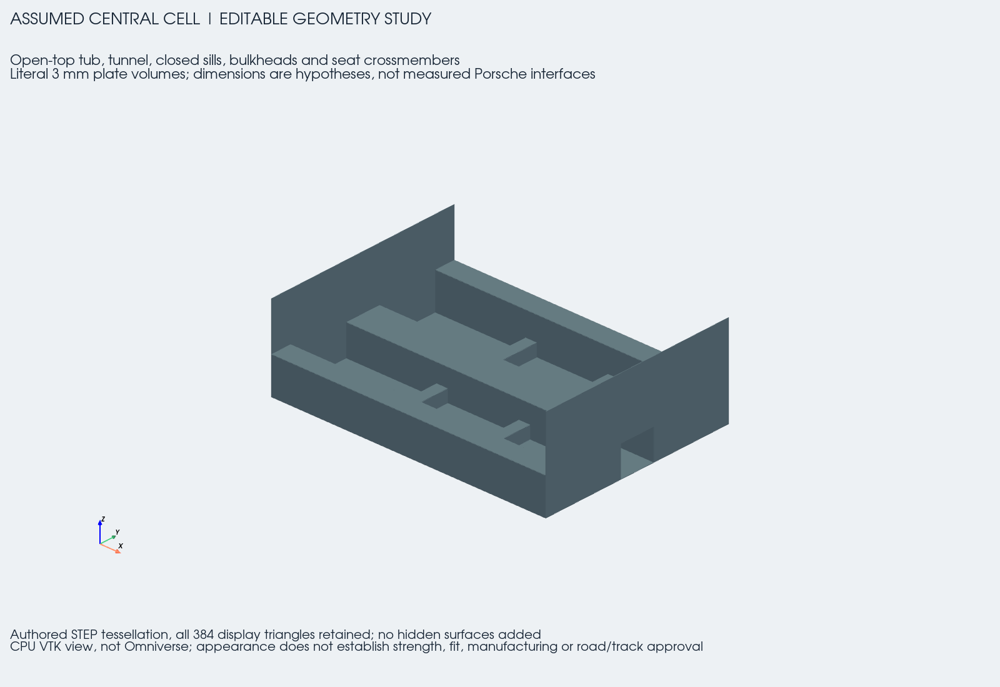
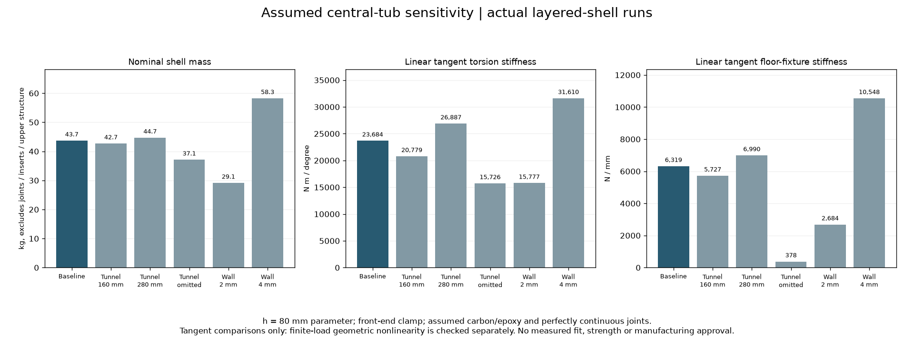
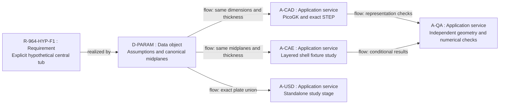

# F1 assumed central carbon tub

The owner requested continuing with hypotheses on 6 November 2026. This is an
editable clean-sheet central-tub study for exploring load paths and conditional
elastic response. The donor measurements and their unresolved interfaces keep
their original status. The earlier withdrawn whole-body model is not reused.

The current tub has a floor, two closed sills, an open-ended central tunnel,
front and rear bulkheads, and four seat-crossmember spans around the tunnel.
It is open above the sills: windshield, door and roof load paths are not present.
No suspension, drivetrain, steering, seat or restraint attachment is designed.



The [interior](media/inside.png), [cross-section at X = 1,000 mm](media/section_x1000.png),
[orthographic catalogue views](../../../parts/964-central-cell-assumed-f1/media/views.png)
and [five-second geometry turntable](media/turntable.mp4) show the current
revision. These are authored CAD views, not product photographs.

## Assumptions and shared geometry

[assumptions.json](assumptions.json) is the editable design-input register.
Every dimension below is assumed, in an independent design frame with X
rearward, Y transverse and Z up. None is a measured Porsche interface.

| Parameter | Baseline |
|---|---:|
| Tub length / width | 2,000 / 1,440 mm |
| Sill width / height | 150 / 260 mm |
| Tunnel midplane width / height | 260 / 220 mm |
| Front / rear bulkhead height | 600 / 650 mm |
| Seat crossmember stations | X = 700 and 1,300 mm |
| Crossmember width / height | 80 / 90 mm |
| Physical laminate thickness | 3 mm |
| Assumed unobstructed rectangular tunnel reservation | 257 × 217 mm |

The tunnel passes through both bulkheads. The reservation supplies neither a
shift-linkage axis nor a C4 shaft/movement envelope. The 993 and C4 interfaces
still require their own evidence. The vehicle's 1,200 kg programme input does
not define shell weight, suspension loads or a road/track load spectrum.

[build.py](build.py) creates 28 explicit rectangular midplanes. CAD uses the
union of those same planes extruded by ±half the physical thickness. The
laminated-shell analysis uses the same midplanes and thickness. There is no
independent envelope substituting for the analysis geometry.

The source audit admits this geometry only for the declared hypothesis study.
Positive dimensions, unique non-overlapping coplanar panels, a connected plate
union, a through-tunnel and literal wall thickness are checked before numerical
trials. Ideal sharp junctions limit interpretation to global elastic response;
an unbounded local stress peak would not establish material strength.

## Material and fixture model

The baseline uses eight equally thick UD carbon/epoxy plies in
`[0, +45, -45, 90, 90, -45, +45, 0]`. Assumed constants are E1 = 135 GPa,
E2 = E3 = 10 GPa, G12 = G13 = 5 GPa, G23 = 3.5 GPa, with the Poisson ratios
and density recorded in the register. These are an exploratory elastic card,
not supplier allowables. The full stack is required for bending; in-plane
quasi-isotropy does not make its bending response isotropic.

The fixture clamps the front end. Torsion applies opposed 1,000 N vertical
resultants to the rear sill bands; the actual nodal force positions define its
torque. Bending applies a total downward 10,000 N to the floor. These are
specified numerical fixtures, not reconstructed Porsche suspension tests or
derived service loads. Connections are perfectly continuous, with no adhesive,
insert or joint compliance. The study does not evaluate laminate failure,
buckling, fatigue, impact or occupant restraint.

## Executed elastic calculations

[solve.py](solve.py) uses the pinned offline CalculiX 2.21 runtime and S8R
layered shells. Four executed [solver controls](solver-controls.json) compare
against independent beam formulae: ordinary isotropic and eight-ply isotropic
tip compliance agree to 0.020%, UD 0° to 0.270% and UD 90° to 0.029%. The
isotropic and layered-isotropic solutions are identical at printed precision.
An initial one-element-wide strip exposed a spurious midside mode. The accepted
meshes use at least two elements per shared coordinate interval, including
narrow strips; the earlier diagnostics remain retained privately.

The [18-job linear campaign](linear-results.json) includes three baseline
meshes, five geometry/thickness alternatives and two half-load controls. Values
are **zero-load tangent responses of this assumed fixture**, not Porsche or
finite-service-load stiffnesses. Successive scalar changes screen numerical
stability; they are not a continuum error bound.

| Mesh-size parameter | Torsion, N m/degree | Floor-fixture stiffness, N/mm |
|---|---:|---:|
| 120 mm | 23,694 | 6,446 |
| 80 mm | 23,684 | 6,319 |
| 60 mm | 23,676 | 6,290 |
| Last relative change | 0.0326% | 0.4541% |

At the common 80 mm parameter:

| Assumed variant | Torsion, N m/degree | Floor-fixture stiffness, N/mm |
|---|---:|---:|
| Baseline, 3 mm wall / 220 mm tunnel | 23,684 | 6,319 |
| Tunnel height 160 mm | 20,779 | 5,727 |
| Tunnel height 280 mm | 26,887 | 6,990 |
| Tunnel omitted | 15,726 | 378 |
| Wall thickness 2 mm | 15,777 | 2,684 |
| Wall thickness 4 mm | 31,610 | 10,548 |

Floor-fixture compliance includes local floor deformation under the prescribed
pressure, not just longitudinal body bending. Omitting the tunnel changes that
support path substantially. Changing its height also changes the bulkhead
passage and material area. None of these comparisons proves packaging or an
optimal vehicle design.



All corrected translational force balances pass, with maximum normalized
residual 5.34 × 10⁻⁸. CalculiX RF includes applied force at constrained nodes;
the analysis subtracts that force before adding all external loads. Root
section output for these composites gives zero resultants, so **reaction-moment
equilibrium remains unverified**. Half-load displacement and work scaling pass;
half external work is not an independent strain-energy check. The corrected
postprocessor regenerates all 18 executed input decks byte-identically, with
the original generator revision and updated analysis revision kept distinct.

### Geometric nonlinearity at the specified 10 kN probe load

Large linear deflections motivated two additional bounded
[nonlinear probes](nonlinear-results.json), executed by
[nonlinear_probe.py](nonlinear_probe.py). Both reach full load with fixed
increment controls and unchanged reference geometry, mesh, elastic material,
dead nodal forces and clamp. Only geometric nonlinearity and its step controls
change. The tangent matrix intentionally changes during this calculation.

| Variant | Linear force-weighted floor deflection | Nonlinear force-weighted floor deflection | Change |
|---|---:|---:|---:|
| Baseline | 1.5826 mm | 1.5442 mm | −2.43% |
| Tunnel omitted | 26.4353 mm | 11.4212 mm | −56.80% |

Maximum nodal displacement changes from 6.0854 to 4.8726 mm for the baseline,
and 82.2981 to 29.4723 mm with the tunnel omitted. The linear omitted-tunnel
deflection is therefore not an accepted finite-load prediction. Both final-time
translational balances pass; final displacements and forces are taken at the
same full-load time, not mixed between increments. Endpoint F·U is not nonlinear
strain energy or path work. These two probes have no nonlinear mesh-convergence,
imperfection-sensitivity, laminate-damage, physical-correlation or strength
qualification. The original baseline script revision is preserved separately
from the current revision, whose only intervening change renamed a misleading
receipt field; both generated decks reproduce exactly.

The [official CalculiX 2.21 manual](https://www.dhondt.de/ccx_2.21.pdf) defines
the composite orientation names, RF convention and STATIC/STEP controls used
here; the machine-readable receipts retain the precise sections and revisions.

## Geometric manufacturing screen

[geometry_audit.py](geometry_audit.py) computes the plate-union volume by exact
interval sweeps and tests continuous rigid-core translations. Its baseline
union volume is **27,186,543 mm³**. The shell area × thickness convention gives
27,309,600 mm³; their 0.45% difference comes from intersecting junction volumes.
At the assumed density, shell area × thickness is 43.69536 kg, excluding joints,
inserts, upper structure and all installed equipment. It is not a weighed shell.

With a hypothetical 0.5 mm release clearance, the tunnel core can translate
along either X direction. Both sill cores collide after 0.5 mm in every tested
axis direction. A one-piece rigid-core route is therefore not admitted for
these closed sills. A split assembly or a qualified collapsible/soluble-core
process requires another design iteration. These 18 kinematic trials do not
simulate friction, draft, draping, resin flow, cure or thermal contraction.

## CAD, field and USD boundaries

The [catalogue concept](../../../catalog/parts/964-central-cell-assumed-f1.json)
links an exact STEP from the canonical plate boxes and normal catalogue views.
The native [PicoGK/ShapeKernel source](picogk/Program.cs) produces private STL
and VDB fields using the physical thickness, independent of voxel size.
Raw fields, solver output and meshes remain private.

The [runtime receipt](runtime-receipt.json) distinguishes an unusable native
volume diagnostic from independent geometry measures. At 1.5 mm voxels, the
unchanged exported surface passes edge-incidence, winding and vertex-fan checks;
its signed volume differs from the exact plate union by 0.231%. Self-intersection
and nesting are not proven by that combinatorial test. Both voxel resolutions
preserve the tested material/void probes and VDB roundtrip. The 1.0 mm topology
check reached its memory gate, so its closed-surface volume is not admitted.
These fields supply neither shell weight nor material qualification.

[export_usd.py](export_usd.py) extracts the exact box-union boundary as a
standalone study OpenUSD stage. The executed export has 2,438 vertices and
2,426 quads, two incident faces per boundary edge, and the same enclosed volume
as the STEP. Strict `usdchecker` passes after relocating the standalone file.
This is USD software validation; native Omniverse application review remains
separate from it and from physical qualification.

## Architecture and reproduction

Requirement `R-964-HYP-F1` is an editable, source-separated geometry and
conditional mechanics study with independent numerical checks. The architecture
follows the [local compute and evidence workflow](../../../docs/architecture/engineering-workflow.md).



Use fresh output paths so earlier trials and failures remain intact:

```sh
python3 twins/964-chassis/assumed-cell-20261106/build.py \
  --variant baseline --output work/new-assumed-tub/surfaces.json
python3 twins/964-chassis/assumed-cell-20261106/geometry_audit.py \
  --model work/new-assumed-tub/surfaces.json --output work/new-assumed-tub/audit.json
python3 twins/964-chassis/assumed-cell-20261106/export_usd.py \
  --model work/new-assumed-tub/surfaces.json --output work/new-assumed-tub/usd
usdchecker --strict work/new-assumed-tub/usd/assumed-cell.usda
python3 -m unittest discover -s tests -p test_964_assumed_cell.py
```

With the recorded native libraries and existing CalculiX image, use the
[PicoGK project](picogk/AssumedCell.csproj) and these solver entry points:

```sh
python3 twins/964-chassis/assumed-cell-20261106/solve.py benchmark \
  --output work/new-assumed-tub/solver-controls
python3 twins/964-chassis/assumed-cell-20261106/solve.py run \
  --surfaces work/new-assumed-tub/surfaces.json --audit work/new-assumed-tub/audit.json \
  --case torsion --mesh-size 80 --output work/new-assumed-tub/torsion
```

[export_step.py](export_step.py) accepts the same canonical model and a fresh
output directory in the recorded build123d runtime. It constructs the exact
plate union directly; it is not a voxel-to-BRep conversion. The
[verification record](verification.json) binds source and numerical receipts,
and the [phase ledger](progress-ledger.json) retains the full remaining scope.

The register also defines lower/higher tunnels, thinner/thicker walls and a
tunnel-omitted control. Numerical sensitivity changes only the declared study;
it does not convert an assumed envelope or material card into a measured one.
